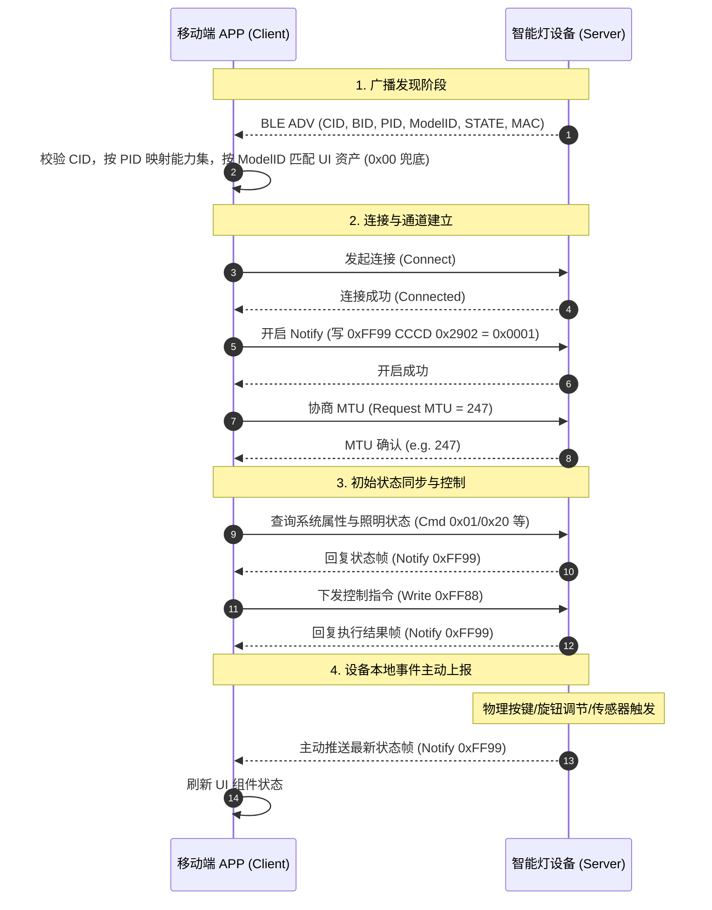

BLE API 规范定义了移动端 APP（GATT Client）与智能照明设备（GATT Server）之间的低功耗蓝牙（BLE GATT）通信协议，涵盖广播数据结构、服务与特征、通用数据帧封装、指令体系及容错机制。

# 一、基本约定

- **网络架构**：APP 为 GATT Client，设备为 GATT Server。
- **字节序**：所有多字节整型（Length、CRC16、PID 等）均严格采用**大端序（Big-Endian）**。
- **字符编码**：文本统一使用 **UTF-8**，最大长度 32 字节，末尾不含 `\0`。
- **数据类型**：
  | 类型 | 长度 | 说明 | 示例 |
  | --- | --- | --- | --- |
  | `UInt8` | 1 Byte | 无符号 8 位单字节整数 | `0x01` |
  | `Int8` | 1 Byte | 有符号 8 位整数（补码表示） | `0xFE` (-2) |
  | `UInt16` | 2 Bytes | 无符号 16 位大端整数 | `0x000A` (10) |
  | `UInt8[]` | N Bytes | 字节数组 / 二进制结构体 | 见具体指令 |
  | `String` | N Bytes | UTF-8 编码字符串（最大 32 字节） | `"SmartLight"` |
- **核心交互原则**：
  1. **闭环应答**：除单向触发类动作外，APP 下发的每条指令设备必须回复响应报文（携带 Status Code）。
  2. **状态驱动**：设备端物理操作（按键、旋钮、传感器触发）必须通过 Notify 特征主动上报最新状态。
  3. **幂等与防抖**：查询与设置类指令必须保持幂等；触发类操作 APP 端需做防抖节流（防抖时间 ≥ 500ms）。

---

# 二、BLE 广播与设备发现

设备通过厂商自定义广播数据（Manufacturer Specific Data，AD Type `0xFF`，总长 31 字节）对外广播元数据。APP 无需建立 GATT 连接即可获取设备型号、款型、开关状态与物理 MAC。

## 2.1 厂商自定义数据结构 (AD Type: 0xFF)

| 字节偏移 | 字段名 | 长度 | 取值 / 示例 | 说明 |
| --- | --- | :---: | --- | --- |
| Byte 0 | `Length` | 1B | `0x1E` | 后续数据总长度（30 字节） |
| Byte 1 | `Type` | 1B | `0xFF` | 厂商自定义数据标志（Manufacturer Specific） |
| Byte 2~3 | `CID` | 2B | `0x22FC` 等 | 厂商识别码（Company ID，大端序） |
| Byte 4~5 | `BID` | 2B | `0x0001` 等 | 品类/品牌识别码（Brand ID，大端序） |
| Byte 6~7 | `PID` | 2B | `0x0001` ~ `0xFFFF` | 产品型号识别码（Product ID，大端序） |
| Byte 8 | `ModelID` | 1B | `0x00` ~ `0xFF` | 外观与商业款型识别码（默认基准款为 `0x00`） |
| Byte 9 | `STATE` | 1B | `0x00` / `0x01` | 灯具开关状态（`0x00`: 关，`0x01`: 开） |
| Byte 10~15 | `MAC` | 6B | 6 Bytes | 设备物理蓝牙 MAC 混淆数据（异或 `0xAD`） |
| Byte 16~30 | `RESERVE` | 15B | 全 `0x00` | 预留扩展字段，固定填充 `0x00` |

## 2.2 PID 与 ModelID 解耦规范

为保证同一硬件平台的多个外观款式共享同一固件镜像与 OTA 包，遵循“**功能能力绑定 PID、外观呈现绑定 ModelID**”原则：

- **PID (2 Bytes)**：定义硬件功能能力（指令集、混色算法、物模型属性）。同一硬件平台的所有外观款型共享相同的 PID 和固件。
- **ModelID (1 Byte)**：定义商业款型与外观资产（3D 渲染图、配色贴图、UI 主题色）。
- **容错降级**：APP 扫描时根据 `(PID, ModelID)` 加载对应 UI 资产；若 ModelID 未匹配，**必须自动降级展示 `0x00`（标准默认款）资产**，禁止异常或白屏。

## 2.3 物理 MAC 地址混淆与还原

iOS 系统不暴露真实 MAC 地址，固件在广播中显式携带经 `0xAD` 异或混淆的物理 MAC 用于设备绑定与鉴权：

- **还原算法**：$\text{Original\_MAC}[i] = \text{Raw\_MAC}[i] \oplus 0\text{xAD} \quad (0 \le i \le 5)$
- **解析示例 (TypeScript)**：
```typescript
function decodeClassicMac(bytes: Uint8Array): string {
  return Array.from(bytes, b => (b ^ 0xAD).toString(16).padStart(2, '0').toUpperCase()).join(':');
}
```

## 2.4 设备能力集映射参考

| 产品分类 | PID 示例 | 核心能力集 (Capability Matrix) |
| --- | --- | --- |
| 单色温调光灯 | `0x0001` | 0%~100% 线性调光、开关定时、延时关灯 |
| 双色温 CCT 灯 | `0x0101` | 2700K~6500K 色温连续调节、平滑调光、场景预设 |
| 全彩 RGBCW 氛围灯 | `0x0201` | 1600 万色 RGB + CCT 混光、音乐律动拾音、动态流光特效 |
| 户外多功能灯 | `0x0301` | PIR 人体感应、环境光敏检测、BLE 组网群控、电量监测 |

---

# 三、GATT 服务与通信参数

## 3.1 服务与特征分配 (UUID)

| 类型 | 属性 (Properties) | 128-bit UUID | 16-bit 别名 | 说明 |
| --- | --- | --- | :---: | --- |
| **Control Service** | - | `0000FF77-0000-1000-8000-00805F9B34FB` | `0xFF77` | 核心控制服务 |
| **Write Characteristic** | `Write` / `Write Without Response` | `0000FF88-0000-1000-8000-00805F9B34FB` | `0xFF88` | APP 下发控制与查询指令 |
| **Notify Characteristic** | `Notify` | `0000FF99-0000-1000-8000-00805F9B34FB` | `0xFF99` | 设备应答与主动状态上报 |

> [!IMPORTANT]
> APP 建立连接后，必须第一时间向 `0xFF99` 的 CCCD（UUID: `0x2902`）写入 `0x0001` 开启 Notify 监听，否则无法接收任何设备响应与上报。

## 3.2 链路交互参数

- **MTU 协商**：连接建立后 APP 立即发起 MTU 协商，推荐协商至 **247 字节**，确保指令在单个 ATT PDU 内传输，避免分包重组。
- **连接间隔**：推荐 **7.5ms ~ 20ms**，兼顾通信响应速度与设备功耗。

---

# 四、通用数据帧协议规范

APP 与设备双向通信的所有数据均封装在统一格式的数据帧中。

## 4.1 帧结构定义

| 字段 | 长度 | 取值范围 | 说明 | CRC-16 范围 |
| --- | :---: | --- | --- | :---: |
| `Head Flag` | 1B | `0xFE` | 帧起始标志，固定 `0xFE` | 参与计算 |
| `Command ID` | 1B | `0x01` ~ `0xFE` | 控制指令标识符 | 参与计算 |
| `Status Code` | 1B | `0x00` ~ `0x05` | 状态码（APP 发送填 `0x00`，设备应答填执行结果） | 参与计算 |
| `Data Length` | 2B | `0x0000` ~ `0xFFFF` | 数据负载长度 $N$（大端序），不含帧头与校验码 | 参与计算 |
| `Command Data` | N B | 字节流 | 业务参数体（Length = 0 时缺省） | 参与计算 |
| `CRC16` | 2B | `0x0000` ~ `0xFFFF` | 循环冗余校验码（大端序），覆盖前 $5+N$ 字节 | **校验存放位** |

## 4.2 校验码算法规范 (CRC-16/CCITT-FALSE)

- **多项式**：`0x1021` ($x^{16} + x^{12} + x^5 + 1$)
- **算法参数**：初始值 `0xFFFF`，异或输出 `0x0000`，输入/输出均不反转（RefIn/RefOut = False）。

```c
uint16_t ble_crc16(const uint8_t *buffer, uint32_t size) {
    uint16_t crc = 0xFFFF;
    while (size--) {
        crc = (crc >> 8) | (crc << 8);
        crc ^= *buffer++;
        crc ^= ((uint8_t)crc) >> 4;
        crc ^= crc << 12;
        crc ^= (crc & 0xFF) << 5;
    }
    return crc;
}
```

## 4.3 状态码定义 (Status Code)

| 状态码 | 常量定义 | 含义 | 说明 |
| :---: | --- | --- | --- |
| `0x00` | `SUCCESS` | 成功 | 指令正常接收并执行 |
| `0x01` | `INVALID_COMMAND` | 无效指令 | 固件不支持该 Command ID |
| `0x02` | `LENGTH_ERROR` | 数据长度错误 | Data Length 与指令所需参数长度不符 |
| `0x03` | `CHECKSUM_ERROR` | 校验码错误 | CRC-16 校验失败 |
| `0x04` | `PARAMETER_ERROR` | 参数错误 | 参数值超出合法区间 |
| `0x05` | `CONDITION_NOT_MET` | 环境不具备 | 设备当前状态不允许该操作（如过热保护） |

> [!NOTE]
> **异常应答格式**：当设备检测到错误时，回复帧的 `Status Code` 置非零错误码，`Data Length` 固定为 `0x0000`，`Command Data` 缺省，重新计算前 5 字节帧头的 CRC16 返回。

---

# 五、控制指令设计规范

## 5.1 指令交互模型

| 指令类别 | 通信方向 | 请求载荷 | 设备响应行为 | 幂等性 |
| --- | --- | --- | --- | :---: |
| **属性查询 (Query)** | APP $\to$ BT | Data Length = 0 | 回复当前最新属性值（Status = `0x00`） | 是 |
| **属性设置 (Set)** | APP $\to$ BT | 目标属性数据 | 执行后回复当前生效状态（Status = `0x00`） | 是 |
| **动作触发 (Action)** | APP $\to$ BT | 动作参数或无载荷 | 回复 ACK 帧后异步执行硬件动作 | 否（APP 端防抖 ≥ 500ms） |
| **状态上报 (Notify)** | BT $\to$ APP | 最新全量状态 | 设备主动推送（Status = `0x00`），无需回复 | - |

## 5.2 Command ID 号段分配

| 号段区间 | 业务功能领域 | 包含内容 / 典型范例 |
| --- | --- | --- |
| `0x00` | **系统保留** | 严禁分配 |
| `0x01` ~ `0x1F` | **系统与设备管理** | 供电/电池状态、蓝牙名称、出厂复位、时钟同步、固件版本、OTA 握手 |
| `0x20` ~ `0x3F` | **基础照明与开关调光** | 开关、主亮度 (0~100%)、淡入淡出时长、夜灯模式、倒计时关灯 |
| `0x40` ~ `0x5F` | **色彩、色温与光学** | 色温 (2700K~6500K)、RGB 混色、HSV、通道独立控制、渐变速率 |
| `0x60` ~ `0x7F` | **动态场景与传感器** | 动态情景（呼吸/流光/烛光）、音乐律动拾音、PIR 感应、光敏阈值 |
| `0x80` ~ `0xDF` | **业务预留与群组扩展** | 多灯 Mesh 组网编队、生物节律日程、情景链 |
| `0xE0` ~ `0xFE` | **产测与调试私有号段** | 色温校准、老化测试、PWM 频率校准（生产包严禁暴露） |
| `0xFF` | **协议保留字** | 禁止作为 Command ID 分配 |

## 5.3 载荷设计与兼容性规则

1. **紧凑打包**：字段按固定偏移排列，严禁编译器填充 Padding（固件必须使用 `packed` 属性），多字节整型强制大端序。
2. **尾部追加**：已有指令新增参数时，只允许在原 Payload 末尾依次追加，严禁在中间插入新字段或更改既有字段语义。
3. **短包容忍（APP 兼容旧固件）**：APP 收到实际长度小于新协议定义的报文时，缺失字段以安全默认值填充，严禁丢包或崩溃。
4. **长包容忍（固件兼容新 APP）**：固件收到实际长度大于自身定义的报文时，仅解析已知前置字段，忽略尾部多余字节，严禁报 `0x02`（LENGTH_ERROR）。

## 5.4 典型指令定义范例

### 1. 主亮度调节 (`0x21`)
- **类别**：Query / Set / Notify
- **载荷定义**：`Byte 0: target_brightness`（UInt8，`0x00` ~ `0x64`，表示 0% ~ 100%）
- **报文流向**：
  - APP 查询：`FE 21 00 00 00 F9 06`
  - 设置 10% / 设备回复 10% / 设备主动上报 10%：`FE 21 00 00 01 0A 2F 91`

### 2. 复合混光参数配置 (`0x41`)
- **类别**：Set / Notify
- **载荷定义 (5 字节)**：
  - `Byte 0: mode_select`（UInt8，0: CCT，1: RGB，2: 流光，3: 自定义）
  - `Byte 1~4: param_array`（Int8[4]，R/G/B/W 各通道微调增益，-10 ~ +10）
- **报文流向**：
  - APP 下发模式 1，增益 2, 3, 4, 5：`FE 41 00 00 05 01 02 03 04 05 96 8B`
  - 成功回显：`FE 41 00 00 05 01 02 03 04 05 96 8B`
  - 参数越界错误应答：`FE 41 04 00 00 1B 8B`

### 3. 出厂复位 (`0x11`)
- **类别**：Action（无载荷，Data Length = `0x0000`）
- **报文流向**：
  - APP 下发复位 / 设备确认 ACK：`FE 11 00 00 00 8C E1`
  - 设备处理逻辑：回复 ACK 帧 $\to$ 清除配对与绑定数据 $\to$ 延时 100ms 断开 BLE 并重启广播。

---

# 六、通信流程与容错机制

## 6.1 完整交互时序



## 6.2 工程容错策略

1. **超时与重发机制**：
   - APP 发出需应答指令后启动 **1500ms** 超时定时器。
   - 超时未收到对应 `Command ID` 响应最多重试 **2 次**；连续 3 次无应答判定通信链路故障。
2. **流式接收与粘包拆包**：
   - 基于 `0xFE` 帧头与 `Data Length` 进行流式状态机解析。
   - 必须接收完整 $5 + N + 2$ 字节且通过 CRC-16 校验后，才交付业务层处理。
3. **断线与重连处理**：
   - 蓝牙物理链路断开时，APP 必须立即清空等待队列，防止重连后历史请求造成状态污染。
   - 重连成功并重新开启 Notify 后，APP 必须全量重新查询一次设备基础状态以对齐数据。

---

# 七、测试向量与基准校验

## 7.1 CRC-16/CCITT-FALSE 基准
- 输入 ASCII `"123456789"`（9 字节） $\to$ 期望 CRC16 为 `0x29B1`
- 输入 `FE 01 00 00 00`（5 字节） $\to$ 期望 CRC16 为 `0x9746`

## 7.2 通用协议帧基准测试向量表

| 序号 | 业务场景 | 方向 | 原始负载 Hex (帧头+数据) | CRC16 (大端) | 完整报文 Hex |
| :---: | --- | :---: | --- | :---: | --- |
| 1 | 无载荷通用查询帧 (Cmd 0x01) | APP $\to$ BT | `FE 01 00 00 00` | `97 46` | `FE010000009746` |
| 2 | 通用成功响应 (返回数据 00 64) | BT $\to$ APP | `FE 01 00 00 02 00 64` | `EB 3C` | `FE010000020064EB3C` |
| 3 | 单字节亮度设置帧 (Cmd 0x21, 值为 10%) | APP $\to$ BT | `FE 21 00 00 01 0A` | `2F 91` | `FE210000010A2F91` |
| 4 | 亮度设置成功回显 / 主动上报 | BT $\to$ APP | `FE 21 00 00 01 0A` | `2F 91` | `FE210000010A2F91` |
| 5 | 多参数混光配置帧 (Cmd 0x41, 5 字节负载) | APP $\to$ BT | `FE 41 00 00 05 01 02 03 04 05` | `96 8B` | `FE410000050102030405968B` |
| 6 | 无参动作触发帧 (Cmd 0x11, 复位/动作) | APP $\to$ BT | `FE 11 00 00 00` | `8C E1` | `FE110000008CE1` |
| 7 | 变长文本设置帧 (Cmd 0x0A, "SmartLight") | APP $\to$ BT | `FE 0A 00 00 0A 53 6D 61 72 74 4C 69 67 68 74` | `03 F0` | `FE0A00000A536D6172744C6967687403F0` |
| 8 | 应答 - 无效指令 (INVALID_COMMAND, Status 0x01) | BT $\to$ APP | `FE 25 01 00 00` | `5D C9` | `FE250100005DC9` |
| 9 | 应答 - 长度错误 (LENGTH_ERROR, Status 0x02) | BT $\to$ APP | `FE 21 02 00 00` | `CE 68` | `FE21020000CE68` |
| 10 | 应答 - 校验错误 (CHECKSUM_ERROR, Status 0x03) | BT $\to$ APP | `FE 21 03 00 00` | `F9 58` | `FE21030000F958` |
| 11 | 应答 - 参数错误 (PARAMETER_ERROR, Status 0x04) | BT $\to$ APP | `FE 21 04 00 00` | `7C C8` | `FE210400007CC8` |
| 12 | 应答 - 环境不满足 (CONDITION_NOT_MET, Status 0x05) | BT $\to$ APP | `FE 21 05 00 00` | `4B F8` | `FE210500004BF8` |
