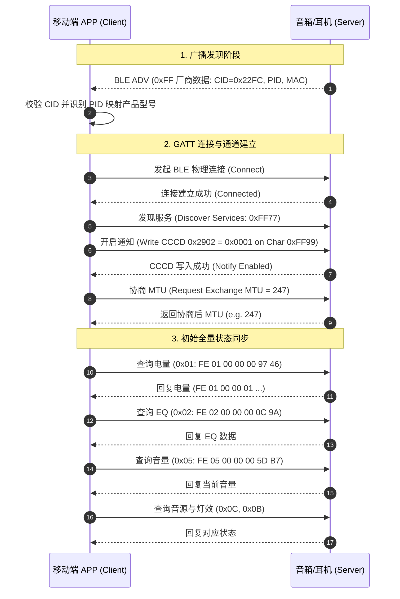
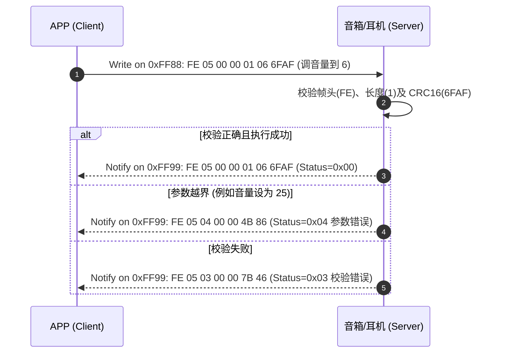
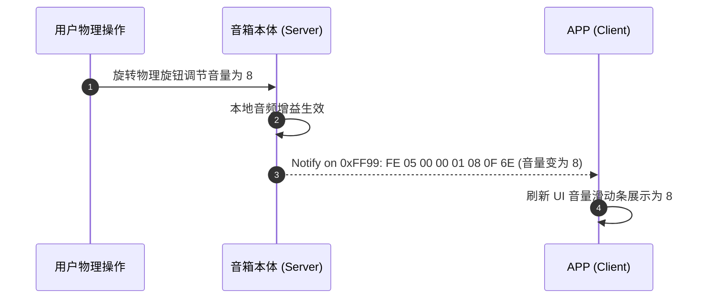

BLE API 规范关注的是移动端 APP 与蓝牙音频设备（YeahBox 音响/耳机系列）之间在低功耗蓝牙（BLE GATT）层面的通信协议设计、广播过滤识别、数据帧封装、指令交互与状态同步。

BLE（Bluetooth Low Energy）采用客户端/服务端（Client/Server，即 Central/Peripheral）通信架构。APP 作为 GATT Client，音箱/耳机设备作为 GATT Server；通过自定义 Service 与 Characteristic 实现双向数据交换，并通过 Manufacturer Specific Data 广播实现设备敏捷发现与型号判定。

# 一、前提

为了统一移动端（iOS / Android）与嵌入式固件端的交互，提高通信可靠性、可读性、可维护性与可扩展性，所有 BLE 交互必须遵循以下基础约定：

- **传输层基础**：基于标准 BLE GATT 协议栈，依托专用 Service 与 Characteristic 进行读写与监听。
- **大端字节序**：所有多字节整型数值（包括数据长度 `Length`、校验码 `CRC16`、产品标识 `PID` 等）均严格采用大端序（Big-Endian，网络字节序，高位在前，低位在后）。
- **统一帧结构**：所有通过 GATT Characteristic 发送与接收的数据包均使用统一的“帧头 + 指令 ID + 状态码 + 长度 + 负载 + CRC16”封装。
- **可靠校验**：传输帧统一采用 CRC-16/CCITT-FALSE 校验算法，杜绝无线传输过程中的误码。
- **双向通信模型**：支持“APP 下发请求/设置并接收 ACK/响应”以及“设备状态突变主动 Notify 上报”两种模式。

## 1.1 字符集与字符串编码

- 所有文本字符串（如设备蓝牙名称 `device_name`）均统一使用 **UTF-8** 编码。
- 文本长度受通信包及固件存储限制，最大长度不得超过 32 字节（即 `N <= 32`），末尾无需包含 C 语言字符串结束符 `\0`。

## 1.2 字节序与数据类型

| 类型定义 | 字节长度 | 说明 | 示例 |
| --- | --- | --- | --- |
| `UInt8` | 1 Byte | 无符号 8 位单字节整数 | `0x01`（值为 1） |
| `Int8` | 1 Byte | 有符号 8 位整数（补码表示，-128 ~ 127） | `0xFE`（-2 dB） |
| `UInt16` | 2 Bytes | 无符号 16 位大端整数（高位在前） | `0x000A`（值为 10） |
| `UInt8[]` | N Bytes | 字节数组或特定二进制结构体 | 见各指令定义 |
| `String` | N Bytes | UTF-8 编码字节流（最大 32 字节） | `"Yeahbox"` |

## 1.3 核心设计原则

1. **确定性与闭环响应**：除单向触发类动作外，APP 向设备发送的每条指令，设备均必须回复携带状态码（Status Code）的响应帧；禁止单向吞吞没响应。
2. **状态驱动与主动上报**：当设备发生物理操作（如按键调节音量、插拔 AUX/TF 卡、电量变化等）时，设备端必须通过 Notify 特征主动将最新状态同步给 APP，保证两端状态强一致。
3. **幂等性控制**：对于查询类与赋值设置类指令（如查询电量、设置 EQ、设置音量）必须设计为幂等操作；对于触发类指令（如切歌、恢复出厂、关机）须在 APP 端做防连击节流保护（防抖 ≥ 500ms）。

---

# 二、BLE 广播与设备发现

设备在未被连接或可被发现时，会周期性发送 BLE 广播包。APP 扫描阶段无需发起 GATT 连接即可通过厂商自定义广播数据（Manufacturer Specific Data，AD Type `0xFF`）完成设备过滤、型号判定与经典蓝牙 MAC 获取。

## 2.1 厂商自定义数据结构

广播数据段中 AD Type 为 `0xFF` 的厂商自定义数据（Manufacturer Specific Data）布局如下：

| 字节偏移 (Offset) | 字段名 | 长度 (Bytes) | 取值 (Hex) | 说明 |
| --- | --- | --- | --- | --- |
| Byte 0 | `Length` | 1 | `0x1E` 等 | 后面数据的总字节数（不包含 Length 本身） |
| Byte 1 | `Type` | 1 | `0xFF` | 厂商自定义数据标志（EIR / AD Type: Manufacturer Specific） |
| Byte 2~3 | `CID` | 2 | `0x22FC` | 公司识别码（Company Identifier，固定值，用于识别所属耳机/音箱） |
| Byte 4~5 | `BID` | 2 | `0x0001` | 品牌识别码（Brand ID，固定为 `0x0001`） |
| Byte 6~7 | `PID` | 2 | `0x0001` ~ `0xFFFF` | 产品型号识别码（Product ID，大端序，详见 2.3 节） |
| Byte 8 | `STATE` | 1 | `0x00` / `0x01` | 经典蓝牙（BR/EDR）连接状态：`0x00` 未连接，`0x01` 已连接 |
| Byte 9~14 | `MAC` | 6 | 6 Bytes | 经典蓝牙 MAC 地址混淆数据（按字节与 `0xAD` 异或加密） |
| Byte 15~30 | `RESERVE` | 16 | 全 `0x00` | 保留位，用于后续扩展，固件固定用 `0x00` 补位填充 |

## 2.2 经典蓝牙 MAC 地址混淆与还原算法

为了防止被公开嗅探并关联设备，广播中的 6 字节经典蓝牙 MAC 地址采用固定异或掩码（XOR Mask `0xAD`）存储。

### 混淆与还原公式：

$$\text{Original\_MAC}[i] = \text{Raw\_MAC}[i] \oplus 0\text{xAD} \quad (0 \le i \le 5)$$

```typescript
/**
 * 经典蓝牙 MAC 地址解析还原示例 (TypeScript)
 * @param obfuscatedBytes 从广播中提取的 6 字节 MAC 字段
 * @returns 标准格式 MAC 地址，如 "AA:BB:CC:DD:EE:FF"
 */
function decodeClassicMac(obfuscatedBytes: Uint8Array): string {
  const macHex: string[] = [];
  for (let i = 0; i < 6; i++) {
    const originalByte = obfuscatedBytes[i] ^ 0xAD;
    macHex.push(originalByte.toString(16).padStart(2, '0').toUpperCase());
  }
  return macHex.join(':');
}
```

## 2.3 产品型号与 PID 映射表

APP 端根据广播中的 `PID`（大端 2 字节）映射对应的产品型号与 UI 渲染套件：

| 产品型号 (Model Name) | PID (Hex) | 主控芯片 (Chipset) | 状态 |
| --- | --- | --- | --- |
| Sonic Boom | `0x0001` | ATS2853C | 已接入 |
| Sonic Boom Max3 | `0x0002` | ATS2853C | 已接入 |
| Yeahbox Thunder | `0x0003` | ATS2853C | 已接入 |
| Yeahbox Starro | `0x0004` | ATS2853C | 已接入 |
| Sonic Boom Max K | `0x0005` | ATS2853C | 已接入 |
| Sonic Boom POP | `0x0006` | ATS2853C | 已接入 |
| X Ultra k | `0x0007` | ATS2853C | 已接入 |
| X Ultra | `0x0008` | ATS2853C | 已接入 |
| T135 | `0x0009` | ATS2853C | 已接入 |
| X70 | `0x000A` | ATS2853C | 已接入 |
| Pro | `0x000B` | - | 待接入/预留 |
| T600 | `0x000C` | - | 待接入/预留 |

---

# 三、GATT 通信架构与服务定义

设备与 APP 通过标准的 BLE GATT 协议通信。在建立物理连接后，APP 需发现自定义服务并开启相关特征的监听。

## 3.1 服务与特征分配 (UUID)

| 类型 (Type) | 属性 (Properties) | 128-bit 标准 UUID | 16-bit 别名 | 说明 |
| --- | --- | --- | --- | --- |
| **Control Service** | - | `0000FF77-0000-1000-8000-00805F9B34FB` | `0xFF77` | 核心控制服务 |
| **Write Characteristic** | `Write` / `Write Without Response` | `0000FF88-0000-1000-8000-00805F9B34FB` | `0xFF88` | APP 向设备下发控制指令与查询请求 |
| **Notify Characteristic** | `Notify` | `0000FF99-0000-1000-8000-00805F9B34FB` | `0xFF99` | 设备向 APP 发送指令回复及主动状态上报 |

> [!IMPORTANT]
> APP 建立连接后，必须第一时间向 `0xFF99` 特征的 CCCD（Client Characteristic Configuration Descriptor，UUID: `0x2902`）写入 `0x0001` 以启用 Notification 监听；否则将无法收到任何设备响应与上报数据。

## 3.2 链路交互参数与 MTU 协商

1. **MTU 交换 (Exchange MTU)**：
   - BLE 默认 ATT_MTU 为 23 字节（有效负载 20 字节）。
   - 连接建立并开启通知后，APP 端建议立即请求 MTU 协商，推荐协商至 **247 字节**（或 512 字节），保证长指令（如自定义 EQ 18 字节、设备重命名 39 字节）可在单个 ATT PDU 内完整发送，避免固件端进行分包重组。
2. **连接间隔 (Connection Interval)**：
   - 推荐配置：7.5ms ~ 20ms，平衡响应延迟与功耗。

---

# 四、数据帧协议规范

无论是 APP 发给设备的指令，还是设备发给 APP 的回复与上报，所有通信数据均封装在统一格式的数据帧中。

## 4.1 帧结构定义

数据帧由 **帧头（Frame Head）**、**指令数据（Command Data Body）** 和 **校验码（Checksum）** 三部分组成：

```
+------------+------------+-------------+---------------------+-------------------+-----------------+
| Head Flag  | Command ID | Status Code | Command Data Length |   Command Data    |     CRC-16      |
|  (1 Byte)  |  (1 Byte)  |  (1 Byte)   |      (2 Bytes)      |     (N Bytes)     |    (2 Bytes)    |
+------------+------------+-------------+---------------------+-------------------+-----------------+
|<--------------------------- 帧头 (5 Bytes) ------------------->|<-- 负载 (N Bytes) ->|<- 校验 (2 Bytes) ->|
|<-------------------------------- CRC16 计算范围 (5 + N 字节) --------------------->|
```

### 字段说明表

| 序号 | 字段名 | 长度 (Byte) | 取值范围 | 说明 |
| --- | --- | --- | --- | --- |
| 1 | `Head Flag` | 1 | `0xFE` | 帧起始标志符，固定为 `0xFE`，APP 与固件双向一致。 |
| 2 | `Command ID` | 1 | `0x01` ~ `0xFF` | 指令标识符，见第五章控制指令列表。 |
| 3 | `Status Code` | 1 | `0x00` ~ `0x05` | 错误码/执行状态。APP 发起请求时固定为 `0x00`；设备回复时表示执行结果。详见 4.4 节。 |
| 4 | `Command Data Length` | 2 | `0x0000` ~ `0xFFFF` | 数据负载长度 $N$（大端序）。表示后续 `Command Data` 的字节数，**不包含**帧头 5 字节和 CRC16 2 字节。无数据体时传 `0x0000`。 |
| 5 | `Command Data` | N | 二进制字节流 | 具体的指令参数体。当 Length = 0 时此字段缺省。 |
| 6 | `CRC16` | 2 | `0x0000` ~ `0xFFFF` | 循环冗余校验码（大端序）。计算范围从 `Head Flag` 到 `Command Data` 末尾（共 $5 + N$ 字节）。 |

## 4.2 校验码算法规范 (CRC-16/CCITT-FALSE)

本规范采用工业通用的 **CRC-16/CCITT-FALSE** 算法：
- **多项式 (Polynomial)**：$x^{16} + x^{12} + x^5 + 1$（`0x1021`）
- **初始值 (Initial Value)**：`0xFFFF`
- **异或输出 (XorOut)**：`0x0000`
- **输入反转 (RefIn)**：False
- **输出反转 (RefOut)**：False

### 4.2.1 C 语言标准实现

```c
#include <stdint.h>
#include <stddef.h>

/**
 * CRC-16/CCITT-FALSE 计算函数
 * @param buffer 输入数据指针（从 Head Flag 0xFE 开始）
 * @param size   计算长度（5 字节帧头 + N 字节负载）
 * @return 16位 CRC 校验码
 */
uint16_t ble_crc16(const uint8_t *buffer, uint32_t size)
{
    uint16_t crc = 0xFFFF; // 初始值为 0xFFFF
    if (buffer != NULL && size > 0) {
        while (size--) {
            crc = (crc >> 8) | (crc << 8);
            crc ^= *buffer++;
            crc ^= ((uint8_t)crc) >> 4;
            crc ^= crc << 12;
            crc ^= (crc & 0xFF) << 5;
        }
    }
    return crc;
}
```

### 4.2.2 Java / Kotlin 标准实现

```java
public class BleCrc16 {
    /**
     * CRC-16/CCITT-FALSE 计算
     */
    public static int calculate(byte[] data, int size) {
        if (data == null) return 0;
        int crc = 0xFFFF;
        for (int i = 0; i < data.length && i < size; i++) {
            crc = ((crc >> 8) | (crc << 8)) & 0xFFFF;
            crc ^= (data[i] & 0xFF);
            crc ^= ((crc & 0xFF) >> 4) & 0xFFFF;
            crc ^= (crc << 12) & 0xFFFF;
            crc ^= ((crc & 0xFF) << 5) & 0xFFFF;
        }
        return crc & 0xFFFF;
    }
}
```

### 4.2.3 TypeScript / JavaScript 标准实现

```typescript
/**
 * CRC-16/CCITT-FALSE 计算
 */
export function calculateCrc16(data: Uint8Array, size?: number): number {
  const len = size !== undefined ? Math.min(size, data.length) : data.length;
  let crc = 0xFFFF;
  for (let i = 0; i < len; i++) {
    crc = ((crc >> 8) | (crc << 8)) & 0xFFFF;
    crc ^= (data[i] & 0xFF);
    crc ^= ((crc & 0xFF) >> 4) & 0xFFFF;
    crc ^= (crc << 12) & 0xFFFF;
    crc ^= ((crc & 0xFF) << 5) & 0xFFFF;
  }
  return crc & 0xFFFF;
}
```

## 4.3 状态码 / 错误码定义 (Status Code)

当设备向 APP 返回响应时，通过帧头中的 `Status Code`（第 3 字节）标识指令执行状态。

| 状态码 (Hex) | 常量定义 | 含义说明 | 典型场景 |
| --- | --- | --- | --- |
| `0x00` | `SUCCESS` | 成功 | 指令已正确接收并生效，无异常。 |
| `0x01` | `INVALID_COMMAND` | 无效指令 | 设备固件不支持该 `Command ID`。 |
| `0x02` | `LENGTH_ERROR` | 数据长度错误 | `Command Data Length` 与指令所需参数长度不符。 |
| `0x03` | `CHECKSUM_ERROR` | 校验码错误 | 数据帧传输误码，CRC-16 校验失败。 |
| `0x04` | `PARAMETER_ERROR` | 参数错误 | 参数值超出合法区间（如音量超出 0~16）。 |
| `0x05` | `CONDITION_NOT_MET` | 环境不具备，不能执行 | 设备当前处于不允许该操作的状态（如未插 TF 卡切换到 TF 模式）。 |

> [!NOTE]
> APP 发送给设备的所有指令，设备端必须回复响应报文（至少携带对应状态码），以形成确定性通信闭环。若校验失败或格式错误，设备端直接回复 `0x02` 或 `0x03` 错误帧。

---

# 五、控制指令详细规范 (Control Command APIs)

## 5.1 获取/上报设备电量 (`0x01`)

用于查询电池电量百分比及充电状态；设备在电量发生变动或充电状态切换时，亦主动上报。

- **Command ID**：`0x01`
- **支持方向**：
  - `APP -> BT`：查询当前电量
  - `BT -> APP`：电量查询响应 / 电量更新主动上报

### 5.1.1 请求报文 (APP -> BT)
- **负载长度**：`0`（无参数）
- **完整报文**：`FE 01 00 00 00 97 46`

### 5.1.2 响应 / 上报报文 (BT -> APP)
- **负载长度**：`1` 字节（单体音响）或 `3` 字节（TWS 耳机/带仓音响）

**数据字段结构**：

| 字节偏移 | 字段名 | 类型 | 取值范围 | 说明 |
| --- | --- | --- | --- | --- |
| Byte 0 | `left_bat` | `UInt8` | `0x00` ~ `0xFF` | 单电量设备/左耳：<br>• bit0~bit6：电量百分比（0~100）<br>• bit7：充电标志（`0`=未充电，`1`=充电中） |
| Byte 1 | `right_bat` | `UInt8` | `0x00` ~ `0xFF` | 右耳电量（单电量设备不传或填 `0xFF` 占位） |
| Byte 2 | `case_bat` | `UInt8` | `0x00` ~ `0xFF` | 充电仓电量（不支持设备不传或填 `0xFF` 占位） |

**示例**：
- 单体设备电量 75% 且充电中（`0x4B | 0x80 = 0xCB`）：
  - 报文：`FE 01 00 00 01 CB EE 48`
- TWS 耳机：左 80% 充电中（`0xD0`）、右 80% 未充电（`0x50`）、仓 100% 未充电（`0x64`）：
  - 报文：`FE 01 00 00 03 D0 50 64 86 16`

---

## 5.2 EQ 调节与状态同步 (`0x02`)

支持切换预设音效与 10 段自定义均衡器调节；EQ 发生变化时设备主动上报。

- **Command ID**：`0x02`
- **支持方向**：`APP -> BT`，`BT -> APP`

### 5.2.1 频点约定表
自定义 EQ 包含 10 个频点增益，依次排列：

| 序号 | 频点 | 序号 | 频点 |
| :--- | :--- | :--- | :--- |
| Band 0 | **32 Hz** | Band 5 | **1000 Hz (1 kHz)** |
| Band 1 | **62 Hz** | Band 6 | **2000 Hz (2 kHz)** |
| Band 2 | **125 Hz** | Band 7 | **4000 Hz (4 kHz)** |
| Band 3 | **250 Hz** | Band 8 | **8000 Hz (8 kHz)** |
| Band 4 | **500 Hz** | Band 9 | **16000 Hz (16 kHz)** |

### 5.2.2 数据字段结构

| 字段名 | 类型 | 长度 | 取值范围 | 说明 |
| --- | --- | --- | --- | --- |
| `mode` | `UInt8` | 1 Byte | `0x00` ~ `0x64`：预设模式<br>`0x65`：自定义模式 | `0x00` 默认，`0x01` 流行，`0x02` 摇滚等；`0x65` 为自定义 |
| `gains` | `Int8[10]` | 10 Bytes | `-10` ~ `+10`（dB） | 仅在 `mode == 0x65` 时必选；10 个频点的增益值（带符号整数） |

### 5.2.3 报文示例
1. **APP 查询当前 EQ**：
   - 报文：`FE 02 00 00 00 0C 9A`
2. **APP 设置预设 EQ 为流行 (0x01)**：
   - 报文：`FE 02 00 00 01 01 78 9C`
3. **APP 设置自定义 EQ (0x65, 增益依次为 +1 ~ +10 dB)**：
   - 数据负载：`65 01 02 03 04 05 06 07 08 09 0A` (11 字节)
   - 报文：`FE 02 00 00 0B 65 01 02 03 04 05 06 07 08 09 0A A3 77`
4. **BT 响应/主动上报当前自定义 EQ**：
   - 同设置报文格式。

---

## 5.3 TWS 对联开关设置与上报 (`0x03`)

用于控制与获取两台音响的 TWS 对联立体声模式。

- **Command ID**：`0x03`
- **支持方向**：`APP -> BT`，`BT -> APP`

### 5.3.1 数据字段结构

| 字段名 | 类型 | 长度 | 取值 | 说明 |
| --- | --- | --- | --- | --- |
| `stereo_state` | `UInt8` | 1 Byte | `0x00` / `0x01` | `0x00`：关闭 TWS 对联模式<br>`0x01`：开启 TWS 对联模式 |

### 5.3.2 报文示例
1. **APP 查询当前状态**：`FE 03 00 00 00 7A 2E`
2. **APP 设置开启 TWS**：`FE 03 00 00 01 01 D2 CD`
3. **APP 设置关闭 TWS**：`FE 03 00 00 01 00 C2 EC`
4. **BT 状态变化主动上报**：同上述包含状态字段的格式。

---

## 5.4 音量调节与同步 (`0x05`)

用于控制音箱音量与同步当前音量阶数。

- **Command ID**：`0x05`
- **支持方向**：`APP -> BT`，`BT -> APP`

### 5.4.1 数据字段结构

| 字段名 | 类型 | 长度 | 取值范围 | 说明 |
| --- | --- | --- | --- | --- |
| `volume` | `UInt8` | 1 Byte | `0` ~ `16` | 当前设备音量值（0 表示静音，16 为最大音量） |

### 5.4.2 报文示例
1. **APP 查询音量**：`FE 05 00 00 00 5D B7`
2. **APP 设置音量为 6**：`FE 05 00 00 01 06 6F AF`
3. **APP 设置最大音量 16 (`0x10`)**：`FE 05 00 00 01 10 1D 58`
4. **设备物理旋钮调节后主动上报**：`FE 05 00 00 01 <volume> <CRC16>`

---

## 5.5 播放控制 (`0x06`, `0x07`, `0x08`)

### 5.5.1 切换下一曲 (`0x06`)
- **Command ID**：`0x06`
- **方向**：`APP -> BT`（设备执行后回复 ACK）
- **报文**：`FE 06 00 00 00 C6 6B`

### 5.5.2 切换上一曲 (`0x07`)
- **Command ID**：`0x07`
- **方向**：`APP -> BT`（设备执行后回复 ACK）
- **报文**：`FE 07 00 00 00 B0 DF`

### 5.5.3 播放/暂停控制与状态同步 (`0x08`)
- **Command ID**：`0x08`
- **方向**：`APP -> BT`，`BT -> APP`

**数据字段结构**：

| 字段名 | 类型 | 长度 | 取值 | 说明 |
| --- | --- | --- | --- | --- |
| `playing_status` | `UInt8` | 1 Byte | `0x00` / `0x01` | `0x00`：暂停播放<br>`0x01`：开始播放 |

**报文示例**：
- **APP 查询播放状态**：`FE 08 00 00 00 64 31`
- **APP 设置播放**：`FE 08 00 00 01 01 3E 32`
- **APP 设置暂停**：`FE 08 00 00 01 00 2E 13`
- **设备按键切换后主动上报**：同包含状态的数据帧。

---

## 5.6 蓝牙名称修改 (`0x0A`)

允许 APP 为设备重命名，新名称写入设备 Flash 并作为后续经典蓝牙及 BLE 广播的 Local Name。

- **Command ID**：`0x0A`
- **方向**：`APP -> BT`
- **数据字段**：
  - `device_name`：`UInt8[]`，UTF-8 编码，长度 $N \le 32$ 字节。

**报文示例**：
- 设置名称为 `"Lenyes耳机"`（UTF-8 字节：`4C 65 6E 79 65 73 E8 80 B3 E6 9C BA`，长度 12 字节）：
  - 报文：`FE 0A 00 00 0C 4C 65 6E 79 65 73 E8 80 B3 E6 9C BA 7E 19`
- 设备收到后校验长度与字符，成功返回通用 ACK（`FE 0A 00 00 00 ...`）。

---

## 5.7 灯效模式查询与设置 (`0x0B`)

控制音箱的 RGB 氛围灯效果、色彩模式与具体颜色值。

- **Command ID**：`0x0B`
- **方向**：`APP -> BT`，`BT -> APP`
- **数据负载长度**：固定为 5 字节。

### 5.7.1 数据字段结构

| 字节偏移 | 字段名 | 类型 | 取值范围 | 说明 |
| --- | --- | --- | --- | --- |
| Byte 0 | `light_mode` | `UInt8` | `0x00` ~ `0x05` | 灯光模式：<br>• `0x00`：关闭<br>• `0x01`：遥控模式<br>• `0x02`：音乐律动（随节奏跳动）<br>• `0x03`：交叉流动<br>• `0x04`：涟漪扩散<br>• `0x05`：单色呼吸 |
| Byte 1 | `color_mode` | `UInt8` | `0x00` / `0x01` | 色彩模式：<br>• `0x00`：单色固定<br>• `0x01`：全彩渐变 |
| Byte 2~4 | `color_value` | `UInt8[3]` | `0x00` ~ `0xFF` | RGB 颜色值：依次为 R、G、B 分量。<br>当 `color_mode == 0x01`（渐变色）时固定填 `00 00 00`。 |

### 5.7.2 报文示例
1. **APP 查询灯效**：`FE 0B 00 00 00 FF ED`
2. **APP 设置单色呼吸-红色 (RGB: 255, 0, 0)**：
   - 负载：`05 00 FF 00 00`
   - 报文：`FE 0B 00 00 05 05 00 FF 00 00 48 F6`
3. **APP 设置音乐律动-渐变色**：
   - 负载：`02 01 00 00 00`
   - 报文：`FE 0B 00 00 05 02 01 00 00 00 96 F5`
4. **BT 状态变化主动上报**：发送当前 5 字节灯效数据帧。

---

## 5.8 音源输入模式切换与查询 (`0x0C`)

控制并查询音箱当前播放音源输入通道（Input Source）。

- **Command ID**：`0x0C`
- **方向**：`APP -> BT`，`BT -> APP`

### 5.8.1 数据字段结构

| 字段名 | 类型 | 长度 | 取值 | 说明 |
| --- | --- | --- | --- | --- |
| `input_source` | `UInt8` | 1 Byte | `0x00` ~ `0x03` | 音频输入源通道：<br>• `0x00`：蓝牙模式 (Bluetooth)<br>• `0x01`：U 盘模式 (USB Disk)<br>• `0x02`：TF 卡模式 (MicroSD/TF Card)<br>• `0x03`：Line-In 模式 (AUX 音频线) |

### 5.8.2 报文示例
1. **APP 查询当前音源**：`FE 0C 00 00 00 AE C0`
2. **APP 切换为蓝牙模式 (0x00)**：`FE 0C 00 00 01 00 A7 15`
3. **APP 切换为 U 盘模式 (0x01)**：`FE 0C 00 00 01 01 B7 34`
4. **APP 切换为 TF 卡模式 (0x02)**：`FE 0C 00 00 01 02 87 57`
5. **APP 切换为 AUX 模式 (0x03)**：`FE 0C 00 00 01 03 97 76`
6. **物理插拔音频线/TF 卡后音箱主动上报**：发送最新通道数据帧。

> [!WARNING]
> 当切换的目标外设（如 U 盘或 TF 卡）未物理插入时，设备端应返回 `0x05`（`CONDITION_NOT_MET`，环境不具备，不能执行）错误码。

---

## 5.9 麦克风音量与音效调节 (`0x0D`)

用于带 K 歌/麦克风功能的音响，调节低音、高音、混响回声与麦克风总音量。

- **Command ID**：`0x0D`
- **方向**：`APP -> BT`，`BT -> APP`
- **数据负载长度**：固定为 4 字节。

### 5.9.1 数据字段结构

| 字节偏移 | 字段名 | 类型 | 取值范围 | 默认值 | 说明 |
| --- | --- | --- | --- | --- | --- |
| Byte 0 | `mic_bass` | `UInt8` | `0x00` ~ `0x0A` (0~10) | `0x05` | 麦克风低音调节阶数 |
| Byte 1 | `mic_treble` | `UInt8` | `0x00` ~ `0x0A` (0~10) | `0x05` | 麦克风高音调节阶数 |
| Byte 2 | `mic_echo` | `UInt8` | `0x00` ~ `0x0A` (0~10) | `0x05` | 麦克风回声/混响深度 |
| Byte 3 | `mic_volume` | `UInt8` | `0x00` ~ `0x0A` (0~10) | `0x05` | 麦克风总输入音量 |

### 5.9.2 报文示例
1. **APP 查询麦克风状态**：`FE 0D 00 00 00 D8 74`
2. **APP 设置参数 (低音 4, 高音 5, 回声 6, 音量 5)**：
   - 负载：`04 05 06 05`
   - 报文：`FE 0D 00 00 04 04 05 06 05 7B 0C`
3. **音箱面板旋钮调整后主动上报**：发送包含 4 字节参数的数据帧。

---

## 5.10 DJ 音效变音模式 (`0x0E`)

调节麦克风的人声变声算法效果（DSP 变调）。

- **Command ID**：`0x0E`
- **方向**：`APP -> BT`，`BT -> APP`

### 5.10.1 数据字段结构

| 字段名 | 类型 | 长度 | 取值 | 说明 |
| --- | --- | --- | --- | --- |
| `voice_change_mode` | `UInt8` | 1 Byte | `0x00` ~ `0x03` | 变声算法模式：<br>• `0x00`：DJ 原声（无变调）<br>• `0x01`：男神声<br>• `0x02`：女神声<br>• `0x03`：娃娃音/萝莉音 |

### 5.10.2 报文示例
1. **APP 查询变音模式**：`FE 0E 00 00 00 43 A8`
2. **APP 设置为男神音 (0x01)**：`FE 0E 00 00 01 01 F3 B7`
3. **设备按键切换后主动上报**：`FE 0E 00 00 01 <mode> <CRC16>`

---

## 5.11 DJ 趣味音效触发播放 (`0x0F`)

触发设备内置 DSP 播放预置的现场气氛特效声（单次播放）。

- **Command ID**：`0x0F`
- **方向**：`APP -> BT`

### 5.11.1 数据字段结构

| 字段名 | 类型 | 长度 | 取值 | 对应气氛特效音 |
| --- | --- | --- | --- | --- |
| `sound_type` | `UInt8` | 1 Byte | `0x00` | 乌鸦飞过 |
| | | | `0x01` | 尖叫 |
| | | | `0x02` | 大笑 |
| | | | `0x03` | 欢呼 |
| | | | `0x04` | 打耳光 |
| | | | `0x05` | 感谢 |
| | | | `0x06` | 掌声 |
| | | | `0x07` | 点关注 |

### 5.11.2 报文示例
- **触发播放“掌声” (`0x06`)**：
  - 负载：`06`
  - 报文：`FE 0F 00 00 01 06 29 01`
- 设备收到后立即播放特效音并回复成功 ACK。

---

## 5.12 低音增强控制 (`0x10`)

控制硬件重低音增强算法（Bass Boost / Mega Bass）的启闭。

- **Command ID**：`0x10`
- **方向**：`APP -> BT`，`BT -> APP`

### 5.12.1 数据字段结构

| 字段名 | 类型 | 长度 | 取值 | 说明 |
| --- | --- | --- | --- | --- |
| `bass_boost_mode` | `UInt8` | 1 Byte | `0x00` / `0x01` | `0x00`：关闭低音增强<br>`0x01`：开启低音增强 |

### 5.12.2 报文示例
1. **APP 查询当前状态**：`FE 10 00 00 00 FA 55`
2. **APP 设置开启低音增强**：`FE 10 00 00 01 01 38 45`
3. **APP 设置关闭低音增强**：`FE 10 00 00 01 00 28 64`
4. **BT 状态变化主动上报**：发送最新状态帧。

---

## 5.13 恢复出厂设置 (`0x11`)

指令音箱清除配对历史、重置 EQ、重置音量与灯效为出厂默认值。

- **Command ID**：`0x11`
- **方向**：`APP -> BT`
- **负载长度**：`0`（无参数）
- **完整报文**：`FE 11 00 00 00 8C E1`
- **设备行为**：设备收到后回复成功 ACK，随后执行复位重启，BLE 物理链路将主动断开。

---

## 5.14 远程关机 (`0x12`)

APP 触发音箱软关机切断供电。

- **Command ID**：`0x12`
- **方向**：`APP -> BT`
- **负载长度**：`0`（无参数）
- **完整报文**：`FE 12 00 00 00 17 3D`
- **设备行为**：设备回复成功 ACK，延时 100ms 播放关机提示音并断电。

---

# 六、通信流程与容错机制

## 6.1 连接与初始化握手时序

APP 与设备从扫描发现到建立双向受控状态，必须严格遵循以下时序流程：



## 6.2 请求与响应交互模型 (Request-Response)

针对 APP 发起的设置与查询指令，设备均以携带执行状态的报文进行应答：



## 6.3 事件驱动的主动上报模型 (Device-Initiated Notification)

当用户在音箱本体上进行物理按键、旋钮或插拔接口等操作时，设备通过 `0xFF99` 特征主动将变化后的状态推送给 APP：



## 6.4 异常处理与工程容错策略

1. **超时与重发机制**：
   - APP 发出需应答指令后，启动 **1500ms** 单次超时计时器。
   - 若 1500ms 内未收到对应 `Command ID` 的响应，允许最多重试 **2 次**。
   - 超过 3 次仍无应答，APP 判定为通信链路故障，提示用户或检测蓝牙连接健康度。
2. **防重放与粘包拆包（Frame Slicing）**：
   - 虽然通过 MTU 协商后绝大多数指令无需拆包，但为应对复杂 Android 终端未成功协商 MTU（仍为 23 字节）的情况，APP 与固件均必须实现基于 `0xFE` 帧头与 `Command Data Length` 的流式接收状态机。
   - 只有接收完整 $5 + N + 2$ 字节并通过 CRC-16 校验后，才将整帧提交给上层业务解析器。
3. **断线与自动重连**：
   - 蓝牙物理链路断开时，APP 必须立刻清理正在等待响应的请求队列，避免重连后历史请求造成状态污染。
   - 链路重连成功并重新开启 Notify 后，APP 必须全量重新查询一次设备基础状态（电量、音量、音源、灯效等）。

---

# 七、指令报文测试向量集 (Test Vectors)

以下测试向量提供全指令集的原始 16 进制报文字节流及 CRC 校验计算结果，用于固件与 APP 研发联调、单元测试基准比对。

| 序号 | 业务场景 | 方向 | 原始负载 Hex (帧头+数据) | CRC16 (大端) | 完整报文 Hex |
| :--- | :--- | :--- | :--- | :--- | :--- |
| 1 | **查询设备电量** | APP -> BT | `FE 01 00 00 00` | `97 46` | `FE010000009746` |
| 2 | 回复电量 (单电量 75% 充电) | BT -> APP | `FE 01 00 00 01 CB` | `EE 48` | `FE01000001CBEE48` |
| 3 | 回复电量 (左80%充,右80%,仓100%) | BT -> APP | `FE 01 00 00 03 D0 50 64` | `86 16` | `FE01000003D050648616` |
| 4 | **查询当前 EQ** | APP -> BT | `FE 02 00 00 00` | `0C 9A` | `FE020000000C9A` |
| 5 | 设置预设 EQ 为流行 (0x01) | APP -> BT | `FE 02 00 00 01 01` | `78 9C` | `FE0200000101789C` |
| 6 | 设置自定义 EQ (增益 1~10 dB) | APP -> BT | `FE 02 00 00 0B 65 01 02 03 04 05 06 07 08 09 0A` | `A3 77` | `FE0200000B650102030405060708090AA377` |
| 7 | 设置自定义 EQ (10 段全 0 dB) | APP -> BT | `FE 02 00 00 0B 65 00 00 00 00 00 00 00 00 00 00` | `6E 3C` | `FE0200000B65000000000000000000006E3C` |
| 8 | **查询 TWS 对联状态** | APP -> BT | `FE 03 00 00 00` | `7A 2E` | `FE030000007A2E` |
| 9 | 设置开启 TWS 对联 | APP -> BT | `FE 03 00 00 01 01` | `D2 CD` | `FE0300000101D2CD` |
| 10 | 设置关闭 TWS 对联 | APP -> BT | `FE 03 00 00 01 00` | `C2 EC` | `FE0300000100C2EC` |
| 11 | **查询当前音量** | APP -> BT | `FE 05 00 00 00` | `5D B7` | `FE050000005DB7` |
| 12 | 调节音量为 6 | APP -> BT | `FE 05 00 00 01 06` | `6F AF` | `FE05000001066FAF` |
| 13 | 调节音量为最大值 16 (0x10) | APP -> BT | `FE 05 00 00 01 10` | `1D 58` | `FE05000001101D58` |
| 14 | **切换下一曲** | APP -> BT | `FE 06 00 00 00` | `C6 6B` | `FE06000000C66B` |
| 15 | **切换上一曲** | APP -> BT | `FE 07 00 00 00` | `B0 DF` | `FE07000000B0DF` |
| 16 | **查询播放暂停状态** | APP -> BT | `FE 08 00 00 00` | `64 31` | `FE080000006431` |
| 17 | 设置播放音乐 | APP -> BT | `FE 08 00 00 01 01` | `3E 32` | `FE08000001013E32` |
| 18 | 设置暂停音乐 | APP -> BT | `FE 08 00 00 01 00` | `2E 13` | `FE08000001002E13` |
| 19 | **设置蓝牙名称 (Lenyes耳机)** | APP -> BT | `FE 0A 00 00 0C 4C 65 6E 79 65 73 E8 80 B3 E6 9C BA` | `7E 19` | `FE0A00000C4C656E796573E880B3E69CBA7E19` |
| 20 | **查询灯效模式** | APP -> BT | `FE 0B 00 00 00` | `FF ED` | `FE0B000000FFED` |
| 21 | 设置单色呼吸-纯红 (05 00 FF 00 00) | APP -> BT | `FE 0B 00 00 05 05 00 FF 00 00` | `48 F6` | `FE0B0000050500FF000048F6` |
| 22 | 设置音乐律动-渐变 (02 01 00 00 00) | APP -> BT | `FE 0B 00 00 05 02 01 00 00 00` | `96 F5` | `FE0B000005020100000096F5` |
| 23 | **查询音源读取模式** | APP -> BT | `FE 0C 00 00 00` | `AE C0` | `FE0C000000AEC0` |
| 24 | 切换为蓝牙模式 (0x00) | APP -> BT | `FE 0C 00 00 01 00` | `A7 15` | `FE0C00000100A715` |
| 25 | 切换为 U 盘模式 (0x01) | APP -> BT | `FE 0C 00 00 01 01` | `B7 34` | `FE0C00000101B734` |
| 26 | 切换为 TF 卡模式 (0x02) | APP -> BT | `FE 0C 00 00 01 02` | `87 57` | `FE0C000001028757` |
| 27 | 切换为 AUX 模式 (0x03) | APP -> BT | `FE 0C 00 00 01 03` | `97 76` | `FE0C000001039776` |
| 28 | **查询麦克风参数** | APP -> BT | `FE 0D 00 00 00` | `D8 74` | `FE0D000000D874` |
| 29 | 设置麦克风参数 (4, 5, 6, 5) | APP -> BT | `FE 0D 00 00 04 04 05 06 05` | `7B 0C` | `FE0D000004040506057B0C` |
| 30 | **查询变音模式** | APP -> BT | `FE 0E 00 00 00` | `43 A8` | `FE0E00000043A8` |
| 31 | 设置变音为男神音 (0x01) | APP -> BT | `FE 0E 00 00 01 01` | `F3 B7` | `FE0E00000101F3B7` |
| 32 | **触发播放气氛音效-掌声 (0x06)** | APP -> BT | `FE 0F 00 00 01 06` | `29 01` | `FE0F000001062901` |
| 33 | **查询低音增强** | APP -> BT | `FE 10 00 00 00` | `FA 55` | `FE10000000FA55` |
| 34 | 设置开启低音增强 | APP -> BT | `FE 10 00 00 01 01` | `38 45` | `FE10000001013845` |
| 35 | 设置关闭低音增强 | APP -> BT | `FE 10 00 00 01 00` | `28 64` | `FE10000001002864` |
| 36 | **恢复出厂设置** | APP -> BT | `FE 11 00 00 00` | `8C E1` | `FE110000008CE1` |
| 37 | **远程关机** | APP -> BT | `FE 12 00 00 00` | `17 3D` | `FE12000000173D` |
| 38 | *通用 ACK-成功响应 (以 0x01 为例)* | BT -> APP | `FE 01 00 00 00` | `97 46` | `FE010000009746` |
| 39 | *通用 ACK-参数错误响应 (Status 0x04)* | BT -> APP | `FE 01 04 00 00` | `4B 86` | `FE010400004B86` |
| 40 | *通用 ACK-校验错误响应 (Status 0x03)* | BT -> APP | `FE 01 03 00 00` | `7B 46` | `FE010300007B46` |
