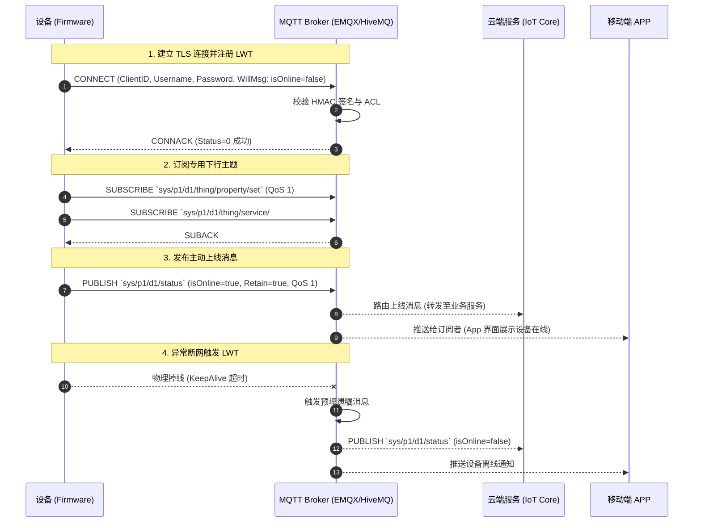
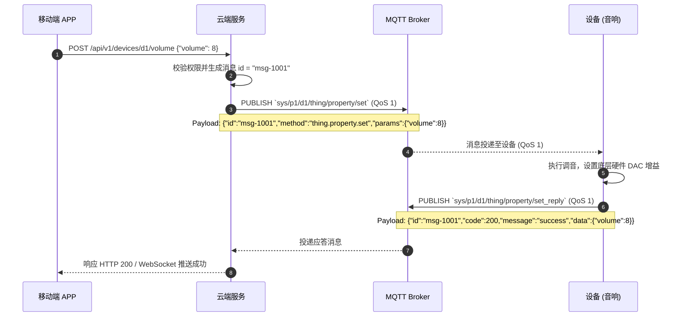
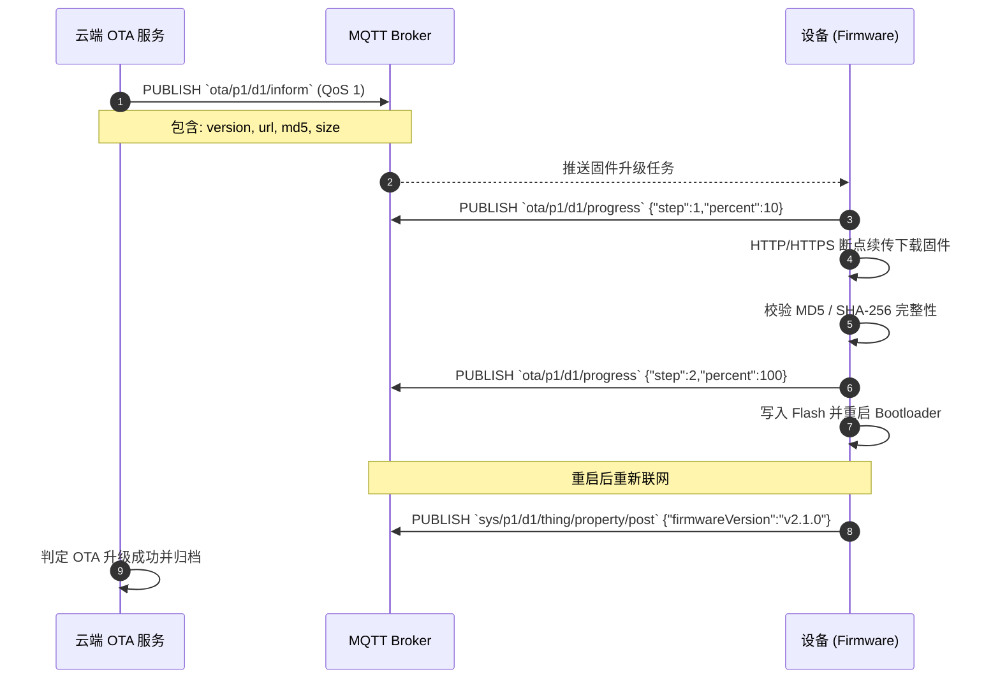

MQTT 规范关注的是物联网硬件设备（音箱、耳机、网关、传感器）、移动端 APP 以及云端微服务之间，基于 MQTT 协议进行异步消息发布/订阅（Pub/Sub）、物模型数据同步、远程控制与状态感知的工程化通信标准。

MQTT（Message Queuing Telemetry Transport）是一种基于发布/订阅模式的轻量级物联网通信协议。为了统一各端交互，消除 Topic 命名碎片化，保障弱网环境下的通信高可用与传输安全，特制定本规范。

# 一、前提

为了统一设备端（Firmware）、移动端（iOS / Android）及云端服务（Backend）之间的消息交互，提升系统的可读性、可维护性与高并发扩展能力，所有端必须遵循以下基础约定：

- **版本基准**：推荐采用 **MQTT v5.0**，全面向下兼容 **MQTT v3.1.1**。
- **传输安全**：所有生产环境连接必须采用 **TLS 1.2 / TLS 1.3 加密传输**（MQTT over TLS，标准端口 `8883`；Web 客户端采用 WSS，标准端口 `8084`）。
- **统一数据格式**：消息负载（Payload）一律采用 **JSON** 格式（固件极受限二进制场景需单独报备扩展），且必须为标准的 UTF-8 编码。
- **严格认证与授权**：所有连接必须通过身份认证，禁止开放匿名连接；Broker 必须配置基于设备身份的细粒度主题 ACL（访问控制列表）。
- **双向确认与闭环**：除纯遥测数据外，远程控制类指令必须遵循“请求-响应”闭环机制，保证端云状态强一致。

## 1.1 字符集与编码

- 所有 MQTT Topic 及 JSON Payload 字符串必须统一使用 **UTF-8** 字符编码。
- 禁止在 Topic 和 JSON 字符串中出现非法控制字符或非打印字符。

## 1.2 日期与时间格式

- **绝对时间戳**：统一使用 UTC，RFC 3339 格式，精确到毫秒，固定以 `Z` 结尾。例如：`2026-10-22T07:30:20.123Z`。
- **Unix 时间戳**：在对固件性能及网络流量要求极高的特定协议头或签名参数中，允许使用 Unix 毫秒级整数时间戳（例如 `1792654220123`）。
- **时序防护**：服务端或设备端更新属性时，必须比对 Payload 内的 `timestamp`，**禁止使用旧时间戳的数据覆盖新状态**，避免因网络重传或乱序导致状态倒退。

## 1.3 命名规范

- **JSON 字段命名**：严格遵循小驼峰（`camelCase`），例如 `deviceId`、`batteryLevel`、`firmwareVersion`。
- **ID 格式**：所有设备 ID、消息 ID、事件 ID 统一使用**字符串（String）**，禁止使用大整型（防止前端 JavaScript 精度丢失）。
- **布尔字段**：必须使用 `is` 或 `has` 前缀，例如 `isOnline`、`hasMicrophone`。
- **枚举值**：枚举字符串统一使用全大写下划线（`SCREAMING_SNAKE_CASE`）或小驼峰，但在同一协议内必须保持一致。
- **Topic 路径**：严格采用小写字母、数字及下划线组成，层级间以斜杠 `/` 分隔。

---

# 二、Topic（主题）层级与命名规范

Topic 是 MQTT 消息路由的核心。清晰、层级严密的 Topic 结构是实现多租户隔离、权限细分及通配符订阅的前提。

## 2.1 Topic 设计原则

1. **禁止前导斜杠**：Topic 严禁以 `/` 开头（例如禁止使用 `/sys/...`，必须写为 `sys/...`），避免在 Broker 内存树中生成多余的空根节点。
2. **禁止在发布主题中使用通配符**：客户端发布消息的主题必须是明确的物理主题，严禁包含 `+`（单层通配符）或 `#`（多层通配符）。
3. **区分请求与响应**：成对出现的指令交互，响应主题统一在请求主题末尾添加 `_reply`。
4. **多租户与产品隔离**：所有设备端主题必须包含 `{productKey}` 与 `{deviceId}`，天然实现设备维度的数据隔离。

## 2.2 基础层级结构

系统标准 Topic 统一分为三大空间：
- **`sys/`**：系统物模型主题空间（标准属性、事件、服务及生命周期）
- **`ota/`**：设备固件 OTA 升级主题空间
- **`ext/`**：业务自定义扩展主题空间

```
sys/{productKey}/{deviceId}/{domain}/{category}/{action}
```

- `{productKey}`：产品唯一识别码（字符串，如 `yeahbox_t100`）。
- `{deviceId}`：设备唯一物理标识/序列号（MAC 或 SN，如 `84F703ABC123`）。
- `{domain}`：业务域（如 `thing` 物模型、`shadow` 设备影子）。
- `{category}`：类别（如 `property` 属性、`event` 事件、`service` 服务）。
- `{action}`：具体行为动作（如 `post` 上报、`set` 下发、`reply` 应答）。

## 2.3 核心物模型 Topic 矩阵

| 序号 | 业务场景 | Topic 定义 | 方向 | QoS | 描述 |
| :--- | :--- | :--- | :--- | :--- | :--- |
| 1 | **设备上下线状态** | `sys/{productKey}/{deviceId}/status` | Dev -> Cloud | 1 | 设备生命周期、连接及遗嘱 (LWT) 主题 |
| 2 | **属性上报** | `sys/{productKey}/{deviceId}/thing/property/post` | Dev -> Cloud | 1 | 设备主动上报状态数据（电量、音量等） |
| 3 | **属性上报应答** | `sys/{productKey}/{deviceId}/thing/property/post_reply` | Cloud -> Dev | 1 | 云端确认设备属性上报入库成功 |
| 4 | **属性设置** | `sys/{productKey}/{deviceId}/thing/property/set` | Cloud -> Dev | 1 | 云端/APP 远程修改设备属性 |
| 5 | **属性设置应答** | `sys/{productKey}/{deviceId}/thing/property/set_reply` | Dev -> Cloud | 1 | 设备反馈属性修改结果 |
| 6 | **事件上报** | `sys/{productKey}/{deviceId}/thing/event/{eventCode}/post` | Dev -> Cloud | 1 | 发生关键事件（如低电告警、硬件故障） |
| 7 | **事件上报应答** | `sys/{productKey}/{deviceId}/thing/event/{eventCode}/post_reply`| Cloud -> Dev | 1 | 云端确认事件已消费 |
| 8 | **服务调用 (RPC)** | `sys/{productKey}/{deviceId}/thing/service/{serviceCode}` | Cloud -> Dev | 1 | 远程触发设备动作（如重启、切歌） |
| 9 | **服务调用应答** | `sys/{productKey}/{deviceId}/thing/service/{serviceCode}_reply`| Dev -> Cloud | 1 | 设备执行服务后的同步返回结果 |
| 10 | **OTA 通知** | `ota/{productKey}/{deviceId}/inform` | Cloud -> Dev | 1 | 云端推送新固件版本可用通知 |
| 11 | **OTA 进度上报** | `ota/{productKey}/{deviceId}/progress` | Dev -> Cloud | 1 | 设备上报下载、烧录进度 |
| 12 | **设备影子更新** | `shadow/{productKey}/{deviceId}/update` | Dev/App -> Cloud| 1 | 更新设备影子 desired / reported 状态 |
| 13 | **设备影子下发** | `shadow/{productKey}/{deviceId}/delta` | Cloud -> Dev | 1 | 云端向设备推送期望与现实的差异状态 |

---

# 三、消息协议与 Payload 规范

所有 MQTT 传输的负载必须遵循统一的基础 JSON 数据契约。

## 3.1 请求与下发消息格式 (Request / Downstream)

用于云端向设备下发指令（属性设置、服务调用）或设备向云端发送上报请求。

```json
{
  "id": "msg-20261022-0001",
  "version": "1.0",
  "method": "thing.property.set",
  "timestamp": "2026-10-22T07:30:20.123Z",
  "params": {
    "volume": 8,
    "lightMode": 2
  }
}
```

### 字段说明表

| 字段名 | 类型 | 必填 | 说明 |
| --- | --- | --- | --- |
| `id` | String | 是 | 消息唯一请求标识（UUID 或流水号），应答帧必须回传相同的 `id` 以建立请求映射。 |
| `version` | String | 是 | 协议版本号，固定为 `"1.0"`。 |
| `method` | String | 是 | 调用的方法名称，格式为 `{domain}.{category}.{action}`。 |
| `timestamp` | String | 是 | 消息产生的 UTC 时间戳（RFC 3339 毫秒格式）。 |
| `params` | Object | 是 | 业务参数对象；无参数时传空对象 `{}`，不得为 `null`。 |

## 3.2 响应与应答消息格式 (Response / Upstream)

用于接收方对请求消息进行结果反馈。

```json
{
  "id": "msg-20261022-0001",
  "version": "1.0",
  "code": 200,
  "message": "success",
  "timestamp": "2026-10-22T07:30:20.345Z",
  "data": {
    "currentVolume": 8
  }
}
```

### 字段说明表

| 字段名 | 类型 | 必填 | 说明 |
| --- | --- | --- | --- |
| `id` | String | 是 | 原样回传请求消息中的 `id`。 |
| `version` | String | 是 | 协议版本号，固定为 `"1.0"`。 |
| `code` | Integer | 是 | 业务响应状态码，`200` 表示成功，其它为错误码（详见 3.3 节）。 |
| `message` | String | 是 | 状态描述文本（人类可读，英文或多语言提示）。 |
| `timestamp` | String | 是 | 响应生成的 UTC 时间戳。 |
| `data` | Object | 否 | 业务返回的数据内容；若无具体返回数据则不传或返回 `{}`。 |

## 3.3 标准状态码 (Status Codes)

状态码参考业界成熟标准与 RESTful 规范对齐：

| 状态码 | 常量定义 | 含义 | 场景示例 |
| --- | --- | --- | --- |
| **200** | `SUCCESS` | 操作成功 | 指令已在设备端生效并执行完毕。 |
| **202** | `ACCEPTED` | 任务已接收并异步执行 | 设备已开始耗时任务（如 OTA 固件烧录中）。 |
| **400** | `BAD_REQUEST` | 请求报文格式非法或参数错误 | JSON 解析失败、参数越界（如音量值超出范围）。 |
| **401** | `UNAUTHORIZED` | 鉴权失败或签名无效 | 设备 Token 过期或 Client 身份未通过认证。 |
| **403** | `FORBIDDEN` | 无权执行此操作 | 当前连接角色无权调用该受限服务。 |
| **404** | `NOT_FOUND` | 方法或服务不存在 | 设备固件未实现该 `method` 或服务标识。 |
| **409** | `CONFLICT` | 设备当前状态冲突 | 设备正在通话中，拒绝执行 DJ 特效音播放。 |
| **429** | `TOO_MANY_REQUESTS` | 频控超限（限流） | 设备上报频次超过 Broker 或云端限流阈值。 |
| **500** | `INTERNAL_ERROR` | 设备或服务端内部执行异常 | 硬件外设故障、Flash 擦写失败。 |
| **503** | `DEVICE_OFFLINE` | 设备不可达或已断开连接 | 云端尝试下发 RPC 控制，但设备已离线。 |

---

# 四、MQTT 传输与 QoS 控制策略

合理的 QoS 与连接控制策略是平衡物联网通信带宽、网络延迟与数据可靠性的核心。

## 4.1 QoS 选型矩阵

MQTT 支持三个服务质量级别（QoS），必须根据业务性质严格按规范选型，**禁止全量盲目使用 QoS 1 或 QoS 2**：

| QoS 级别 | 交付保证 | 网络开销 | 适用场景 | 禁用场景 |
| --- | --- | --- | --- | --- |
| **QoS 0** (最多交付一次) | 无确认，尽力而为，可能丢失 | 极低（1 次发送） | 高频环境遥测、每秒连续状态监测、丢包不影响全局的数据 | 关键控制指令、OTA 升级包通知、扣费/订单事件 |
| **QoS 1** (至少交付一次) | PUBACK 保证到达，可能重复 | 中等（2 次交互） | **绝大多数业务场景**：属性上报、远程控制、生命周期状态、告警事件 | 极端受限的低功耗单发传感器（会消耗重传电量） |
| **QoS 2** (刚好交付一次) | 四步握手，绝不丢失与重复 | 高（4 次交互，延迟大）| 严禁重复触发的财务结算、开锁操作（如无端侧幂等兜底） | 普通数据上报、高频交互 |

> [!IMPORTANT]
> - 在本规范中，**所有属性设置（Set）、服务调用（RPC）及响应（Reply）均必须使用 QoS 1**。
> - 客户端与服务端应用层必须针对 QoS 1 实施**基于消息 `id` 的幂等去重控制**。

## 4.2 Retain（保留消息）规范

Broker 会为设置了 `Retain=true` 的主题缓存最后一条消息，新订阅者一旦订阅即可瞬间获知最新状态。

1. **允许使用 Retain 的主题**：
   - 设备上下线状态主题：`sys/{productKey}/{deviceId}/status`（用于 App 订阅时即刻获得设备当前在线状态）。
   - 设备影子状态主题：`shadow/{productKey}/{deviceId}/update`。
2. **严禁使用 Retain 的主题**：
   - 所有控制类指令（`.../thing/property/set`、`.../thing/service/...`）：**绝对禁止设置 Retain**！若在控制主题开启 Retain，设备离线重连后将瞬间重放历史旧指令，极易导致严重安全事故（如突发音量拉满、设备意外关机）。
   - 所有事件告警主题（`.../thing/event/...`）：禁止设置 Retain，避免重复警报。

## 4.3 遗嘱消息 (LWT - Last Will and Testament)

为了在设备发生异常掉线（弱网断开、断电、看门狗复位）时，云端及 APP 能毫秒级感知设备离线，必须规范配置 MQTT 遗嘱消息。

- **遗嘱主题 (Will Topic)**：`sys/{productKey}/{deviceId}/status`
- **遗嘱 QoS**：`QoS 1`
- **遗嘱 Retain**：`true`
- **遗嘱 Payload**：

```json
{
  "id": "lwt-msg-0001",
  "version": "1.0",
  "timestamp": "2026-10-22T07:30:20.123Z",
  "params": {
    "isOnline": false,
    "offlineReason": "NETWORK_ABNORMAL"
  }
}
```

## 4.4 会话保持与 Keep Alive 心跳

1. **Keep Alive 周期**：
   - 常供电设备（如插电音箱）：建议设置为 `30` 秒或 `60` 秒。
   - 电池供电低功耗设备：建议设置为 `120` 秒 ~ `300` 秒。
   - 超时判定标准：Broker 在 $1.5 \times \text{KeepAlive}$ 时间周期内未收到任何客户端报文（PINGREQ 或业务报文），即触发主动断开并发布 LWT 遗嘱。
2. **Clean Session (MQTT 3.1.1) / Clean Start (MQTT 5.0)**：
   - 移动端 APP 连接：必须设置 `Clean Session = true`，防止历史堆积的离线推送阻塞移动端。
   - 硬件设备连接：建议设置 `Clean Session = false`（MQTT 5.0 中配置 `Session Expiry Interval = 86400`），保证设备短时弱网重连后无缝恢复订阅关系，不丢失离线期间下发的 QoS 1 关键指令。

---

# 五、认证、鉴权与安全接入

## 5.1 传输安全要求

- 生产环境严禁使用未加密的纯明文 MQTT（1883 端口）。
- 必须使用 **TLS 1.2 / TLS 1.3** 证书加密连接（8883 端口），推荐选用包含双向认证（mTLS）或高等级 CA 签名的服务端证书。
- 移动端与小程序采用 WebSocket Secure（WSS）接入时，强制要求域名绑定正规 HTTPS 证书。

## 5.2 Client ID 命名规范

Client ID 是 Broker 区分连接实体的唯一标识。同一 Broker 内 Client ID 冲突会导致互踢（Connection Flapping）。

### 客户端 Client ID 结构：

$$\text{ClientID} = \{\text{ClientType}\}\_\{\text{ProductKey}\}\_\{\text{DeviceID}\}\_\{\text{InstanceSuffix}\}$$

- `ClientType`：客户端角色前缀，固定为：
  - `dev`：物理硬件设备
  - `app`：移动端 App
  - `srv`：云端微服务实例
- `ProductKey`：产品标识。
- `DeviceID`：设备唯一物理标识（MAC/SN）；微服务使用服务名。
- `InstanceSuffix`：随机串或 Unix 毫秒时间戳（设备固定单点连接时可省略；APP 与微服务必须携带以支持多点并发登录）。

**示例**：
- 硬件音响：`dev_yeahbox_t100_84F703ABC123`
- 用户 App：`app_yeahbox_t100_user9527_1792654220000`
- 云端集群服务：`srv_iot_core_node01_d8a7c2`

## 5.3 鉴权认证模式 (HMAC-SHA256 签名)

为了避免设备固件硬编码明文密钥导致批量泄露风险，设备接入采用**动态签名鉴权**模式：

- **MQTT Username**：`{deviceId}&{productKey}`
- **MQTT Password 计算**：使用预置在设备安全芯片/安全存储区的 `DeviceSecret`，对约定的签名原文计算 HMAC-SHA256 得到十六进制摘要字符串（64 个小写字符）。

### 签名原文约定：

$$\text{SIGN\_TEXT} = \text{"clientId"}\{\text{clientId}\} + \text{"deviceId"}\{\text{deviceId}\} + \text{"productKey"}\{\text{productKey}\} + \text{"timestamp"}\{\text{timestamp}\}$$

$$\text{MQTT Password} = \text{Hex}(\text{HMAC-SHA256}(\text{DeviceSecret}, \text{UTF8}(\text{SIGN\_TEXT})))$$

> [!NOTE]
> 服务端验签时检查 `timestamp` 与当前服务器时间偏差在 $\pm 600$ 秒内，并检验摘要是否匹配。

## 5.4 ACL 访问控制规则 (Topic Authorization)

Broker 必须严格配置 ACL 规则，遵循**最小权限原则**：

1. **设备端 (dev)**：
   - 仅允许发布：`sys/{self.productKey}/{self.deviceId}/#`、`ota/{self.productKey}/{self.deviceId}/#`
   - 仅允许订阅：`sys/{self.productKey}/{self.deviceId}/#`、`ota/{self.productKey}/{self.deviceId}/#`
   - **绝对禁止**设备订阅通配符 `sys/+/+/#` 或其它设备的主题，彻底杜绝横向越权。
2. **移动端 APP (app)**：
   - 仅允许在经过云端绑定关系鉴权后，订阅与发布其绑定的指定设备控制主题。
3. **云端微服务 (srv)**：
   - 具备全局系统主题读写权限，通过专属白名单通道或内网集群连接 Broker。

---

# 六、典型交互时序与核心物模型场景

## 6.1 设备接入与上线/离线生命周期



## 6.2 远程控制与异步应答流程 (RPC / Service)

以 APP 远程调节音响音量至 8 为例：



## 6.3 固件 OTA 升级交互时序



---

# 七、工程实践与容错设计

## 7.1 消息幂等与去重处理

由于 MQTT QoS 1 保证的是“至少送达一次（At least once）”，网络抖动重发不可避免。
- **发送端策略**：在重发定时器触发时，重发报文内的 `id` 必须保持不变。
- **接收端策略**：维护一个基于内存或 Redis 的滑动窗口布隆过滤器 / 去重缓存（TTL 建议 300 秒）：
  - 收到请求后先检查 `id` 是否已处理；
  - 若已处理，直接返回上一次缓存的响应 `reply`，不再重复执行硬件动作（例如防止“切下一曲”被重复执行两次）。

## 7.2 状态乱序与时间戳防护

网络延迟抖动可能导致“后发出的指令先到达，先发出的指令后到达”。
- 设备端上报属性与云端下发设置必须携带 `timestamp`。
- 设备和云端在接收到属性更新时，必须检查：
  
  $$\text{if } \text{IncomingTimestamp} < \text{CurrentStateTimestamp} \implies \text{直接丢弃该属性更新并打 Warning 日志}$$

## 7.3 指数退避断线重连 (Backoff with Jitter)

当因服务端升级或网络故障发生批量断线时，若所有设备同时以固定时间发起重连，将瞬间引发 **惊群效应（Thundering Herd）** 击垮 Broker。

设备端重连算法必须引入带随机抖动的指数退避：

$$T_{\text{reconnect}} = \min(T_{\max}, \; T_{\text{base}} \times 2^{\text{retryCount}}) + \text{Random}(-\text{jitter}, \; +\text{jitter})$$

- 推荐参数：$T_{\text{base}} = 1\text{s}, \; T_{\max} = 60\text{s}, \; \text{jitter} = 0.2 \times T_{\text{reconnect}}$。

---

# 八、常用测试向量与 Payload 示例集

本章节整理典型业务场景的主题与完整合法 JSON 报文，供研发和测试团队直接作为 Mock 与单元测试基准。

### 8.1 设备上线通知 (Presence / Status)
- **Topic**：`sys/yeahbox_t100/84F703ABC123/status`
- **QoS**：`1` | **Retain**：`true`
- **Payload**：
```json
{
  "id": "status-init-001",
  "version": "1.0",
  "timestamp": "2026-10-22T07:30:20.123Z",
  "params": {
    "isOnline": true,
    "ip": "192.168.1.105",
    "firmwareVersion": "v1.2.0",
    "rssi": -55
  }
}
```

### 8.2 属性批量上报 (Property Post)
- **Topic**：`sys/yeahbox_t100/84F703ABC123/thing/property/post`
- **QoS**：`1` | **Retain**：`false`
- **Payload**：
```json
{
  "id": "post-20261022-001",
  "version": "1.0",
  "method": "thing.property.post",
  "timestamp": "2026-10-22T07:30:25.000Z",
  "params": {
    "batteryLevel": 85,
    "isCharging": false,
    "volume": 6,
    "playingStatus": "PLAYING",
    "inputSource": "BLUETOOTH",
    "lightMode": 2,
    "bassBoost": true
  }
}
```

### 8.3 属性设置下发 (Property Set)
- **Topic**：`sys/yeahbox_t100/84F703ABC123/thing/property/set`
- **QoS**：`1` | **Retain**：`false`
- **Payload**：
```json
{
  "id": "set-20261022-002",
  "version": "1.0",
  "method": "thing.property.set",
  "timestamp": "2026-10-22T07:30:30.120Z",
  "params": {
    "volume": 10,
    "lightMode": 5,
    "lightRgb": "#FF0000"
  }
}
```

### 8.4 属性设置成功应答 (Property Set Reply)
- **Topic**：`sys/yeahbox_t100/84F703ABC123/thing/property/set_reply`
- **QoS**：`1` | **Retain**：`false`
- **Payload**：
```json
{
  "id": "set-20261022-002",
  "version": "1.0",
  "code": 200,
  "message": "success",
  "timestamp": "2026-10-22T07:30:30.250Z",
  "data": {
    "volume": 10,
    "lightMode": 5
  }
}
```

### 8.5 服务调用下发-播放气氛音效 (Service Call)
- **Topic**：`sys/yeahbox_t100/84F703ABC123/thing/service/playSoundEffect`
- **QoS**：`1` | **Retain**：`false`
- **Payload**：
```json
{
  "id": "rpc-20261022-003",
  "version": "1.0",
  "method": "thing.service.playSoundEffect",
  "timestamp": "2026-10-22T07:31:00.000Z",
  "params": {
    "soundType": "APPLAUSE",
    "durationMs": 3000
  }
}
```

### 8.6 服务调用应答-成功 (Service Reply)
- **Topic**：`sys/yeahbox_t100/84F703ABC123/thing/service/playSoundEffect_reply`
- **QoS**：`1` | **Retain**：`false`
- **Payload**：
```json
{
  "id": "rpc-20261022-003",
  "version": "1.0",
  "code": 200,
  "message": "success",
  "timestamp": "2026-10-22T07:31:00.120Z",
  "data": {
    "played": true
  }
}
```

### 8.7 事件主动告警-低电量告警 (Event Post)
- **Topic**：`sys/yeahbox_t100/84F703ABC123/thing/event/lowBatteryAlert/post`
- **QoS**：`1` | **Retain**：`false`
- **Payload**：
```json
{
  "id": "evt-20261022-004",
  "version": "1.0",
  "method": "thing.event.lowBatteryAlert.post",
  "timestamp": "2026-10-22T07:32:00.000Z",
  "params": {
    "batteryLevel": 10,
    "threshold": 15,
    "batteryVoltageMv": 3450
  }
}
```
