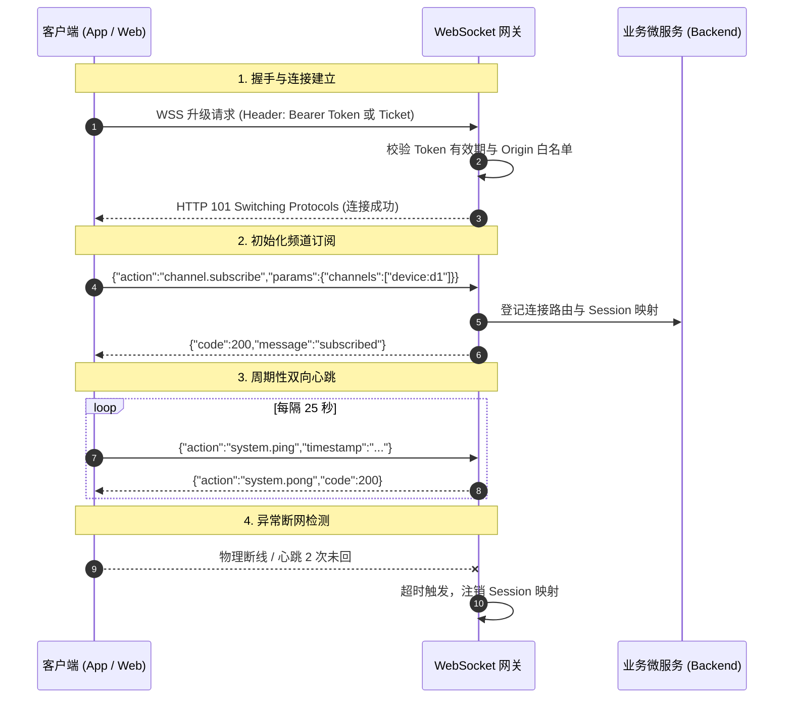
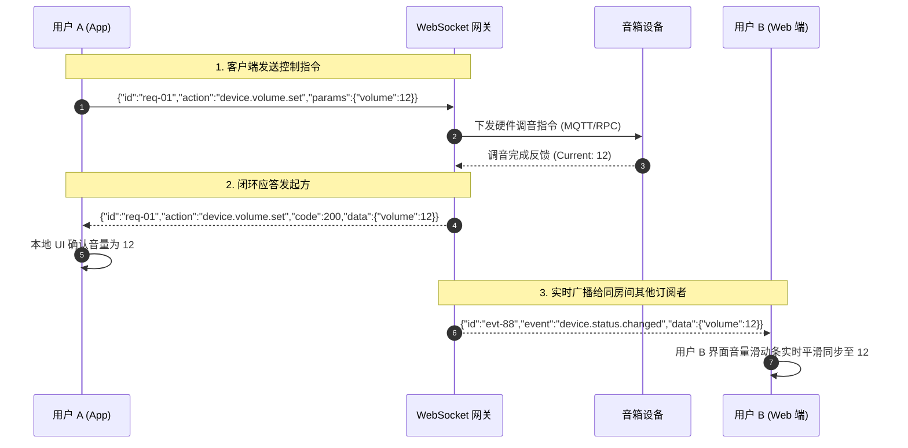
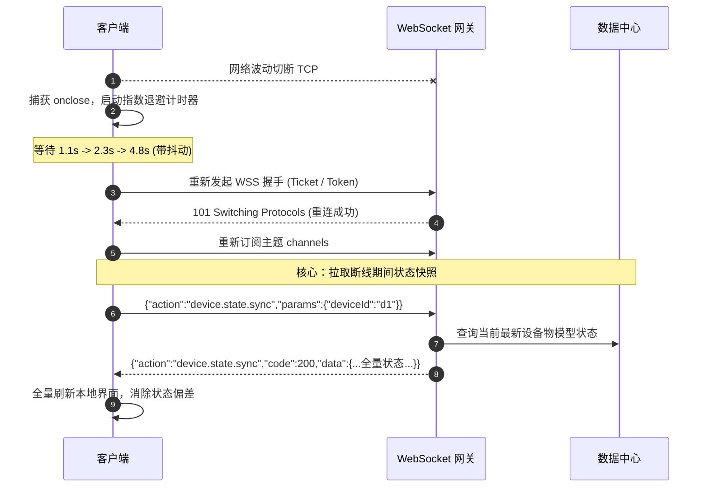

WebSocket 规范关注的是移动端 APP、Web 前端应用以及物联网管理平台与后端微服务之间，基于 WebSocket 协议建立长连接、进行全双工（Full-Duplex）低延迟数据通信、实时状态同步与双向事件推送的工程化标准。

WebSocket 协议（RFC 6455）在单个 TCP 连接上提供了持久化的全双工通信能力。为了统一长连接数据信封格式、消除握手鉴权隐患、保障弱网下的保活重连与多端并发一致性，特制定本规范。

# 一、前提与基础约定

为了统一系统内各终端与服务端之间的长连接数据交互，提高协议的一致性、可维护性与高并发容错能力，各端必须严格遵守以下基础约定：

- **传输层安全**：生产环境**强制使用 WSS（WebSocket Secure，即 WebSocket over TLS）**，标准接入端口为 `443` 或微服务网关专用端口 `8084` / `8443`；严禁在生产环境暴露未加密的 `ws://` 明文协议。
- **数据格式统一**：消息负载一律采用 **JSON** 格式作为通用数据交换载体，字符编码必须采用 **UTF-8**。在涉及音视频裸流或超低延时二进制数据包场景下，经架构评审后方可使用二进制帧（Binary Frame）。
- **统一信封契约（Envelope）**：所有业务报文必须包含统一的元数据头（`id`、`action`/`event`、`timestamp` 等），实现请求与响应精准配对、链路追踪与幂等去重。
- **闭环与主动推送并存**：协议清晰划分为“客户端发起请求-服务端应答（Request-Response）”以及“服务端主动事件广播/推送（Server-Push Event）”两类交互通道。

## 1.1 字符集与编码

- 所有文本帧内容、URL 路径、查询参数均采用 **UTF-8** 字符编码。
- 严禁包含非法控制字符或截断的 Unicode 字符序列。

## 1.2 时间格式规范

- 统一使用 **UTC** 时间，遵循 **RFC 3339** 格式，固定毫秒精度并以 `Z` 结尾。
- 格式示例：`2026-10-22T07:30:20.123Z`。
- **时序防护**：服务端或客户端处理属性同步与事件消费时，必须比对报文中的 `timestamp`，**禁止使用旧时间戳的历史消息覆盖最新状态**。

## 1.3 字段命名规范

- **JSON 字段**：严格使用小驼峰（`camelCase`），如 `deviceId`、`playingStatus`、`voiceChangeMode`。
- **动作与事件标识**：统一采用点分层级命名法（Dot Notation），全部小写，格式为 `{domain}.{category}.{action}`，如 `device.volume.set`、`device.status.changed`。
- **标识符 (ID)**：所有消息 ID、设备 ID、用户 ID 必须使用**字符串（String）**表示（推荐使用 UUID v4 或分布式雪花算法 ID），严禁使用超过 53 位的整型（避免前端 JavaScript 解析丢失精度）。
- **布尔字段**：强制使用 `is` 或 `has` 前缀，如 `isOnline`、`hasPermission`。

---

# 二、连接建立与握手鉴权规范

WebSocket 连接的生命周期始于标准的 HTTP 升级（Upgrade）请求。握手阶段是实施安全防御与身份识别的第一道防线。

## 2.1 握手 URL 规范

WebSocket 统一接入网关遵循如下 RESTful 语义化路由规范：

```
wss://{domain}/ws/{version}/{namespace}
```

- `{version}`：协议版本，固定为 `v1`、`v2` 等。
- `{namespace}`：业务命名空间或接入域，例如：
  - `/ws/v1/devices`：用于设备管理、音箱控制与状态监听
  - `/ws/v1/chat`：实时语音/互动聊天房间
  - `/ws/v1/notifications`：全局通知与用户消息推送

## 2.2 握手鉴权方案

针对不同运行环境（移动端 App、Web 浏览器）对 WebSocket Header 设置能力的支持差异，规范定义以下两种标准握手鉴权机制：

### 方案 A：标准 Header 认证（推荐 - App / 原生客户端）
适用于 iOS、Android 原生端或 Node.js 后台等支持自定义握手 HTTP Header 的客户端。

- 在握手请求的 HTTP Header 中携带标准的 Bearer Token：
  ```http
  GET /ws/v1/devices HTTP/1.1
  Host: api.example.com
  Upgrade: websocket
  Connection: Upgrade
  Sec-WebSocket-Key: dGhlIHNhbXBsZSBub25jZQ==
  Sec-WebSocket-Version: 13
  Authorization: Bearer <accessToken>
  X-Client-Version: 5.2.0
  X-Device-Model: iPhone17
  ```

### 方案 B：一次性票据认证（One-Time Ticket - Web / 浏览器端兜底）
标准浏览器原生 `WebSocket` API 不支持自定义 HTTP Header，**禁止直接在 URL Query 中明文传递长期有效的 `accessToken`**（防止被浏览器历史记录、中间代理或接入日志泄露）。

- **执行流程**：
  1. Web 前端先通过标准 HTTPS 接口请求获取一次性短期票据（One-Time Ticket）：
     - `POST /api/v1/auth/ws-tickets` -> 返回 `{"ticket": "tkt_a8f9c2d1", "expiresIn": 60}`（有效期 60 秒，单次使用立即失效）。
  2. 前端携带票据连接 WebSocket 网关：
     ```http
     GET /ws/v1/devices?ticket=tkt_a8f9c2d1 HTTP/1.1
     Host: api.example.com
     Upgrade: websocket
     Connection: Upgrade
     Sec-WebSocket-Key: dGhlIHNhbXBsZSBub25jZQ==
     Sec-WebSocket-Version: 13
     ```
  3. 服务端验票成功后建立连接，并将票据自 Redis 中原子核销。

## 2.3 握手安全防护 (CSWSH 防御)

为防止跨站 WebSocket 劫持（Cross-Site WebSocket Hijacking, CSWSH）：
1. **Origin 白名单校验**：服务端在响应握手请求前，**必须严格检查 `Origin` 请求头**是否在合法业务域名白名单中；非法来源直接返回 `403 Forbidden` 并阻断连接。
2. **连接超时断开**：握手建立后，客户端必须在 **10 秒**内完成初始握手准备，否则服务端主动切断 TCP 连接。

---

# 三、数据帧类型与信封契约 (Payload Envelope)

为了实现强类型、易解析、能闭环的消息通信，所有业务消息均封装于统一的顶层信封（Envelope）中。

## 3.1 帧类型（Frame Type）选用

- **文本帧 (Text Frame - Opcode 0x1)**：用于传输系统标准 JSON 业务报文。
- **二进制帧 (Binary Frame - Opcode 0x2)**：仅用于音频流、固件分段包等特定大块二进制传输，默认不开启。
- **控制帧 (Control Frames - Ping 0x9 / Pong 0xA / Close 0x8)**：由底层协议栈自动处理或用于协议级保活。

## 3.2 统一信封格式 (Unified Envelope)

通信交互分为三大核心模式：
1. **请求报文（Request - 客户端发起）**
2. **响应报文（Response - 服务端应答）**
3. **事件报文（Event - 服务端主动推送）**

### 3.2.1 客户端请求报文 (Request)

客户端发送控制指令或查询数据时使用的格式：

```json
{
  "id": "req-20261022-0001",
  "action": "device.property.set",
  "timestamp": "2026-10-22T07:30:20.123Z",
  "params": {
    "deviceId": "dev-yeahbox-001",
    "volume": 8,
    "lightMode": 2
  }
}
```

| 字段名 | 类型 | 必填 | 说明 |
| --- | --- | --- | --- |
| `id` | String | 是 | 客户端生成的请求唯一标识（UUID 或流水号），服务端响应时必须原样回传。 |
| `action` | String | 是 | 请求执行的动作名称，采用 `{domain}.{category}.{action}` 点分格式。 |
| `timestamp` | String | 是 | 客户端发送请求的 UTC 时间戳（RFC 3339 毫秒精度）。 |
| `params` | Object | 是 | 业务入参对象；无参数时传空对象 `{}`，严禁为 `null`。 |

### 3.2.2 服务端响应报文 (Response)

服务端针对客户端请求处理完成后的应答格式：

```json
{
  "id": "req-20261022-0001",
  "action": "device.property.set",
  "code": 200,
  "message": "success",
  "timestamp": "2026-10-22T07:30:20.250Z",
  "data": {
    "deviceId": "dev-yeahbox-001",
    "currentVolume": 8,
    "updatedAt": "2026-10-22T07:30:20.245Z"
  }
}
```

| 字段名 | 类型 | 必填 | 说明 |
| --- | --- | --- | --- |
| `id` | String | 是 | 原样回传客户端请求中的 `id`，客户端据此将 Promise / 回调闭环。 |
| `action` | String | 是 | 原样回传请求中的 `action`。 |
| `code` | Integer | 是 | 业务响应状态码，`200` 代表成功，其余见 3.3 节。 |
| `message` | String | 是 | 状态结果的人类可读描述（支持国际化）。 |
| `timestamp` | String | 是 | 服务端生成响应的 UTC 时间戳。 |
| `data` | Object | 否 | 业务返回的数据实体；失败时可携带具体 `details`。 |

### 3.2.3 服务端主动事件推送 (Server-Push Event)

服务端感知到设备状态变动、告警或外部系统变动，向客户端单向推送的消息格式：

```json
{
  "id": "evt-20261022-0089",
  "event": "device.status.changed",
  "timestamp": "2026-10-22T07:30:21.000Z",
  "data": {
    "deviceId": "dev-yeahbox-001",
    "isOnline": true,
    "batteryLevel": 85,
    "isCharging": false,
    "playingStatus": "PAUSED"
  }
}
```

| 字段名 | 类型 | 必填 | 说明 |
| --- | --- | --- | --- |
| `id` | String | 是 | 事件唯一标识，用于客户端事件去重与本地缓存。 |
| `event` | String | 是 | 事件类型标识，格式为 `{domain}.{category}.{action/status}`。 |
| `timestamp` | String | 是 | 事件发生时的 UTC 时间戳。 |
| `data` | Object | 是 | 事件负载数据对象。 |

## 3.3 业务状态码 (Business Status Codes)

与 RESTful / MQTT 规范对齐，采用三位标准数值：

| 状态码 | 常量名 | 说明 |
| --- | --- | --- |
| **200** | `SUCCESS` | 处理成功 |
| **202** | `ACCEPTED` | 任务已接收，正在异步处理中 |
| **400** | `BAD_REQUEST` | 参数校验不通过、JSON 语法错误或协议不匹配 |
| **401** | `UNAUTHORIZED` | 认证失效（Token 过期或票据无效） |
| **403** | `FORBIDDEN` | 无权访问目标资源（无设备控制权） |
| **404** | `ACTION_NOT_FOUND` | 请求的 `action` 动作未注册或不存在 |
| **409** | `CONFLICT` | 资源状态冲突（如设备正在升级固件中，拒绝设置操作） |
| **429** | `TOO_MANY_REQUESTS` | 客户端发送过于频繁触发限流 |
| **500** | `INTERNAL_ERROR` | 服务端内部异常 |
| **503** | `SERVICE_UNAVAILABLE` | 后端微服务或下游设备连接暂时不可用 |

## 3.4 WebSocket 协议级断开状态码规范 (Close Codes)

当连接被主动关闭时，服务端或客户端发送的标准 Close Frame 状态码（遵循 RFC 6455 及应用层扩展）：

| 状态码 (Code) | 描述 | 发起方 | 场景说明 |
| --- | --- | --- | --- |
| **1000** | Normal Closure | 双向 | 正常断开（用户登出、退出页面、正常切断） |
| **1001** | Going Away | 客户端 | 浏览器导航离开、APP 进程退到后台被系统挂起 |
| **1008** | Policy Violation | 服务端 | 策略违规（如握手 Origin 校验失败、非法协议） |
| **4001** | Token Expired | 服务端 | 运行时鉴权过期，客户端需重新刷新 Token 并重连 |
| **4002** | Session Replaced | 服务端 | 异地登录互踢（单点登录冲突） |
| **4003** | Rate Limit Exceeded | 服务端 | 触发严厉的频控限流熔断，强制断开 |
| **4004** | Heartbeat Timeout | 服务端 | 连续多次心跳超时，判定客户端假死强制踢除 |

---

# 四、心跳保活与连接生命周期管理

由于 NAT 网关、移动网络运营商基站会定期杀掉无流量传输的空闲 TCP 连接（通常空闲 60~120 秒即被静默切断），且客户端拔线掉网服务端无法瞬时感知，必须实施主动心跳保活。

## 4.1 双向应用层心跳机制

虽然 WebSocket 底层协议定义了 Ping（`0x9`）/ Pong（`0xA`）控制帧，但由于**浏览器原生 JavaScript API 无法直接监听和发送协议层 Ping/Pong 帧**，因此系统统一采用**应用层 JSON 心跳**作为通用方案。

### 4.1.1 心跳报文契约

- **客户端心跳请求 (Ping)**：
  ```json
  {
    "id": "ping-1792654220000",
    "action": "system.ping",
    "timestamp": "2026-10-22T07:30:20.000Z",
    "params": {}
  }
  ```
- **服务端心跳应答 (Pong)**：
  ```json
  {
    "id": "ping-1792654220000",
    "action": "system.pong",
    "code": 200,
    "message": "pong",
    "timestamp": "2026-10-22T07:30:20.015Z",
    "data": {}
  }
  ```

## 4.2 心跳参数与超时策略

| 参数名 | 推荐值 | 说明 |
| --- | --- | --- |
| **心跳发送间隔 (Ping Interval)** | `25 秒` | 客户端每隔 25 秒定时发送一次 `system.ping`（避开运营商 60 秒超时）。 |
| **应答超时阈值 (Pong Timeout)** | `5 秒` | 客户端发出 Ping 后，若 5 秒内未收到对应 `system.pong`，判定当次异常。 |
| **最大容忍失败次数 (Max Misses)** | `2 次` | 客户端连续 2 次（或 55 秒内）未收到有效回复，判定长连接已“假死”，立即主动关闭物理连接并触发退避重连。 |
| **服务端空闲断开 (Server Idle)** | `65 秒` | 服务端若连续 65 秒内未收到该连接的任何消息（包括业务消息与心跳），主动发送 Close 帧（Code `4004`）释放资源。 |

## 4.3 频道订阅与多端协同 (Channel / Topic)

为了避免将海量无关消息广播给所有客户端，WebSocket 网关基于“频道/主题订阅模式”管理连接关系：

1. **订阅频道请求**：
   ```json
   {
     "id": "sub-001",
     "action": "channel.subscribe",
     "timestamp": "2026-10-22T07:30:20.123Z",
     "params": {
       "channels": ["device:yeahbox-001", "user:user-9527"]
     }
   }
   ```
2. **退订频道请求**：
   ```json
   {
     "id": "unsub-001",
     "action": "channel.unsubscribe",
     "timestamp": "2026-10-22T07:30:20.123Z",
     "params": {
       "channels": ["device:yeahbox-001"]
     }
   }
   ```

---

# 五、可靠性与工程容错设计

## 5.1 幂等性与消息去重

在网络波动、弱网重传或重连瞬间，同一条控制指令可能被重复投递。
- **发送端规则**：每次业务重发必须保留相同的请求 `id`。
- **接收端规则**：服务端对关键控制指令（如播放、暂停、切歌、配置变更）基于 `id` 在 Redis / 内存中设置防重去重锁（TTL 建议为 120 秒）：
  - 若 `id` 首次到达，正常执行并缓存结果；
  - 若 `id` 已存在，直接返回先前缓存的应答报文，防止硬件接口被多次击穿。

## 5.2 状态对齐与消息补发 (State Sync on Reconnect)

WebSocket 断线重连后，客户端在断网期间必然错失了部分服务端事件（如音量在本地断网期间被其他成员调整）。
- **禁止单靠事件增量推演**：重连建立并订阅成功后，客户端**必须向服务端主动拉取一次全量快照（Full State Sync）**：
  ```json
  {
    "id": "sync-001",
    "action": "device.state.sync",
    "timestamp": "2026-10-22T07:30:25.000Z",
    "params": {
      "deviceId": "dev-yeahbox-001",
      "lastSyncTimestamp": "2026-10-22T07:29:00.000Z"
    }
  }
  ```
- 服务端返回当前最新完整物模型状态，客户端据此全量刷新 UI。

## 5.3 带随机抖动的指数退避重连算法 (Exponential Backoff with Jitter)

当服务端网关重启或网络中心出现抖动时，大量客户端几乎同时断开。**严禁客户端以固定间隔（如每 2 秒）无限重连**，否则将引发灾难性的雪崩惊群效应。

### 重连退避公式：

$$T_{\text{delay}} = \min(T_{\max}, \; T_{\text{base}} \times 2^{\text{retryCount}}) + \text{Random}(-\text{jitter}, \; +\text{jitter})$$

- 推荐配置：
  - $T_{\text{base}} = 1000\text{ms}$（初次等待 1 秒）
  - $T_{\max} = 30000\text{ms}$（最大上限 30 秒）
  - $\text{jitter} = 0.2 \times T_{\text{delay}}$（加入 $\pm 20\%$ 的随机漂移量）
  - 最大自动尝试次数：无限次（后台低频重试）或提示用户手动重试。

```typescript
/**
 * 带抖动的指数退避延迟计算 (TypeScript)
 */
function calculateBackoffDelay(retryCount: number): number {
  const base = 1000;  // 1s
  const max = 30000;  // 30s
  const exponential = Math.min(max, base * Math.pow(2, retryCount));
  const jitter = exponential * 0.2 * (Math.random() * 2 - 1); // ±20%
  return Math.max(500, Math.floor(exponential + jitter));
}
```

## 5.4 客户端请求队列与离线缓存

- 当 WebSocket 处于 `CONNECTING` 或 `CLOSED` 状态时，客户端发起的请求应存入内部有限等待队列（FIFO，上限例如 50 条）。
- 队列设置超时时间（如 10 秒超时拒绝），防止连接长时间无法恢复时内存泄漏。
- 连接重新恢复为 `OPEN` 状态后，依次排队清空并发出。

---

# 六、典型交互时序 (Sequence Diagrams)

## 6.1 握手鉴权、订阅与心跳生命周期



## 6.2 客户端请求-响应与服务端实时广播

以控制音箱音量并向同房间其他成员同步为例：



## 6.3 异常断网、退避重连与全量同步



---

# 七、常用报文测试向量集 (Test Vectors)

本节汇总各交互类型的典型标准报文，供前后端研发进行 Mock 测试与接口对齐。

### 7.1 应用层心跳请求 (Ping)
- **Direction**：Client -> Server
- **Payload**：
```json
{
  "id": "ping-1792654220000",
  "action": "system.ping",
  "timestamp": "2026-10-22T07:30:20.000Z",
  "params": {}
}
```

### 7.2 应用层心跳应答 (Pong)
- **Direction**：Server -> Client
- **Payload**：
```json
{
  "id": "ping-1792654220000",
  "action": "system.pong",
  "code": 200,
  "message": "pong",
  "timestamp": "2026-10-22T07:30:20.015Z",
  "data": {}
}
```

### 7.3 调节设备音量请求 (Request)
- **Direction**：Client -> Server
- **Payload**：
```json
{
  "id": "req-20261022-1001",
  "action": "device.property.set",
  "timestamp": "2026-10-22T07:30:25.100Z",
  "params": {
    "deviceId": "dev-yeahbox-001",
    "volume": 12
  }
}
```

### 7.4 调节设备音量成功应答 (Response - 200 OK)
- **Direction**：Server -> Client
- **Payload**：
```json
{
  "id": "req-20261022-1001",
  "action": "device.property.set",
  "code": 200,
  "message": "success",
  "timestamp": "2026-10-22T07:30:25.210Z",
  "data": {
    "deviceId": "dev-yeahbox-001",
    "volume": 12,
    "maxVolume": 16
  }
}
```

### 7.5 参数越界错误响应 (Response - 400 Bad Request)
- **Direction**：Server -> Client
- **Payload**：
```json
{
  "id": "req-20261022-1002",
  "action": "device.property.set",
  "code": 400,
  "message": "Invalid volume level: 25. Must be between 0 and 16.",
  "timestamp": "2026-10-22T07:30:26.050Z",
  "data": {
    "targetField": "volume",
    "reason": "VALUE_OUT_OF_RANGE"
  }
}
```

### 7.6 设备状态变更事件推送 (Server-Push Event)
- **Direction**：Server -> Client
- **Payload**：
```json
{
  "id": "evt-20261022-9001",
  "event": "device.status.changed",
  "timestamp": "2026-10-22T07:30:30.000Z",
  "data": {
    "deviceId": "dev-yeahbox-001",
    "volume": 12,
    "batteryLevel": 90,
    "isCharging": true,
    "inputSource": "BLUETOOTH",
    "playingStatus": "PLAYING",
    "lightMode": 2
  }
}
```

### 7.7 频道订阅请求 (Channel Subscribe)
- **Direction**：Client -> Server
- **Payload**：
```json
{
  "id": "sub-20261022-3001",
  "action": "channel.subscribe",
  "timestamp": "2026-10-22T07:30:35.000Z",
  "params": {
    "channels": [
      "device:dev-yeahbox-001",
      "room:party-room-888"
    ]
  }
}
```

### 7.8 频道订阅应答 (Channel Subscribe Reply)
- **Direction**：Server -> Client
- **Payload**：
```json
{
  "id": "sub-20261022-3001",
  "action": "channel.subscribe",
  "code": 200,
  "message": "Channels subscribed successfully.",
  "timestamp": "2026-10-22T07:30:35.045Z",
  "data": {
    "subscribed": [
      "device:dev-yeahbox-001",
      "room:party-room-888"
    ]
  }
}
```
