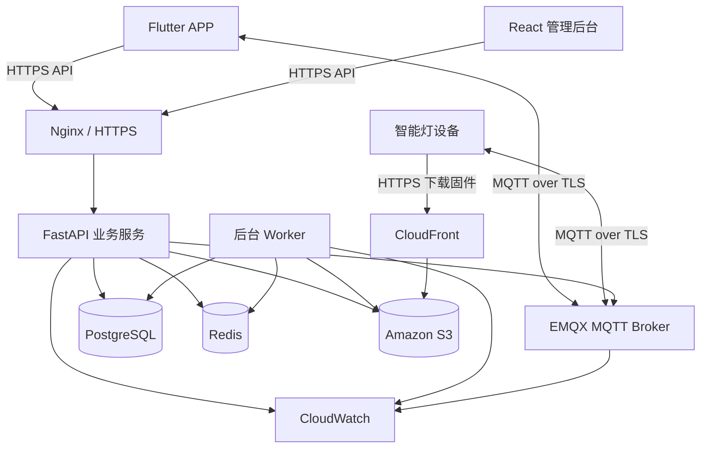

# 智能灯 APP 与云平台技术架构方案

> **版本**：1.0  
> **状态**：技术方案基线  
> **适用范围**：智能灯 APP、设备端、云端业务服务、运营管理后台  
> **目标用户规模**：初期约 15,000 名注册用户  
> **核心原则**：模块化单体、轻量部署、权限安全、便于扩展、避免过早微服务化

---

## 1. 项目目标与范围

建设一套支持多型号智能灯设备的 APP 与云平台，覆盖用户、设备、家庭、实时控制、固件升级、日志和运营管理等能力。

### 1.1 核心功能

- 用户注册、登录、身份认证与账号管理。
- 设备发现、绑定、解绑、设备信息管理。
- APP 与设备之间的 MQTT 实时通信。
- 灯具开关、亮度、色温、RGB、灯效等属性控制。
- 设备状态上报、在线状态展示与状态同步。
- 家庭管理、成员邀请、设备分享和权限控制。
- 固件版本管理、OTA 升级任务、升级进度与结果管理。
- APP 日志、设备日志、操作日志和用户反馈。
- React Web 管理后台。
- 后续可扩展场景、自动化、定时任务和设备分组。

### 1.2 规模假设

初期预计约 15,000 名注册用户。该数字本身不足以决定服务器规格，实际容量还取决于：

- 同时在线 APP 数量。
- 同时在线设备数量。
- 每台设备的 MQTT 消息频率和消息大小。
- 设备状态上报策略。
- OTA 并发下载量及固件文件大小。
- 日志写入量、保留周期和查询方式。

因此，服务器规格应作为压测起点，而不是仅根据注册用户数确定最终配置。

---

## 2. 技术选型总览

| 层级 | 技术选型 | 主要职责 |
| :--- | :--- | :--- |
| APP | Flutter | iOS / Android 客户端 |
| Web 管理后台 | React + TypeScript + Vite | 运营管理、设备管理 |
| UI 组件 | Ant Design | 管理后台组件 |
| 前端数据请求 | TanStack Query | 服务端数据缓存与请求状态 |
| 前端路由 | React Router | 页面路由 |
| 后端 API | Python FastAPI | 用户、设备、权限、OTA 等业务 API |
| ORM | SQLAlchemy 2.0 | 数据访问层 |
| 数据库迁移 | Alembic | 数据库结构版本管理 |
| 主数据库 | PostgreSQL | 核心关系型业务数据 |
| 缓存 | Redis | 缓存、临时状态、授权缓存、限流 |
| MQTT Broker | EMQX | APP 与设备实时消息转发 |
| 对象存储 | Amazon S3 | 固件、日志、图片等文件 |
| CDN | Amazon CloudFront | 固件和静态文件分发 |
| 云服务器 | AWS EC2 | 初期运行容器化服务 |
| 容器部署 | Docker Compose | 初期服务编排 |
| 反向代理 | Nginx | HTTPS 入口、静态资源和 API 转发 |
| 监控 | Amazon CloudWatch | 云资源、日志和告警 |

### 2.1 数据库最终选择

主数据库采用 **PostgreSQL**，不再同时维护 MySQL 和 PostgreSQL 两套数据库。

选择原因：

1. 用户、设备、家庭、成员、分享、OTA 等数据具有明确的关系型结构。
2. PostgreSQL 具备成熟的事务、外键、唯一约束和复杂查询能力。
3. JSONB 可以保存不同型号设备的可扩展属性和配置。
4. PostGIS、TimescaleDB、pgvector 等生态可为未来扩展提供选择，但初期不必安装或引入。
5. PostgreSQL 与 FastAPI、SQLAlchemy 2.0、Alembic 配合成熟。

建议新项目优先评估 PostgreSQL 18；如果依赖、云服务或运维工具对新主版本的支持尚不完整，则采用 PostgreSQL 17。生产环境使用官方仍在支持周期内的版本，并持续更新小版本安全补丁。

---

## 3. 总体系统架构

系统采用模块化单体后端，APP 和设备直接连接 EMQX，FastAPI 负责业务 API、身份认证、设备权限和 MQTT 授权管理。



### 3.1 通信职责划分

| 通信方式 | 参与方 | 用途 |
| :--- | :--- | :--- |
| HTTPS | APP ↔ FastAPI | 登录、设备管理、家庭管理、OTA 管理等 |
| HTTPS | 管理后台 ↔ FastAPI | 后台业务管理 |
| MQTT over TLS | APP ↔ EMQX | 实时控制、状态订阅 |
| MQTT over TLS | 设备 ↔ EMQX | 接收控制命令、上报状态和事件 |
| HTTPS | 设备 ↔ S3 / CloudFront | 下载 OTA 固件 |
| HTTPS 预签名 URL | APP / 设备 ↔ S3 | 直接上传日志或文件 |

### 3.2 关键原则

- MQTT 负责实时消息，不承担用户、设备、家庭等业务数据的最终存储。
- FastAPI 是业务权限和数据关系的权威来源。
- PostgreSQL 保存核心业务数据。
- Redis 保存可重建的缓存和短期数据，不作为核心业务数据唯一存储。
- S3 保存大文件，不通过 EC2 中转大文件上传和下载。
- OTA 固件不通过 MQTT 传输，只通过 HTTPS 下载。
- 初期采用模块化单体，不拆分微服务。

---

## 4. MQTT 通信设计

### 4.1 连接方式

采用方案 A：

- Flutter APP 直接连接 EMQX。
- 智能灯设备直接连接 EMQX。
- EMQX 负责 APP 与设备之间的消息转发。
- FastAPI 负责登录认证、设备授权、MQTT 凭证签发和权限变更。
- 设备和 APP 不直接连接彼此。

### 4.2 MQTT 认证与授权

**APP 连接流程：**

1. APP 通过 HTTPS 向 FastAPI 登录。
2. FastAPI 验证用户身份。
3. APP 请求短期 MQTT 连接凭证。
4. FastAPI 根据 PostgreSQL 中的设备授权关系生成允许访问的 Topic 范围。
5. APP 使用短期凭证连接 EMQX。
6. EMQX 根据认证和 ACL 规则限制客户端可订阅、发布的 Topic。

**安全要求：**

- 不允许 APP 使用永久凭证。
- 不允许使用 APP 登录密码作为 MQTT 密码。
- 不允许 APP 任意订阅或发布任意 deviceId 对应的 Topic。
- 用户只能访问自己拥有或被分享授权的设备。
- 用户解绑设备或分享权限被撤销时，必须更新授权，并处理已有连接的权限撤销。
- 设备端使用每台设备独立的密钥或证书，禁止所有设备共用同一组账号密码。
- 认证与授权应结合 EMQX 能力、短期凭证和 Redis 缓存设计，避免每条 MQTT 消息都同步请求 FastAPI。

### 4.3 Topic 规划

以下为建议的 Topic 基线，正式实施前应形成统一协议文档。

| Topic | 发布方 | 订阅方 | 说明 |
| :--- | :--- | :--- | :--- |
| `smartlight/device/{deviceId}/property/set` | APP / 可信业务服务 | 设备 | 属性控制命令 |
| `smartlight/device/{deviceId}/property/report` | 设备 | APP / 可信业务服务 | 属性状态上报 |
| `smartlight/device/{deviceId}/property/set_reply` | 设备 | APP | 控制命令响应 |
| `smartlight/device/{deviceId}/status/online` | 设备 / Broker 机制 | APP / 后端 | 上线状态 |
| `smartlight/device/{deviceId}/status/offline` | Broker 机制 / 后端 | APP / 后端 | 离线状态 |
| `smartlight/device/{deviceId}/ota/notify` | 后端 | 设备 | OTA 升级通知 |
| `smartlight/device/{deviceId}/ota/progress` | 设备 | 后端 / APP | OTA 进度 |
| `smartlight/device/{deviceId}/ota/result` | 设备 | 后端 / APP | OTA 结果 |
| `smartlight/device/{deviceId}/event/report` | 设备 | 后端 / APP | 设备事件 |
| `smartlight/user/{userId}/device/{deviceId}/event` | 可信后端服务 | 对应用户 APP | 用户维度事件 |

**权限要求：**

- 设备只能发布其被允许的上报 Topic。
- 设备不能发布 `smartlight/user/...` 用户事件 Topic。
- APP 只能访问后端授权的设备 Topic。
- 后端服务账号应使用独立身份，并限制其发布和订阅范围。

### 4.4 APP 生命周期

iOS 和 Android 可能在后台暂停网络连接或 MQTT 活动。APP 应实现：

- 前台恢复时检查连接状态。
- 断线自动重连，并采用退避策略。
- 重连成功后恢复订阅。
- 对关键状态执行必要的 HTTP 同步，避免只依赖 MQTT 消息。
- 重要的离线通知通过 APNs / FCM 推送，不依赖后台 MQTT 长连接。

---

## 5. PostgreSQL 数据库设计原则

### 5.1 数据分类

建议按以下原则设计数据表：

| 数据类别 | 存储方式 | 示例 |
| :--- | :--- | :--- |
| 核心业务数据 | PostgreSQL 关系型字段 | 用户、设备、家庭、成员 |
| 业务扩展属性 | PostgreSQL JSONB | 不同型号设备能力和扩展配置 |
| 高频临时数据 | Redis | 短期缓存、授权缓存、限流 |
| 大文件 | S3 | 固件、日志文件、反馈图片 |
| MQTT 实时消息 | EMQX 转发 | 控制指令、状态上报 |
| 长期海量遥测 | 后续按需求增加时序存储 | 温度、功耗、传感器采样数据 |

### 5.2 JSONB 使用原则

不同型号的灯具可能支持不同功能，例如：

- 普通灯：开关、亮度、色温。
- RGB 灯：开关、亮度、RGB、色温、模式。
- 户外投光灯：多分区、动态灯效。
- 灯带：分段控制、颜色和动画效果。

可以使用 JSONB 保存型号相关的扩展配置，例如：

```json
{
  "power": true,
  "brightness": 80,
  "color_mode": "rgb",
  "rgb": {
    "red": 255,
    "green": 120,
    "blue": 50
  },
  "effects": {
    "mode": "breathing",
    "speed": 60
  }
}
```

**使用约束：**

- 用户 ID、设备 ID、状态、权限、固件版本、创建时间等核心字段应使用明确的关系型字段。
- JSONB 主要用于型号差异较大、可能变化的扩展属性。
- 经常用于筛选、排序、关联或权限判断的字段，不应只放在 JSONB 中。
- 对经常查询的 JSONB 路径，可在有实际查询需求后建立合适的索引。
- 应对 JSONB 数据定义版本和校验规则，避免不同固件或 APP 随意写入不兼容结构。

### 5.3 核心数据表建议

以下是逻辑数据模型的初步范围，具体字段、索引和约束需在详细数据库设计阶段确定。

| 模块 | 建议数据表 | 说明 |
| :--- | :--- | :--- |
| 用户 | `users` | 用户账号、状态、注册信息 |
| 认证 | `user_credentials` / `refresh_tokens` | 凭证与会话管理，按认证方案确定 |
| 设备 | `devices` | 设备唯一标识、型号、固件版本、状态 |
| 产品 | `products` | 产品型号、产品能力定义 |
| 用户设备关系 | `user_devices` | 用户与设备关系及角色 |
| 家庭 | `families` | 家庭信息 |
| 家庭成员 | `family_members` | 家庭与用户关系 |
| 设备分享 | `device_shares` | 分享关系、权限和有效期 |
| 固件 | `firmware` | 固件版本、文件地址、校验值 |
| OTA 任务 | `ota_tasks` | OTA 批次、目标版本、任务状态 |
| OTA 设备执行 | `ota_task_devices` | 每台设备的升级进度和结果 |
| 场景 | `scenes` | 用户场景配置 |
| 自动化 | `automations` | 自动化规则 |
| 反馈 | `feedback` | 用户反馈及附件引用 |
| 操作日志 | `operation_logs` | 重要业务操作审计 |
| 管理员 | `admins` | 后台管理员 |
| 角色权限 | `roles` / `permissions` / `admin_role_bindings` | 后台 RBAC |

### 5.4 数据库设计要求

- 主键建议使用 UUID，或统一的分布式 ID 方案；项目内必须保持一致。
- 时间字段统一存储 UTC，API 层按用户或设备时区展示。
- 为高频查询字段建立索引，例如用户 ID、设备 ID、状态、创建时间。
- 对设备唯一标识建立唯一约束。
- 对用户和设备授权关系建立唯一约束，避免重复授权。
- 外键、唯一约束和事务应承担数据完整性职责，不能只依赖业务代码。
- 重要业务操作记录审计日志。
- 数据库结构变更统一通过 Alembic Migration 管理。
- 禁止在生产环境手动修改表结构而不记录迁移脚本。

---

## 6. FastAPI 后端设计

### 6.1 架构原则

采用模块化单体（Modular Monolith）：

- 一个后端代码库。
- 一个主要 API 服务。
- 按业务领域拆分模块。
- 通过模块边界控制依赖。
- 耗时任务交由 Worker。
- 未来有明确扩展需求时再拆分独立服务。

### 6.2 推荐目录

```text
backend/
├── app/
│   ├── main.py
│   ├── core/
│   │   ├── config.py
│   │   ├── security.py
│   │   ├── database.py
│   │   ├── redis.py
│   │   └── exceptions.py
│   ├── modules/
│   │   ├── auth/
│   │   ├── users/
│   │   ├── devices/
│   │   ├── families/
│   │   ├── scenes/
│   │   ├── automations/
│   │   ├── mqtt/
│   │   ├── firmware/
│   │   ├── ota/
│   │   ├── logs/
│   │   ├── feedback/
│   │   └── admin/
│   ├── integrations/
│   │   ├── emqx/
│   │   ├── s3/
│   │   └── notifications/
│   └── workers/
│       ├── ota_worker.py
│       └── log_worker.py
├── migrations/
├── tests/
├── Dockerfile
├── pyproject.toml
└── alembic.ini
```

### 6.3 推荐依赖

- FastAPI
- SQLAlchemy 2.0
- Pydantic 2
- psycopg 3
- Alembic
- redis-py
- PyJWT 或经评估的 OAuth2/OIDC 组件
- Argon2id 密码哈希实现
- boto3（AWS S3）
- pytest

依赖安装示例：

```bash
pip install \
  fastapi \
  sqlalchemy \
  "psycopg[binary]" \
  alembic \
  redis \
  pydantic \
  boto3
```

### 6.4 业务模块职责

| 模块 | 职责 |
| :--- | :--- |
| auth | 注册、登录、Token、密码管理 |
| users | 用户资料、账号状态 |
| devices | 设备绑定、解绑、信息和状态 |
| families | 家庭、成员和邀请 |
| mqtt | MQTT 凭证、授权、Topic ACL |
| firmware | 固件文件和版本管理 |
| ota | OTA 任务创建、执行、结果 |
| scenes | 场景管理 |
| automations | 自动化规则 |
| logs | 日志接收、查询和归档 |
| feedback | 用户反馈 |
| admin | 管理员、角色、权限和运营接口 |

### 6.5 后台任务

初期可以采用独立 Worker + Redis 队列或轻量任务机制。任务规模和可靠性要求提升后，再评估 Celery 等方案。

**不应在普通 HTTP 请求中直接执行：**

- 大批量 OTA 任务。
- 大文件处理。
- 日志批量归档。
- 大规模设备通知。
- 耗时统计和报表任务。

---

## 7. Flutter APP 设计

### 7.1 模块建议

```text
lib/
├── core/
│   ├── network/
│   ├── storage/
│   ├── router/
│   ├── theme/
│   └── utils/
├── features/
│   ├── auth/
│   ├── home/
│   ├── devices/
│   ├── families/
│   ├── scenes/
│   ├── automation/
│   ├── ota/
│   └── profile/
└── services/
    ├── api_service.dart
    ├── mqtt_service.dart
    ├── auth_service.dart
    ├── device_service.dart
    └── notification_service.dart
```

### 7.2 MQTT 客户端要求

- MQTT 连接管理单例化。
- 自动重连和退避。
- 重连后恢复订阅。
- 统一消息解析和错误处理。
- 设备状态集中管理。
- 支持多个设备同时收发消息。
- 正确处理 APP 前后台生命周期。
- Token 过期时重新申请 MQTT 凭证。
- 对关键状态支持 HTTP 补偿同步。

---

## 8. React 管理后台设计

### 8.1 技术栈

- React
- TypeScript
- Vite
- Ant Design
- TanStack Query
- React Router

### 8.2 功能模块

| 模块 | 功能 |
| :--- | :--- |
| 仪表盘 | 用户数、设备数、在线率、OTA 成功率 |
| 用户管理 | 用户列表、详情、状态管理 |
| 设备管理 | 设备列表、详情、绑定关系、在线状态 |
| 产品管理 | 产品型号、硬件版本、设备能力 |
| 固件管理 | 固件上传、版本、校验信息 |
| OTA 管理 | 升级任务、灰度发布、执行结果 |
| 家庭管理 | 家庭、成员和分享关系 |
| 场景管理 | 场景查询和管理 |
| 日志管理 | APP 日志、设备日志、操作日志 |
| 系统管理 | 管理员、角色、权限、系统配置 |

后台管理员认证必须与普通 APP 用户认证隔离。后台接口应实施 RBAC 和操作审计。

---

## 9. OTA 升级设计

### 9.1 OTA 流程

1. 管理员上传固件到 S3。
2. 后端记录固件版本、适用型号、硬件版本、文件大小、SHA-256 和签名信息。
3. 管理员创建 OTA 任务，选择目标设备或设备分组。
4. 后端校验设备型号、当前版本和升级条件。
5. 后端通过 MQTT 向设备发送 OTA 通知。
6. 设备通过 HTTPS 从 S3 / CloudFront 下载固件。
7. 设备验证文件 SHA-256 和数字签名。
8. 设备执行升级并上报进度。
9. 设备上报升级结果。
10. 后端更新 OTA 执行记录，APP 和管理后台展示结果。

### 9.2 安全要求

- 固件 Bucket 默认私有。
- 使用短期预签名 URL 或 CloudFront Signed URL。
- 固件必须进行完整性校验。
- 建议对固件进行数字签名，设备端验证签名后再安装。
- 设备应检查型号、硬件版本和版本兼容性。
- 设计失败回滚或安全恢复机制。
- OTA 任务应支持灰度发布、暂停和失败统计。
- 大规模升级应控制并发和下载速率，避免瞬间带宽成本过高。

---

## 10. 文件与日志存储

### 10.1 S3 存储范围

- OTA 固件。
- APP 日志文件。
- 设备日志文件。
- 用户反馈图片和附件。
- 其他需要长期保存的文件。

### 10.2 上传方式

APP 或设备先向 FastAPI 申请预签名 URL，再直接上传 S3。大文件不经过 EC2，以降低服务器带宽、内存和 CPU 压力。

### 10.3 日志策略

- 结构化日志优先。
- 日志记录用户、设备、时间、事件类型和关联 ID。
- 避免记录密码、Token、密钥等敏感信息。
- 高频日志采用批量上传和异步处理。
- 根据日志类型设置保留周期和生命周期策略。
- 需要全文检索或复杂分析时，再评估 OpenSearch 等系统。

---

## 11. AWS 初期部署方案

### 11.1 初期部署

初期可以使用一台 EC2 运行 Docker Compose：

```text
EC2
├── Nginx
├── FastAPI
├── Worker（可选）
├── PostgreSQL
├── Redis
├── EMQX
└── React Admin（也可部署到 S3 + CloudFront）

AWS 托管资源
├── S3
├── CloudFront
└── CloudWatch
```

建议容器独立、配置独立、数据卷独立，便于后续拆分迁移。

### 11.2 服务器起步配置

可将以下配置作为初期压测起点：

- 实例：AWS EC2 m7i.xlarge 同等级。
- CPU：4 vCPU。
- 内存：16 GB。
- 操作系统：Ubuntu 24.04 LTS。
- 磁盘：约 100 GB gp3 EBS，容量和 IOPS 按实际数据增长调整。
- 部署：Docker Compose。

这并不是最终容量承诺。上线前应针对 MQTT 并发连接、消息吞吐、数据库读写、OTA 下载和日志上传进行压测。

### 11.3 网络与端口

| 端口 | 用途 | 公网策略 |
| :--- | :--- | :--- |
| 443 | HTTPS API / Web | 对公网开放 |
| 8883 | MQTT over TLS | 按设备和 APP 接入需求开放 |
| 443 / WebSocket | MQTT over WebSocket TLS | 如使用则开放对应入口 |
| 22 | SSH | 仅允许管理 IP |
| 5432 | PostgreSQL | 不允许公网访问 |
| 6379 | Redis | 不允许公网访问 |
| 18083 | EMQX Dashboard | 仅内网或指定管理 IP |
| 1883 | 明文 MQTT | 不开放公网 |

注意：MQTT 8883 是 TCP 服务，不能简单地通过普通 HTTP 反向代理转发。需要配置 TCP 代理、独立监听或合适的负载均衡方案。

### 11.4 域名建议

| 域名 | 用途 |
| :--- | :--- |
| `api.example.com` | FastAPI |
| `mqtt.example.com` | MQTT TLS |
| `ws-mqtt.example.com` | MQTT WebSocket TLS（如启用） |
| `cdn.example.com` | CloudFront 文件分发 |
| `admin.example.com` | React 管理后台 |

### 11.5 Docker Compose 服务要求

- PostgreSQL 使用持久化数据卷。
- Redis 根据缓存用途决定是否开启持久化。
- EMQX 配置和必要数据持久化。
- 容器设置健康检查、重启策略和资源限制。
- 密钥和密码通过安全配置注入，不写入代码仓库。
- 生产环境与开发环境分离。
- 定期备份 PostgreSQL，并验证恢复流程。
- PostgreSQL 应配置合适的连接池，避免应用实例和 Worker 造成连接数失控。

---

## 12. 安全设计

### 12.1 账号与身份

- 密码使用 Argon2id 等安全哈希算法保存。
- Access Token 设置合理有效期。
- Refresh Token 应支持轮换和撤销。
- 管理员账号使用独立认证策略，建议启用 MFA。
- 敏感操作要求重新验证或二次确认。

### 12.2 设备安全

- 每台设备具有独立身份凭证。
- 生产烧录阶段安全写入设备密钥或证书。
- 禁止设备之间共享默认密钥。
- 支持设备凭证轮换、吊销和异常设备隔离。
- 设备绑定流程应防止设备被恶意重复认领。

### 12.3 API 与基础设施

- 全站 HTTPS。
- MQTT 使用 TLS。
- 数据库和 Redis 不暴露公网。
- 管理后台实施 RBAC。
- 关键操作记录审计日志。
- 对登录、验证码、设备绑定和高风险 API 实施限流。
- 定期更新容器镜像和依赖。
- 生产密钥不提交到 Git。

---

## 13. 监控、备份与恢复

### 13.1 监控指标

- EC2 CPU、内存、磁盘和网络。
- PostgreSQL 连接数、慢查询、事务、磁盘增长和备份状态。
- Redis 内存、命中率和连接数。
- EMQX 连接数、消息吞吐、消息积压和断连情况。
- FastAPI 请求量、错误率、响应时间。
- OTA 成功率、失败率和下载耗时。
- S3 存储量、请求量和 CloudFront 流量。

### 13.2 备份要求

- PostgreSQL 定期自动备份。
- 根据恢复目标配置 WAL 归档和时间点恢复能力。
- 备份文件与生产实例故障域隔离。
- 定期执行恢复演练。
- 明确 RPO（可接受数据丢失时间）和 RTO（可接受恢复时间）。
- 对 S3 重要文件启用版本控制或其他适当保护措施。

单机部署意味着 EC2 故障可能导致服务整体不可用。必须明确这一风险，并制定恢复流程。

---

## 14. 成本与扩容策略

### 14.1 初期成本原则

初期优先控制服务数量，避免同时引入 RDS、多个缓存集群、时序数据库、搜索集群和微服务平台。

成本主要由以下因素决定：

- EC2 实例和 EBS。
- S3 存储容量和请求量。
- CloudFront 出网流量。
- CloudWatch 日志和指标。
- MQTT 连接规模及消息吞吐。
- 备份存储和数据传输。

具体费用应根据 AWS 部署区域、流量、实例购买方式和数据保留策略，通过 AWS Pricing Calculator 重新核算，不应将早期估算视为固定报价。

### 14.2 扩容阶段

#### 14.2.1 阶段一：初期

- 一台 EC2 + Docker Compose。
- PostgreSQL、Redis、EMQX、FastAPI 同机部署。
- S3 + CloudFront 负责文件存储和分发。

#### 14.2.2 阶段二：业务增长

- PostgreSQL 迁移到 Amazon RDS for PostgreSQL。
- EMQX 独立部署。
- FastAPI 和 Worker 分离。
- 根据负载增加 API 实例。
- Redis 视缓存和高可用需求独立部署。

#### 14.2.3 阶段三：规模化

- PostgreSQL 高可用和读写扩展。
- EMQX 集群。
- API 多实例和负载均衡。
- Worker 横向扩展。
- 根据数据分析需求引入时序数据库或日志检索系统。

扩容应由实际指标触发，而不是提前引入所有云服务。

---

## 15. 开发实施顺序

建议按以下阶段推进：

### 15.1 阶段一：基础设施与工程规范

- 建立 Git 仓库和分支规范。
- 建立 Flutter、React、FastAPI 项目骨架。
- 配置 Docker Compose。
- 建立 PostgreSQL、Redis、EMQX 本地开发环境。
- 配置 Alembic 数据库迁移。
- 建立环境变量和密钥管理规范。
- 建立日志、异常处理和测试规范。

### 15.2 阶段二：用户与设备基础能力

- 注册、登录、Token 刷新。
- 设备身份认证。
- 设备绑定、解绑。
- 设备列表和详情。
- MQTT 凭证签发和 ACL。
- 设备在线状态与基础属性控制。

### 15.3 阶段三：家庭与权限

- 家庭创建和管理。
- 家庭成员邀请。
- 设备分享。
- 角色和权限控制。
- 权限撤销和 MQTT 已连接会话处理。

### 15.4 阶段四：OTA 与日志

- 固件上传和版本管理。
- OTA 任务和灰度升级。
- 设备下载、校验、升级和结果上报。
- APP / 设备日志上传和查询。
- 操作审计。

### 15.5 阶段五：运营后台与增强功能

- React 管理后台。
- 用户、设备、产品、固件和 OTA 管理。
- 监控告警。
- 场景、自动化和其他增值功能。

---

## 16. 关键技术决策汇总

| 决策项 | 最终建议 |
| :--- | :--- |
| 后端 | Python FastAPI |
| APP | Flutter |
| 管理后台 | React + TypeScript |
| 主数据库 | PostgreSQL |
| JSON 扩展 | PostgreSQL JSONB，按需使用 |
| 缓存 | Redis |
| MQTT Broker | EMQX |
| APP 与设备通信 | APP、设备分别直连 EMQX |
| 业务 API | HTTPS + FastAPI |
| OTA 固件传输 | HTTPS + S3 / CloudFront |
| 文件存储 | Amazon S3 |
| CDN | CloudFront |
| 初期云服务器 | AWS EC2 |
| 初期部署 | Docker Compose |
| 后台任务 | 独立 Worker |
| 架构形态 | 模块化单体，暂不微服务化 |
| 初期注册用户目标 | 约 15,000，容量需压测验证 |

---

## 17. 尚需确认的事项

以下事项不影响当前总体架构，但进入详细设计前需要确认：

1. 智能灯设备使用的 MCU / Wi-Fi 芯片型号，例如 ESP32、BK7231 或其他方案。
2. 预计同时在线设备数量，而不只是注册用户数量。
3. 单台设备的典型 MQTT 上报频率和消息大小。
4. 是否需要设备离线期间的指令缓存，以及指令过期策略。
5. 设备绑定采用二维码、蓝牙辅助、SoftAP 还是其他方式。
6. 是否需要多区域部署，以及主要用户所在地区。
7. 日志和设备历史数据的保留周期。
8. OTA 是否需要分批灰度、定时升级和失败自动回滚。

---

## 18. 结论

本项目建议采用：

**Flutter + React + FastAPI + PostgreSQL + Redis + EMQX + S3 + CloudFront + AWS EC2 + Docker Compose。**

其中：

- PostgreSQL 是核心业务数据库。
- Redis 负责缓存和短期数据。
- EMQX 负责设备与 APP 的实时消息通信。
- FastAPI 负责业务逻辑、身份认证和权限管理。
- S3 / CloudFront 负责文件存储与固件分发。
- 初期使用模块化单体和单机 Docker Compose 控制成本。
- 通过独立容器、标准数据库迁移、对象存储和清晰模块边界，为未来拆分和扩容做好准备。

**最终原则：先把业务模型、设备身份、MQTT ACL、数据一致性和 OTA 安全设计正确，再根据真实并发和流量扩容。**
