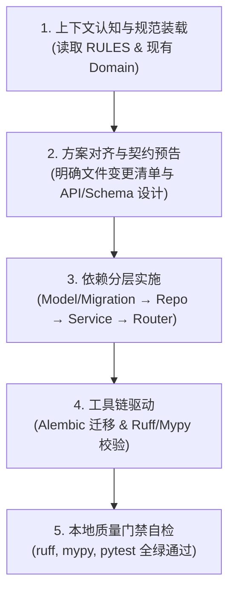

# 标准作业流程规范 (WORKFLOW)

规范编号：CORE-002  
版本：1.0.0  
适用范围：强制执行  

---

## 1. 流程全景图

所有 AI 在执行 FastAPI 项目的需求开发、缺陷修复或架构重构时，必须严格遵循以下标准五步法作业流程 (SOP)：



---

## 2. 标准五阶段执行规范

### 阶段 1：上下文认知与规范装载 (Context Discovery)

在触碰任何代码前：
1. 阅读 `AI_RULES/RULES.md`，明确当前任务关联的具体开发规范。
2. 检索对应业务领域目录 `app/domains/<domain>/` 下的既有资产：
   - `models.py`：查看已有 ORM 表结构、字段约束与关联关系。
   - `schemas.py`：查看已有 Pydantic 请求/响应模型。
   - `repository.py`：查看已有数据持久化方法与 SQL 逻辑。
   - `service.py`：查看核心业务规则与事务控制。
   - `router.py`：查看端点路径、HTTP 方法与依赖注入项。
3. 检索 `alembic/versions/` 了解最新数据库迁移版本。

### 阶段 2：方案对齐与契约预告 (Contract Alignment)

1. 向开发者清晰呈现技术方案概要：
   - 计划创建或修改的文件完整相对路径。
   - 接口契约变更：HTTP 路径、Method、请求体 Schema、响应体 Schema 及状态码设计。
   - 数据库表结构变更：新增表、字段、索引以及可逆迁移设计。
   - 核心事务与锁策略：说明是否涉及多表事务或并发行锁保护。
2. 若涉及重大架构调整或可能引起接口不兼容的改动，主动向开发者说明并征求意见。

### 阶段 3：依赖分层实施 (Layered Implementation)

严格按照自底向上的依赖顺序编写代码，严禁颠倒：

```
[第 1 层：数据模型与数据库迁移 (Model & Migration)]
  ├── ORM 模型：app/domains/<domain>/models.py (继承 Base & AuditMixin)
  └── 数据库迁移：alembic/versions/xxxx_add_feature.py (Alembic 脚本)
        ▼
[第 2 层：数据仓储层 (Repository Layer)]
  └── 仓储实现：app/domains/<domain>/repository.py (继承 BaseRepository[Model])
        ▼
[第 3 层：业务服务层 (Service Layer)]
  ├── 领域异常：app/domains/<domain>/exceptions.py (继承 AppException)
  └── 业务服务：app/domains/<domain>/service.py (用例编排、事务与业务规则)
        ▼
[第 4 层：表现与接入层 (Router & Schema Layer)]
  ├── 数据契约：app/domains/<domain>/schemas.py (Pydantic V2 Request/Response)
  ├── 专属依赖：app/domains/<domain>/deps.py (校验依赖，如 valid_entity_id)
  └── API 路由：app/domains/<domain>/router.py (APIRouter 端点挂载)
```

### 阶段 4：自动化工具链驱动 (Toolchain Execution)

1. **生成并检查数据库迁移**：
   - 若修改了 `models.py`，必须生成并核对 Alembic 迁移脚本：
     ```bash
     alembic revision --autogenerate -m "add feature table"
     ```
   - 检查生成的迁移文件，确认没有误判的外键或索引删除，并确认 `downgrade()` 逻辑完整可逆。
2. **代码风格与静态类型检查**：
   ```bash
   ruff check .
   ruff format .
   mypy .
   ```

### 阶段 5：本地质量门禁自检 (Quality Gate)

在向开发者汇报任务完成前，必须在本地依次执行并全部通过以下三大门禁：

```bash
# 1. 自动格式化与代码质量校验
ruff check --fix . && ruff format --check .

# 2. 严格静态类型检查
mypy .

# 3. 运行全量异步测试用例
pytest -v
```

若出现任何警告或错误，立即修复并重新执行，直到所有检查全绿通过。

---

## 3. 典型任务操作指南

### 任务 A：新增业务 Domain 领域模块
1. 建立目录：`app/domains/<name>/`，创建 `__init__.py`。
2. 在 `models.py` 中定义 ORM 模型类，继承 `Base` 与 `AuditMixin`。
3. 在 `alembic/env.py` 中确保该 Model 元数据已被导入注册，生成并校验迁移脚本。
4. 在 `repository.py` 中编写 `XxxRepository`，实现领域专属查询（如带 `selectinload` 的详情查询）。
5. 在 `service.py` 中编写业务编排逻辑，处理事务提交与业务异常抛出。
6. 在 `schemas.py` 中定义 `XxxCreate`、`XxxUpdate` 与 `XxxResponse`，配置 `from_attributes = True`。
7. 在 `router.py` 中挂载端点，并在 `app/main.py` 的全局路由器中包含该子路由。
8. 在 `tests/domains/<name>/` 中编写对应的 Repository 与 API 自动化测试用例。

### 任务 B：并发热点业务防御（如库存扣减/状态抢占）
1. 定位需要加锁的持久化操作。
2. 在 Repository 中实现基于行锁的查询：`select(Model).where(...).with_for_update()`。
3. 在 Service 中使用异步事务上下文：`async with session.begin():`。
4. 在扣减前做严格防御检查（如 `item.stock < quantity` 时抛出 `OutOfStockException`）。
5. 编写并发测试用例（使用 `asyncio.gather` 并发触发多个请求），验证无超卖且并发事务被正确排队处理。
