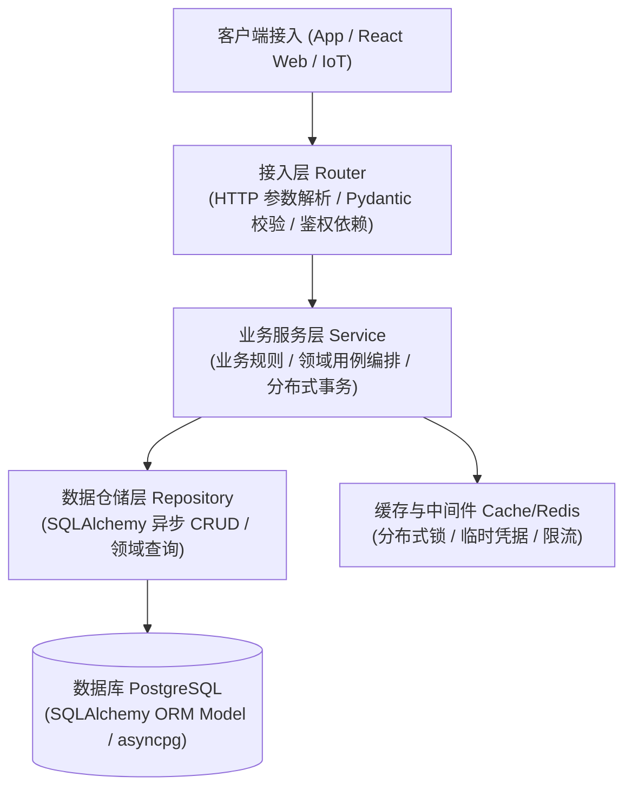

# 架构分层与工程设计规范 (ARCHITECTURE)

规范编号：DEV-002  
版本：1.0.0  
适用范围：强制执行  

---

## 1. 架构总蓝图：领域模块化单体 (Modular Monolith)

本项目采用**领域模块化单体（Domain-Driven Modular Monolith）**架构体系，在保障单体部署轻量与运维简便的同时，通过严格的领域边界实现高内聚、低耦合。



### 1.1 核心分层职责矩阵

| 分层 | 典型文件 | 核心职责 | 绝对严禁的行为 (Anti-Patterns) |
|---|---|---|---|
| **接入层 (Router)** | `domains/<domain>/router.py` | 声明 HTTP 路径与 Method；校验入参 Pydantic 模型；通过 `Depends` 注入依赖；返回标准统一响应体。 | 严禁编写任何业务逻辑；严禁直接调用 `session.execute()` 或编写 SQL；严禁直接捕获底层数据库异常。 |
| **业务层 (Service)** | `domains/<domain>/service.py` | 纯业务用例实现；跨仓储业务编排；声明并管理事务边界；抛出明确的领域业务异常 (`AppException`)。 | 严禁引入 HTTP Request/Response 或 FastAPI 相关对象；严禁直接拼接裸 SQL。 |
| **仓储层 (Repository)** | `domains/<domain>/repository.py` | 封装针对特定 ORM Model 的查询与持久化；处理复杂查询、分页及预加载 (`selectinload`)。 | 严禁承载核心业务规则判断；严禁直接向上层抛出未包装的底层 DB 驱动异常。 |
| **模型层 (Model)** | `domains/<domain>/models.py` | 纯 SQLAlchemy Declarative ORM 实体；定义字段类型、索引、外键与关系映射；继承 `Base` 与 `AuditMixin`。 | 严禁在 Model 中侵入 HTTP、业务或网络 I/O 逻辑。 |

---

## 2. 单向依赖流动铁律

```
Router → Service → Repository → Model / Database
```

1. **依赖单向不可逆**：上层可以依赖下层，下层绝对禁止反向 import 上层。
2. **领域边界隔离**：
   - 领域内部的私有实现（如 `models.py`、内部 `repository.py`）仅在当前 Domain 内可见。
   - 跨领域业务协同必须通过目标领域的公开服务接口（Public Service）或通过 `deps.py` 暴露的通用依赖进行装配（例如 `auth` 领域对外暴露 `get_current_user`）。
   - 严禁 Domain A 直接 import Domain B 的私有仓储并修改底层表状态。

---

## 3. 全局生命周期与异步基础设施 (Lifespan)

应用统一采用 FastAPI 官方推荐的 `lifespan` 异步上下文管理器管理资源生命周期：

```python
# app/main.py
from contextlib import asynccontextmanager
from fastapi import FastAPI
from app.core.logging import setup_logging
from app.shared.db.session import engine
from app.shared.cache import redis_client

@asynccontextmanager
async def lifespan(app: FastAPI):
    # 启动时执行：初始化日志、验证数据库连通性、连接 Redis/MQTT
    setup_logging()
    async with engine.begin() as conn:
        pass  # 探活连接池
    yield
    # 关闭时平滑释放：断开连接池、清理后台任务
    await engine.dispose()
    await redis_client.aclose()

app = FastAPI(lifespan=lifespan)
```

---

## 4. 依赖注入体系 (`fastapi.Depends`)

整个系统遵循显式依赖注入原则，统一在 `app/shared/deps.py` 与各领域 `deps.py` 中声明：

1. **数据库会话注入 (`get_db`)**：
   ```python
   async def get_db() -> AsyncGenerator[AsyncSession, None]:
       async with async_session_factory() as session:
           try:
               yield session
               await session.commit()
           except Exception:
               await session.rollback()
               raise
   ```
2. **用户鉴权注入 (`get_current_user`, `require_roles`)**：
   - 解析 Authorization 头，校验 JWT 签名与过期时间。
   - 从 Redis 验证 Token 黑名单。
   - 返回当前经过校验的不可变用户上下文对象。
3. **服务层依赖装配**：
   - Router 中的端点统一通过 `Depends(get_order_service)` 注入 Service 实例，保持测试时的高可 Mock 性。

---

## 5. SQLAlchemy 2.0 异步 ORM 规范

1. **统一异步会话**：
   - 引擎使用 `create_async_engine("postgresql+asyncpg://...", echo=False, pool_size=20, max_overflow=10)`。
   - 会话工厂统一配置 `async_sessionmaker(engine, expire_on_commit=False, class_=AsyncSession)`。
2. **关系预加载规约**：
   - 一对多、多对多关联必须显式使用 `selectinload(Model.relation)` 预加载。
   - 一对一、多对一关联根据需要使用 `joinedload(Model.relation)`。
   - **绝对禁止在循环或没有预加载的情况下访问 ORM 延迟关联属性**（在异步模式下会导致 `MissingGreenlet` 报错或隐式 N+1 性能崩溃）。
