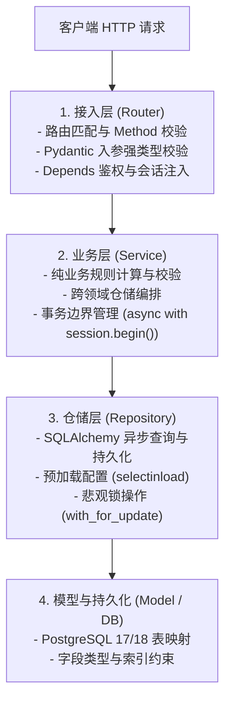
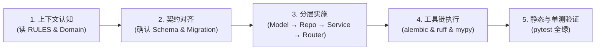

## 一、技术选型

| 类别 | 选择 | 说明 |
| --- | --- | --- |
| 编程语言 / 运行时 | **Python 3.12+** | 强类型注解、PEP 695 泛型语法、原生 `A \| B` 联合类型 |
| Web 框架 | **FastAPI** | 见第三节，基于 Starlette 与 ASGI，高性能完全异步 Web 框架 |
| 架构模式 | **领域模块化单体 (Modular Monolith)** | 见第三节，Domain 垂直切分：Router / Service / Repository / Model |
| 数据校验与序列化 | **Pydantic V2** | 见第四节，`BaseSchema`、`ConfigDict`、请求验证与 camelCase 自动转换 |
| ORM 与持久化 | **SQLAlchemy 2.0 (完全异步体系)** | 见第五节，`AsyncSession`、强类型 `select()`，显式加载杜绝 N+1 |
| 数据库驱动 | **asyncpg** | PostgreSQL 17/18 官方高性能异步驱动 |
| 数据库迁移 | **Alembic** | 见第五节，版本化双向可逆迁移，禁止生产手工 DDL |
| 缓存与会话存储 | **Redis** (`redis.asyncio`) | 鉴权缓存、Token 黑名单、分布式锁、限流 |
| 依赖注入 | **FastAPI Depends** | 见第六节，会话注入 `get_db`、鉴权注入 `get_current_user` |
| 配置管理 | **pydantic-settings** | 见第八节，`BaseSettings` 集中配置，默认 `prod` 兜底防泄露 |
| 统一错误处理 | **自定义 `AppException` + 统一错误信封** | 见第七节，全局异常处理器，全链路携带 `traceId` |
| 日志与链路追踪 | **structlog** | 见第九节，JSON 格式输出，禁止裸用 `print`，透传 `traceId` |
| 测试框架 | **pytest** + **pytest-asyncio** + **httpx** | 见第十节，覆盖 Repository、Service 与 API 集成测试 |
| 包管理与代码规范 | **uv** + **Ruff** + **Mypy** | 见第十节，极速依赖锁定 (`uv.lock`)、代码检查与强静态分析 |

代码格式化与校验命令：

```bash
# 格式化与静态检查
ruff check --fix . && ruff format .
mypy .

# 运行自动化测试
pytest -v
```

---

## 二、目录结构

```
my-fastapi-service/
├── AI_RULES/                     # AI 协作主规范体系（单一真实来源，所有 AI 工具共用）
│   ├── RULES.md                  # 规范总入口 / 规范清单 (Manifest)
│   ├── core/                     # 核心规范：MASTER(行为), WORKFLOW(流程), COMMUNICATION(沟通)
│   ├── development/              # 开发规范：CODING(编码), ARCHITECTURE(架构), TESTING(测试)
│   ├── project/                  # 项目知识：CONTEXT(背景), DECISIONS(技术决策), STATUS(进度)
│   └── CHANGELOG.md              # 规范变更记录
├── AGENTS.md                     # Codex / Copilot / OpenDevin 平台适配入口
├── CLAUDE.md                     # Claude Code 平台适配入口
├── GEMINI.md                     # Gemini CLI / Antigravity 平台适配入口
├── .github/
│   ├── workflows/
│   │   └── ci.yml                # 自动化检查 (Ruff, Mypy, Pytest)
│   └── pull_request_template.md
├── alembic/                      # 数据库版本迁移
│   ├── versions/                 # 具体版本迁移脚本 (xxxx_add_feature.py)
│   ├── env.py                    # 注册各 Domain Model 的 Metadata
│   └── script.py.mako            # 迁移模板
├── app/
│   ├── __init__.py
│   ├── main.py                   # 应用入口：生命周期 (Lifespan)、全局中间件、路由总装
│   ├── core/                     # [无业务属性] 系统底层运行支撑
│   │   ├── __init__.py
│   │   ├── config.py             # pydantic-settings 环境配置（默认 prod）
│   │   ├── security.py           # 密码哈希算法 (Argon2/Bcrypt)、JWT 编解码
│   │   ├── logging.py            # Structlog JSON 结构化日志与 TraceId 配置
│   │   └── exceptions.py         # 核心基类异常 (AppException) 与全局异常拦截器
│   ├── shared/                   # [跨域通用] 框架级公共基类与协议
│   │   ├── __init__.py
│   │   ├── db/
│   │   │   ├── __init__.py
│   │   │   ├── base.py           # DeclarativeBase, 通用 AuditMixin (ID, timestamps, is_deleted)
│   │   │   └── session.py        # AsyncEngine, async_sessionmaker 工厂
│   │   ├── base_repository.py    # 泛型通用 CRUD 仓储基类 (BaseRepository[Model])
│   │   ├── base_schema.py        # 通用分页入参、统一 API 响应包装信封
│   │   └── deps.py               # 纯技术依赖注入 (get_db, get_redis, 分页参数解析)
│   └── domains/                  # 【核心】业务领域边界 (垂直划分，高内聚低耦合)
│       ├── __init__.py
│       ├── auth/                 # 认证与授权领域 (Identity & Access)
│       │   ├── __init__.py
│       │   ├── router.py         # /api/v1/auth/login, /refresh 等端点
│       │   ├── schemas.py        # LoginRequest, TokenResponse 等契约
│       │   ├── service.py        # 密码比对、Token 签发、黑名单校验业务
│       │   └── deps.py           # 跨域公开业务依赖: get_current_user, require_roles
│       ├── users/                # 用户领域 (Profile, Status)
│       │   ├── __init__.py
│       │   ├── models.py         # User ORM 模型
│       │   ├── schemas.py        # UserCreate, UserUpdate, UserResponse
│       │   ├── repository.py     # UserRepository: 用户专属持久化查询
│       │   ├── service.py        # 注册、禁用、资料变更用例
│       │   ├── router.py         # /api/v1/users/* 路由端点
│       │   └── exceptions.py     # UserNotFoundError, UserAlreadyExistsError
│       ├── products/             # 产品与型号领域 (智能灯硬件规格、分类)
│       │   ├── __init__.py
│       │   ├── models.py         # Product, Category ORM 模型
│       │   ├── schemas.py        # ProductCreate, ProductDetailResponse
│       │   ├── repository.py     # ProductRepository
│       │   ├── service.py        # 产品上架、属性定义业务
│       │   ├── router.py         # /api/v1/products/*
│       │   └── exceptions.py     # ProductNotFoundError
│       ├── orders/               # 订单聚合域 (交易流转、跨域协同典型)
│       │   ├── __init__.py
│       │   ├── models.py         # Order, OrderItem ORM 模型
│       │   ├── schemas.py        # OrderCreateRequest, OrderDetailResponse
│       │   ├── repository.py     # OrderRepository (含 with_for_update 行锁)
│       │   ├── service.py        # 核心编排：库存校验 -> 扣减 -> 落单 -> 支付流转
│       │   ├── router.py         # /api/v1/orders/*
│       │   ├── deps.py           # 订单专属依赖 (如 valid_order_id)
│       │   └── exceptions.py     # OrderStatusInvalidError, InsufficientStockError
│       ├── devices/              # 智能灯设备核心域
│       │   ├── __init__.py
│       │   ├── models.py         # Device, DeviceBinding ORM 模型
│       │   ├── schemas.py        # DeviceBindRequest, DeviceStateResponse
│       │   ├── repository.py     # DeviceRepository
│       │   ├── service.py        # 设备激活、配网绑定、状态上报与控制
│       │   ├── router.py         # /api/v1/devices/*
│       │   └── exceptions.py     # DeviceOfflineError, DeviceAlreadyBoundError
│       └── ota/                  # 固件升级与设备管理
│           ├── __init__.py
│           ├── models.py         # Firmware, OtaTask ORM 模型
│           ├── schemas.py        # FirmwareUploadRequest, OtaTaskCreate
│           ├── repository.py     # OtaRepository
│           ├── service.py        # 固件验签、差分包生成、任务批次下发
│           ├── router.py         # /api/v1/ota/*
│           └── exceptions.py     # FirmwareVersionInvalidError
├── tests/                        # 自动化测试目录（镜像 domains 结构）
│   ├── conftest.py               # 全局 test_engine, db_session, client Fixtures
│   ├── shared/                   # 测试公共库与 Mock 工具
│   ├── domains/
│   │   ├── auth/
│   │   ├── users/
│   │   ├── orders/
│   │   └── devices/
│   └── e2e/                      # 真实端到端场景验收测试
├── .editorconfig
├── .env.example                  # 环境变量模板
├── .gitignore
├── .python-version               # Python 运行时声明 (如 3.12)
├── alembic.ini                   # Alembic 入口配置文件
├── docker-compose.yml            # 本地基础设施编排 (Postgres, Redis, EMQX)
├── Dockerfile                    # 多阶段生产容器镜像构建
├── Makefile                      # 统一开发 CLI (make run, make test, make lint)
├── pyproject.toml                # 统一依赖、Ruff、Mypy 与 Pytest 配置
├── uv.lock                       # 确定性依赖锁定文件
└── README.md
```

### 目录组织规则

1. **领域内高内聚**：每个业务 Domain 在 `app/domains/<domain>/` 下形成自闭环，私有逻辑不出域。
2. **分层严格受限**：`Router -> Service -> Repository -> Model` 单向依赖，严禁跨层调用（如 Router 直接执行 SQL）。
3. **跨域协同规范**：跨域通信统一调用目标领域的公开 Service 或使用 `deps.py` 暴露的公开依赖，严禁 Domain A 直接 import Domain B 的私有 Model 或 Repository。
4. **共享代码下沉**：纯技术、无业务属性的基础设施下沉到 `core/` 或 `shared/`。
5. **测试镜像映射**：测试文件严格按源码结构放置在 `tests/domains/<domain>/` 下。
6. **AI 规范单一真理源与平台适配**：工程根目录维护唯一的 `AI_RULES/` 知识库体系，`AGENTS.md`、`CLAUDE.md`、`GEMINI.md` 仅作为各 AI 平台的适配桥梁，统一指向 `AI_RULES/RULES.md`，杜绝多平台指令漂移。

---

## 三、架构设计与领域分层

### 3.1 分层职责与数据流向



### 3.2 依赖流动约束

- **禁止 Router 触碰 Session/SQL**：所有持久化必须由 Repository 承载，Router 只能调用 Service。
- **禁止 Service 依赖 HTTP 对象**：Service 必须是纯 Python 业务逻辑，不得 import `fastapi.Request` 或 `fastapi.Response`。
- **禁止原始异常向外逃逸**：Repository 与 Service 中捕获到的底层故障，必须映射为有明确业务含义的 `AppException`。

---

## 四、Pydantic V2 与请求响应契约

### 4.1 通用基类与 camelCase 自动转换

对外 RESTful API 统一采用 `camelCase` 契约，内部代码使用 `snake_case`：

```python
# app/shared/base_schema.py
from pydantic import BaseModel, ConfigDict
from pydantic.alias_generators import to_camel

class BaseSchema(BaseModel):
    model_config = ConfigDict(
        alias_generator=to_camel,
        populate_by_name=True,
        from_attributes=True,
        arbitrary_types_allowed=True,
    )
```

### 4.2 统一响应体信封 (Response Envelope)

统一响应体必须符合《RESTful API 规范》与《统一错误码与异常处理规范》：

```python
from typing import Generic, TypeVar
from pydantic import Field
from app.shared.base_schema import BaseSchema

T = TypeVar("T")

class ResponseEnvelope(BaseSchema, Generic[T]):
    code: int = Field(default=0, description="业务错误码，0 代表成功")
    message: str = Field(default="success", description="提示信息")
    data: T | None = Field(default=None, description="业务数据载荷")
    trace_id: str = Field(description="分布式链路追踪 ID")
    timestamp: str = Field(description="服务端 UTC 时刻 (RFC 3339)")
```

### 4.3 分页入参防御

```python
class PaginationParams(BaseSchema):
    page: int = Field(default=1, ge=1, description="页码，从 1 开始")
    page_size: int = Field(default=20, ge=1, le=100, description="每页条数，最大 100")
    sort_by: str | None = Field(default="created_at", description="排序字段")
    order: str = Field(default="desc", pattern="^(asc|desc)$", description="排序方向")
```

---

## 五、SQLAlchemy 2.0 异步 ORM 与数据库持久化

### 5.1 DeclarativeBase 与 AuditMixin

```python
# app/shared/db/base.py
import uuid
from datetime import datetime, timezone
from sqlalchemy import String, DateTime, Boolean
from sqlalchemy.orm import DeclarativeBase, Mapped, mapped_column

def utc_now() -> datetime:
    return datetime.now(timezone.utc)

class Base(DeclarativeBase):
    pass

class AuditMixin:
    id: Mapped[str] = mapped_column(String(36), primary_key=True, default=lambda: str(uuid.uuid4()))
    created_at: Mapped[datetime] = mapped_column(DateTime(timezone=True), default=utc_now, nullable=False)
    updated_at: Mapped[datetime] = mapped_column(DateTime(timezone=True), default=utc_now, onupdate=utc_now, nullable=False)
    is_deleted: Mapped[bool] = mapped_column(Boolean, default=False, nullable=False)
```

### 5.2 杜绝 N+1 预加载规约

在异步环境下，访问未预加载的关系字段会导致 `MissingGreenlet` 崩溃：

```python
# 正确：显式声明预加载
async def get_order_with_items(session: AsyncSession, order_id: str) -> Order | None:
    stmt = (
        select(Order)
        .options(selectinload(Order.items))
        .where(Order.id == order_id, Order.is_deleted.is_(False))
    )
    result = await session.execute(stmt)
    return result.scalar_one_or_none()
```

### 5.3 Alembic 迁移铁律

1. 严禁直接手改数据库结构。
2. 每次模型定义调整后，执行 `alembic revision --autogenerate -m "描述"`。
3. 务必人工检查迁移文件，确认包含完整的 `upgrade()` 与可逆的 `downgrade()` 逻辑。

---

## 六、依赖注入与生命周期管理

### 6.1 异步生命周期管理器 (Lifespan)

```python
# app/main.py
from contextlib import asynccontextmanager
from fastapi import FastAPI
from app.shared.db.session import engine
from app.core.logging import setup_logging

@asynccontextmanager
async def lifespan(app: FastAPI):
    setup_logging()
    # 探活数据库与依赖
    async with engine.begin() as conn:
        pass
    yield
    # 释放数据库与缓存连接池
    await engine.dispose()

app = FastAPI(lifespan=lifespan)
```

### 6.2 依赖注入提供器 (`app/shared/deps.py`)

```python
from collections.abc import AsyncGenerator
from sqlalchemy.ext.asyncio import AsyncSession
from app.shared.db.session import async_session_factory

async def get_db() -> AsyncGenerator[AsyncSession, None]:
    async with async_session_factory() as session:
        try:
            yield session
            await session.commit()
        except Exception:
            await session.rollback()
            raise
```

---

## 七、异常处理与统一错误信封契约

### 7.1 AppException 密封基类

```python
# app/core/exceptions.py
from typing import Any

class AppException(Exception):
    def __init__(
        self,
        code: int,
        message: str,
        status_code: int = 400,
        data: Any = None,
        details: list[dict[str, str]] | None = None,
        is_retryable: bool = False
    ):
        self.code = code
        self.message = message
        self.status_code = status_code
        self.data = data
        self.details = details or []
        self.is_retryable = is_retryable
```

### 7.2 全局异常处理器 (Global Exception Handler)

```python
# app/main.py 注册捕获器
from fastapi import Request
from fastapi.responses import JSONResponse
from app.core.exceptions import AppException
from app.core.logging import get_trace_id, utc_now_iso

@app.exception_handler(AppException)
async def app_exception_handler(request: Request, exc: AppException):
    return JSONResponse(
        status_code=exc.status_code,
        content={
            "code": exc.code,
            "message": exc.message,
            "data": exc.data,
            "traceId": get_trace_id(),
            "timestamp": utc_now_iso(),
            "details": exc.details,
            "isRetryable": exc.is_retryable,
        }
    )
```

---

## 八、配置管理与环境隔离

使用 `pydantic-settings` 统一管理环境变量，严禁散落 `os.getenv`：

```python
# app/core/config.py
from pydantic_settings import BaseSettings, SettingsConfigDict

class Settings(BaseSettings):
    app_env: str = "prod"  # 默认生产环境
    app_name: str = "SmartLight Cloud API"
    database_url: str
    redis_url: str
    jwt_secret: str
    jwt_expire_seconds: int = 7200

    model_config = SettingsConfigDict(env_file=".env", env_file_encoding="utf-8")

settings = Settings()
```

---

## 九、结构化日志与全链路追踪

1. **统一采用 Structlog** 输出 JSON 格式，方便日志收集与检索。
2. **中间件注入 TraceId**：通过 ASGI 中间件读取 `X-Trace-Id` 或生成全新 UUID4 注入 `contextvars`。
3. **严禁裸写 `print()`**：生产代码禁止使用 `print()`，敏感信息必须自动脱敏。

---

## 十、工程化、工具链与测试

### 10.1 uv 依赖管理

```bash
# 安装依赖
uv sync

# 添加依赖
uv add fastapi
uv add ruff --dev
```

### 10.2 Ruff 与 Mypy 静态检查

```bash
# 代码检查与修复
ruff check --fix .
ruff format .

# 严格类型检查
mypy .
```

### 10.3 自动化测试套件

使用 `pytest-asyncio` + `httpx.AsyncClient` 编写异步集成测试，测试前自动隔离数据库事务。

---

## 十一、代码走查清单 (Checklist)

在代码合并或发布前，开发者与 AI 必须逐项核对：

- [ ]  所有端点与 I/O 均为完全异步 (`async def` / `await`)，无同步阻塞调用
- [ ]  无裸 SQL 字符串拼接，查询均使用 SQLAlchemy 2.0 API
- [ ]  多表关联查询已配置 `selectinload` 或 `joinedload`，无 N+1 隐患
- [ ]  涉及数据库表结构变更，已生成可逆的 Alembic 迁移脚本
- [ ]  对外 API 契约均为 `camelCase`，无未验证的裸字典传参
- [ ]  没有使用 `print`，日志统一走 `structlog` 并携带 `traceId`
- [ ]  没有硬编码密码、密钥与数据库连接串
- [ ]  金额计算未直接使用 `float`，使用最小货币单位整数或 `Decimal`
- [ ]  `ruff check`、`ruff format --check`、`mypy` 与 `pytest` 全部绿灯通过
- [ ]  **AI 协作与架构合规**：AI 生成的代码严格遵循 `AI_RULES/` 架构红线，分层清晰，无未批准的第三方库

---

## 十二、AI 开发协作规范（AI_RULES 体系与落地）

为了保障不同 AI 辅助工具（如 Cursor、Claude Code、GitHub Copilot、Gemini CLI、Antigravity 等）在协助开发 FastAPI 项目时输出高度一致、符合工程架构且零质量妥协的代码，本项目严格遵循 `9. AI/AI 开发协作规范.md` 所定义的三层协作架构体系。

### 12.1 核心架构定位

```
┌──────────────────────────────────────────────────────────┐
│                   平台适配层 (Adapters)                    │
│      AGENTS.md      │      CLAUDE.md      │  GEMINI.md   │
└─────────────────────────────┬────────────────────────────┘
                              │ 统一指向 (@AI_RULES/RULES.md)
                              ▼
┌──────────────────────────────────────────────────────────┐
│                   通用规范层 (AI_RULES)                    │
│  RULES.md (总清单)                                        │
│  ├── core/            # 核心准则 (MASTER, WORKFLOW, COMM) │
│  ├── development/     # 开发规范 (CODING, ARCH, TESTING)  │
│  ├── project/         # 项目资产 (CONTEXT, ADR, STATUS)   │
│  └── CHANGELOG.md     # 变更记录                          │
└──────────────────────────────────────────────────────────┘
```

### 12.2 AI 协作文件职责矩阵

| 文件路径 | 规范标识 | 核心定位与职责 |
| --- | --- | --- |
| `AI_RULES/RULES.md` | **MANIFEST** | **AI 唯一主入口与索引清单**。定义文档权威性、执行优先级与核心技术栈速查。 |
| `AI_RULES/core/MASTER.md` | **CORE-001** | **核心行为规范与红线禁令**。确立 AI 角色定位、安全边界与严禁违反的 10 条铁律。 |
| `AI_RULES/core/WORKFLOW.md` | **CORE-002** | **标准作业流程 (SOP)**。规定 AI 从需求分析、方案确认、分层实施到静态检查的完整执行链路。 |
| `AI_RULES/core/COMMUNICATION.md` | **CORE-003** | **沟通与交付规范**。约束 AI 回复风格、Diff 呈现、代码解释深度与决策对齐机制。 |
| `AI_RULES/development/CODING.md` | **DEV-001** | **FastAPI 编码规范**。Python 3.12+ 强类型、Pydantic V2、并发锁与防御性入参校验。 |
| `AI_RULES/development/ARCHITECTURE.md` | **DEV-002** | **领域模块化单体架构**。Router/Service/Repository/Model 分层职责、异步 Session 与依赖注入。 |
| `AI_RULES/development/TESTING.md` | **DEV-003** | **质量与测试规范**。pytest-asyncio 异步测试、httpx 接口集成测试与 Alembic 迁移检查。 |
| `AI_RULES/project/CONTEXT.md` | **PROJECT-001** | **项目业务背景**。智能灯云平台与后台服务全景、领域边界划分与核心基础设施。 |
| `AI_RULES/project/DECISIONS.md` | **PROJECT-002** | **架构决策记录 (ADR)**。记录为何选用 FastAPI、SQLAlchemy 2.0 异步、Alembic、Pydantic 等。 |
| `AI_RULES/project/STATUS.md` | **PROJECT-003** | **项目当前进展**。已完成模块、正在进行任务、遗留技术债务与后续迭代目标。 |
| `AI_RULES/CHANGELOG.md` | — | **规范演进记录**。记录 AI 规则与架构约定的版本迭代变更。 |
| `AGENTS.md` / `CLAUDE.md` / `GEMINI.md` | — | **轻量平台引导入口**。仅包含引入 `@AI_RULES/RULES.md` 的锚点与基础触发指令。 |

### 12.3 AI 开发 FastAPI 代码的十条绝对红线（Hard Bans）

任何 AI 工具在编写或重构本项目代码时，**绝对禁止**以下行为：

1. **严禁在异步端点中引入同步阻塞操作**：严禁使用 `requests`、`time.sleep`、同步 `psycopg2` 等阻塞主事件循环的库，一律使用 `httpx.AsyncClient`、`asyncio.sleep` 与 `asyncpg`。
2. **严禁在 Router 层直接操作数据库与裸写业务**：Router 必须通过 `Depends` 注入 Service，持久化逻辑必须下沉到 Repository。
3. **严禁拼接裸 SQL 字符串**：所有查询必须采用 SQLAlchemy 2.0 的强类型 `select()`、`insert()`、`update()` API 或受控参数化绑定，杜绝 SQL 注入漏洞。
4. **严禁在 ORM 查询中引发 N+1 问题**：关联实体读取严禁在 `for` 循环中惰性触发查询，必须显式使用 `selectinload` 或 `joinedload` 进行预加载。
5. **严禁绕过 Alembic 直接手动篡改数据库表结构**：所有表结构变更必须生成版本化的 Alembic 迁移脚本，并确保 `upgrade` 与 `downgrade` 双向可逆。
6. **严禁在代码中使用 `print()` 输出日志**：所有日志必须使用 `structlog` 输出规范的 JSON 格式，并携带全链路分布式 `traceId`。
7. **严禁在代码中硬编码任何敏感密钥与连接凭据**：所有配置必须通过 `app/core/config.py` 的 `pydantic-settings` 环境变量安全加载。
8. **严禁裸报 500 异常与数据库内部堆栈给客户端**：业务异常必须继承自 `AppException`；未捕获系统异常必须统一被全局中间件拦截，包装为标准错误信封。
9. **严禁使用浮点数 `float` 计算或存储货币金额**：必须统一使用最小货币单位整数（如“分”，`int`）或标准高精度 `Decimal`。
10. **严禁交付未通过本地质量门禁的代码**：代码编写完毕后，必须运行 `ruff check`、`ruff format --check`、`mypy` 与 `pytest` 全绿通过。

### 12.4 AI 辅助开发标准化作业流程（AI SOP）

当向 AI 下发开发或修改任务时，AI 必须严格执行以下五步法：


