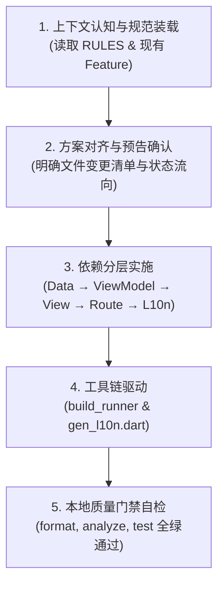

# 标准作业流程规范 (WORKFLOW)

规范编号：CORE-002  
版本：1.0.0  
适用范围：强制执行  

---

## 1. 流程全景图

所有 AI 在执行 Flutter 项目的需求开发、Bug 修复或架构重构时，必须严格遵循以下标准五步法作业流程 (SOP)：



---

## 2. 标准五阶段执行规范

### 阶段 1：上下文认知与规范装载 (Context Discovery)

在触碰任何代码前：
1. 阅读 `AI_RULES/RULES.md`，明确当前任务关联的具体开发规范。
2. 检索对应功能目录 `lib/features/<feature>/` 下的既有资产：
   - `data/requests/`：查看已封装的请求对象与 HTTP 接口。
   - `data/models/`：查看已有数据模型及 Freezed 定义。
   - `data/<feature>_repository.dart`：查看已有仓储方法及 Provider。
   - `l10n/`：查看已有国际化多语言文案与上下文扩展。
   - `<page>/`：查看已有页面组件、控制器及私有组件。
3. 检查 `app/router/app_routes.dart` 明确当前路由层级。

### 阶段 2：方案对齐与预告确认 (Architecture Alignment)

1. 向开发者清晰呈现技术方案概要：
   - 计划创建或修改的文件完整相对路径。
   - 状态设计选择：说明是选用 `AsyncNotifier<void>`（纯操作类提交）还是 `Notifier<T>` / `AsyncNotifier<T>`（带复杂联动数据）。
   - 路由传参方案：明确 Path 参数（唯一业务 ID）、Query 参数（筛选排序）以及 `$extra` 的安全降级策略。
2. 若涉及重大架构调整或可能引起冲突的代码，主动向开发者说明并征求意见。

### 阶段 3：依赖分层实施 (Layered Implementation)

严格按照自底向上的依赖顺序编写代码，严禁颠倒：

```
[第 1 层：数据层 (Data Layer)]
  ├── 请求对象：features/<feature>/data/requests/xxx_request.dart (继承 ApiRequest<T>)
  ├── 数据模型：features/<feature>/data/models/xxx.dart (@freezed + json)
  └── 业务仓储：features/<feature>/data/xxx_repository.dart (@riverpod AuthRepository)
        ▼
[第 2 层：控制器 / ViewModel (Controller Layer)]
  └── 页面状态：features/<feature>/<page>/xxx_controller.dart (@riverpod AsyncNotifier)
        ▼
[第 3 层：表现层 / 视图 (View Layer)]
  ├── 页面组件：features/<feature>/<page>/xxx_page.dart (ConsumerWidget)
  └── 私有组件：features/<feature>/<page>/widgets/xxx_widget.dart
        ▼
[第 4 层：路由配置 (Routing Layer)]
  └── 路由声明：app/router/app_routes.dart (@TypedGoRoute)
        ▼
[第 5 层：国际化多语言 (Localization Layer)]
  ├── 文案定义：features/<feature>/l10n/<feature>_{en,zh}.arb
  ├── 上下文扩展：features/<feature>/l10n/<feature>_l10n.dart
  └── 全局注册：app/l10n/delegates.dart (新增 feature 时配置)
```

### 阶段 4：自动化工具链驱动 (Code Generation)

在修改数据模型（`@freezed`）、控制器（`@riverpod`）、路由（`@TypedGoRoute`）或国际化文件（ARB）后：
1. 执行代码生成命令：
   ```bash
   dart run build_runner build -d
   ```
2. 执行跨平台多语言生成脚本：
   ```bash
   dart run tool/gen_l10n.dart
   ```
3. 验证生成文件（`.g.dart`、`.freezed.dart`、`app_localizations.dart`）无编译报错。

### 阶段 5：本地质量门禁自检 (Quality Gate)

在向开发者汇报任务完成前，必须在本地依次执行并全部通过以下三大门禁：

```bash
# 1. 格式化代码校验
dart format --set-exit-if-changed .

# 2. 静态代码分析
flutter analyze

# 3. 单元与 Widget 测试套件
flutter test
```

若出现任何警告或错误，立即修复并重新执行，直到所有检查全绿通过。

---

## 3. 典型任务操作指南

### 任务 A：新增业务 Feature 模块
1. 建立目录：`lib/features/<name>/{data/requests,data/models,l10n,<page>/widgets}`。
2. 编写 `ApiRequest<T>` 请求类与 `@freezed` 模型类。
3. 编写 Repository 类及其 `@riverpod` provider。
4. 编写页面 Controller（优先继承 `_$XxxController`，使用 `AsyncValue.guard` 封装操作）。
5. 编写 Page 组件（继承 `ConsumerWidget`，应用 `AppSpacing`、`AppRadius`、`Gap` 与边界防御）。
6. 在 `app/router/app_routes.dart` 添加 `@TypedGoRoute` 注解。
7. 在 `<name>_{en,zh}.arb` 中配置文案，编写 `context.<name>L10n` 扩展。
8. 在 `app/l10n/delegates.dart` 注册 feature delegate。
9. 运行 `build_runner`、`gen_l10n.dart`，并通过格式化、静态分析与单元测试。

### 任务 B：UI 缺陷修复与防御加固
1. 定位缺陷页面并分析布局结构。
2. 检查 `Row` / `Flex` 内的长文本是否遗漏 `Expanded` / `Flexible`，单行是否配置 `overflow: TextOverflow.ellipsis`。
3. 检查异步按钮是否在 `state.isLoading` 期间处于禁用态，是否出现加载动画导致的尺寸跳动。
4. 检查输入框是否使用了具备清空功能的 `AppTextField`，页面根部是否配置点击空白收起键盘及滚动避让。
5. 检查下拉刷新 `RefreshIndicator` 的子容器是否配置 `physics: const AlwaysScrollableScrollPhysics()`。
6. 检查滑动删除 `Dismissible` 的 key 是否为业务主键实体 ID（严禁使用 index）。
7. 执行 `flutter test` 验证修复无副作用。
