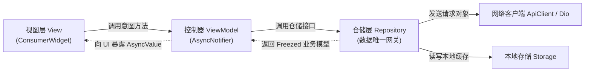

# 架构分层与工程设计规范 (ARCHITECTURE)

规范编号：DEV-002  
版本：1.0.0  
适用范围：强制执行  

---

## 1. 架构总蓝图：Clean MVVM

项目全面落地以 Clean MVVM 为核心的架构体系，确保单向数据流与清晰的职责边界。



### 1.1 核心分层职责矩阵

| 分层 | 典型实现 | 核心职责 | 绝对严禁的行为 (Anti-Patterns) |
|---|---|---|---|
| **View** | `ConsumerWidget` / `ConsumerStatefulWidget` | 依据 State 渲染 UI；通过 `ref.listen` 响应弹窗与路由跳转；转发手势。 | 严禁编写任何业务逻辑；严禁直接调用 Repository 或 ApiClient；严禁私自修改状态。 |
| **ViewModel** | `Notifier` / `AsyncNotifier` (以 `xxx_controller.dart` 实现) | 持有 UI 状态；调用 Repository 获取数据；暴露不可变 State 或 `AsyncValue`。 | 严禁引入 `BuildContext`、`Navigator`、`Widget` 或 `l10n`。 |
| **Repository** | `XxxRepository` + Provider | ViewModel 获取数据的唯一入口；拦截底层 `DioException` 并统一转化为 `AppException`。 | 严禁向上层抛出原始网络异常；严禁将未解析的原始 Map 暴露给 Controller。 |
| **Request Object** | 继承自 `ApiRequest<T>` | 封装具体 API 的 Path、Method、Query、Body、CancelToken 及数据解包方法 `parse`。 | 严禁在业务代码中裸写散落的 Dio 请求。 |

---

## 2. 单向依赖流动铁律

```
View → ViewModel (Controller) → Repository → ApiClient / LocalStorage
```

- **依赖单向不可逆**：上层可以依赖下层，下层绝对禁止引用上层。
- **Feature 互相隔离**：**Feature A 严禁直接 import Feature B 的代码**。
- **跨模块共享机制**：多模块共用的公共逻辑下沉至 `core/` 或 `shared/`；跨模块读取业务数据统一通过公开的 Repository Provider 进行装配。

---

## 3. 状态管理与生命周期 (Riverpod 2.x)

1. **Notifier 即 ViewModel**：
   - 每个页面的业务状态统一封装在继承自 `_$XxxController` 的 Notifier 中。
   - 简单表单与提交操作使用 `AsyncNotifier<void>`；展示型异步数据列表使用 `AsyncNotifier<T>`。
2. **生命周期管控 (autoDispose vs keepAlive)**：
   - 页面级 Controller 默认遵循自动释放策略（`@riverpod`），页面彻底退出后内存即刻回收，杜绝数据滞留与泄漏。
   - 仅限全局基础设施与会话状态显式标记 `@Riverpod(keepAlive: true)`：
     - `apiClientProvider`、`prefsProvider`、`secureStorageProvider`
     - `authControllerProvider`（全局登录态）
     - `localeControllerProvider`、`themeModeControllerProvider`
3. **高频重复进入页面的动态时长缓存 (Cache-for-time)**：
   - 商品详情等高频页面，采用 `ref.keepAlive()` 搭配定时器实现指定时长保活（如 5 分钟），既复用数据又允许超时后系统垃圾回收：
     ```dart
     @riverpod
     Future<ProductDetail> productDetail(Ref ref, {required String id}) async {
       final link = ref.keepAlive();
       final timer = Timer(const Duration(minutes: 5), () => link.close());
       ref.onDispose(() => timer.cancel());
       return ref.watch(productRepositoryProvider).getDetail(id);
     }
     ```

---

## 4. 强类型路由系统 (`go_router`)

1. **强类型路由定义 (`go_router_builder`)**：
   - 所有页面路由统一在 `app/router/app_routes.dart` 通过类注解声明：
     ```dart
     @TypedGoRoute<OrderDetailRoute>(path: '/orders/:orderId')
     class OrderDetailRoute extends GoRouteData {
       const OrderDetailRoute({required this.orderId, this.$extra});
       final String orderId;
       final Map<String, dynamic>? $extra;

       @override
       Widget build(BuildContext context, GoRouterState state) =>
           OrderDetailPage(orderId: orderId, cachedData: $extra);
     }
     ```
2. **DeepLink 唯一标识与 `$extra` 降级原则**：
   - 业务实体的唯一主键（如 `orderId`）**必须声明为 Path 路径参数**（`:orderId`），确保生成的 URL 具备全局唯一可达性。
   - 允许通过 `$extra` 传递轻量复杂对象以优化页面转场骨架屏等待；但接收页**必须做好 `$extra == null` 时的网络拉取降级**，保证外部 DeepLink 唤醒可用。
3. **底部导航栏多栈状态保持**：
   - 底部多 Tab 结构统一使用 `StatefulShellRoute.indexedStack` 实现，各个分支的浏览深度与滚动偏移自动保存在内存中，切回时不重新加载。
4. **鉴权状态重定向与防白屏机制**：
   - **核心禁令**：严禁在 `appRouterProvider` 中直接 `ref.watch(authControllerProvider)`！
   - 正确方案：通过 `RouterRefreshNotifier` 监听登录态变化并挂载到 `refreshListenable` 上，仅触发重定向逻辑检查，不重建整个 Router 实例。
5. **导航跳转 API 与返回拦截**：
   - 平级 Tab 切换使用 `Route.go(context)`。
   - 打开二级子页面使用 `Route.push(context)`。
   - 表单未保存拦截统一使用 Flutter 推荐的 `PopScope` API。

---

## 5. 请求对象模式网络层 (`dio`)

1. **请求基类 (`ApiRequest<T>`)**：
   - 每一个接口封装为一个继承自 `ApiRequest<T>` 的独立对象，包含 `path`、`method`、`query`、`body`、`cancelToken` 以及自定义解析方法 `parse(dynamic data)`。
2. **统一响应体外壳解包 (Envelope Handling)**：
   - 后端通用响应格式统一约定为 `{ "code": 200, "message": "...", "data": ... }`。
   - `ApiClient` 统一校验业务状态码（非 200 抛出 `ServerException(code, message)`）。
   - 校验通过后，**仅将剥离外壳后的 `data` 数据传递给 `req.parse(data)`**，业务 Model 绝不污染外层包装字段。
3. **密封类异常体系 (`AppException`)**：
   - 统一抽象为密封类：`NetworkException`、`TimeoutException`、`UnauthorizedException`、`ServerException`、`ParseException`、`UnknownException`。
   - View 层通过 `error.message(context.l10n)` 统一转化为本地化多语言文案展示。

---

## 6. 按 Feature 隔离的国际化方案

1. **多目录物理隔离**：
   - 全局公共文案放在 `lib/l10n/app_{en,zh}.arb`，生成 `AppLocalizations`。
   - 各 Feature 专用文案放置在 `features/<feature>/l10n/<feature>_{en,zh}.arb`，生成独立的 `XxxLocalizations`。
2. **跨平台 Dart 脚本构建**：
   - 执行 `dart run tool/gen_l10n.dart` 跨平台一键编译全局和所有 Feature 的 ARB 文件到各自的 `generated/` 目录。
3. **上下文扩展访问**：
   - 全局文案通过 `context.l10n.cancel` 访问；Feature 文案通过 `context.authL10n.loginButton` 访问。
   - 各 Feature 的 Localization Delegate 集中在 `app/l10n/delegates.dart` 注册给 `MaterialApp.router`。
