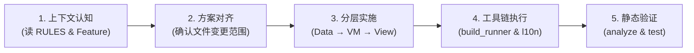

## 一、技术选型

| 类别 | 选择 | 说明 |
| --- | --- | --- |
| 架构模式 | **MVVM** | 见第三节，View / ViewModel(Controller) / Repository / Service(DataSource) |
| 状态管理 | **Riverpod**（`flutter_riverpod` + `riverpod_annotation` + `riverpod_generator`） | 见第四节，全项目唯一方案，Notifier 即 ViewModel/Controller |
| 依赖注入 | **Riverpod 本身** | 不引入 get_it，由 Provider 统一接管依赖组装与生命周期 |
| 路由 | `go_router` + `go_router_builder` | 见第五节，强类型代码生成路由，配合 Riverpod 做登录重定向 |
| 网络 | `dio`，封装为请求对象模式 | 见第六节（支持 CancelToken、FormData 与响应体解包） |
| 数据类 / 序列化 | `freezed` + `json_serializable` | State、Model 全部不可变 |
| 本地存储 | `shared_preferences`（普通配置）+ `flutter_secure_storage`（token） | 需要结构化数据时再加 `drift` |
| 错误处理 | 自定义 `AppException` + `AsyncValue` | 见第六节与第四节，以 `AsyncValue.guard` 为核心，不引入 Result / Either 库 |
| 国际化 | 官方 `flutter_localizations` + `intl` + gen-l10n（ARB），**按 feature 隔离** | 见第七节（跨平台 Dart 脚本生成） |
| UI 规范 / 主题 / 间距 | Material 3 + `app/theme/`（Design Tokens）+ `gap` | 见第八节，统一主题、颜色、字体、步长间距，规范交互与边界条件 |
| 环境配置 | 纯 Dart 集中配置（`core/config/env.dart`） | 见第九节，默认 `prod`，支持 `--dart-define=ENV=dev` 切换 |
| 日志 | `talker`（或 `logger`） | 统一入口，禁止 `print` |
| 测试 | `flutter_test` + `mocktail` | 见第九节，覆盖 Repository、Controller 与 Widget 测试 |
| 代码规范 / Lint | `very_good_analysis` | 见第九节，开发初期即开启最严格规则，CI 强校验 |

版本一律使用当前 stable 最新版。代码生成命令：

```bash
dart run build_runner build -d
```

---

## 二、目录结构

```
my-flutter-app/
├── AI_RULES/                     # AI 协作主规范体系（单一真实来源，所有 AI 工具共用）
│   ├── RULES.md                  # 规范总入口 / 规范清单 (Manifest)
│   ├── core/                     # 核心规范：MASTER(行为), WORKFLOW(流程), COMMUNICATION(沟通)
│   ├── development/              # 开发规范：CODING(编码), ARCHITECTURE(架构), TESTING(测试)
│   ├── project/                  # 项目知识：CONTEXT(背景), DECISIONS(技术决策), STATUS(进度)
│   └── CHANGELOG.md              # 规范变更记录
├── AGENTS.md                     # Codex / Copilot / OpenDevin 平台适配入口
├── CLAUDE.md                     # Claude Code 平台适配入口
├── GEMINI.md                     # Gemini CLI / Antigravity 平台适配入口
├── lib/
│   ├── main.dart                 # 入口：只调用 bootstrap
│   ├── bootstrap.dart            # 初始化(日志、存储、ProviderScope、错误捕获)
│   ├── app/
│   │   ├── app.dart              # MaterialApp.router
│   │   ├── router/
│   │   │   ├── app_router.dart   # go_router 配置(provider + refreshListenable)
│   │   │   ├── app_routes.dart   # 强类型路由定义(@TypedGoRoute)
│   │   │   └── app_routes.g.dart # 生成的路由代码
│   │   ├── l10n/
│   │   │   └── delegates.dart    # 汇总各 feature 的 l10n delegate
│   │   └── theme/                # 主题、颜色、字体、间距规范
│   │       ├── app_theme.dart    # ThemeData (Light/Dark)、ColorScheme
│   │       ├── app_colors.dart   # 语义色扩展 (ThemeExtension)
│   │       ├── app_typography.dart # 统一排版与字体系统 (TextTheme)
│   │       └── app_spacing.dart  # 统一间距 (AppSpacing) 与圆角 (AppRadius)
│   ├── core/                     # 与业务无关的基础设施
│   │   ├── config/env.dart       # 环境配置（默认 prod，支持单参数切换）
│   │   ├── network/
│   │   │   ├── api_client.dart   # dio 封装，唯一发请求的地方
│   │   │   ├── api_request.dart  # 请求基类(含 CancelToken / FormData / parse)
│   │   │   ├── interceptors/     # 公共头、签名、鉴权、日志
│   │   │   └── providers.dart
│   │   ├── storage/              # kv 存储、secure 存储封装
│   │   ├── error/app_exception.dart
│   │   ├── logging/
│   │   └── utils/
│   ├── shared/                   # 跨 feature 复用
│   │   ├── widgets/              # 通用基础组件(无业务：AppButton、AppTextField、EmptyView 等)
│   │   ├── extensions/           # context.l10n 等
│   │   └── providers/            # 全局 provider(locale、themeMode)
│   ├── features/
│   │   └── auth/                 # 每个 feature 自成一体
│   │       ├── data/             # 数据层（整个 feature 共享）
│   │       │   ├── requests/     # LoginRequest 等请求对象
│   │       │   ├── models/       # freezed + json (User, Token 等)
│   │       │   └── auth_repository.dart
│   │       ├── domain/           # 可选，见规则 6
│   │       ├── l10n/             # 该 feature 自己的文案与上下文扩展
│   │       │   ├── auth_en.arb   # 模板语言，生成类 AuthLocalizations
│   │       │   ├── auth_zh.arb
│   │       │   ├── auth_l10n.dart # context.authL10n 扩展（归属于文案层）
│   │       │   └── generated/
│   │       ├── auth_controller.dart # feature 级全局状态（登录态、当前用户、登出等，keepAlive: true）
│   │       ├── login/            # 页面级就近聚合：View 与 Controller 同目录
│   │       │   ├── login_page.dart      # View
│   │       │   ├── login_controller.dart # ViewModel（基于 AsyncNotifier，无需多余 State 类）
│   │       │   └── widgets/             # （可选）仅登录页私有子组件
│   │       ├── register/         # 注册页面
│   │       │   ├── register_page.dart
│   │       │   ├── register_controller.dart
│   │       │   └── widgets/
│   │       └── widgets/          # （可选）仅本 feature 多个页面共用的组件
│   └── l10n/                     # 全局公共文案(确定/取消/通用错误等)
│       ├── app_en.arb            # 模板语言，生成类 AppLocalizations
│       ├── app_zh.arb
│       └── generated/
├── test/                         # 单元与集成测试（镜像对应 lib/）
└── tool/
    └── gen_l10n.dart             # 跨平台 Dart 脚本：一次生成全局 + 所有 feature 的 l10n
```

### 目录组织规则

1. **就近聚合（Colocation），消除冗余层级**：去掉了多余的 `presentation/` 包装层，页面直接在 feature 下按页面名建目录（如 `login/`、`register/`）。一个页面的 View（`xxx_page.dart`）、ViewModel（`xxx_controller.dart`）和私有组件（`widgets/`）聚合在一起，降低目录嵌套深度，修改页面无需在深层目录树中上下跳跃。
2. **异步状态优先采用 `AsyncNotifier`**：绝大多数页面的异步操作与表单提交直接使用 `AsyncNotifier<void>` + `AsyncValue.guard`，无需手动编写包含 `submitting`、`error` 的 State 类和配套的 freezed 代码；只有当页面具有复杂的前端多字段联动时才编写独立的不可变 State 类。
3. **数据层保持在 Feature 级**：`data/`（Repository、Requests、Models）由整个 feature 共享，不按页面下沉。后端接口通常按业务模块聚合，且模型（如 `User`、`AuthToken`）常在多页面间共享，集中在 `data/` 能保证边界清晰并杜绝页面间互相 import。
4. **Feature 级状态管理与生命周期**：
   - 页面级 Controller 默认使用 `@riverpod`（具有 `autoDispose` 特性），页面退出后自动销毁与释放状态；
   - 跨页面常驻的会话级状态（如登录态、当前用户），定义在 feature 根目录（如 `auth_controller.dart`），且必须标记 `@Riverpod(keepAlive: true)`。
5. **组件归宿规则**：
   - 仅单个页面使用的组件放该页面目录下的 `widgets/`；
   - 本 feature 内两个以上页面共用的组件放 `features/<feature>/widgets/`（按需创建，不提前设计）；
   - 跨两个以上 feature 共用的组件才提升到根目录 `shared/widgets/`。
6. **国际化完全自闭环**：feature 专用的 `xxx_l10n.dart`（`BuildContext` 扩展）放在该 feature 的 `l10n/` 目录下，与 ARB 和生成的代码共同构成自闭环的国际化模块。
7. **强类型路由**：路由路径与传参统一在 `app/router/app_routes.dart` 通过 `go_router_builder` 定义，组件内禁止手写字符串路径与无类型安全的 `extra` 转换。
8. **UI 设计系统规范**：组件间距、Padding、Margin 一律使用 `AppSpacing` 常量搭配 `Gap`；字体、颜色与圆角从 `Theme.of(context)` 获取，严禁硬编码魔法数值。组件交互与极端边界防御遵循第八节规范。
9. **测试目录与源码镜像**：如 `test/features/auth/login/login_controller_test.dart`。
10. **AI 规范单一真理源与平台适配**：工程根目录维护唯一的 `AI_RULES/` 知识库体系，`AGENTS.md`、`CLAUDE.md`、`GEMINI.md` 仅作为各 AI 平台的适配桥梁，统一指向 `AI_RULES/RULES.md`，杜绝多平台指令漂移。

---

## 三、MVVM 落地规则

### 3.1 角色对应

| 角色 | 实现 | 职责 |
| --- | --- | --- |
| **View** | `ConsumerWidget` / `ConsumerStatefulWidget` | 渲染、转发用户操作，监听状态弹窗/跳转，不含业务逻辑 |
| **ViewModel** | `Notifier` / `AsyncNotifier`（以 `xxx_controller.dart` 实现） | 持有 UI 状态，调用 Repository，向 View 暴露不可变 State 或 `AsyncValue` |
| **Model** | Repository + 数据模型 | Repository 是 ViewModel/Controller 唯一的数据入口 |

**依赖方向（单向）**：

```
View → ViewModel(Controller) → Repository → ApiClient / Storage
```

禁止反向引用；View 不能直接访问 Repository 或 ApiClient。

### 3.2 示例：登录

#### Controller（基于 `AsyncNotifier`，无需手写繁琐的 State 类）

```dart
// features/auth/login/login_controller.dart
import 'package:riverpod_annotation/riverpod_annotation.dart';
import '../data/auth_repository.dart';

part 'login_controller.g.dart';

@riverpod
class LoginController extends _$LoginController {
  @override
  FutureOr<void> build() {
    // 初始状态默认为 AsyncData(null)，未提交状态
  }

  Future<void> submit(String email, String password) async {
    state = const AsyncLoading();
    // AsyncValue.guard 会自动捕获异常并转为 AsyncError(e, st)
    state = await AsyncValue.guard(
      () => ref.read(authRepositoryProvider).login(email, password),
    );
  }
}
```

> **说明**：简单表单或操作仅有“初始、加载中、出错、成功”几种状态，使用 `AsyncValue<void>` 原生支持 `.isLoading`、`.hasError`、`.error`，**直接省去 `login_state.dart` 和 `freezed` 的生成**。只有当页面有复杂表单输入项联动（如多选筛选器、多步骤表单数据缓存）时，才需定义带字段的 freezed State。

#### Repository

```dart
// features/auth/data/auth_repository.dart
import 'package:dio/dio.dart';
import 'package:riverpod_annotation/riverpod_annotation.dart';
import '../../../core/network/providers.dart';
import 'models/auth_token.dart';
import 'requests/login_request.dart';

part 'auth_repository.g.dart';

@Riverpod(keepAlive: true)
AuthRepository authRepository(Ref ref) =>
    AuthRepository(ref.watch(apiClientProvider));

class AuthRepository {
  AuthRepository(this._client);
  final ApiClient _client;

  Future<AuthToken> login(
    String email,
    String password, {
    CancelToken? cancelToken,
  }) =>
      _client.send(
        LoginRequest(
          email: email,
          password: password,
          cancelToken: cancelToken,
        ),
      );
}
```

#### View

```dart
// features/auth/login/login_page.dart
import 'package:flutter/material.dart';
import 'package:flutter_riverpod/flutter_riverpod.dart';
import 'package:gap/gap.dart';
import '../../../app/theme/app_spacing.dart';
import '../../../core/error/app_exception.dart';
import '../../../shared/extensions/app_exception_x.dart';
import '../../../shared/extensions/context_x.dart';
import '../l10n/auth_l10n.dart';
import 'login_controller.dart';

class LoginPage extends ConsumerWidget {
  const LoginPage({super.key});

  @override
  Widget build(BuildContext context, WidgetRef ref) {
    final state = ref.watch(loginControllerProvider);
    final l10n = context.authL10n;

    // 监听状态变化以展示 Toast/SnackBar 或处理页面响应
    ref.listen<AsyncValue<void>>(loginControllerProvider, (_, next) {
      next.whenOrNull(
        error: (error, _) {
          if (error is AppException) {
            ScaffoldMessenger.of(context).showSnackBar(
              SnackBar(content: Text(error.message(context.l10n))),
            );
          }
        },
      );
    });

    return Scaffold(
      body: SafeArea(
        child: SingleChildScrollView(
          padding: const EdgeInsets.all(AppSpacing.lg),
          keyboardDismissBehavior: ScrollViewKeyboardDismissBehavior.onDrag,
          child: Column(
            mainAxisAlignment: MainAxisAlignment.center,
            children: [
              FilledButton(
                onPressed: state.isLoading
                    ? null
                    : () => ref
                        .read(loginControllerProvider.notifier)
                        .submit('a@b.com', '123456'),
                child: state.isLoading
                    ? const SizedBox.square(
                        dimension: 20,
                        child: CircularProgressIndicator(strokeWidth: 2),
                      )
                    : Text(l10n.loginButton),
              ),
              const Gap(AppSpacing.md),
            ],
          ),
        ),
      ),
    );
  }
}
```

### 3.3 十条硬性规则

1. 页面级数据一律用 `@riverpod` 生成的 provider，不手写 `Provider(...)`。
2. 异步操作与表单提交优先使用 `AsyncNotifier`，利用 `AsyncValue.guard` 自动管理 loading/error；不要为简单的提交/加载重复造布尔值 State 类。只有在涉及多字段联动时才编写 freezed 状态类。
3. Feature 级控制器默认使用 `@riverpod`（页面退出后自动 dispose）；全局会话级控制器（如 `auth_controller.dart`）必须显式标记为 `@Riverpod(keepAlive: true)`。
4. ViewModel/Controller 中不出现 `BuildContext`、`Navigator`、`Widget`、`l10n`。导航和弹窗通过 View 里的 `ref.listen` 或方法返回值触发。
5. ViewModel/Controller 只暴露"错误类型"（`AppException`），错误文案在 View 中用 l10n 翻译。
6. Repository 只抛 `AppException`，不向上泄露 `DioException`。
7. `domain/` 默认不建。只有同一段业务逻辑被多个 Controller 复用时，才加 `domain/usecases/` 或 `entities/`。模型默认直接使用 `data/models` 里的 freezed 类，接口结构与 UI 需求明显不同时再拆 Entity。
8. feature 之间不互相 import。共用内容下沉到 `core/` 或 `shared/`；跨 feature 的数据通过 Repository provider 获取。
9. 全局单例（ApiClient、存储、Locale）做成 `keepAlive: true` 的 provider，测试时用 `ProviderScope(overrides: [...])` 替换。
10. 文件命名：`xxx_page.dart`、`xxx_controller.dart`、`xxx_repository.dart`、`xxx_request.dart`，类名与文件名对应。

---

## 四、状态管理规范（Riverpod 实践）

项目全量基于 **Riverpod 2.x 代码生成体系**（`flutter_riverpod` + `riverpod_annotation` + `riverpod_generator`）作为唯一的全局状态管理与依赖注入（DI）中枢，全面替代 `get_it`、`Provider` 与 `Bloc`。

### 4.1 核心原则与架构定位

1. **唯一真相源（Single Source of Truth）与单向数据流**：
   - 状态只保存在 Controller（Notifier）中，UI 仅根据状态渲染；用户操作只能通过调用 Controller 暴露的意图方法（Intent Methods）触发状态变更，严禁逆向篡改。
2. **状态管理与依赖注入一体化**：
   - 数据源、网络客户端、仓储层与控制器一律通过 Riverpod Provider 进行组装与注入，彻底消除全局单例和环境耦合。
3. **全面代码生成（Code Generation）**：
   - 统一采用 `@riverpod` 或 `@Riverpod(keepAlive: true)` 注解，由 `build_runner` 生成类型安全的代码。
   - **严禁手写旧版原生 Provider**（如 `StateNotifierProvider`、`ChangeNotifierProvider`、`FutureProvider`、`StateProvider` 等）。
4. **Notifier 即 ViewModel/Controller**：
   - 每个页面的业务逻辑抽象为一个 Notifier，它持有不可变 State，负责协调数据请求与业务校验，不含任何 UI 视图元素。

### 4.2 Provider 选型与声明规范

根据业务状态的性质，必须遵循如下选型矩阵：

| Provider 类型 | 声明语法 | 适用场景 | 状态类型 |
| --- | --- | --- | --- |
| **函数式 Provider** | `@riverpod T name(Ref ref)` | 依赖注入（Repository、ApiClient）、纯只读计算派生数据 | `T`（直接返回值） |
| **同步 Notifier** | `@riverpod class Name extends _$Name`（重写 `T build()`） | 纯前端本地状态（如复杂多字段筛选器、本地草稿、向导步骤） | `T`（同步不可变对象） |
| **异步 Notifier（数据获取）** | `@riverpod class Name extends _$Name`（重写 `FutureOr<T> build()`） | 服务端数据拉取、列表分页、需要响应式刷新的页面主状态 | `AsyncValue<T>` |
| **异步 Notifier（操作提交）** | `@riverpod class Name extends _$Name`（重写 `FutureOr<void> build() {}`） | 纯操作类提交（登录、提交表单、修改密码、删除条目） | `AsyncValue<void>` |

#### 4.2.1 函数式 Provider（依赖注入与派生计算）

```dart
// 1. 依赖注入：暴露仓库实例
@riverpod
AuthRepository authRepository(Ref ref) =>
    AuthRepository(ref.watch(apiClientProvider));

// 2. 派生计算：基于已有 Provider 计算衍生指标（自动缓存与响应式重算）
@riverpod
int unreadNotificationCount(Ref ref) {
  final notifications =
      ref.watch(notificationListControllerProvider).valueOrNull ?? [];
  return notifications.where((n) => !n.isRead).length;
}
```

#### 4.2.2 同步状态控制器（`Notifier<T>`）

用于纯前端交互与表单过滤条件缓存，无需异步等待：

```dart
// features/product/filter/product_filter_controller.dart
import 'package:flutter/foundation.dart';
import 'package:riverpod_annotation/riverpod_annotation.dart';

part 'product_filter_controller.g.dart';

@immutable
class ProductFilterState {
  const ProductFilterState({
    this.category = 'all',
    this.minPrice,
    this.maxPrice,
    this.inStockOnly = false,
  });

  final String category;
  final double? minPrice;
  final double? maxPrice;
  final bool inStockOnly;

  ProductFilterState copyWith({
    String? category,
    double? minPrice,
    double? maxPrice,
    bool? inStockOnly,
  }) =>
      ProductFilterState(
        category: category ?? this.category,
        minPrice: minPrice ?? this.minPrice,
        maxPrice: maxPrice ?? this.maxPrice,
        inStockOnly: inStockOnly ?? this.inStockOnly,
      );
}

@riverpod
class ProductFilterController extends _$ProductFilterController {
  @override
  ProductFilterState build() => const ProductFilterState();

  void updateCategory(String category) {
    state = state.copyWith(category: category);
  }

  void updatePriceRange({double? min, double? max}) {
    state = state.copyWith(minPrice: min, maxPrice: max);
  }

  void toggleInStockOnly() {
    state = state.copyWith(inStockOnly: !state.inStockOnly);
  }

  void reset() => state = const ProductFilterState();
}
```

#### 4.2.3 异步业务控制器（`AsyncNotifier<T>`）

用于从后端拉取数据并支持刷新、乐观更新：

```dart
// features/product/list/product_list_controller.dart
import 'package:riverpod_annotation/riverpod_annotation.dart';
import '../data/models/product.dart';
import '../data/product_repository.dart';

part 'product_list_controller.g.dart';

@riverpod
class ProductListController extends _$ProductListController {
  @override
  FutureOr<List<Product>> build() async {
    return _fetchProducts();
  }

  Future<List<Product>> _fetchProducts() {
    return ref.read(productRepositoryProvider).getProducts();
  }

  /// 下拉刷新：保留当前屏幕数据展示，杜绝闪白或骨架屏突变
  Future<void> refresh() async {
    state = const AsyncLoading<List<Product>>().copyWithPrevious(state);
    state = await AsyncValue.guard(() => _fetchProducts());
  }

  /// 乐观更新：本地秒级响应，网络失败自动回滚
  Future<void> toggleFavorite(String productId) async {
    final previousState = state;
    final currentList = state.valueOrNull;
    if (currentList == null) return;

    // 1. 本地立即更新
    state = AsyncData(
      currentList.map((product) {
        return product.id == productId
            ? product.copyWith(isFavorite: !product.isFavorite)
            : product;
      }).toList(),
    );

    // 2. 发起异步网络请求；失败时原子回滚
    try {
      await ref.read(productRepositoryProvider).toggleFavorite(productId);
    } catch (e, st) {
      state = previousState; // 失败回滚到上一次状态
      state = AsyncError(e, st).copyWithPrevious(previousState);
    }
  }
}
```

### 4.3 生命周期与资源管控（autoDispose 与 keepAlive）

1. **默认 `autoDispose` 策略**：
   - 未显式声明 `keepAlive: true` 的 Provider，默认具备 `autoDispose` 行为。
   - 当页面退出（最后一个监听 Widget 销毁）后，Riverpod 会自动释放该 Provider 的状态与内存。
   - **好处**：用户下次进入该页面时永远看到全新加载的数据，从根本上杜绝脏数据滞留与内存泄露。
2. **全局常驻 Provider（`@Riverpod(keepAlive: true)`）**：
   - **严格限定范围**：仅允许基础设施与全局会话使用，包括：
     - `apiClientProvider`、`prefsProvider`、`secureStorageProvider`（基础设施）
     - `authControllerProvider`（全局用户会话）
     - `localeControllerProvider`、`themeModeControllerProvider`（全局偏好设置）
   - 页面级 Controller **严禁滥用 `keepAlive: true`**。
3. **动态缓存与定时保活（Cache-for-time 模式）**：
   - 对于商品详情、个人主页等高频重复进入的页面，为了既避免重复请求后端，又不在离开后永久霸占内存，使用 `ref.keepAlive()` + `Timer` 实现优雅的指定时长缓存：

```dart
@riverpod
Future<ProductDetail> productDetail(Ref ref, {required String id}) async {
  // 保持缓存活跃 5 分钟，5 分钟后关闭连接允许系统 GC
  final link = ref.keepAlive();
  final timer = Timer(const Duration(minutes: 5), () => link.close());
  ref.onDispose(() => timer.cancel());

  return ref.watch(productRepositoryProvider).getDetail(id);
}
```

4. **资源清理与取消（`ref.onDispose`）**：
   - 当 Provider 被销毁时，必须在 `ref.onDispose` 中释放外部资源：
     - 取消尚未完成的网络请求（`CancelToken.cancel()`）；
     - 关闭原生控制器（如内部创建的 `StreamController`、`TextEditingController`）；
     - 取消外部订阅（`StreamSubscription.cancel()`）或定时器（`Timer.cancel()`）。

### 4.4 参数化 Provider（Family）与参数等价性铁律

当 Provider 需要根据不同参数动态获取不同数据（例如根据 ID 获取详情，根据分页索引获取列表）时，使用参数化 Provider（Family）。

```dart
// 语法：在 build 方法（或函数式签名）中声明入参
@riverpod
class OrderDetailController extends _$OrderDetailController {
  @override
  FutureOr<OrderDetail> build(String orderId) {
    return ref.watch(orderRepositoryProvider).getOrderDetail(orderId);
  }
}
```

> [!CAUTION]
> **参数等价性铁律（Crucial）**
> Riverpod 内部依据参数的 `operator ==` 与 `hashCode` 来索引和复用 Provider 实例。
> 1. **严禁使用未重写 `==` 的普通对象** 或裸 `List` / `Map` 作为参数！
> 2. **必须使用**：基本数据类型（`String`、`int` 等）、Dart 3 Records（元组，如 `({String id, int tab})`）或带有 `@freezed` 的不可变数据模型。
> 3. 若传入未重写等价性的普通对象，每次 Widget `build` 都会生成新参数对象，导致 Riverpod 误以为是全新的 Provider，从而**触发死循环重新请求网络**！

### 4.5 Widget 消费与细粒度渲染规范（Watch vs Read vs Listen vs Select）

在 Widget 中消费 Provider 时，必须严格遵守以下对应关系：

| 消费方法 | 允许调用的上下文 | 禁止调用的上下文 | 核心作用与行为 |
| --- | --- | --- | --- |
| **`ref.watch`** | Widget 的 `build()` 方法内部、其他 Provider 内部 | **严禁**在按钮 `onPressed`、手势回调、`initState` 或异步微任务中调用 | 建立依赖关系；当 Provider 状态变动时，**自动触发当前 Widget 重新 build** |
| **`ref.read`** | 用户交互回调（如 `onPressed`、`onTap`）、异步任务完成之后 | **严禁**在 Widget 的 `build()` 方法中调用 | 读取当前瞬时值或获取 Controller 实例调用意图方法；**不建立依赖，状态变动不会重绘** |
| **`ref.listen`** | Widget 的 `build()` 方法内部 | 异步闭包内部 | 监听状态跃迁并执行一次性副作用（弹 Toast、Dialog、页面跳转、播放音效） |
| **`ref.watch(provider.select(...))`** | Widget 的 `build()` 方法内部 | — | 细粒度选择器；**仅当关心的字段变化时才重绘**当前 Widget，杜绝无效重绘 |

#### 细粒度更新优化（`select`）示例

当一个大模型（如 `UserProfile`）包含多个字段时，子组件只关心其中某一个字段，必须使用 `select` 进行切片监听：

```dart
// 仅当 user.avatarUrl 发生变动时才重绘此头像 Widget；用户名或简介修改不触发此处重绘
final avatarUrl = ref.watch(
  userControllerProvider.select((user) => user.valueOrNull?.avatarUrl),
);
```

### 4.6 异步状态高级模式（AsyncValue 深度实践）

#### 4.6.1 统一异常捕获与守护：`AsyncValue.guard`

Controller 中的所有异步数据请求与提交，一律使用 `AsyncValue.guard`：

```dart
// 自动捕获可能抛出的 AppException，并安全将 state 转为 AsyncError(e, st)
state = await AsyncValue.guard(
  () => ref.read(orderRepositoryProvider).cancelOrder(orderId),
);
```

#### 4.6.2 四态无缝渲染与统一适配

在 View 层渲染时，推荐使用规范第八节封装的 `AsyncValueWidget<T>`，或标准 `state.when(...)`：

```dart
return ref.watch(productListControllerProvider).when(
  data: (products) => ListView.builder(...),
  loading: () => const Center(child: CircularProgressIndicator()),
  error: (error, _) => ErrorRetryView(
    message: (error as AppException).message(context.l10n),
    onRetry: () => ref.read(productListControllerProvider.notifier).refresh(),
  ),
);
```

### 4.7 状态管理八条禁忌（Anti-Patterns）

1. **严禁在 Widget 的 `build()` 中调用产生副作用的 Controller 方法**：数据加载一律在 Notifier 的 `build()` 中自然触发，或通过用户的显式手势触发。在 `build()` 中调用发请求的方法会陷入无限渲染循环。
2. **严禁在 Controller/Notifier 内部引入 `BuildContext` 或 `flutter/material.dart`**：Controller 必须是纯 Dart 逻辑，弹窗与路由跳转由 View 层通过 `ref.listen` 响应。
3. **严禁在 Controller 外部直接向 `state` 赋值**：所有状态变更必须封装在 Controller 明确命名的意图方法内部（如 `submit()`、`clear()`），外部仅调用方法。
4. **严禁将纯局部临时交互状态提升为 Riverpod 全局状态**：单个输入框的 `TextEditingController`、动画控制器 `AnimationController`、下拉折叠的展开/收起布尔值等，必须留在 `StatefulWidget` 内部自行管理。
5. **严禁在 `ref.watch` 后直接使用 `.requireValue` 强解包**：在异步未完成或异常时使用 `.requireValue` 会直接抛出 `StateError` 导致红屏崩溃，必须使用 `.valueOrNull` 或 `.when()` 做防御性处理。
6. **严禁在 Family Provider 中使用未重写等价性的复合对象**：导致缓存失效与无限循环请求。
7. **严禁跨 Feature 互相 import Controller**：Feature 之间完全解耦；跨模块读取数据必须通过公共的 Repository Provider，或将共享状态下沉至 `shared/providers/`。
8. **严禁在工程中手写任何非代码生成的旧版 Provider**：新写代码统一遵循 `@riverpod` 规范。

---

## 五、路由规范（GoRouter 强类型路由）

项目采用官方推荐的声明式路由系统 **`go_router` 搭配 `go_router_builder` 代码生成**作为唯一路由解决方案，彻底终结魔术字符串与无约束的 `extra` 隐式类型转换。

### 5.1 核心设计与优势

1. **编译期入参类型安全**：路由入参与路径绑定在强类型 Dart 类中，参数缺失或类型错误在编译期直接报错，大幅降低重构与维护成本。
2. **单向集成 Riverpod**：路由实例通过 `refreshListenable` 响应 Riverpod 的鉴权状态，实现全局无感知无闪屏的登录态重定向。
3. **完整的移动端导航支持**：原生支持底部导航栏多栈状态保持（`StatefulShellRoute`）、Android 原生物理返回键与 iOS 侧滑返回手势拦截。
4. **深度链接（Deep Linking）开箱即用**：所有带参数页面天然支持标准 URI Path / Query 映射，无缝支持 Universal Links 与 App Links 唤起。

### 5.2 强类型路由定义规范（`app/router/app_routes.dart`）

所有的路由定义集中在 `app/router/app_routes.dart` 中，严格遵循以下结构规范：

```dart
// app/router/app_routes.dart
import 'package:flutter/material.dart';
import 'package:go_router/go_router.dart';
import '../../features/auth/login/login_page.dart';
import '../../features/home/home_shell_page.dart';
import '../../features/home/dashboard_page.dart';
import '../../features/order/list/order_list_page.dart';
import '../../features/order/detail/order_detail_page.dart';
import '../../features/profile/profile_page.dart';

part 'app_routes.g.dart';

// ==========================================
// 1. 独立根路由（例如登录页）
// ==========================================
@TypedGoRoute<LoginRoute>(path: '/login')
class LoginRoute extends GoRouteData {
  const LoginRoute({this.redirect});

  /// Query 参数：/login?redirect=...
  final String? redirect;

  @override
  Widget build(BuildContext context, GoRouterState state) =>
      LoginPage(redirectPath: redirect);
}

// ==========================================
// 2. 底部导航栏架构（StatefulShellRoute）
// ==========================================
@TypedStatefulShellRoute<AppShellRouteData>(
  branches: <TypedStatefulShellBranch<StatefulShellBranchData>>[
    // 首页分支
    TypedStatefulShellBranch<HomeBranchData>(
      routes: <TypedRoute<RouteData>>[
        TypedGoRoute<DashboardRoute>(path: '/'),
      ],
    ),
    // 订单中心分支（含嵌套子路由）
    TypedStatefulShellBranch<OrderBranchData>(
      routes: <TypedRoute<RouteData>>[
        TypedGoRoute<OrderListRoute>(
          path: '/orders',
          routes: <TypedRoute<RouteData>>[
            TypedGoRoute<OrderDetailRoute>(path: ':orderId'),
          ],
        ),
      ],
    ),
    // 个人中心分支
    TypedStatefulShellBranch<ProfileBranchData>(
      routes: <TypedRoute<RouteData>>[
        TypedGoRoute<ProfileRoute>(path: '/profile'),
      ],
    ),
  ],
)
class AppShellRouteData extends StatefulShellRouteData {
  const AppShellRouteData();

  @override
  Widget builder(
    BuildContext context,
    GoRouterState state,
    StatefulNavigationShell navigationShell,
  ) {
    return HomeShellPage(navigationShell: navigationShell);
  }
}

// 分支定义
class HomeBranchData extends StatefulShellBranchData {
  const HomeBranchData();
}

class DashboardRoute extends GoRouteData {
  const DashboardRoute();

  @override
  Widget build(BuildContext context, GoRouterState state) =>
      const DashboardPage();
}

class OrderBranchData extends StatefulShellBranchData {
  const OrderBranchData();
}

class OrderListRoute extends GoRouteData {
  const OrderListRoute({this.status});

  /// Query 参数：/orders?status=pending
  final String? status;

  @override
  Widget build(BuildContext context, GoRouterState state) =>
      OrderListPage(initialStatus: status);
}

class OrderDetailRoute extends GoRouteData {
  const OrderDetailRoute({required this.orderId, this.$extra});

  /// Path 路径参数：/orders/:orderId
  final String orderId;

  /// 可选的内存对象传递（用于页面转场优化）
  final Map<String, dynamic>? $extra;

  @override
  Widget build(BuildContext context, GoRouterState state) =>
      OrderDetailPage(orderId: orderId, cachedData: $extra);
}

class ProfileBranchData extends StatefulShellBranchData {
  const ProfileBranchData();
}

class ProfileRoute extends GoRouteData {
  const ProfileRoute();

  @override
  Widget build(BuildContext context, GoRouterState state) =>
      const ProfilePage();
}
```

> [!IMPORTANT]
> **参数传递与 DeepLink 降级原则**
> - **Path 参数**：实体的唯一业务主键（如 `orderId`）**必须**作为 Path 参数（`:orderId`），确保生成的 URL 具备全局唯一可达性。
> - **Query 参数**：页面筛选、排序、标签（如 `?status=completed&page=1`）必须通过路由类的可选字段映射为 Query 参数。
> - **`$extra` 的安全边界**：允许使用 `$extra` 传递轻量复杂对象（如从列表带到详情的预加载数据）以优化转场骨架屏等待；**但接收页绝对不能硬性假设 `$extra` 必然存在**！当用户通过 DeepLink 外部跳转或浏览器直接输入 URL 进入时 `$extra` 为 `null`，此时页面必须通过 Path 参数 `orderId` 降级从网络接口拉取完整数据。

### 5.3 底部导航栏与状态保持（StatefulShellRoute）

使用 `StatefulShellRoute.indexedStack` 作为多 Tab 根框架。切换 Tab 时，各个分支的导航栈、页面滚动位置、表单输入草稿均自动保持在内存中，切回时不发生重新加载：

```dart
// features/home/home_shell_page.dart
import 'package:flutter/material.dart';
import 'package:go_router/go_router.dart';

class HomeShellPage extends StatelessWidget {
  const HomeShellPage({required this.navigationShell, super.key});

  final StatefulNavigationShell navigationShell;

  @override
  Widget build(BuildContext context) {
    return Scaffold(
      body: navigationShell,
      bottomNavigationBar: NavigationBar(
        selectedIndex: navigationShell.currentIndex,
        onDestinationSelected: (index) {
          // initialLocation: index == navigationShell.currentIndex
          // 表示如果已经在当前 Tab，再次点击则切回该分支的根路由
          navigationShell.goBranch(
            index,
            initialLocation: index == navigationShell.currentIndex,
          );
        },
        destinations: const [
          NavigationDestination(
            icon: Icon(Icons.home_outlined),
            selectedIcon: Icon(Icons.home),
            label: '首页',
          ),
          NavigationDestination(
            icon: Icon(Icons.receipt_long_outlined),
            selectedIcon: Icon(Icons.receipt_long),
            label: '订单',
          ),
          NavigationDestination(
            icon: Icon(Icons.person_outline),
            selectedIcon: Icon(Icons.person),
            label: '我的',
          ),
        ],
      ),
    );
  }
}
```

### 5.4 页面导航与传参规范（Navigation API）

#### 5.4.1 `context.go()` 与 `context.push()` 的语义区分

- **`Route.go(context)`（状态流转/替换栈）**：
  - 用于顶层平级 Tab 切换、登录成功后进入主页、退出登录返回登录页。
  - 它会根据路由树层级匹配或重置路由堆栈。
- **`Route.push(context)`（入栈/二级页面）**：
  - 用于打开详情页、新建编辑页、次级设置页。
  - 它会在当前导航栈顶部推入新页面，保留左上角返回按钮与原生侧滑返回手势。

```dart
// 强类型跳转语法（杜绝手写字符串与参数拼接）
const DashboardRoute().go(context);
OrderDetailRoute(orderId: '10086').push(context);
OrderListRoute(status: 'pending').push(context);
```

#### 5.4.2 强类型页面返回与结果接收

子页面需要向父页面回传数据时，统一结合泛型 `push<T>` 与 `context.pop(result)`：

```dart
// 1. 父页面：发起跳转并强类型等待返回结果
final bool? isUpdated = await OrderDetailRoute(orderId: '10086').push<bool>(context);
if (isUpdated == true) {
  // 刷新上一页列表
  ref.read(orderListControllerProvider.notifier).refresh();
}

// 2. 子页面：完成操作并回传数据
context.pop(true);
```

#### 5.4.3 返回拦截与未保存防护（`PopScope`）

表单填写等敏感场景，必须使用 Flutter 3.12+ 推荐的 `PopScope` API 替代已废弃的 `WillPopScope`，实现返回二次确认拦截：

```dart
PopScope(
  canPop: !hasUnsavedChanges, // 若无未保存修改，直接放行返回
  onPopInvokedWithResult: (didPop, _) async {
    if (didPop) return; // 已经退出则不处理

    final shouldLeave = await showDialog<bool>(
      context: context,
      builder: (ctx) => AlertDialog(
        title: const Text('放弃保存？'),
        content: const Text('当前表单尚未提交，退出后所填内容将丢失。'),
        actions: [
          TextButton(
            onPressed: () => Navigator.of(ctx).pop(false),
            child: const Text('继续编辑'),
          ),
          FilledButton(
            onPressed: () => Navigator.of(ctx).pop(true),
            child: const Text('放弃离开'),
          ),
        ],
      ),
    );

    if (shouldLeave == true && context.mounted) {
      context.pop(); // 用户确认后执行退出
    }
  },
  child: FormBody(...),
);
```

### 5.5 全局路由拦截与 Riverpod 深度联动（Redirect & RefreshListenable）

> [!WARNING]
> **致命陷阱防范**
> **绝对禁止**在 `appRouterProvider` 内直接 `ref.watch(authControllerProvider)`！
> 如果在 Router Provider 中 `ref.watch` 整个控制器，每次登录状态或 Token 刷新变动时，整个 `GoRouter` 实例都会被全量销毁并重新构造，导致当前屏幕发生白屏闪退、已有页面栈被彻底破坏。

**正确方案**：
通过 `refreshListenable` 将 Riverpod 的状态变更事件适配为 `Listenable` 通知给 `GoRouter`。当且仅当登录态跃迁时触发 `redirect` 函数内部检查，不重建 Router 实例。

```dart
// app/router/app_router.dart
import 'package:flutter/foundation.dart';
import 'package:flutter/material.dart';
import 'package:go_router/go_router.dart';
import 'package:riverpod_annotation/riverpod_annotation.dart';
import '../../features/auth/auth_controller.dart';
import 'app_routes.dart';

part 'app_router.g.dart';

final _rootNavigatorKey = GlobalKey<NavigatorState>(debugLabel: 'rootNav');

/// 桥接 Riverpod 登录态变动到 Listenable，驱动 GoRouter 执行内部重定向检查
class RouterRefreshNotifier extends ChangeNotifier {
  RouterRefreshNotifier(Ref ref) {
    ref.listen(
      authControllerProvider.select((state) => state.valueOrNull?.isAuthenticated),
      (_, __) => notifyListeners(),
    );
  }
}

@Riverpod(keepAlive: true)
RouterRefreshNotifier routerRefreshNotifier(Ref ref) =>
    RouterRefreshNotifier(ref);

@Riverpod(keepAlive: true)
GoRouter appRouter(Ref ref) {
  final refreshNotifier = ref.watch(routerRefreshNotifierProvider);

  return GoRouter(
    navigatorKey: _rootNavigatorKey,
    initialLocation: '/',
    routes: $appRoutes, // go_router_builder 生成的顶层路由表
    refreshListenable: refreshNotifier,
    redirect: (BuildContext context, GoRouterState state) {
      final authState = ref.read(authControllerProvider);
      final isAuthenticated = authState.valueOrNull?.isAuthenticated ?? false;

      // 启动阶段正在读取本地 Token 时不进行误判拦截
      if (authState.isLoading) return null;

      final isGoingToLogin =
          state.matchedLocation == const LoginRoute().location;

      // 1. 未登录且试图访问受保护页面：重定向到登录页并记录回跳路径
      if (!isAuthenticated && !isGoingToLogin) {
        return LoginRoute(redirect: state.matchedLocation).location;
      }

      // 2. 已登录且当前处于登录页：自动重定向回上一目标页或主页
      if (isAuthenticated && isGoingToLogin) {
        final redirectPath = state.uri.queryParameters['redirect'];
        return (redirectPath != null && redirectPath.isNotEmpty)
            ? redirectPath
            : const DashboardRoute().location;
      }

      return null; // 放行访问
    },
    errorBuilder: (context, state) => Scaffold(
      body: Center(
        child: Column(
          mainAxisAlignment: MainAxisAlignment.center,
          children: [
            Text('页面未找到：${state.uri.path}'),
            const SizedBox(height: 16),
            FilledButton(
              onPressed: () => const DashboardRoute().go(context),
              child: const Text('返回首页'),
            ),
          ],
        ),
      ),
    ),
  );
}
```

### 5.6 页面转场动效规范（Custom Transitions）

- **默认平台转场体验**：
  默认无需手动配置转场，`GoRouteData.build` 会根据当前操作系统自动匹配转场规范（iOS 默认水平推入与边缘侧滑返回手势，Android 默认 Predictive Back / Zoom 转场）。
- **自定义特殊转场（如 Modal 底部升起 / 淡入）**：
  在对应的 Route 类中重写 `buildPage` 而非 `build`，返回 `CustomTransitionPage`：

```dart
class FilterModalRoute extends GoRouteData {
  const FilterModalRoute();

  @override
  Page<void> buildPage(BuildContext context, GoRouterState state) {
    return CustomTransitionPage<void>(
      key: state.pageKey,
      child: const FilterModalPage(),
      transitionsBuilder: (context, animation, secondaryAnimation, child) {
        return SlideTransition(
          position: Tween<Offset>(
            begin: const Offset(0, 1),
            end: Offset.zero,
          ).animate(CurvedAnimation(parent: animation, curve: Curves.easeOutCubic)),
          child: child,
        );
      },
    );
  }
}
```

### 5.7 路由监听与埋点（`NavigatorObserver`）

统一在 `app/router/app_router.dart` 中注入 `AppRouteObserver`，监听路由压栈、出栈与替换，对接 Talker 统一日志与数据分析上报：

```dart
class AppRouteObserver extends NavigatorObserver {
  @override
  void didPush(Route<dynamic> route, Route<dynamic>? previousRoute) {
    super.didPush(route, previousRoute);
    TalkerLogger.info('Router Push: ${route.settings.name}');
  }

  @override
  void didPop(Route<dynamic> route, Route<dynamic>? previousRoute) {
    super.didPop(route, previousRoute);
    TalkerLogger.info('Router Pop: ${route.settings.name}');
  }
}
```

### 5.8 路由八条铁律

1. **严禁在组件中裸写字符串路由跳转**：页面跳转必须使用 `XxxRoute(...).go(context)` 或 `.push(context)` 强类型调用，严禁书写 `context.go('/detail?id=123')`。
2. **严禁使用旧版 `Navigator.of(context).push(...)`**：新页面必须注册在强类型路由表中，保持路由栈唯一受控。
3. **严禁在 Controller、Repository 或任何非 UI 层引入路由或持有 `BuildContext` 执行跳转**：业务操作完成后的跳转一律在 View 层通过 `ref.listen` 响应执行。
4. **详情类页面必须具备 Path 唯一 ID 映射**：严禁仅依赖 `$extra` 传递数据，页面必须保证在 `$extra == null` 时能基于 Path 参数通过网络重新获取数据，确保 DeepLink 与系统恢复可用。
5. **底部导航栏必须使用 `StatefulShellRoute.indexedStack`**：严禁在单个 Tab 页面内部手写裸 `IndexedStack` 叠加，避免导致物理返回键错乱和手势冲突。
6. **Router 监听鉴权必须使用 `refreshListenable`**：严禁在 `appRouterProvider` 中直接 `ref.watch(authControllerProvider)` 重建整个 Router 导致页面重置与白屏。
7. **返回拦截一律使用 `PopScope`**：严禁使用已在 Flutter 新版本中废弃的 `WillPopScope`。
8. **敏感业务凭证严禁裸露在路由 URL 中**：密码、Token、支付密钥等严禁作为 Path 或 Query 参数传递。

---

## 六、网络层（请求对象模式）

业务代码只继承基类、填写参数；公共头、签名、鉴权、取消令牌与通用外壳解包统一在 `core/network` 处理。

### 6.1 请求基类

```dart
// core/network/api_request.dart
import 'package:dio/dio.dart';

enum HttpMethod { get, post, put, delete, patch }

abstract class ApiRequest<T> {
  const ApiRequest();

  String get path;
  HttpMethod get method => HttpMethod.post;
  Map<String, dynamic>? get query => null;

  /// 请求体，支持 Map<String, dynamic>（JSON）或 FormData（文件上传）
  dynamic get body => null;

  bool get requiresAuth => true;

  /// 请求取消令牌（防重复点击、页面销毁或搜索输入防抖）
  CancelToken? get cancelToken => null;

  /// 把剥离后端通用响应外壳后的 data 解析成业务对象
  T parse(dynamic data);
}
```

### 6.2 业务请求

```dart
// features/auth/data/requests/login_request.dart
import 'package:dio/dio.dart';
import '../../../../core/network/api_request.dart';
import '../models/auth_token.dart';

class LoginRequest extends ApiRequest<AuthToken> {
  const LoginRequest({
    required this.email,
    required this.password,
    this.cancelToken,
  });

  final String email;
  final String password;

  @override
  final CancelToken? cancelToken;

  @override
  String get path => '/auth/login';

  @override
  bool get requiresAuth => false;

  @override
  Map<String, dynamic> get body => {'email': email, 'password': password};

  @override
  AuthToken parse(dynamic data) =>
      AuthToken.fromJson(data as Map<String, dynamic>);
}
```

### 6.3 ApiClient 职责

`ApiClient.send<T>(ApiRequest<T> req)` 负责：

- 拼装 URL、method、query、body、cancelToken。
- 拦截器依次处理：公共头 → 签名 → 附加 token（`requiresAuth` 为 true 时）→ 日志。
- **统一响应体外壳解包（Envelope Handling）**：
  后端约定通用响应结构如 `{ "code": 200, "message": "...", "data": ... }`。
  `ApiClient` 统一验证业务状态码（如 `code != 200` 则抛出 `ServerException(code, message)`）；
  **验证通过后，仅将内层的 `data` 传递给 `req.parse(data)`**，业务 Model 绝不承载外层包装字段。
- 把 `DioException`（含网络超时、4xx/5xx、请求取消等）统一转换成 `AppException`。
- 遇到 401 时尝试刷新 token，失败则通知 auth 状态登出。

### 6.4 异常体系

`AppException` 使用 sealed class，子类固定为：

- `NetworkException`
- `TimeoutException`
- `UnauthorizedException`
- `ServerException(code, message)`
- `ParseException`
- `UnknownException`

View 层可用 `switch` 做穷尽匹配。

---

## 七、国际化方案（按 feature 隔离）

### 7.1 总体思路

- **全局公共文案**：放在 `lib/l10n/`，生成类 `AppLocalizations`，只放通用内容（确定、取消、重试、通用错误、应用名等）。
- **feature 文案**：每个 feature 在自己的 `l10n/` 下维护 ARB，生成类 `XxxLocalizations`（如 `AuthLocalizations`）。
- 不采用"把各 feature 的 ARB 合并成一个"的做法，那样生成出来的类仍然是单一的，feature 之间的隔离会丢失。

好处：删除一个 feature 时，连同它的文案一起删掉，只需去掉 delegate 列表中的一行；多个 feature 并行开发时不会改同一个 ARB 文件。

### 7.2 配置

`pubspec.yaml`：

```yaml
dependencies:
  flutter_localizations:
    sdk: flutter
  intl: any   # 版本跟随 flutter_localizations
```

- **不使用**根目录的 `l10n.yaml`，也不设置 `flutter: generate: true`；所有生成参数统一由 `tool/gen_l10n.dart` 执行。
- 生成文件输出到源码目录（`generated/`），**提交进 git**。

### 7.3 跨平台生成脚本

采用纯 Dart 编写的跨平台生成脚本，彻底解决 Windows / macOS / Linux 终端环境不一致问题。

`tool/gen_l10n.dart`：

```dart
import 'dart:io';

void main() async {
  print('===> 1/2 生成全局公共 l10n...');
  await _runGenL10n(
    arbDir: 'lib/l10n',
    templateArb: 'app_en.arb',
    outputDir: 'lib/l10n/generated',
    outputFile: 'app_localizations.dart',
    outputClass: 'AppLocalizations',
  );

  print('===> 2/2 生成各 Feature l10n...');
  final featuresDir = Directory('lib/features');
  if (featuresDir.existsSync()) {
    for (final entity in featuresDir.listSync()) {
      if (entity is! Directory) continue;
      final l10nDir = Directory('${entity.path}/l10n');
      if (!l10nDir.existsSync()) continue;

      final featureName = entity.uri.pathSegments.reversed.elementAt(1);
      final className = '${_toPascalCase(featureName)}Localizations';

      await _runGenL10n(
        arbDir: l10nDir.path,
        templateArb: '${featureName}_en.arb',
        outputDir: '${l10nDir.path}/generated',
        outputFile: '${featureName}_localizations.dart',
        outputClass: className,
      );
    }
  }
  print('===> 全部 l10n 生成完成！');
}

Future<void> _runGenL10n({
  required String arbDir,
  required String templateArb,
  required String outputDir,
  required String outputFile,
  required String outputClass,
}) async {
  final result = await Process.run(
    'flutter',
    [
      'gen-l10n',
      '--arb-dir=$arbDir',
      '--template-arb-file=$templateArb',
      '--output-dir=$outputDir',
      '--output-localization-file=$outputFile',
      '--output-class=$outputClass',
      '--no-nullable-getter',
    ],
    runInShell: true,
  );

  if (result.exitCode != 0) {
    stderr.write(result.stderr);
    exit(result.exitCode);
  }
}

String _toPascalCase(String input) {
  return input
      .split('_')
      .where((s) => s.isNotEmpty)
      .map((s) => '${s[0].toUpperCase()}${s.substring(1)}')
      .join();
}
```

执行命令（跨平台统一）：

```bash
dart run tool/gen_l10n.dart
```

命名约定：feature 目录 `xxx` → ARB 文件 `xxx_en.arb`、`xxx_zh.arb` → 生成类 `XxxLocalizations`。

### 7.4 ARB 约定

全局（`lib/l10n/app_en.arb`）：

```json
{
  "@@locale": "en",
  "appName": "MyApp",
  "cancel": "Cancel",
  "retry": "Retry",
  "errorNetwork": "Network error, please try again",
  "errorUnauthorized": "Session expired, please sign in again",
  "errorUnknown": "Something went wrong"
}
```

feature（`features/auth/l10n/auth_en.arb`）：

```json
{
  "@@locale": "en",
  "loginButton": "Sign in",
  "@loginButton": { "description": "登录按钮文案" },
  "welcomeUser": "Welcome, {name}",
  "@welcomeUser": { "placeholders": { "name": { "type": "String" } } },
  "attemptsLeft": "{count, plural, =1{1 attempt left} other{{count} attempts left}}",
  "@attemptsLeft": { "placeholders": { "count": { "type": "int" } } }
}
```

- 模板语言用 `xxx_en.arb`，其他语言（`xxx_zh.arb` 等）按相同 key 补充。
- feature 内的 key **不加 feature 前缀**（类本身已隔离命名空间），使用 lowerCamelCase，如 `loginButton`。
- 复数、性别使用 ICU 语法，不在代码里手写判断。
- 日期、数字、货币使用 `intl` 的 `DateFormat` / `NumberFormat`，并传入当前 locale，不手拼字符串。

### 7.5 使用方式

```dart
// shared/extensions/context_x.dart（全局）
extension L10nX on BuildContext {
  AppLocalizations get l10n => AppLocalizations.of(this);
}

// features/auth/l10n/auth_l10n.dart（feature 自己的）
extension AuthL10n on BuildContext {
  AuthLocalizations get authL10n => AuthLocalizations.of(this);
}

// 使用
Text(context.authL10n.loginButton)   // feature 自己的
Text(context.l10n.cancel)            // 全局公共的
```

`AppException` 到文案的映射放在全局，因为通用错误文案在全局 ARB 里：

```dart
// shared/extensions/app_exception_x.dart
extension AppExceptionL10n on AppException {
  String message(AppLocalizations l10n) => switch (this) {
        NetworkException() => l10n.errorNetwork,
        UnauthorizedException() => l10n.errorUnauthorized,
        ServerException(:final message) => message,
        _ => l10n.errorUnknown,
      };
}
```

feature 特有的业务错误码，在该 feature 内用自己的 l10n 映射。

### 7.6 注册 delegate（app 层集中）

```dart
// app/l10n/delegates.dart
const featureL10nDelegates = <LocalizationsDelegate<dynamic>>[
  AuthLocalizations.delegate,
  ProfileLocalizations.delegate,
];

// app/app.dart
MaterialApp.router(
  locale: ref.watch(localeControllerProvider),
  localizationsDelegates: [
    ...AppLocalizations.localizationsDelegates, // 含 Material / Cupertino / Widgets
    ...featureL10nDelegates,
  ],
  supportedLocales: AppLocalizations.supportedLocales,
  // ...
)
```

app 层本来就允许依赖各 feature，所以这里的引用不违反依赖方向。

### 7.7 语言切换

```dart
// shared/providers/locale_provider.dart
@Riverpod(keepAlive: true)
class LocaleController extends _$LocaleController {
  @override
  Locale? build() {
    final code = ref.watch(prefsProvider).getString('locale');
    return code == null ? null : Locale(code);   // null = 跟随系统
  }

  Future<void> set(Locale? locale) async {
    state = locale;
    // 持久化到 SharedPreferences，null 则删除
  }
}
```

### 7.8 一致性测试

所有 `l10n/` 目录必须提供相同的语言集合，用测试保证：

```dart
// test/l10n_consistency_test.dart
import 'dart:convert';
import 'dart:io';
import 'package:flutter_test/flutter_test.dart';

Set<String> _locales(Directory dir) => dir
    .listSync()
    .whereType<File>()
    .where((f) => f.path.endsWith('.arb'))
    .map((f) => jsonDecode(f.readAsStringSync())['@@locale'] as String)
    .toSet();

void main() {
  test('各 l10n 目录语言集合一致', () {
    final expected = _locales(Directory('lib/l10n'));
    for (final d in Directory('lib/features').listSync().whereType<Directory>()) {
      final l10n = Directory('${d.path}/l10n');
      if (l10n.existsSync()) {
        expect(_locales(l10n), expected, reason: l10n.path);
      }
    }
  });
}
```

### 7.9 规则

1. feature 自己的文案只放自己的 `l10n/`；全局 `l10n/` 只放通用文案，且**不引用任何 feature**。
2. feature 可以使用全局 `AppLocalizations`，但**不能使用其他 feature 的 l10n**（与"feature 之间不互相 import"一致）。
3. 某条文案被两个以上 feature 使用时，上移到全局 `l10n/`。
4. UI 中禁止硬编码中英文字符串，包括 `Text('...')`、`SnackBar`、`hintText` 等。
5. 后端返回的错误信息仅作兜底，优先用错误码映射到 l10n 文案。
6. 请求头统一携带 `Accept-Language`（取当前 locale），让后端也能返回对应语言。
7. 新增文案流程：改 `xxx_en.arb` → 补其他语言 → 运行 `dart run tool/gen_l10n.dart`。
8. 新增语言：给全局和每个 feature 各加一个对应的 `_xx.arb`，一致性测试会提醒遗漏。
9. 新增 feature 的 l10n：建 `l10n/` 目录与 ARB → 运行脚本 → 在 `app/l10n/delegates.dart` 注册 delegate。

---

## 八、UI 与交互规范

### 8.1 设计系统与 Design Tokens（`app/theme/`）

整个应用的所有视觉呈现必须统一基于 Design Tokens 驱动，严禁在页面或组件中硬编码魔法数值。

#### 8.1.1 主题与色彩体系（Theme & ColorScheme）

- **Material 3 基础**：全局主题使用 `ThemeData(useMaterial3: true, colorScheme: ColorScheme.fromSeed(...))` 配置，必须完整支持 Light 与 Dark 双主题，并支持根据系统设置自动切换。
- **色彩取用铁律**：严禁在 Widget 中手写 `Colors.white`、`Colors.black`、`Colors.grey` 或十六进制色值（如 `Color(0xFF333333)`）。一律使用语义化角色：
  - `Theme.of(context).colorScheme.primary` / `onPrimary`（主色 / 主色上文本）
  - `Theme.of(context).colorScheme.surface` / `onSurface`（卡片与背景色 / 表面文本）
  - `Theme.of(context).colorScheme.surfaceContainer`（层级容器背景）
  - `Theme.of(context).colorScheme.outline` / `outlineVariant`（边框与分割线）
  - `Theme.of(context).colorScheme.error` / `onError`（错误色）
- **自定义业务语义色（ThemeExtension）**：产品专属状态色（如 Success、Warning、Info、品牌辅助渐变等）不得随意定义全局变量，统一在 `app/theme/app_colors.dart` 中通过 `ThemeExtension<AppCustomColors>` 注入，使业务色同样具备无缝的暗黑模式响应能力：

```dart
// app/theme/app_colors.dart
import 'package:flutter/material.dart';

@immutable
class AppCustomColors extends ThemeExtension<AppCustomColors> {
  const AppCustomColors({
    required this.success,
    required this.warning,
    required this.info,
  });

  final Color success;
  final Color warning;
  final Color info;

  @override
  AppCustomColors copyWith({Color? success, Color? warning, Color? info}) =>
      AppCustomColors(
        success: success ?? this.success,
        warning: warning ?? this.warning,
        info: info ?? this.info,
      );

  @override
  AppCustomColors lerp(ThemeExtension<AppCustomColors>? other, double t) {
    if (other is! AppCustomColors) return this;
    return AppCustomColors(
      success: Color.lerp(success, other.success, t)!,
      warning: Color.lerp(warning, other.warning, t)!,
      info: Color.lerp(info, other.info, t)!,
    );
  }

  static const light = AppCustomColors(
    success: Color(0xFF16A34A),
    warning: Color(0xFFF59E0B),
    info: Color(0xFF2563EB),
  );

  static const dark = AppCustomColors(
    success: Color(0xFF22C55E),
    warning: Color(0xFFFBBF24),
    info: Color(0xFF3B82F6),
  );
}

extension AppColorsX on BuildContext {
  AppCustomColors get colors =>
      Theme.of(this).extension<AppCustomColors>() ?? AppCustomColors.light;
}
```

#### 8.1.2 排版与字体系统（Typography）

- 集中在 `app/theme/app_typography.dart` 统一配置 `TextTheme`。
- **严禁随意手写字号**：禁止在 Widget 中散落书写 `TextStyle(fontSize: 15)` 等未经对齐的字号。统一使用标准角色：
  - `titleLarge`（18-22sp，大标题）、`titleMedium`（16sp，列表主标题）
  - `bodyLarge`（16sp，正文突出）、`bodyMedium`（14sp，默认正文）、`bodySmall`（12sp，辅助次要文本）
  - `labelLarge`（14sp，按钮文本）、`labelMedium`（12sp，标签）、`labelSmall`（10sp，角标/时间戳）
- **行高（height）与中英文基线对齐**：所有 TextStyle 必须显式声明规范的 `height`（通常在 1.2 ~ 1.5 之间），杜绝不同平台默认字体渲染不同导致的中英文混排基线偏移或字体上下裁切。

#### 8.1.3 间距系统（AppSpacing）

基于 4/8 栅格步长（`app/theme/app_spacing.dart`）：

```dart
abstract final class AppSpacing {
  static const double xs = 4;
  static const double sm = 8;
  static const double md = 12;
  static const double lg = 16;
  static const double xl = 24;
  static const double xxl = 32;
  static const double xxxl = 48;
}
```

- 页面 Padding、Margin 以及组件垂直/水平间距一律使用 `AppSpacing` 常量搭配 `Gap(AppSpacing.md)`，严禁随手书写未经对齐的奇数或魔法像素（如 7、11、13、17）。

#### 8.1.4 圆角与阴影体系（AppRadius & Elevation）

在 `app/theme/app_spacing.dart` 统一定义圆角常量：

```dart
abstract final class AppRadius {
  static const double sm = 4;
  static const double md = 8;
  static const double lg = 12;
  static const double xl = 16;
  static const double pill = 999; // 胶囊按钮、圆形头像、Tag 标签
}
```

- 统一控件圆角规范：
  - 输入框与普通卡片：`AppRadius.md` (8) 或 `AppRadius.lg` (12)
  - 按钮：`AppRadius.sm` (8) 或 `AppRadius.pill` (胶囊圆角)
  - 底部弹窗（Bottom Sheet）：顶部双圆角 `AppRadius.lg` (16)
  - 对话框（Dialog）：`AppRadius.lg` (16)

---

### 8.2 统一用户交互规范（User Interactions）

#### 8.2.1 输入框与表单交互铁律

1. **快速清空按钮（Clear Button）**：
   - 所有的单行文本输入框（包括搜索框、账号/邮箱/手机号输入框等），必须配备快速清空按钮（suffixIcon）。
   - **交互细节**：仅在输入框**获得焦点且内容不为空**时显现；内容为空或失去焦点时自动隐藏；点击清除按钮后，清空控制器内容并**保持输入焦点不失焦**（软键盘不收起）。
2. **密码可见性切换**：
   - 密码输入框必须提供眼睛图标切换明文/密文（`obscureText`），切换时不改变已有光标位置。
3. **软键盘与滚动避让体验**：
   - **点击空白处收起键盘**：页面根部必须具备点击空白收起键盘体验（统一在页面层或顶层包裹带 `HitTestBehavior.opaque` 的点击手势收起聚焦，或封装通用的 `KeyboardDismissOnTap`）。
   - **滑动收起软键盘**：包含表单项的所有滚动容器统一配置 `keyboardDismissBehavior: ScrollViewKeyboardDismissBehavior.onDrag`，用户下滑浏览时自动隐匿键盘。
   - **输入项自动避让**：包含输入框的页面根容器一律使用可滚动布局（如 `SingleChildScrollView`），当键盘弹出时自动将聚焦输入框滚动至可视区域上方，严禁输入框被软键盘遮挡。
4. **键盘动作键（TextInputAction）与焦点流转**：
   - 表单多输入框的前序项统一设置 `TextInputAction.next`，回车自动跳转下一个输入框；最后一项设置 `TextInputAction.done` 或 `TextInputAction.send`，回车直接提交表单。
5. **搜索输入防抖（Debounce）**：
   - 实时输入搜索场景必须配备 300~500ms 的防抖机制，并在发起新请求前使用 `CancelToken` 取消上一次未决请求，防止因网络竞态导致旧请求结果晚返回覆盖新结果。

#### 8.2.2 操作反馈与防重复点击

1. **异步提交按钮防重复点击（Loading Debounce）**：
   - 涉及网络请求或资产变动的提交类操作（登录、下单、支付、发布、提交表单等），在 `state.isLoading` 期间必须将 `onPressed` 设为 `null`（禁用态），防止用户因连击触发重复提交或重复扣款。
   - **尺寸防抖**：加载时应在按钮内显示尺寸匹配的微型 `CircularProgressIndicator`（尺寸 18~20dp，保持与文字等高的容器空间），严禁因为加载动画出现而导致按钮高度/宽度突然拉伸或缩水跳动。
2. **状态反馈规范（SnackBars & Dialogs）**：
   - **轻量即时反馈（非阻塞）**：操作成功、通用网络异常一律使用轻量 `SnackBar`，推荐底部悬浮（`SnackBarBehavior.floating`），展示 2~3 秒后自动消失，绝不可为常规成功提示弹出阻塞式 Dialog 打断用户链路。
   - **阻断性确认反馈（阻塞）**：仅在不可逆高危操作（如删除数据、注销账户、清空历史等）时唤起 `AlertDialog`。确认弹窗遵循固定层级：左侧取消（弱样式 `TextButton`），右侧确认（高危使用错误色 `FilledButton`）。

#### 8.2.3 触摸热区规范（Touch Target Size）

- **最小触摸热区 48×48 dp**：遵循移动端人体工学原则（WCAG / Material 指南），任何可交互控件的触摸响应区域不得低于 48×48 逻辑像素（紧凑场景不得低于 44×44）。
- **小图标热区补齐**：视觉尺寸仅为 16~24dp 的小图标（返回键、清除键、关闭叉、更多菜单、收藏星号等），禁止裸用小尺寸 `GestureDetector`，必须使用带有内边距的 `IconButton`，或外层包裹 `Padding` 并配置 `behavior: HitTestBehavior.opaque`，杜绝用户多次按空的不良体验。

#### 8.2.4 列表常规手势与交互（List Gestures & Common Operations）

1. **下拉刷新（Pull-to-Refresh）**：
   - 凡展示动态远端数据的列表页面，**必须支持下拉刷新**（基于官方 `RefreshIndicator`）。
   - **交互反馈**：下拉拉动时呈现 Material 原生带色进度环；松手后进入异步刷新流程；数据拉取完毕（无论成功或异常）指示器必须平滑收起，严禁死锁在转圈状态。
   - **原地刷新保护**：下拉刷新应在后台拉取并就地替换，保留屏幕已有内容直到新数据渲染；若刷新失败，仅通过悬浮 `SnackBar` 提示错误，**严禁将已有列表清空跳成空白或全局错误页**。
2. **左滑操作与滑动删除（Swipe-to-Dismiss / Slide Actions）**：
   - 支持快捷删除、置顶、标记已读等操作的列表项，统一采用向左滑动交互（基于 `Dismissible` 或 `flutter_slidable` 库）。
   - **二次确认与防误触（Confirm Dismiss）**：
     - **不可逆高危删除**：破坏性删除**绝对禁止一滑即删**！必须通过 `confirmDismiss` 唤起确认弹窗（`AlertDialog`），经用户明确点击确认后才执行；或在滑动后立即触发底部带有「撤销（Undo）」按钮的 `SnackBar`（提供 3~4 秒缓冲时间）。
     - **低危操作（如标记已读、加星收藏）**：可单向滑动直接触发，并伴随轻微震动反馈（`HapticFeedback.lightImpact()`）与轻提示。
   - **视觉底色与动效**：滑动拉开时必须平滑透出底色与动作意图：删除操作使用主题错误色底（`colorScheme.error`），右侧靠边对齐白色删除图标与“删除”文案；仅支持删除时，严格限定单向左滑 `direction: DismissDirection.endToStart`，禁止向右划动。
3. **触控按压水波纹（Ink Splash）与长按菜单**：
   - 列表卡片与条目只要支持点击，必须包裹在 `InkWell`（配合 `Material`）或基于 `ListTile`，提供符合当前主题的水波纹按压视觉反馈，严禁使用空白 `GestureDetector` 导致点击没有任何触觉/视觉回馈。
   - 列表项支持长按（`onLongPress`）唤起快捷操作菜单（`showMenu`、底部弹窗）或触发多选批量编辑模式。

---

### 8.3 UI 边界条件与极端场景防御（Edge Cases & Defensiveness）

#### 8.3.1 长文本与排版防溢出（Text Overflow & Truncation）

1. **Row / Flex 布局防溢出铁律**：
   - 在 `Row`、`Flex` 中放置 `Text` 时，若同级存在其他定宽或自适应组件（如右侧有时间戳、价格、状态标签、箭头图标），该 `Text` **必须外层包裹 `Expanded` 或 `Flexible`**。
   - 裸放 `Text` 一旦遇到长标题或长昵称，必定触发 Flutter 最典型的 `RenderFlex overflowed by xxx pixels`（黄黑斑马纹溢出错误）。
2. **单行文案截断**：
   - 用户昵称、地址简称、列表卡片主标题等单行场景，必须显式限制：
     ```dart
     Text(
       title,
       maxLines: 1,
       overflow: TextOverflow.ellipsis,
     )
     ```
3. **多行文案与自适应高度**：
   - 描述性长文本明确最大行数（如 `maxLines: 2` 或 `3`）配合 `overflow: TextOverflow.ellipsis`，对有完整阅读需求的场景提供通用的“展开 / 收起”交互。
4. **不可断行特殊字符防爆（Long Words / URLs / Hashes）**：
   - 遇到连续无空格的长英文字符串、长 URL、区块链哈希或订单流水号时，文本默认不会在单个字母内自动折行。必须设置 `softWrap: true`，或采用中间省略（如 `10086...999`）并提供“一键复制”操作。

#### 8.3.2 系统大字体与无障碍缩放防护（Font Scaler Clamping）

- **问题背景**：用户在系统“辅助功能”中开启大号字体或老年模式时，`textScaleFactor` 可高达 2.0~3.0。此时固定高度的控件（如 AppBar、自定义 TabBar、固定高 48 的输入框、固定尺寸的 Dialog）会发生文字垂直重叠、被裁切丢失或溢出报错。
- **全局防护机制**：在 `app.dart` 的 `MaterialApp.builder` 中，对 `MediaQuery` 的 `TextScaler` 统一进行合理限幅，兼顾弱视群体的可读性与界面的结构稳定性：
  ```dart
  // app/app.dart
  MaterialApp.router(
    builder: (context, child) {
      final mediaQuery = MediaQuery.of(context);
      return MediaQuery(
        data: mediaQuery.copyWith(
          textScaler: mediaQuery.textScaler.clamp(
            minScaleFactor: 0.85,
            maxScaleFactor: 1.25, // 既照顾大字体阅读，又守住 UI 布局不崩塌
          ),
        ),
        child: child!,
      );
    },
    // ...
  );
  ```

#### 8.3.3 全面屏与安全区适配（SafeArea & Insets）

- 所有页面与自定义弹窗必须严格适配刘海屏、灵动岛、打孔屏以及底部横条（Home Indicator）。
- **吸底组件（Bottom Bar / Bottom Sheet）规范**：自定义底部悬浮操作条、吸底结算栏或 Bottom Sheet，必须使用 `SafeArea(top: false, child: ...)` 或手动获取 `MediaQuery.paddingOf(context).bottom`，确保按钮与底部边缘保持充足缓冲距离，严禁按钮与系统退出手势区域重合导致误触。

#### 8.3.4 页面与组件四态闭环（Loading / Empty / Error / Success）

凡是依赖异步请求的页面与列表，**严禁只有“成功态”和“转圈态”**，必须完整闭环四态：

1. **加载中（Loading）**：
   - 首屏加载优先采用骨架屏（Shimmer/Skeleton）提供视觉占位预期，避免全屏阻断式大黑菊花；
   - 下拉刷新统一使用原生 `RefreshIndicator`；
   - 分页加载在列表底部展示尺寸对齐的微型菊花。
2. **空状态（Empty）**：
   - 统一使用 `shared/widgets/empty_state.dart`（包含统一插画、提示文案、以及明确的引导动作按钮，例如“去添加”或“刷新”），杜绝白屏或空白区域让用户误以为应用卡死。
3. **错误状态（Error）**：
   - 统一使用 `shared/widgets/error_state.dart`，将 `AppException` 翻译为清晰的人性化文案，**且必须提供明确的“重试”按钮**，赋予用户自愈操作路径。
4. **成功展示（Success）**：
   - 正常渲染业务数据。

#### 8.3.5 列表滚动与性能防御（Scroll & Memory Defensiveness）

1. **按需懒加载原则**：
   - 凡是动态长度或超过一屏的数据列表，一律使用 `ListView.builder`、`ListView.separated` 或 `SliverList` 进行视口复用；严禁使用 `SingleChildScrollView(Column(...))` 一次性渲染未分页的长列表，避免导致高内存占用与滑动掉帧。
2. **下拉刷新边界防爆（Pull-to-Refresh Boundaries）**：
   - **空数据与错误态可拉动**：无论列表处于初始空数据态（Empty State）还是网络加载失败态（Error State），用户必须能够通过手势直接下拉刷新进行重试！因此外层包裹 `RefreshIndicator` 的列表或单页面容器，必须显式配置 `physics: const AlwaysScrollableScrollPhysics()`。
   - **刷新与加载更多互斥并发锁**：下拉刷新与上拉“加载更多（Pagination）”必须在 Controller/ViewModel 层互斥。在下拉刷新执行期间，必须锁定上拉触发；上拉分页进行中，禁止重复发起分页请求，彻底杜绝网络并发乱序导致分页游标（cursor/offset）错乱或重复插入数据。
3. **左滑删除边界防爆（Dismissible Boundaries & State Sync）**：
   - **Key 强唯一性铁律**：`Dismissible` 的 `key` **必须使用强唯一业务实体 ID**（如 `Key('item_${item.id}')`），**绝对禁止使用 `ValueKey(index)` 或没有业务 ID 的普通 Key**。使用索引作为 Key 会在条目被删除后引发 Widget 树错位复用，导致“删除了 A 项，UI 上却把 B 项吞掉”或状态严重错乱的致命 Bug。
   - **数据源与 Widget 树同步原子性**：在 `onDismissed` 触发时，必须在同一微任务帧内同步从本地列表数据源移除该项（或通知 Controller 更新不可变 State），严禁出现动画结束而数据源中该条目依然存在的状态，否则 Flutter 会直接触发红屏崩溃：`A dismissed Dismissible widget is still part of the tree`。
   - **异步网络回滚机制（Optimistic UI Rollback）**：若采用乐观删除（先从 UI 移除后发请求），一旦后端接口报错（如无权限、网络中断），必须将条目回退回列表原位置，并弹出 `SnackBar` 告知用户“删除失败，已恢复”。
4. **图片内存与缓存防护**：
   - 网络图片统一使用带磁盘缓存与内存下采样的组件（如 `cached_network_image`），列表大图必须传入 `memCacheWidth` / `memCacheHeight`，防止原图超高分辨率直接解码至内存导致 OOM 闪退。

---

### 8.4 核心通用组件封装参考（`shared/widgets/`）

#### 8.4.1 通用输入框 `AppTextField`（内置清空与明密文切换）

```dart
// shared/widgets/app_text_field.dart
import 'package:flutter/material.dart';
import '../../app/theme/app_spacing.dart';

class AppTextField extends StatefulWidget {
  const AppTextField({
    super.key,
    this.controller,
    this.hintText,
    this.labelText,
    this.isPassword = false,
    this.keyboardType,
    this.textInputAction,
    this.onChanged,
    this.onSubmitted,
    this.errorText,
    this.prefixIcon,
    this.focusNode,
  });

  final TextEditingController? controller;
  final String? hintText;
  final String? labelText;
  final bool isPassword;
  final TextInputType? keyboardType;
  final TextInputAction? textInputAction;
  final ValueChanged<String>? onChanged;
  final ValueChanged<String>? onSubmitted;
  final String? errorText;
  final Widget? prefixIcon;
  final FocusNode? focusNode;

  @override
  State<AppTextField> createState() => _AppTextFieldState();
}

class _AppTextFieldState extends State<AppTextField> {
  late final TextEditingController _controller;
  late final FocusNode _focusNode;
  bool _obscureText = true;
  bool _showClear = false;

  @override
  void initState() {
    super.initState();
    _controller = widget.controller ?? TextEditingController();
    _focusNode = widget.focusNode ?? FocusNode();
    _obscureText = widget.isPassword;
    _showClear = _controller.text.isNotEmpty && _focusNode.hasFocus;

    _controller.addListener(_handleStateChange);
    _focusNode.addListener(_handleStateChange);
  }

  void _handleStateChange() {
    final shouldShow = _controller.text.isNotEmpty && _focusNode.hasFocus;
    if (_showClear != shouldShow) {
      setState(() => _showClear = shouldShow);
    }
  }

  @override
  void dispose() {
    _controller.removeListener(_handleStateChange);
    _focusNode.removeListener(_handleStateChange);
    if (widget.controller == null) _controller.dispose();
    if (widget.focusNode == null) _focusNode.dispose();
    super.dispose();
  }

  @override
  Widget build(BuildContext context) {
    return TextField(
      controller: _controller,
      focusNode: _focusNode,
      obscureText: widget.isPassword && _obscureText,
      keyboardType: widget.keyboardType,
      textInputAction: widget.textInputAction,
      onChanged: widget.onChanged,
      onSubmitted: widget.onSubmitted,
      decoration: InputDecoration(
        labelText: widget.labelText,
        hintText: widget.hintText,
        errorText: widget.errorText,
        prefixIcon: widget.prefixIcon,
        suffixIcon: Row(
          mainAxisSize: MainAxisSize.min,
          children: [
            // 快速清空按钮：有内容且聚焦时显示，点击清空且保持聚焦
            if (_showClear)
              IconButton(
                icon: const Icon(Icons.cancel, size: 20),
                onPressed: () {
                  _controller.clear();
                  widget.onChanged?.call('');
                  _focusNode.requestFocus();
                },
                splashRadius: 20,
                tooltip: '清除',
              ),
            // 密码明密文切换
            if (widget.isPassword)
              IconButton(
                icon: Icon(
                  _obscureText ? Icons.visibility_off : Icons.visibility,
                  size: 20,
                ),
                onPressed: () => setState(() => _obscureText = !_obscureText),
                splashRadius: 20,
              ),
          ],
        ),
        border: OutlineInputBorder(
          borderRadius: BorderRadius.circular(AppRadius.md),
        ),
        contentPadding: const EdgeInsets.symmetric(
          horizontal: AppSpacing.lg,
          vertical: AppSpacing.md,
        ),
      ),
    );
  }
}
```

#### 8.4.2 统一四态渲染组件 `AsyncValueWidget`

```dart
// shared/widgets/async_value_widget.dart
import 'package:flutter/material.dart';
import 'package:flutter_riverpod/flutter_riverpod.dart';
import '../../core/error/app_exception.dart';
import '../extensions/app_exception_x.dart';
import '../extensions/context_x.dart';
import 'error_retry_view.dart';

class AsyncValueWidget<T> extends StatelessWidget {
  const AsyncValueWidget({
    super.key,
    required this.value,
    required this.data,
    this.onRetry,
    this.loading,
  });

  final AsyncValue<T> value;
  final Widget Function(T data) data;
  final VoidCallback? onRetry;
  final Widget? loading;

  @override
  Widget build(BuildContext context) {
    return value.when(
      data: data,
      loading: () =>
          loading ??
          const Center(
            child: CircularProgressIndicator(),
          ),
      error: (error, _) {
        final message = error is AppException
            ? error.message(context.l10n)
            : context.l10n.errorUnknown;

        return ErrorRetryView(
          message: message,
          onRetry: onRetry,
        );
      },
    );
  }
}
```

#### 8.4.3 列表左滑删除组件 `AppDismissibleItem`

```dart
// shared/widgets/app_dismissible_item.dart
import 'package:flutter/material.dart';
import '../../app/theme/app_spacing.dart';

class AppDismissibleItem extends StatelessWidget {
  const AppDismissibleItem({
    required this.itemKey,
    required this.child,
    required this.onDismissed,
    this.confirmTitle = '确认删除',
    this.confirmMessage = '删除后将无法恢复，是否确认删除？',
    this.confirmButtonText = '删除',
    this.cancelButtonText = '取消',
    this.needConfirm = true,
    super.key,
  });

  /// 严禁使用 index，必须传入强唯一业务实体 ID 作为 Key
  final Key itemKey;
  final Widget child;
  final VoidCallback onDismissed;
  final String confirmTitle;
  final String confirmMessage;
  final String confirmButtonText;
  final String cancelButtonText;
  final bool needConfirm;

  @override
  Widget build(BuildContext context) {
    final theme = Theme.of(context);

    return Dismissible(
      key: itemKey,
      direction: DismissDirection.endToStart,
      confirmDismiss: (direction) async {
        if (!needConfirm) return true;
        return await showDialog<bool>(
              context: context,
              builder: (ctx) => AlertDialog(
                title: Text(confirmTitle),
                content: Text(confirmMessage),
                actions: [
                  TextButton(
                    onPressed: () => Navigator.of(ctx).pop(false),
                    child: Text(cancelButtonText),
                  ),
                  FilledButton(
                    style: FilledButton.styleFrom(
                      backgroundColor: theme.colorScheme.error,
                      foregroundColor: theme.colorScheme.onError,
                    ),
                    onPressed: () => Navigator.of(ctx).pop(true),
                    child: Text(confirmButtonText),
                  ),
                ],
              ),
            ) ??
            false;
      },
      onDismissed: (_) => onDismissed(),
      background: Container(
        color: theme.colorScheme.error,
        alignment: Alignment.centerRight,
        padding: const EdgeInsets.symmetric(horizontal: AppSpacing.lg),
        child: Row(
          mainAxisSize: MainAxisSize.min,
          children: [
            Icon(Icons.delete_outline, color: theme.colorScheme.onError),
            const SizedBox(width: AppSpacing.xs),
            Text(
              '删除',
              style: TextStyle(
                color: theme.colorScheme.onError,
                fontWeight: FontWeight.bold,
              ),
            ),
          ],
        ),
      ),
      child: child,
    );
  }
}
```

---

## 九、工程基建与质量规范

### 9.1 启动流程与环境配置

- **启动流程**：`main.dart` → `bootstrap()`：初始化 binding → 读取 `Env` → 初始化 SharedPreferences 与日志 → 设置 `FlutterError.onError` 与 `runZonedGuarded` → `runApp(ProviderScope(overrides: [...], child: App()))`。
- **环境配置**：统一在 `core/config/env.dart` 中用纯 Dart 编写，**默认兜底为 `prod` 生产环境**以确保线上发布绝对安全；本地开发联调或测试时通过 `--dart-define=ENV=dev` 进行切换：
  ```dart
  // core/config/env.dart
  enum Environment { dev, prod }

  abstract final class Env {
    // 默认兜底为 prod，防止未传参数打包时将测试接口发布上线
    static const _envName = String.fromEnvironment('ENV', defaultValue: 'prod');

    static final Environment current = _envName == 'dev'
        ? Environment.dev
        : Environment.prod;

    static bool get isDev => current == Environment.dev;
    static bool get isProd => current == Environment.prod;

    static String get baseUrl => switch (current) {
      Environment.prod => 'https://api.example.com',
      Environment.dev  => 'https://dev-api.example.com',
    };
  }
  ```
  - 本地日常开发联调：`flutter run --dart-define=ENV=dev`（可在 IDE 的 `launch.json` 中配置默认带此参数）。
  - 正式发布与 CI 构建：直接执行 `flutter build appbundle` 或 `flutter build ipa`，无需传参默认即安全打包生产环境。

### 9.2 测试规范

- **Repository 测试**：mock `ApiClient`，验证入参组装与响应解析逻辑。
- **ViewModel/Controller 测试**：使用 `ProviderContainer(overrides: [authRepositoryProvider.overrideWithValue(mock)])` 测试状态流转。
- **View 测试**：使用 `WidgetTester` 进行组件渲染测试，关键核心页面执行 Golden Test。

### 9.3 提交前检查

本地提交或 CI 流水线必须依次通过：
```bash
dart format --set-exit-if-changed .
flutter analyze
flutter test
```

---

## 十、新增 feature 的标准流程

1. 建立 `features/xxx/{data,l10n}`。
2. 在 `data/requests/` 编写请求对象（继承 `ApiRequest`），在 `data/models/` 编写 freezed 模型。
3. 编写 `xxx_repository.dart` 及其 provider。
4. 为页面建立 `features/xxx/<页面名>/` 目录（如 `login/`），编写 `xxx_controller.dart`（优先基于 `AsyncNotifier`）。
5. 在同一目录编写 `xxx_page.dart`（私有组件放其 `widgets/`）。
6. 在 `app/router/app_routes.dart` 添加 `@TypedGoRoute` 路由注解，运行代码生成：
   ```bash
   dart run build_runner build -d
   ```
7. 在该 feature 的 `l10n/` 中添加 ARB（en、zh 等）并编写 `xxx_l10n.dart` 扩展，运行：
   ```bash
   dart run tool/gen_l10n.dart
   ```
   并在 `app/l10n/delegates.dart` 注册 delegate。

---

## 十一、检查清单（Code Review 用）

- [ ]  View 里没有业务逻辑，没有直接访问 Repository / ApiClient
- [ ]  ViewModel/Controller 里没有 `BuildContext` / l10n / Widget
- [ ]  异步操作与提交优先使用 `AsyncNotifier`，没有手写多余的 loading/error 布尔值 State 类
- [ ]  `ref.watch` 仅用于 `build()` 或 Provider 内部，事件回调中仅使用 `ref.read`，副作用使用 `ref.listen`
- [ ]  细粒度更新使用 `select` 优化，避免无关字段变动造成父组件无效重绘
- [ ]  Family Provider 参数具备可靠等价性（使用基本类型、Record 或 Freezed），严禁传原生 List/Map
- [ ]  页面退出时私有状态能自动释放（autoDispose），常驻全局状态显式标记为 `keepAlive: true`
- [ ]  接口请求统一使用 `AsyncValue.guard` 捕获异常，Repository 只抛 `AppException`，ApiClient 正确剥离外壳 data
- [ ]  没有硬编码用户可见字符串，全部接入 l10n
- [ ]  没有在组件中裸写字符串路由跳转，使用 `go_router_builder` 生成的强类型路由（`XxxRoute().go(context)` / `.push(context)`）
- [ ]  `GoRouter` 使用 `refreshListenable` 监听登录态变化，没有在 `routerProvider` 中直接 `ref.watch` 造成路由树重建
- [ ]  底部 Tab 导航使用 `StatefulShellRoute.indexedStack` 保留页面状态与滚动位置
- [ ]  拦截未保存表单时使用 `PopScope` 而非已废弃的 `WillPopScope`
- [ ]  间距、外边距一律使用 `AppSpacing`，圆角使用 `AppRadius`，无未对齐的魔法数值
- [ ]  颜色与文本样式从 `Theme.of(context)` 获取，无硬编码颜色（如 `Colors.white` 或 `Color(0x...)`）
- [ ]  **长文本溢出防护**：`Row`/`Flex` 内文本已包裹 `Expanded`/`Flexible`，单行/多行文本显式指定了 `maxLines` 与 `overflow: TextOverflow.ellipsis`
- [ ]  **输入框交互完备**：单行输入框具备一键清除按钮（内容且聚焦时显示、清除保持焦点），密码框具备明密文切换，表单页面支持点击空白收起与滚动避让
- [ ]  **按钮防重与状态反馈**：异步提交类按钮在 loading 时已禁用并展示进度指示器，防止重复点击
- [ ]  **四态闭环**：页面/列表完整处理了加载中（骨架屏/指示器）、成功、空状态（插画+引导）、错误状态（友好提示+重试按钮）
- [ ]  **触摸热区达标**：小图标按钮点击热区满足最小 48×48 dp（至少不低于 44×44 dp）
- [ ]  **大字号无障碍防护**：全局已在 `MaterialApp.builder` 对 `TextScaler` 做了合理限幅（`clamp`），防止系统超大字号破坏核心布局
- [ ]  **安全区与吸底适配**：吸底组件与弹窗正确处理了 `SafeArea`，与底部手势条保持安全间距
- [ ]  **滚动与下拉刷新**：动态长度列表使用 `ListView.builder`/`SliverList` 懒加载；配置了 `RefreshIndicator` 的列表显式设置了 `AlwaysScrollableScrollPhysics`（空数据/错误态仍可下拉重试）；下拉刷新与分页加载逻辑互斥，刷新失败保留原地旧数据仅弹轻提示
- [ ]  **左滑删除安全性**：`Dismissible` 的 `key` 使用了全局唯一的业务实体 ID（严禁使用 `index`）；高危删除具备二次确认弹窗或撤销缓冲；数据源移除与 `onDismissed` 严格原子同步，防止 Widget 树崩溃
- [ ]  **图片内存防护**：网络大图配置了 `memCacheWidth/Height` 降采样，防止解码原图造成 OOM
- [ ]  feature 文案放在自己的 `l10n/`，没有塞进全局 ARB，也没有引用其他 feature 的 l10n
- [ ]  新 feature 的 l10n delegate 已在 `app/l10n/delegates.dart` 注册，各目录语言集合一致
- [ ]  feature 之间没有互相 import
- [ ]  页面级就近聚合：page、controller、私有 widget 在同一页面目录下，结构扁平清晰
- [ ]  只被一个页面使用的 widget 没有被提前放进 feature 级或全局 `widgets/`
- [ ]  没有手写 `Provider(...)`，全部使用 `@riverpod`
- [ ]  没有 `print`，日志走统一入口
- [ ]  `dart format`、`flutter analyze`、`flutter test` 全部通过
- [ ]  **AI 协作与架构合规**：AI 生成的代码严格遵循 `AI_RULES/` 架构红线，无未批准的第三方 package 或非钦定状态管理方案
- [ ]  **代码生成物一致性**：模型、路由已运行 `build_runner` 生成并无报错，ARB 文案已运行 `tool/gen_l10n.dart` 生成并提交
- [ ]  **测试与防御保障**：新增业务逻辑均补充了对应的 Controller / Repository 单元测试，UI 完备处理长文本、输入框焦点、软键盘与四态防护

---

## 十二、AI 开发协作规范（AI_RULES 体系与落地）

为了保障不同 AI 辅助工具（如 Cursor、Claude Code、GitHub Copilot、Gemini CLI、Antigravity 等）在协助开发 Flutter 项目时输出高度一致、符合工程架构且零质量妥协的代码，本项目严格遵循 `9. AI/AI 开发协作规范.md` 所定义的三层协作架构体系。

### 12.1 核心架构定位

```
┌──────────────────────────────────────────────────────────┐
│                   平台适配层 (Adapters)                    │
│      AGENTS.md      │      CLAUDE.md      │  GEMINI.md   │
└─────────────────────────────┬────────────────────────────┘
                              │ 统一指向 (@AI_RULES/RULES.md)
                              ▼
┌──────────────────────────────────────────────────────────┐
│                   通用规范层 (AI_RULES)                    │
│  RULES.md (总清单)                                        │
│  ├── core/        (MASTER 行为、WORKFLOW 流程、COMM 沟通)     │
│  ├── development/ (CODING 编码、ARCHITECTURE 架构、TESTING 测试)│
│  └── project/     (CONTEXT 背景、DECISIONS 决策、STATUS 状态) │
└──────────────────────────────────────────────────────────┘
```

1. **一套规范，全平台通行**：无论使用何种 AI 客户端或底层模型，统一读取 `AI_RULES/`，禁止不同工具私自定制冲突指令。
2. **规范优先与模型无关**：当更换模型或工具版本时，通过完备的规则文档瞬间加载项目上下文，无需人工重复培训 AI。
3. **技术决策闭环延续**：所有架构选型（如 Riverpod 代码生成、Typed GoRouter、Request Object 模式等）固化在 `project/DECISIONS.md`，杜绝 AI 擅自倒退回废弃写法。

---

### 12.2 AI 协作文件职责矩阵

| 文件路径 | 规范标识 | 核心定位与职责 |
| --- | --- | --- |
| `AI_RULES/RULES.md` | **MANIFEST** | **AI 唯一主入口与索引清单**。定义文档权威性、执行优先级与核心技术栈速查。 |
| `AI_RULES/core/MASTER.md` | **CORE-001** | **核心行为规范与红线禁令**。确立 AI 角色定位、安全边界与严禁违反的 10 条铁律。 |
| `AI_RULES/core/WORKFLOW.md` | **CORE-002** | **标准作业流程 (SOP)**。规定 AI 从需求分析、方案确认、分层实施到静态检查的完整执行链路。 |
| `AI_RULES/core/COMMUNICATION.md` | **CORE-003** | **沟通与交付规范**。约束 AI 回复风格、Diff 呈现、代码解释深度与决策对齐机制。 |
| `AI_RULES/development/CODING.md` | **DEV-001** | **Flutter 编码规范**。Dart 3 新特性、命名、不可变性、UI 防御性边界与 Design Tokens。 |
| `AI_RULES/development/ARCHITECTURE.md` | **DEV-002** | **MVVM 与分层架构规范**。View/Controller/Repository 职责划分、路由与多 Tab 架构、隔离网络。 |
| `AI_RULES/development/TESTING.md` | **DEV-003** | **质量与测试规范**。ProviderContainer 测试、Repository Mocktail 测试、Widget 与 L10n 一致性测试。 |
| `AI_RULES/project/CONTEXT.md` | **PROJECT-001** | **项目业务背景**。产品定位、业务领域、目标用户、核心功能矩阵与模块分布。 |
| `AI_RULES/project/DECISIONS.md` | **PROJECT-002** | **架构决策记录 (ADR)**。记录为何选用 Riverpod 生成、Freezed、Dio 请求对象、ARB 隔离等技术决议。 |
| `AI_RULES/project/STATUS.md` | **PROJECT-003** | **项目当前进展**。已完成模块、正在进行任务、遗留技术债务与后续迭代目标。 |
| `AI_RULES/CHANGELOG.md` | — | **规范演进记录**。记录 AI 规则与架构约定的版本迭代变更。 |
| `AGENTS.md` / `CLAUDE.md` / `GEMINI.md` | — | **轻量平台引导入口**。仅包含引入 `@AI_RULES/RULES.md` 的锚点与基础触发指令。 |

---

### 12.3 AI 开发 Flutter 代码的十条绝对红线（Hard Bans）

任何 AI 工具在编写或重构本项目代码时，**绝对禁止**以下行为：

1. **严禁擅自引入未批准的第三方库**：绝对禁止在 `pubspec.yaml` 中添加任何未经评审的第三方依赖；严禁引入 `get_it`、`Bloc`、`Provider`、`GetX` 等非项目钦定方案。
2. **严禁手写旧版或非生成版 Provider**：严禁书写 `StateNotifierProvider`、`ChangeNotifierProvider`、`FutureProvider` 等旧写法，所有 Provider 必须通过 `@riverpod` 或 `@Riverpod(keepAlive: true)` 注解生成。
3. **严禁在 ViewModel/Controller 中引入 UI 依赖**：Controller 必须是纯 Dart 逻辑，绝对禁止引入 `BuildContext`、`Navigator`、`Widget` 或 `l10n`。
4. **严禁在 Widget 的 `build()` 中触发产生副作用的操作**：绝对禁止在 `build()` 期间调用发起网络请求或修改状态的 Controller 方法，防止无限循环重绘。
5. **严禁裸写魔术字符串进行路由跳转**：绝对禁止调用 `context.go('/path?id=1')` 或旧版 `Navigator.of(context).push(...)`，必须使用强类型 `XxxRoute(...).go(context)` 或 `.push(context)`。
6. **严禁在 `appRouterProvider` 中直接 `ref.watch(authControllerProvider)`**：必须通过 `RouterRefreshNotifier` 与 `refreshListenable` 联动，防止路由树被销毁导致全屏白屏。
7. **严禁硬编码文本、颜色或间距数值**：UI 文本一律接入 `l10n`；间距一律使用 `AppSpacing` 与 `Gap`；颜色一律取自 `Theme.of(context).colorScheme` 或 `AppCustomColors`。
8. **严禁使用 `print()`**：日志必须走 `Talker` 或集中封装的 Logger 入口。
9. **严禁直接对 `AsyncValue` 强行使用 `.requireValue`**：未完成或错误状态下调用 `.requireValue` 会导致红屏崩溃，必须使用 `.valueOrNull`、`.when()` 或安全防空处理。
10. **严禁提交未通过静态校验与测试的代码**：代码产出后必须保证 `build_runner`、`gen_l10n.dart`、`dart format`、`flutter analyze` 与 `flutter test` 绿灯通过。

---

### 12.4 AI 辅助开发标准化作业流程（AI SOP）

当向 AI 下发开发或修改任务时，AI 必须严格执行以下五步法：



1. **上下文认知与规则定位**：
   - 读取 `AI_RULES/RULES.md` 确定适用的开发规则。
   - 检索 `features/<feature>` 目录下已有的 Requests、Models、Repository 与 Controller，避免重复建设。
2. **方案设计与变更预告**：
   - 梳理需要创建/修改的文件清单，明确数据流向。
   - 若涉及破坏性变更或状态迁移，主动向开发者呈现方案并征询确认。
3. **严格按依赖分层实施代码**：
   - **Step A: 数据层**（`data/requests/` 编写请求对象 -> `data/models/` 编写 freezed 模型 -> `data/xxx_repository.dart` 编写仓储及 provider）。
   - **Step B: 状态/控制层**（`xxx/xxx_controller.dart`，基于 `AsyncNotifier`，使用 `AsyncValue.guard` 封装意图操作）。
   - **Step C: 表现层**（`xxx/xxx_page.dart`，编写 UI 并防御长文本溢出、软键盘、四态、热区与下拉刷新）。
   - **Step D: 路由与多语言**（`app/router/app_routes.dart` 注册强类型路由；`features/<feature>/l10n/` 补充 ARB 并更新上下文扩展）。
4. **自动化工具链驱动**：
   - 执行代码生成：`dart run build_runner build -d`
   - 执行多语言生成：`dart run tool/gen_l10n.dart`
5. **本地质量门禁自检**：
   - 执行代码格式化：`dart format --set-exit-if-changed .`
   - 执行静态代码分析：`flutter analyze`
   - 编写配套单元测试与 Widget 测试，执行：`flutter test`

---

### 12.5 AI 常用指令范式（Prompts & Interaction Templates）

开发者与 AI 协作时，可直接引用以下标准化 Prompt 模板，以激活最优开发范式：

#### 模版 1：新增业务 Feature 模块
```text
请参考 @AI_RULES/RULES.md 与 @3. App/Flutter 项目规范.md，在 `features/` 下新增 [模块名] 模块。
需求描述：[具体功能描述]
要求：
1. 采用 MVVM 架构与 Colocation 目录就近聚合；
2. 数据层编写继承自 ApiRequest 的请求对象，模型采用 @freezed；
3. Controller 优先采用 AsyncNotifier<void> + AsyncValue.guard；
4. 页面完整处理 loading/empty/error/success 四态，防御长文本溢出与键盘避让；
5. 注册强类型 GoRoute，ARB 隔离在当前 feature 的 l10n/ 目录下；
6. 自动运行 build_runner 和 gen_l10n，并提供针对 Controller 的单元测试。
```

#### 模版 2：复杂页面 UI 还原与防御性重构
```text
请参考 @AI_RULES/development/CODING.md 中的 UI 规范，重构/实现 [页面名称] 的 View。
要求：
1. 严格使用 AppSpacing 常量与 Gap 组件，圆角使用 AppRadius；
2. 色彩取自 Theme.of(context).colorScheme 或 AppCustomColors，禁止硬编码颜色；
3. 对 Row/Flex 中的 Text 包裹 Expanded 并设置 maxLines 与 ellipsis；
4. 输入框使用 AppTextField，带一键清空与密码切换，支持点击空白收起；
5. 列表支持下拉刷新（AlwaysScrollableScrollPhysics）与左滑删除（AppDismissibleItem）；
6. 按钮在 loading 时进入禁用态并展示微型指示器，防止重复点击。
```

#### 模版 3：编写单元测试与状态校验
```text
请参考 @AI_RULES/development/TESTING.md，为 [Controller 名称] 编写全覆盖单元测试。
要求：
1. 测试文件置于 `test/features/...` 镜像目录下；
2. 使用 ProviderContainer 并通过 overrideWithValue mock 数据仓储；
3. 覆盖初始状态、异步加载成功、网络异常（AppException）三种状态跃迁；
4. 验证在发生错误时状态正确转换为 AsyncError，且未泄漏底层异常。
```
