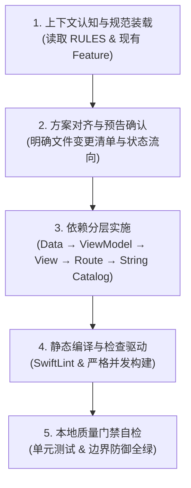

# 标准作业流程规范 (WORKFLOW)

规范编号：CORE-002  
版本：1.0.0  
适用范围：强制执行  

---

## 1. 流程全景图

所有 AI 在执行 iOS 项目的需求开发、Bug 修复或架构重构时，必须严格遵循以下标准五步法作业流程 (SOP)：

---

## 2. 标准五阶段执行规范

### 阶段 1：上下文认知与规范装载 (Context Discovery)

在触碰任何代码前：
1. 阅读 `AI_RULES/RULES.md`，明确当前任务关联的具体开发规范。
2. 检索对应功能目录 `Features/<Feature>/` 下的既有资产：
   - `Data/Requests/`：查看已封装的请求对象与 HTTP 接口契约。
   - `Data/Models/`：查看已有数据模型及 Codable/Sendable 定义。
   - `Data/<Feature>Repository.swift`：查看已有仓储方法及协议定义。
   - `Resources/`：查看已有 String Catalogs 多语言词条。
   - `<Page>/`：查看已有 SwiftUI 视图、ViewModel 及私有组件。
3. 检查 `App/Navigation/AppRoute.swift` 明确当前路由枚举。

### 阶段 2：方案对齐与预告确认 (Architecture Alignment)

1. 向开发者清晰呈现技术方案概要：
   - 计划创建或修改的文件完整相对路径。
   - 状态设计选择：说明是选用 `AsyncPhase<T>`（通用异步数据）还是具象化的只读状态属性。
   - 路由传参方案：明确 `AppRoute` 新增 Case 及强类型参数声明。
2. 若涉及重大架构调整或可能引起冲突的代码，主动向开发者说明并征求意见。

### 阶段 3：依赖分层实施 (Layered Implementation)

严格按照自底向上的依赖顺序编写代码，严禁颠倒：

1. **数据层 (Data Layer)**：
   - 编写遵循 `ApiRequest` 协议的 Request 结构体；
   - 编写遵循 `Codable` 与 `Sendable` 的 Model 结构体；
   - 编写 `XxxRepositoryProtocol` 与 `XxxRepository` 实现。
2. **视图模型层 (ViewModel Layer)**：
   - 编写声明 `@Observable` 与 `@MainActor` 的 ViewModel 类；
   - 注入 Repository 协议，提供结构化 `Task` 调度与并发取消。
3. **视图层 (View Layer)**：
   - 编写 SwiftUI 声明式视图，对接 `AppSpacing`、`AppRadius`、`AppColors`；
   - 落地 44 × 44 pt 触控防御、软键盘收起、四态闭环渲染。
4. **路由与国际化 (Navigation & Localization)**：
   - 在 `AppRoute` 注册路由并在工厂方法中绑定；
   - 在对应模块的 `.xcstrings` 中录入中英双语词条。

### 阶段 4：静态检查与工具链验证 (Verification)

1. 确保代码遵循 Swift 严格并发规范，无任何紫色并发警告。
2. 运行 `SwiftLint` 检查，确保 0 警告 / 0 错误。

### 阶段 5：本地质量门禁自检 (Quality Gate)

1. 运行 `Swift Testing` 单元测试，确保测试用例 100% 通过。
2. 检查 UI 极端边界：大字体截断、弱网重试、快速重复点击防抖。
