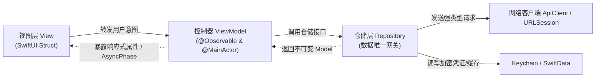

# 架构分层与工程设计规范 (ARCHITECTURE)

规范编号：DEV-002  
版本：1.0.0  
适用范围：强制执行  

---

## 1. 架构总蓝图：Clean MVVM (SwiftUI)

项目全面落地以 Clean MVVM 为核心的架构体系，确保单向数据流与清晰的职责边界。



### 1.1 核心分层职责矩阵

| 分层 | 典型实现 | 核心职责 | 绝对严禁的行为 (Anti-Patterns) |
|---|---|---|---|
| **View** | SwiftUI `struct: View` | 依据 ViewModel 暴露的不可变状态渲染 UI；捕获手势并转发为意图调用；处理弹窗与转场。 | 严禁编写任何业务逻辑；严禁直接调用 Repository 或 ApiClient；严禁私自修改状态。 |
| **ViewModel** | `@Observable @MainActor final class` | 持有 UI 状态；调度结构化异步并发 `Task`；调用 Repository 获取数据并捕获 `AppException`。 | 严禁 `import SwiftUI`；严禁持有 `UIView` 或任何视图实例；严禁省略 `@MainActor`。 |
| **Repository** | `XxxRepository: XxxRepositoryProtocol` | ViewModel 获取数据的唯一入口；拦截底层 `URLError` / `DecodingError` 并统一转换为 `AppException`。 | 严禁向上层抛出未处理的底层原始网络异常；严禁将未解码的裸 Data 暴露给 ViewModel。 |
| **Request Object** | 遵循 `ApiRequest` 协议的不可变 `struct` | 封装具体 API 的 Path、Method、Headers、Query、Body 及其专有泛型返回类型 `Response`。 | 严禁在业务代码中散落直接拼装 `URLRequest`。 |

---

## 2. 单向依赖流动铁律

```
View → ViewModel → Repository → ApiClient / LocalStorage
```

- **依赖单向不可逆**：上层可以依赖下层，下层绝对禁止引用上层。
- **Feature 互相物理隔离**：**Feature A 严禁直接 import 或依赖 Feature B 的私有代码**。
- **跨模块共享机制**：多模块共用的公共逻辑下沉至 `Core/` 或 `Shared/`；跨模块读取业务数据统一通过全局服务或在 App 容器中装配。

---

## 3. 状态管理与生命周期 (Observation)

1. **ViewModel 即状态中枢**：
   - 每个页面的业务状态统一封装在标记为 `@Observable` 和 `@MainActor` 的 ViewModel 类中。
   - 简单异步提交操作使用 `AsyncPhase<Void>`；数据展示型列表使用 `AsyncPhase<[T]>`。
2. **生命周期绑定**：
   - 页面级 ViewModel 由 SwiftUI 视图生命周期声明持有，页面销毁时自动调用 `deinit` 取消进行中的 `Task`。
   - 全局会话状态（如 `AppSession`）由 App 根级环境向外分发。
