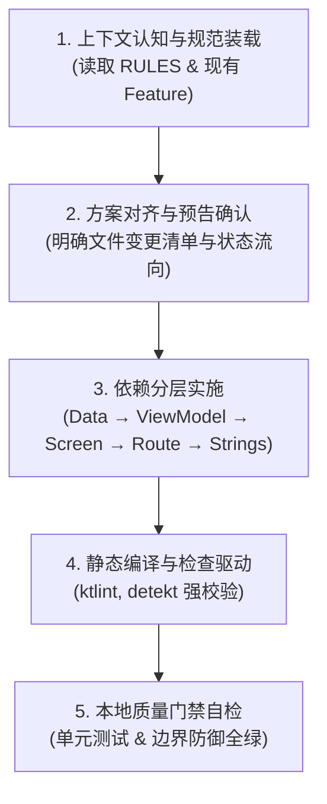

# 标准作业流程规范 (WORKFLOW)

规范编号：CORE-002  
版本：1.0.0  
适用范围：强制执行  

---

## 1. 流程全景图

所有 AI 在执行 Android 项目的需求开发、Bug 修复或架构重构时，必须严格遵循以下标准五步法作业流程 (SOP)：

---

## 2. 标准五阶段执行规范

### 阶段 1：上下文认知与规范装载 (Context Discovery)

在触碰任何代码前：
1. 阅读 `AI_RULES/RULES.md`，明确当前任务关联的具体开发规范。
2. 检索对应功能目录 `features/<feature>/` 下的既有资产：
   - `data/requests/`：查看已封装的请求对象与 HTTP 接口契约。
   - `data/models/`：查看已有数据模型及 `@Serializable` 定义。
   - `data/repository/`：查看已有仓储接口与实现。
   - `res/values/strings_<feature>.xml`：查看已有字符串资源。
   - `<page>/`：查看已有 Composable 屏幕组件、ViewModel 及私有组件。
3. 检查 `navigation/AppRoute.kt` 明确当前路由层级。

### 阶段 2：方案对齐与预告确认 (Architecture Alignment)

1. 向开发者清晰呈现技术方案概要：
   - 计划创建或修改的文件完整相对路径。
   - 状态设计选择：明确 `UiState` 数据类的字段设计与不可变保证。
   - 路由传参方案：明确 `AppRoute` 新增 `@Serializable` 类及强类型入参。
2. 若涉及重大架构调整或可能引起冲突的代码，主动向开发者说明并征求意见。

### 阶段 3：依赖分层实施 (Layered Implementation)

严格按照自底向上的依赖顺序编写代码，严禁颠倒：

1. **数据层 (Data Layer)**：
   - 编写遵循 `ApiRequest` 接口的 Request 类；
   - 编写遵循 `kotlinx.serialization` 的不可变 Model 数据类；
   - 编写 `XxxRepository` 接口与实现类，并在 Hilt Module 中绑定。
2. **视图模型层 (ViewModel Layer)**：
   - 编写标注 `@HiltViewModel` 与 `@Inject` 的 ViewModel 类；
   - 暴露私有 `_uiState` 与只读 `uiState: StateFlow<UiState>`；
   - 调度 `viewModelScope.launch` 执行异步协程任务。
3. **视图层 (View Layer)**：
   - 拆分有状态 Route（负责连接 ViewModel）与无状态 Screen（负责纯渲染）；
   - 对接 `AppSpacing`、`AppRadius`、`MaterialTheme.colorScheme`；
   - 落地 48 × 48 dp 触控防御、软键盘避让与四态闭环渲染。
4. **路由与国际化 (Navigation & Localization)**：
   - 在 `AppRoute` 注册强类型路由，并在 `AppNavHost` 配置映射；
   - 在 `res/values/strings_<feature>.xml` 与中文目录下补齐中英双语词条。

### 阶段 4：静态检查与工具链验证 (Verification)

1. 确保代码遵循 Kotlin 严格语法，无未捕获的协程取消隐患。
2. 运行 `ktlint` 与 `detekt` 检查，确保 0 警告 / 0 错误。

### 阶段 5：本地质量门禁自检 (Quality Gate)

1. 运行 `JUnit 5` 与 `Turbine` 单元测试，确保测试用例 100% 通过。
2. 检查 UI 极端边界：大字体截断、弱网重试、快速重复点击防抖。
