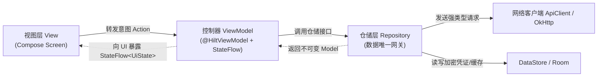

# 架构分层与工程设计规范 (ARCHITECTURE)

规范编号：DEV-002  
版本：1.0.0  
适用范围：强制执行  

---

## 1. 架构总蓝图：Clean MVVM / MVI (Jetpack Compose)

项目全面落地以 Clean MVVM / MVI 为核心的架构体系，确保单向数据流 (UDF) 与清晰的职责边界。



### 1.1 核心分层职责矩阵

| 分层 | 典型实现 | 核心职责 | 绝对严禁的行为 (Anti-Patterns) |
|---|---|---|---|
| **View** | `@Composable fun XxxScreen(...)` | 依据 UiState 渲染 UI；捕获手势事件并通过 Lambda 向上回传；响应一次性副作用。 | 严禁编写任何业务逻辑；严禁直接调用 Repository 或 ApiClient；严禁私自修改状态。 |
| **ViewModel** | `@HiltViewModel class XxxViewModel : ViewModel()` | 持有单一不可变 `StateFlow<UiState>`；调度协程 `viewModelScope.launch`；调用 Repository 并捕获 `AppException`。 | 严禁持有 `Context`、`View` 或任何 Compose 视图实例；严禁对外暴露 `MutableStateFlow`。 |
| **Repository** | `XxxRepository: XxxRepositoryInterface` | ViewModel 获取数据的唯一入口；拦截底层 `IOException` / `HttpException` 并统一转化为 `AppException`。 | 严禁向上层抛出未处理的底层原始网络异常；严禁将未解码的裸 String/Map 暴露给 ViewModel。 |
| **Request Object** | 遵循 `ApiRequest<T>` 接口的不可变类 | 封装具体 API 的 Path、Method、Headers、QueryParams、Body 及其反序列化实现。 | 严禁在业务代码中散落直接拼装 OkHttp 请求。 |

---

## 2. 单向依赖流动铁律

```
View → ViewModel → Repository → ApiClient / LocalStorage
```

- **依赖单向不可逆**：上层可以依赖下层，下层绝对禁止引用上层。
- **Feature 互相物理隔离**：**Feature A 严禁直接 import 或依赖 Feature B 的私有代码**。
- **跨模块共享机制**：多模块共用的公共逻辑下沉至 `core/` 或 `shared/`；跨模块读取业务数据统一通过全局服务或在 Hilt 根容器中装配。

---

## 3. 状态管理与生命周期 (StateFlow + UDF)

1. **ViewModel 即状态中枢**：
   - 每个页面的业务状态统一封装在标记为 `@HiltViewModel` 的 ViewModel 类中。
   - 必须使用 `MutableStateFlow.update { ... }` 执行原子更新，对外暴露只读的 `StateFlow`。
2. **生命周期绑定**：
   - Compose 视图必须通过 `collectAsStateWithLifecycle()` 收集状态流，在应用进入后台时自动停止收集，节约计算资源。
   - 全局会话状态（如 `AuthSession`）注入在 SingletonComponent 中。
