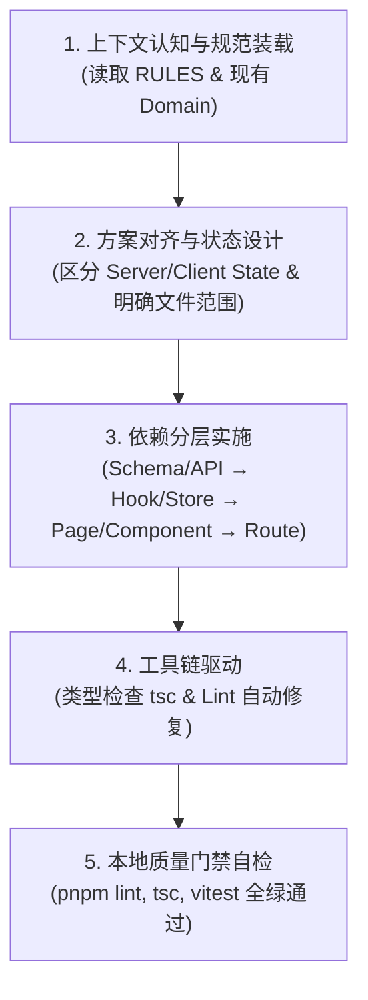

# 标准作业流程规范 (WORKFLOW)

规范编号：CORE-002  
版本：1.0.0  
适用范围：强制执行  

---

## 1. 流程全景图

所有 AI 在执行 React Web 项目的需求开发、Bug 修复或架构重构时，必须严格遵循以下标准五步法作业流程 (SOP)：



---

## 2. 标准五阶段执行规范

### 阶段 1：上下文认知与规范装载 (Context Discovery)

在触碰任何代码前：
1. 阅读 `AI_RULES/RULES.md`，明确当前任务关联的具体开发规范。
2. 检索对应业务领域目录 `src/domains/<domain>/` 下的既有资产：
   - `schemas/`：查看已有 Zod 契约模型与 TypeScript 类型。
   - `api/`：查看已有 API 请求封装与 HTTP 路径。
   - `hooks/`：查看已有基于 TanStack Query 的数据加载与变更 Hook。
   - `components/`：查看本领域内已有的复用组件。
   - `pages/`：查看已有业务页面实现与布局。
3. 检查 `src/app/router/` 明确当前路由层级与权限守卫。

### 阶段 2：方案对齐与状态设计 (Architecture Alignment)

1. 向开发者清晰呈现技术方案概要：
   - 计划创建或修改的文件完整相对路径。
   - 状态归属划分：明确说明数据是属于 TanStack Query 托管的服务端状态，还是属于 Zustand 托管的轻量客户端状态。
   - 交互防御策略：说明四态处理（Loading、Empty、Error、Success）、按钮防重与输入防抖。
2. 若涉及重大架构调整或可能引起接口不兼容的改动，主动向开发者说明并征求意见。

### 阶段 3：依赖分层实施 (Layered Implementation)

严格按照自底向上的依赖顺序编写代码，严禁颠倒：

```
[第 1 层：数据契约与接口层 (Schema & API Layer)]
  ├── 数据契约：src/domains/<domain>/schemas/xxx.schema.ts (Zod 运行时校验与推导类型)
  └── 网络请求：src/domains/<domain>/api/xxx.api.ts (基于统一 client.ts 的接口调用)
        ▼
[第 2 层：状态与数据流层 (State & Hook Layer)]
  ├── 服务端数据 Hook：src/domains/<domain>/hooks/useXxx.ts (useQuery / useMutation)
  └── 客户端轻量 Store：src/domains/<domain>/stores/xxx.store.ts (Zustand，若需要)
        ▼
[第 3 层：表现与组件层 (Component & Page Layer)]
  ├── 领域私有组件：src/domains/<domain>/components/XxxForm.tsx
  └── 业务页面组件：src/domains/<domain>/pages/XxxPage.tsx (处理四态与交互)
        ▼
[第 4 层：路由配置与导出 (Routing & Index Layer)]
  ├── 领域公开暴露：src/domains/<domain>/index.ts (导出 Page 与公开组件)
  └── 路由挂载与常量：src/app/router/paths.ts & index.tsx (配置 Lazy 路由与 AuthGuard)
```

### 阶段 4：自动化工具链驱动 (Toolchain Execution)

1. **类型安全性检查**：
   ```bash
   pnpm exec tsc --noEmit
   ```
2. **代码风格与规范校验**：
   ```bash
   pnpm lint --fix
   ```

### 阶段 5：本地质量门禁自检 (Quality Gate)

在向开发者汇报任务完成前，必须在本地依次执行并全部通过以下三大门禁：

```bash
# 1. 自动格式化与代码风格门禁
pnpm lint

# 2. 严格 TypeScript 编译检查
pnpm exec tsc --noEmit

# 3. 单元与组件测试套件
pnpm test
```

若出现任何警告或错误，立即修复并重新执行，直到所有检查全绿通过。

---

## 3. 典型任务操作指南

### 任务 A：新增业务 Domain 领域模块
1. 建立目录：`src/domains/<name>/{api,components,hooks,pages,schemas,types}`。
2. 在 `schemas/` 下编写 Zod 契约模型并导出推导类型：`export type Xxx = z.infer<typeof xxxSchema>`。
3. 在 `api/` 下封装 API 请求函数，使用泛型绑定返回类型。
4. 在 `hooks/` 下编写 `useXxxQuery` 与 `useXxxMutation`，规范管理 QueryKey。
5. 在 `pages/` 下编写 Page 组件，使用 Ant Design 组件库，严格处理四态闭环。
6. 在 `index.ts` 中对外暴露页面入口。
7. 在 `src/app/router/paths.ts` 与 `index.tsx` 中注册路由守卫与懒加载。
8. 运行 `tsc`、`lint` 与自动化测试。

### 任务 B：UI 交互缺陷修复与边界防御
1. 定位缺陷页面并分析组件层次结构。
2. 检查表格长文本列是否配置了省略与 Tooltip：`ellipsis: true`。
3. 检查异步提交按钮是否绑定了 `loading={mutation.isPending}` 与 `disabled={mutation.isPending}`。
4. 检查搜索输入框是否接入了 `useDebounce`（300~500ms）。
5. 检查列表组件的 `key` 是否为唯一实体 ID（严禁使用 `index`）。
6. 执行 `pnpm test` 验证修复无副作用。
