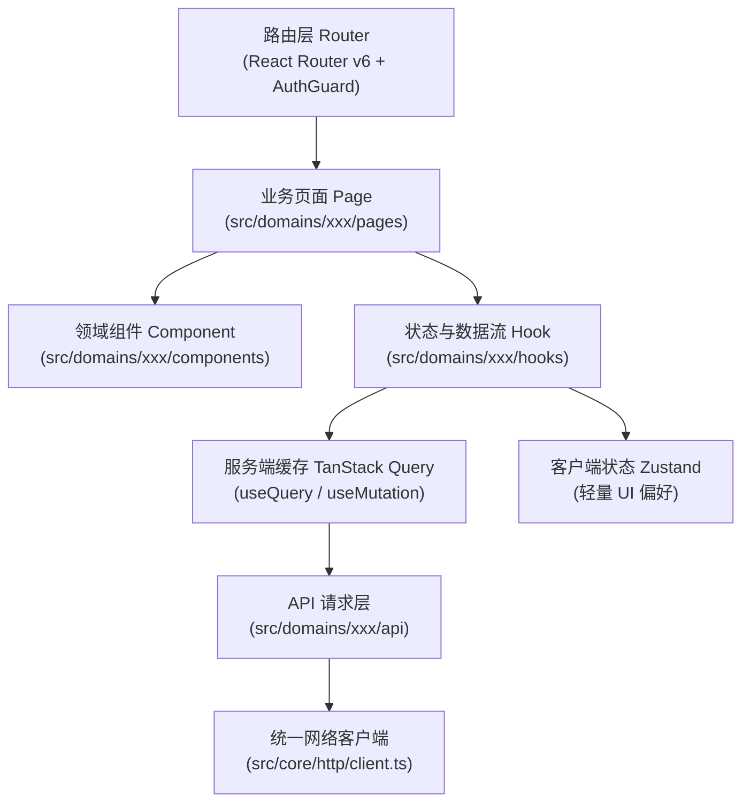

# 架构分层与工程设计规范 (ARCHITECTURE)

规范编号：DEV-002  
版本：1.0.0  
适用范围：强制执行  

---

## 1. 架构总蓝图：领域就近聚合 (Domain-Driven Colocation)

本项目采用**领域就近聚合（Domain-Driven Colocation）**架构，将一个业务领域所需的所有 API、契约模型、状态 Hook、子组件和页面集中在 `src/domains/<domain>/` 下，实现高度的模块自治。



### 1.1 核心分层职责矩阵

| 分层 | 典型路径 | 核心职责 | 绝对严禁的行为 (Anti-Patterns) |
|---|---|---|---|
| **契约层 (Schemas)** | `domains/<domain>/schemas/` | Zod 契约定义；运行时入参及响应格式校验；导出 TypeScript 强类型。 | 严禁编写任何 UI 渲染代码或网络请求。 |
| **接口层 (API)** | `domains/<domain>/api/` | 封装具体的 HTTP 请求函数；调用核心 `client.ts`；明确泛型入参和出参。 | 严禁直接在组件中使用裸 axios 发请求；严禁处理 UI 状态。 |
| **数据流层 (Hooks)** | `domains/<domain>/hooks/` | 封装 TanStack Query (`useQuery`, `useMutation`)；统一定义 QueryKey；处理缓存失效与重试。 | 严禁直接在 Hook 中修改全局 Zustand 服务端缓存数据。 |
| **视图层 (Pages & Components)** | `domains/<domain>/pages/` | 组装组件渲染 UI；依据异步状态渲染四态（Loading/Empty/Error/Success）；响应用户交互。 | 严禁直接发起裸 HTTP 请求；严禁在循环中使用 `index` 作为 key。 |
| **公开暴露 (Index)** | `domains/<domain>/index.ts` | 导出该 Domain 对外公开的页面和必要组件，封装内部私有实现。 | 严禁跨 Domain 穿透导入其他领域的私有内部文件。 |

---

## 2. 状态管理铁律：Server State 与 Client State 彻底分离

前端状态被严格划分为两种类型，必须采用不同的解决方案，**严禁混淆**：

```
┌────────────────────────────────────────────────────────┐
│               服务端状态 (Server State)                 │
│  - 特点：远端持久化、异步拉取、存在多端共享与过时风险   │
│  - 唯一解决方案：TanStack Query v5                      │
│  - 核心能力：自动重新拉取、窗口聚焦刷新、GC 缓存回收    │
└────────────────────────────────────────────────────────┘

┌────────────────────────────────────────────────────────┐
│               客户端状态 (Client State)                 │
│  - 特点：纯前端会话、同步修改、生命周期与页面协同       │
│  - 唯一解决方案：Zustand                                │
│  - 适用范围：侧边栏展开折叠、主题切换、当前登录用户信息 │
└────────────────────────────────────────────────────────┘
```

- **核心禁令**：绝对禁止将从 API 获取的服务端列表或详情数据通过 `useEffect` 写入 Zustand 或全局 Store 中！这会导致缓存状态漂移与冗余的样板代码。

---

## 3. 路由架构与路由守卫 (React Router v6+)

1. **集中化路径管理**：
   - 所有路由字符串常量集中在 `src/app/router/paths.ts` 中定义，组件跳转禁止裸写魔术字符串：
     ```typescript
     export const PATHS = {
       AUTH: {
         LOGIN: '/auth/login',
       },
       DASHBOARD: '/dashboard',
       DEVICES: {
         LIST: '/devices',
         DETAIL: (id: string) => `/devices/${id}`,
       },
     } as const;
     ```
2. **布局分流 (Layout Splitting)**：
   - 业务页面挂载在 `MainLayout` 下（包含侧边栏导航、顶栏面包屑与用户菜单）。
   - 认证页面挂载在 `AuthLayout` 下（独立登录卡片居中布局）。
3. **认证守卫与未登录拦截 (`AuthGuard`)**：
   - 访问受保护路由时，检查 Zustand 或 Token 存储；未登录自动重定向至 `/auth/login?redirect=${currentPath}`。
   - 登录成功后自动回跳 `redirect` 页面，提升用户体验。

---

## 4. 统一网络层架构 (`src/core/http/client.ts`)

1. **统一拦截器 (Interceptors)**：
   - **请求拦截**：自动从本地存储或状态中心读取 Bearer Token 挂载至 `Authorization` 头；自动注入全链路跟踪 `X-Trace-Id`。
   - **响应拦截**：统一解析后端响应外壳 `{ code: 0, data: ..., message: ... }`。
     - 若 `code === 0`，**直接将内层业务 `data` 解包交付给调用者**。
     - 若 `code !== 0`，统一抛出自定义 `ApiClientError(code, message)`，并触发轻量全局 Message 提示。
2. **401 自动登出与拦截**：
   - 收到 HTTP 401 状态码时，清理本地认证凭据并自动重定向至登录页。
3. **并发取消支持**：
   - 每个查询与提交支持传入 `signal: AbortSignal`，在组件卸载或连续触发新请求时自动中断未决网络连接。
