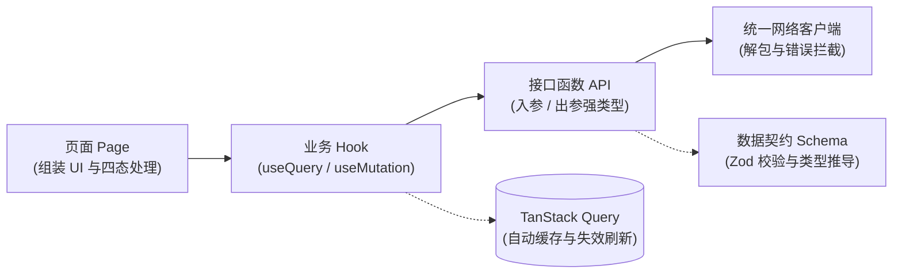
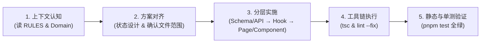

## 一、技术选型

| 类别 | 选择 | 说明 |
| --- | --- | --- |
| 核心框架与运行时 | **React 18/19** + **TypeScript 5.x** | 函数式组件、Hooks 范式、开启严格类型检查模式 (`strict: true`) |
| 构建工具 | **Vite** | 极速冷启动、原生 ESM 开发服务器、快速 HMR 热更新与生产构建优化 |
| 架构模式 | **领域就近聚合 (Domain-Driven Colocation)** | 见第三节，按业务领域垂直划分：`api / components / hooks / pages / schemas / stores` |
| 服务端状态管理 | **TanStack Query (React Query) v5** | 见第四节，统一托管服务端数据拉取、自动重新请求、GC 垃圾回收与分页缓存 |
| 客户端轻量状态 | **Zustand** | 见第四节，仅限纯前端轻量状态：主题、侧边栏展开折叠、弹窗显隐与当前用户信息 |
| 路由导航 | **React Router v6+** | 见第五节，集中化常量路由管理、路由守卫 `AuthGuard`、多布局嵌套 |
| UI 与组件库 | **Ant Design 5.x** + **Tailwind CSS** | 见第七节，企业级组件库 + Design Tokens 驱动 + 原子样式辅助微调 |
| 数据契约与校验 | **Zod** | 见第四节，运行时 Schema 强类型校验、表单验证与 TypeScript 类型自动推导 |
| 网络层 | **Axios** (封装为 `src/core/http/client.ts`) | 见第六节，统一 Token 拦截、响应体解包、401 自动登出与 AbortController 取消 |
| 环境配置 | **集中配置 (`src/core/config/env.ts`)** | 见第九节，基于 `import.meta.env` 搭配 Zod 校验，默认 `prod` 兜底 |
| 国际化 | **react-i18next** | 见第九节，按 Domain 隔离管理语言包，组件内通过 `useTranslation` 访问 |
| 测试框架 | **Vitest** + **@testing-library/react** + **MSW** | 见第十节，覆盖 Hook 数据流测试、组件四态渲染测试与 Mock API 模拟 |
| 包管理与代码规范 | **pnpm** + **ESLint 9+** + **Prettier** | 见第十节，确定性依赖锁定 (`pnpm-lock.yaml`) 与严格 Linter 静态分析 |

代码校验与开发命令：

```bash
# 静态代码检查与格式化
pnpm lint
pnpm exec tsc --noEmit

# 运行自动化测试
pnpm test
```

---

## 二、目录结构

```
my-react-app/
├── AI_RULES/                     # AI 协作主规范体系（单一真实来源，所有 AI 工具共用）
│   ├── RULES.md                  # 规范总入口 / 规范清单 (Manifest)
│   ├── core/                     # 核心规范：MASTER(行为), WORKFLOW(流程), COMMUNICATION(沟通)
│   ├── development/              # 开发规范：CODING(编码), ARCHITECTURE(架构), TESTING(测试)
│   ├── project/                  # 项目知识：CONTEXT(背景), DECISIONS(技术决策), STATUS(进度)
│   └── CHANGELOG.md              # 规范变更记录
├── AGENTS.md                     # Codex / Copilot / OpenDevin 平台适配入口
├── CLAUDE.md                     # Claude Code 平台适配入口
├── GEMINI.md                     # Gemini CLI / Antigravity 平台适配入口
├── .github/
│   ├── workflows/
│   │   └── ci.yml                # 自动化检查 (Lint, TypeScript, Vitest, Build)
│   └── pull_request_template.md
├── public/                       # 不参与构建打包的原样静态资产
│   ├── favicon.ico
│   └── robots.txt
├── src/
│   ├── main.tsx                  # 应用启动装配入口：挂载 React DOM
│   ├── App.tsx                   # 应用根组件：组装全局 Providers 与 Router
│   ├── app/                      # 应用级组装与基础设施配置
│   │   ├── router/
│   │   │   ├── index.tsx         # 路由注册与路由表配置
│   │   │   ├── paths.ts          # 强类型路由常量
│   │   │   └── guards.tsx        # AuthGuard 登录鉴权守卫
│   │   ├── providers/
│   │   │   ├── QueryProvider.tsx # TanStack QueryClient 全局配置
│   │   │   ├── ThemeProvider.tsx # Ant Design ConfigProvider 主题 Tokens 配置
│   │   │   └── AppProviders.tsx  # 全局 Provider 组合容器
│   │   ├── layouts/
│   │   │   ├── MainLayout.tsx    # 主应用框架布局（侧边栏 Sider、Header、Content）
│   │   │   ├── AuthLayout.tsx    # 认证页面独立卡片布局
│   │   │   └── components/       # SiderMenu, HeaderBar, Breadcrumbs 等布局组件
│   │   └── config/
│   │       └── navigation.ts     # 侧边栏导航菜单项配置
│   ├── core/                     # 底层技术支撑 (与业务无耦合)
│   │   ├── config/
│   │   │   └── env.ts            # 环境变量读取与 Zod 契约校验
│   │   ├── http/
│   │   │   ├── client.ts         # Axios 实例封装（Token 注入、统一解包）
│   │   │   ├── interceptors.ts   # 请求与响应拦截器
│   │   │   └── errors.ts         # ApiClientError 统一网络异常定义
│   │   ├── logging/
│   │   │   └── logger.ts         # 统一结构化日志与埋点接口
│   │   └── errors/
│   │       └── ErrorBoundary.tsx # React 渲染异常边界容灾组件
│   ├── shared/                   # 跨业务 Domain 通用复用能力
│   │   ├── components/           # 无业务属性的基础通用 UI 组件
│   │   │   ├── Button/
│   │   │   ├── Modal/
│   │   │   ├── Table/
│   │   │   ├── Pagination/
│   │   │   ├── Loading/
│   │   │   └── EmptyState/
│   │   ├── hooks/                # 通用工具 Hooks (useDebounce, useMediaQuery)
│   │   ├── utils/                # 通用纯函数 (date.ts, format.ts)
│   │   ├── types/                # 全局通用类型定义 (common.ts)
│   │   ├── constants/            # 全局常量
│   │   └── styles/               # 全局样式与变量定义
│   ├── services/                 # 通用第三方与平台级技术服务
│   │   ├── storage/
│   │   │   └── local-storage.ts  # 带类型安全的本地缓存封装
│   │   ├── i18n/
│   │   │   ├── index.ts          # react-i18next 初始化配置
│   │   │   └── locales/          # 全局公共语言包 (zh-CN.json, en-US.json)
│   │   └── monitoring/
│   │       └── index.ts          # 异常监控上报
│   ├── domains/                  # 【核心】按业务领域组织功能 (Domain Colocation)
│   │   ├── auth/                 # 运营认证与会话领域
│   │   │   ├── api/              # auth.api.ts: 登录、刷新 Token、登出
│   │   │   ├── components/       # LoginForm.tsx
│   │   │   ├── hooks/            # useAuth.ts: 登录状态机
│   │   │   ├── pages/            # LoginPage.tsx, ResetPasswordPage.tsx
│   │   │   ├── schemas/          # auth.schema.ts: Zod 登录入参与响应契约
│   │   │   ├── stores/           # auth.store.ts: Zustand 用户 Token 与当前 Profile
│   │   │   ├── types/            # auth.types.ts
│   │   │   └── index.ts          # 领域公开对外接口
│   │   ├── users/                # 终端用户与客户管理
│   │   │   ├── api/              # users.api.ts
│   │   │   ├── components/       # UserTable.tsx, UserDetailDrawer.tsx
│   │   │   ├── hooks/            # useUsersQuery.ts, useUpdateUserMutation.ts
│   │   │   ├── pages/            # UserListPage.tsx
│   │   │   ├── schemas/          # users.schema.ts
│   │   │   ├── types/
│   │   │   └── index.ts
│   │   ├── products/             # 智能灯产品与型号管理
│   │   │   ├── api/
│   │   │   ├── components/
│   │   │   ├── hooks/
│   │   │   ├── pages/            # ProductListPage.tsx, ProductDetailPage.tsx
│   │   │   ├── schemas/
│   │   │   ├── types/
│   │   │   └── index.ts
│   │   ├── orders/               # 交易订单中心
│   │   │   ├── api/
│   │   │   ├── components/
│   │   │   ├── hooks/
│   │   │   ├── pages/
│   │   │   ├── schemas/
│   │   │   ├── types/
│   │   │   └── index.ts
│   │   ├── devices/              # 智能灯设备台账与实时监控
│   │   │   ├── api/              # devices.api.ts
│   │   │   ├── components/       # DeviceTelemetry.tsx, DeviceConfigModal.tsx
│   │   │   ├── hooks/            # useDevicesQuery.ts, useDeviceControlMutation.ts
│   │   │   ├── pages/            # DeviceListPage.tsx, DeviceDetailPage.tsx
│   │   │   ├── schemas/
│   │   │   ├── types/
│   │   │   └── index.ts
│   │   └── ota/                  # 固件升级与任务批次调度
│   │       ├── api/
│   │       ├── components/
│   │       ├── hooks/
│   │       ├── pages/            # FirmwareUploadPage.tsx, OtaTask看板.tsx
│   │       ├── schemas/
│   │       ├── types/
│   │       └── index.ts
│   ├── assets/                   # 参与构建优化的静态资源 (SVG, Images)
│   └── tests/                    # 跨业务集成测试与端到端测试配置
│       ├── setup.ts              # Vitest 环境准备与清理
│       ├── mocks/                # MSW Handlers 接口模拟
│       └── fixtures/
├── .env.example                  # 环境变量模板
├── .env.development              # 本地开发配置
├── .env.production               # 生产环境非敏感配置
├── .editorconfig
├── .gitignore
├── .prettierrc.json
├── eslint.config.js              # ESLint 9 Flat Config
├── index.html                    # SPA 单页入口 HTML
├── package.json
├── pnpm-lock.yaml                # 确定性依赖锁定文件
├── tsconfig.json                 # TypeScript 严格配置
├── vite.config.ts                # Vite 配置文件
├── vitest.config.ts              # Vitest 配置文件
├── playwright.config.ts          # Playwright E2E 配置
├── Dockerfile                    # 生产 Nginx 镜像构建
├── docker-compose.yml
├── nginx.conf                    # SPA 路由重定向与 Gzip/Brotli 缓存配置
├── Makefile
└── README.md
```

### 目录组织规则

1. **领域就近聚合 (Colocation)**：每个功能模块将自己的 `api`、`components`、`hooks`、`pages`、`schemas`、`types` 集中在 `src/domains/<domain>/` 下，模块自闭环。
2. **公开接口封装**：每个 Domain 根部的 `index.ts` 是其唯一允许对外暴露的网关，跨领域严禁穿透导入私有组件。
3. **状态分离铁律**：服务端 API 响应数据一律由 TanStack Query 托管；Zustand 仅用于管理纯前端轻量状态。
4. **共享代码下沉**：仅当组件被两个或更多业务领域使用时，才提升至 `src/shared/components/`。
5. **AI 规范单一真理源与平台适配**：工程根目录维护唯一的 `AI_RULES/` 知识库体系，`AGENTS.md`、`CLAUDE.md`、`GEMINI.md` 仅作为各 AI 平台的适配桥梁，统一指向 `AI_RULES/RULES.md`，杜绝多平台指令漂移。

---

## 三、架构设计与领域组织

### 3.1 领域内部数据流动



### 3.2 依赖流动约束

- **禁止组件内裸发网络请求**：组件严禁直接调用 `axios.get()` 或 `fetch()`，必须通过 `useXxxQuery` 或 `useXxxMutation` 消费。
- **禁止反向依赖**：`shared/` 与 `core/` 绝对禁止 import 任何 `domains/` 下的业务代码。

---

## 四、状态管理铁律 (TanStack Query vs Zustand)

### 4.1 核心边界划分

```
┌────────────────────────────────────────────────────────┐
│               服务端状态 (Server State)                 │
│  - 方案：TanStack Query v5                             │
│  - 涵盖：设备列表、订单明细、固件版本、用户信息拉取      │
│  - 铁律：严禁 set 进 Zustand/Redux，必须自动缓存更新    │
└────────────────────────────────────────────────────────┘

┌────────────────────────────────────────────────────────┐
│               客户端状态 (Client State)                 │
│  - 方案：Zustand                                       │
│  - 涵盖：主题明暗、侧边栏折叠、当前登录 Token、UI 临时弹窗 │
│  - 铁律：纯前端上下文，严禁手动缓存 API 列表数据        │
└────────────────────────────────────────────────────────┘
```

### 4.2 TanStack Query 标准使用范式

```typescript
// src/domains/devices/hooks/useDevices.ts
import { useQuery, useMutation, useQueryClient } from '@tanstack/react-query';
import { fetchDevices, updateDevice } from '../api/devices.api';
import { DeviceQueryParams, UpdateDeviceDto } from '../schemas/device.schema';

export const deviceKeys = {
  all: ['devices'] as const,
  list: (params: DeviceQueryParams) => [...deviceKeys.all, 'list', params] as const,
  detail: (id: string) => [...deviceKeys.all, 'detail', id] as const,
};

export const useDevicesQuery = (params: DeviceQueryParams) => {
  return useQuery({
    queryKey: deviceKeys.list(params),
    queryFn: ({ signal }) => fetchDevices(params, signal),
    staleTime: 1000 * 30, // 30 秒保鲜
  });
};

export const useUpdateDeviceMutation = () => {
  const queryClient = useQueryClient();
  return useMutation({
    mutationFn: (dto: UpdateDeviceDto) => updateDevice(dto),
    onSuccess: (_, variables) => {
      queryClient.invalidateQueries({ queryKey: deviceKeys.all });
    },
  });
};
```

---

## 五、路由系统与路由守卫 (React Router v6+)

### 5.1 集中化路由常量 (`src/app/router/paths.ts`)

```typescript
export const PATHS = {
  ROOT: '/',
  AUTH: {
    LOGIN: '/auth/login',
    FORGOT_PASSWORD: '/auth/forgot-password',
  },
  DASHBOARD: '/dashboard',
  DEVICES: {
    LIST: '/devices',
    DETAIL: (id: string) => `/devices/${id}`,
  },
  OTA: {
    TASKS: '/ota/tasks',
    FIRMWARES: '/ota/firmwares',
  },
} as const;
```

### 5.2 认证路由守卫 (`src/app/router/guards.tsx`)

```tsx
import { Navigate, useLocation, Outlet } from 'react-router-dom';
import { useAuthStore } from '@/domains/auth/stores/auth.store';
import { PATHS } from './paths';

export const AuthGuard = () => {
  const token = useAuthStore((s) => s.token);
  const location = useLocation();

  if (!token) {
    return <Navigate to={`${PATHS.AUTH.LOGIN}?redirect=${encodeURIComponent(location.pathname)}`} replace />;
  }

  return <Outlet />;
};
```

---

## 六、网络层与统一解包契约 (`src/core/http/client.ts`)

```typescript
import axios, { AxiosError } from 'axios';
import { message } from 'antd';
import { env } from '../config/env';

export class ApiClientError extends Error {
  constructor(public code: number, message: string, public data?: unknown) {
    super(message);
    this.name = 'ApiClientError';
  }
}

export const httpClient = axios.create({
  baseURL: env.VITE_API_BASE_URL,
  timeout: 15000,
  headers: { 'Content-Type': 'application/json' },
});

httpClient.interceptors.request.use((config) => {
  const token = localStorage.getItem('access_token');
  if (token) {
    config.headers.Authorization = `Bearer ${token}`;
  }
  return config;
});

httpClient.interceptors.response.use(
  (response) => {
    const res = response.data;
    // 约定: code === 0 为成功
    if (res.code === 0) {
      return res.data; // 剥离外壳，仅向业务交付纯净 data
    }
    message.error(res.message || '业务请求失败');
    throw new ApiClientError(res.code, res.message, res.data);
  },
  (error: AxiosError<{ message?: string; code?: number }>) => {
    if (error.response?.status === 401) {
      localStorage.removeItem('access_token');
      window.location.href = '/auth/login';
    } else {
      message.error(error.response?.data?.message || error.message || '网络异常');
    }
    return Promise.reject(error);
  }
);
```

---

## 七、UI 设计系统与极端场景防御

### 7.1 四态闭环标准 (Loading / Empty / Error / Success)

异步数据页面必须完整闭环处理，严禁空白转圈无响应：

1. **加载态 (Loading)**：表格使用骨架屏 `<Skeleton active />` 或内嵌 `loading={isLoading}`。
2. **空状态 (Empty)**：统一使用 Ant Design `<Empty />` 组件，必须提供明确引导操作（如“添加设备”）。
3. **错误态 (Error)**：渲染 `<Result status="error" />`，必须配备「重新加载」重试按钮。
4. **成功态 (Success)**：正常渲染业务卡片或表格。

### 7.2 表格长文本防溢出与 Tooltip

表格单元格长文本（如 SN、Mac 地址、日志）必须显式配置 `ellipsis: true` 并包裹 `Tooltip`：

```tsx
{
  title: '设备识别码 (MAC)',
  dataIndex: 'macAddress',
  ellipsis: true,
  render: (mac: string) => <Tooltip title={mac}>{mac}</Tooltip>,
}
```

### 7.3 交互防重与输入防抖

1. **提交防重**：按钮必须显式绑定 `loading={mutation.isPending}` 且 `disabled={mutation.isPending}`。
2. **输入防抖**：过滤筛选输入框必须使用 `useDebounce(keyword, 300)`，防止高频触发查询。
3. **循环渲染 Key**：严禁使用 `index` 作为 key，一律使用实体唯一 ID：`key={item.id}`。

---

## 八、错误边界与异常处理 (ErrorBoundary)

在 `src/core/errors/ErrorBoundary.tsx` 中实现类组件错误边界，并在 `MainLayout` 与关键路由层挂载：

```tsx
import React, { Component, ErrorInfo, ReactNode } from 'react';
import { Result, Button } from 'antd';

interface Props { children: ReactNode; }
interface State { hasError: boolean; error: Error | null; }

export class ErrorBoundary extends Component<Props, State> {
  state: State = { hasError: false, error: null };

  static getDerivedStateFromError(error: Error): State {
    return { hasError: true, error };
  }

  componentDidCatch(error: Error, info: ErrorInfo) {
    console.error('ErrorBoundary caught:', error, info);
  }

  render() {
    if (this.state.hasError) {
      return (
        <Result
          status="500"
          title="组件渲染发生非预期异常"
          subTitle={this.state.error?.message}
          extra={<Button type="primary" onClick={() => window.location.reload()}>刷新页面</Button>}
        />
      );
    }
    return this.props.children;
  }
}
```

---

## 九、环境配置与国际化

### 9.1 集中环境变量配置 (`src/core/config/env.ts`)

```typescript
import { z } from 'zod';

const envSchema = z.object({
  VITE_APP_ENV: z.enum(['dev', 'test', 'prod']).default('prod'),
  VITE_API_BASE_URL: z.string().url(),
  VITE_APP_TITLE: z.string().default('SmartLight Admin'),
});

export const env = envSchema.parse(import.meta.env);
```

### 9.2 国际化多语言 (`react-i18next`)

按 Domain 隔离文案 JSON，避免单文件合并冲突。通过 `const { t } = useTranslation('devices');` 访问。

---

## 十、工程化、质量门禁与测试

### 10.1 质量门禁执行命令

```bash
# 1. ESLint 代码质量检查
pnpm lint

# 2. TypeScript 严格类型检查
pnpm exec tsc --noEmit

# 3. 运行自动化单元测试
pnpm test
```

### 10.2 Vitest + React Testing Library 单元测试

使用 `renderHook` 测试 Query Hook，使用 `render` 测试页面在各类状态下的渲染与点击反馈。

---

## 十一、代码走查清单 (Checklist)

在代码合并或发布前，开发者与 AI 必须逐项核对：

- [ ]  所有服务端数据均由 TanStack Query 托管，无手动 `set` 到 Zustand/Redux 的行为
- [ ]  没有使用 `any`，TypeScript 严格检查 0 报错 (`tsc --noEmit`)
- [ ]  没有在循环列表中使用 `key={index}`，均使用唯一主键 ID
- [ ]  异步提交按钮绑定了 `loading` 与 `disabled`，具备防重点击保护
- [ ]  数据页面完整闭环处理了 Loading、Empty、Error 与 Success 四态
- [ ]  表格中长文本列配置了 `ellipsis` 与 `Tooltip`，无页面横向挤爆
- [ ]  搜索输入框接入了 300ms 防抖，且支持取消未决网络请求
- [ ]  路由跳转均引用 `paths.ts` 常量，无裸写魔术字符串
- [ ]  生产代码没有遗留 `console.log`
- [ ]  `pnpm lint`、`tsc --noEmit`、`pnpm test` 全部绿灯通过
- [ ]  **AI 协作与架构合规**：AI 生成的代码严格遵循 `AI_RULES/` 架构红线，无未批准的第三方库

---

## 十二、AI 开发协作规范（AI_RULES 体系与落地）

为了保障不同 AI 辅助工具（如 Cursor、Claude Code、GitHub Copilot、Gemini CLI、Antigravity 等）在协助开发 React Web 项目时输出高度一致、符合工程架构且零质量妥协的代码，本项目严格遵循 `9. AI/AI 开发协作规范.md` 所定义的三层协作架构体系。

### 12.1 核心架构定位

```
┌──────────────────────────────────────────────────────────┐
│                   平台适配层 (Adapters)                    │
│      AGENTS.md      │      CLAUDE.md      │  GEMINI.md   │
└─────────────────────────────┬────────────────────────────┘
                              │ 统一指向 (@AI_RULES/RULES.md)
                              ▼
┌──────────────────────────────────────────────────────────┐
│                   通用规范层 (AI_RULES)                    │
│  RULES.md (总清单)                                        │
│  ├── core/            # 核心准则 (MASTER, WORKFLOW, COMM) │
│  ├── development/     # 开发规范 (CODING, ARCH, TESTING)  │
│  ├── project/         # 项目资产 (CONTEXT, ADR, STATUS)   │
│  └── CHANGELOG.md     # 变更记录                          │
└──────────────────────────────────────────────────────────┘
```

### 12.2 AI 协作文件职责矩阵

| 文件路径 | 规范标识 | 核心定位与职责 |
| --- | --- | --- |
| `AI_RULES/RULES.md` | **MANIFEST** | **AI 唯一主入口与索引清单**。定义文档权威性、执行优先级与核心技术栈速查。 |
| `AI_RULES/core/MASTER.md` | **CORE-001** | **核心行为规范与红线禁令**。确立 AI 角色定位、安全边界与严禁违反的 10 条铁律。 |
| `AI_RULES/core/WORKFLOW.md` | **CORE-002** | **标准作业流程 (SOP)**。规定 AI 从需求分析、方案确认、分层实施到静态检查的完整执行链路。 |
| `AI_RULES/core/COMMUNICATION.md` | **CORE-003** | **沟通与交付规范**。约束 AI 回复风格、Diff 呈现、代码解释深度与决策对齐机制。 |
| `AI_RULES/development/CODING.md` | **DEV-001** | **React 编码规范**。TypeScript 严格模式、Zod 契约、四态闭环、UI 防御性边界与 Design Tokens。 |
| `AI_RULES/development/ARCHITECTURE.md` | **DEV-002** | **架构与分层规范**。领域就近聚合 (Colocation)、TanStack Query 服务端缓存与 Zustand 客户端解耦。 |
| `AI_RULES/development/TESTING.md` | **DEV-003** | **质量与测试规范**。Vitest + RTL 单元/Hook 测试、MSW 模拟网络接口与门禁脚本。 |
| `AI_RULES/project/CONTEXT.md` | **PROJECT-001** | **项目业务背景**。智能灯 Web 运营管理后台全景、领域边界划分与核心基础设施。 |
| `AI_RULES/project/DECISIONS.md` | **PROJECT-002** | **架构决策记录 (ADR)**。记录为何选用 Vite、TanStack Query、Zustand、Ant Design、Zod 等。 |
| `AI_RULES/project/STATUS.md` | **PROJECT-003** | **项目当前进展**。已完成模块、正在进行任务、遗留技术债务与后续迭代目标。 |
| `AI_RULES/CHANGELOG.md` | — | **规范演进记录**。记录 AI 规则与架构约定的版本迭代变更。 |
| `AGENTS.md` / `CLAUDE.md` / `GEMINI.md` | — | **轻量平台引导入口**。仅包含引入 `@AI_RULES/RULES.md` 的锚点与基础触发指令。 |

### 12.3 AI 开发 React 代码的十条绝对红线（Hard Bans）

任何 AI 工具在编写或重构本项目代码时，**绝对禁止**以下行为：

1. **严禁擅自引入未批准的第三方库**：绝对禁止在 `package.json` 中添加未经评审的第三方依赖；严禁引入 Redux、MobX、jQuery 等未批准状态库。
2. **严禁将服务端 API 数据手工同步存入全局 Store**：严禁将获取的 API 数据 `set` 进 Zustand 或全局 Store，必须统一由 TanStack Query 托管。
3. **严禁使用 `any` 逃避类型检查**：严禁使用 `any`、`as any` 或 `@ts-ignore` 屏蔽类型错误，必须定义完整的类型与 Zod 契约。
4. **严禁在组件渲染主体 (render body) 中触发副作用**：严禁在组件顶层直接调用 `navigate()`、`setState()` 或发起异步请求，副作用必须包裹在 `useEffect` 或事件回调中。
5. **严禁裸写魔术字符串进行路由跳转**：所有跳转必须引用 `src/app/router/paths.ts` 中定义的常量路径。
6. **严禁在循环渲染中使用 `index` 作为 key**：必须使用实体唯一主键 ID（如 `item.id`），绝对禁止使用 `key={index}`。
7. **严禁硬编码文本、颜色与间距数值**：文本一律接入 `i18n`；间距与颜色一律遵循 Ant Design Design Tokens 与 Tailwind CSS 预设规范。
8. **严禁在生产代码中使用 `console.log()`**：生产环境严禁遗留 `console.log`，日志统一走统一封装的 Logger 接口。
9. **严禁缺失错误边界 (ErrorBoundary) 保护**：核心路由与关键业务组件必须包裹 `ErrorBoundary`，杜绝渲染崩溃导致全屏白屏。
10. **严禁交付未通过质量门禁的代码**：代码产出后必须保证 `pnpm lint`、`tsc --noEmit` 与 `pnpm test` 全部绿灯通过。

### 12.4 AI 辅助开发标准化作业流程（AI SOP）

当向 AI 下发开发或修改任务时，AI 必须严格执行以下五步法：


