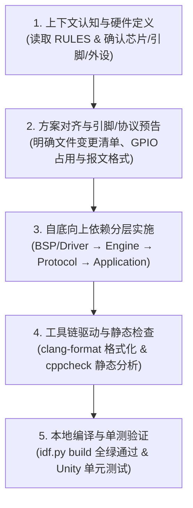

# 标准作业流程规范 (WORKFLOW)

规范编号：CORE-002  
版本：1.0.0  
适用范围：强制执行  

---

## 1. 流程全景图

所有 AI 在执行嵌入式固件的需求开发、驱动适配、协议对接或缺陷修复时，必须严格遵循以下标准五步法作业流程 (SOP)：



---

## 2. 标准五阶段执行规范

### 阶段 1：上下文认知与硬件定义 (Context Discovery)

在编写任何代码前：
1. 阅读 `AI_RULES/RULES.md`，明确当前任务关联的具体开发规范与红线约束。
2. 检索对应组件目录 `components/<component>/` 下的既有资产：
   - `include/*.h`：查看公开接口声明、结构体定义与错误码返回契约。
   - `src/*.c`：查看既有驱动实现、互斥锁机制与任务调用关系。
   - `CMakeLists.txt`：查看组件编译依赖关系与头文件暴露路径。
3. 检查系统配置文件与分区表：
   - `sdkconfig.defaults`：查看系统时钟、堆栈高水位监控、看门狗超时配置。
   - `partitions.csv`：确认 Flash 分区划分与 OTA 双分区大小。

### 阶段 2：方案对齐与引脚/协议预告 (Contract Alignment)

1. 向开发者清晰呈现技术方案概要：
   - 计划创建或修改的文件完整相对路径。
   - 硬件资源变动：GPIO 引脚占用、硬件定时器通道、DMA 通道或 ADC 采样通道分配。
   - 任务与内存评估：新增 FreeRTOS 任务名称、优先级规划及预估堆栈深度 (Stack Depth)。
   - 协议报文契约：BLE 广播字段变更、GATT 特征定义或 MQTT JSON 物模型字段定义。
   - 持久化与防抖策略：是否涉及 NVS 参数读写及防抖保护机制。
2. 若涉及硬件引脚调整或接口不兼容改动，必须主动征求开发者确认后方可实施。

### 阶段 3：自底向上依赖分层实施 (Layered Implementation)

严格按照自底向上的依赖顺序编写代码，严禁颠倒：

```
[第 1 层：板级硬件与驱动层 (BSP & Drivers)]
  ├── 引脚定义与初始化：components/bsp/
  └── 硬件驱动实现：components/drivers/ (LEDC, ADC, GPIO 中断)
        ▼
[第 2 层：领域算法与业务引擎层 (Engine & Domain)]
  ├── 照明控制引擎：components/lighting_engine/ (Gamma 校正, CCT 插值, 缓动过渡)
  └── 存储与电源管理：components/storage/ (NVS 防抖持久化), components/power_mgmt/
        ▼
[第 3 层：通信与协议层 (Protocols)]
  ├── 蓝牙低功耗：components/protocols/ble/ (GATT Server, 31B 主广播含 0xFF55 UUID 与 0xFF 厂商数据)
  ├── 云端与配网：components/protocols/mqtt/ (TLS 鉴权, JSON 物模型, 遗嘱 LWT)
  └── 固件空中升级：components/ota_manager/ (双分区写入, YBOT 验签, 防回滚)
        ▼
[第 4 层：应用层与顶层状态机 (Application & FSM)]
  ├── 顶层状态机：main/app_state_machine.c (系统生命周期、网络连接、配网、OTA 态流转)
  └── 系统总装入口：main/main.c (外设与各组件初始化、任务分发调度)
```

### 阶段 4：工具链驱动与静态检查 (Toolchain Enforcement)

1. 严格执行代码风格格式化：
   - 遵循统一的 C 代码风格（Google / LLVM 规范，缩进 4 空格），运行 `clang-format` 格式化变更文件。
2. 运行静态代码分析：
   - 运行 `cppcheck` 扫描潜在的空指针解引用、数组越界、内存未释放等静态缺陷。
   - 确保编译器告警等级开启（`-Wall -Werror=all`），杜绝隐式类型转换警告。

### 阶段 5：本地编译与单测验证 (Build & Test Verification)

1. 固件编译构建：
   - 执行 `idf.py build`，确保编译过程 **0 错误、0 警告**，检查生成的固件大小 (`.bin`) 未超出分区表限制。
2. 算法与协议单元测试：
   - 对关键数学算法（Gamma 查找表、CCT 双色温插值）与协议解析器（BLE 广播解包、YBOT 头部信封解析），运行 Unity 测试用例确保全部绿灯通过。
3. 检查任务堆栈高水位线与内存泄漏：
   - 确认关键任务堆栈余量充足 (`uxTaskGetStackHighWaterMark`)，杜绝堆栈溢出隐患。

---

## 3. 任务交付与合规要求

任何任务交付前，必须按照 [COMMUNICATION.md](file:///Users/grandboy/Desktop/grandboy/gb-project-guidelines/5.%20Embedded/AI_RULES/core/COMMUNICATION.md) 提供的标准模版进行交付汇报。
