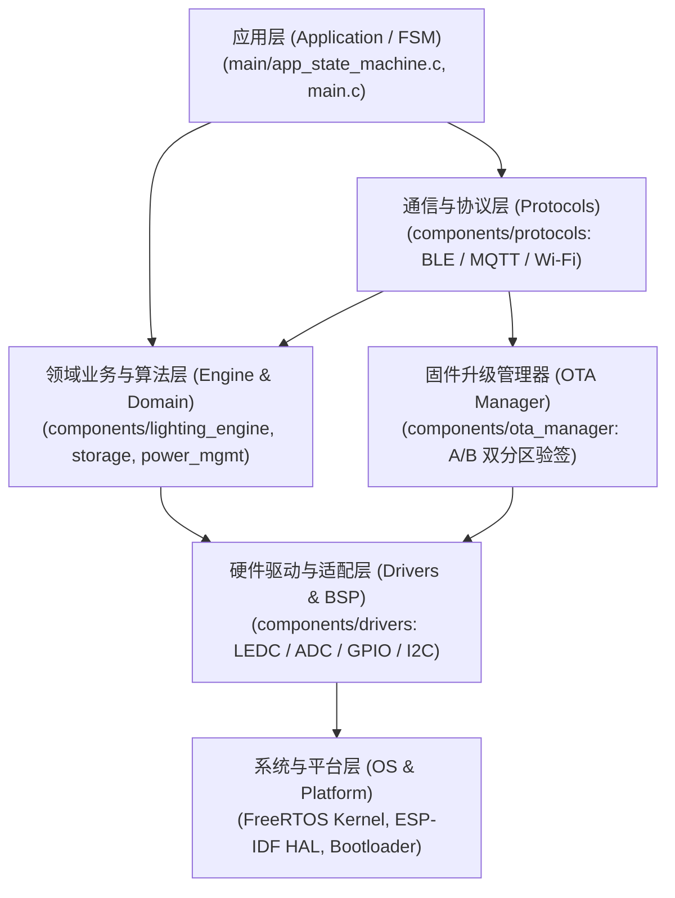

# 架构分层与工程设计规范 (ARCHITECTURE)

规范编号：DEV-002  
版本：1.0.0  
适用范围：强制执行  

---

## 1. 架构总蓝图：ESP-IDF 组件化垂直分层

本项目采用**高内聚、低耦合的组件化垂直分层架构 (Component-based Layered Architecture)**，将底层外设驱动、核心控制算法、网络通信协议与顶层应用状态机严格隔离：



### 1.1 核心分层职责矩阵与反模式禁令

| 分层 | 典型路径 | 核心职责 | 绝对严禁的行为 (Anti-Patterns) |
|---|---|---|---|
| **应用层 (Application)** | `main/` | 顶层有限状态机 (FSM)；系统初始化、任务派发与全局事件路由。 | 严禁直接调用底层硬件寄存器或操作物理引脚。 |
| **通信与协议层 (Protocols)** | `components/protocols/` | 对齐《BLE API 规范》与《MQTT 规范》；GATT Server 交互、大端序转换、物模型 JSON 序列化。 | 严禁直接在协议解析函数中控制 PWM 硬件；必须通过 Engine 层解耦。 |
| **固件升级层 (OTA Manager)** | `components/ota_manager/` | YBOT 头部信封校验、ECDSA 数字验签、A/B 双分区写入、自动回滚与防降级。 | 严禁单分区覆盖刷写；严禁跳过电量和签名校验。 |
| **业务算法层 (Engine)** | `components/lighting_engine/` | Gamma 2.2 亮度校正、CCT 双色温插值、HSV 混色、场景过渡曲线计算。 | 严禁依赖特定引脚编号；纯数学算法必须具备可测试性。 |
| **存储管理层 (Storage)** | `components/storage/` | NVS 参数持久化、磨损均衡管理、掉电保护与 2 秒状态变更防抖。 | 严禁高频频繁写 Flash；严禁明文存储 Wi-Fi 密码。 |
| **驱动适配层 (Drivers/BSP)** | `components/drivers/`, `bsp/` | 板级引脚映射、LEDC 高频 PWM 驱动、ADC 电量采样滤波、按键/PIR 中断。 | 严禁在驱动层混入具体业务逻辑；严禁在 ISR 中阻塞。 |

---

## 2. FreeRTOS 多任务划分与优先级矩阵

系统运行于 FreeRTOS 抢占式内核之上，任务优先级与堆栈深度严格按照以下矩阵分配：

| 任务名称 | 优先级 (Priority) | 堆栈大小 (Bytes) | 核心职责与触发机制 | 关键约束与防御 |
|---|---|---|---|---|
| **`ctrl_task`** | 5 (较高) | 4096 | 业务状态机驱动、调光过渡插值、按键事件消费 | 注册 TWDT 喂狗，严禁长时间延时 |
| **`net_task`** | 4 (中高) | 4096 | BLE 事件分发、MQTT 报文收发、Wi-Fi 状态协同 | 阻塞于网络事件队列，超时唤醒 |
| **`ota_task`** | 4 (中高) | 8192 | 固件升级包解包、SHA-256 校验、Flash 分区写入 | 仅在升级态激活，预留大堆栈 |
| **`sensor_task`** | 3 (普通) | 3072 | ADC 电池电量多点采样、均值滤波、环境光感 | 定时器周期触发 (如 1 秒一次) |

---

## 3. 任务间通信与并发安全原则 (IPC)

1. **绝对禁止裸全局变量跨任务共享**：
   - 跨任务状态传递必须使用 FreeRTOS 队列 (`QueueHandle_t`) 或事件组 (`EventGroupHandle_t`)。
2. **临界资源互斥保护**：
   - 多个任务并发访问共享外设（如 I2C 总线、NVS 存储）时，必须通过互斥量 (`SemaphoreHandle_t` / Mutex) 进行排他保护，且互斥量持有时间必须尽量短（$\le 5\text{ms}$）。
3. **中断与任务安全隔离**：
   - 中断服务例程向任务派发事件时，**必须且仅能使用 `xxxFromISR` 专用 API**，并在唤醒更高优先级任务时触发上下文切换 (`portYIELD_FROM_ISR`)。

---

## 4. Flash 分区表与 A/B 双分区无缝容灾架构

系统分区必须配置于 `partitions.csv` 中，严格对齐《OTA 固件升级与设备管理规范》：

```csv
# Name,   Type, SubType, Offset,  Size, Flags
nvs,      data, nvs,     0x9000,  0x6000,
otadata,  data, ota,     0xf000,  0x2000,
phy_init, data, phy,     0x11000, 0x1000,
factory,  app,  factory, 0x20000, 1M,
ota_0,    app,  ota_0,   0x120000, 1536K,
ota_1,    app,  ota_1,   0x2A0000, 1536K,
storage,  data, spiffs,  0x420000, 512K,
```

- **双分区容灾机制**：当前运行于 `ota_0` 时，升级固件写入 `ota_1`；写入完成校验 Tail CRC32 与 ECDSA 签名无误后更新 `otadata` 分区。
- **自检与回滚闭环**：重启后 Bootloader 加载新分区，固件必须完成硬件初始化自检并调用 `esp_ota_mark_app_valid_cancel_rollback()` 确认健康；若因崩溃触发重启，Bootloader 自动回滚至先前正常分区。
