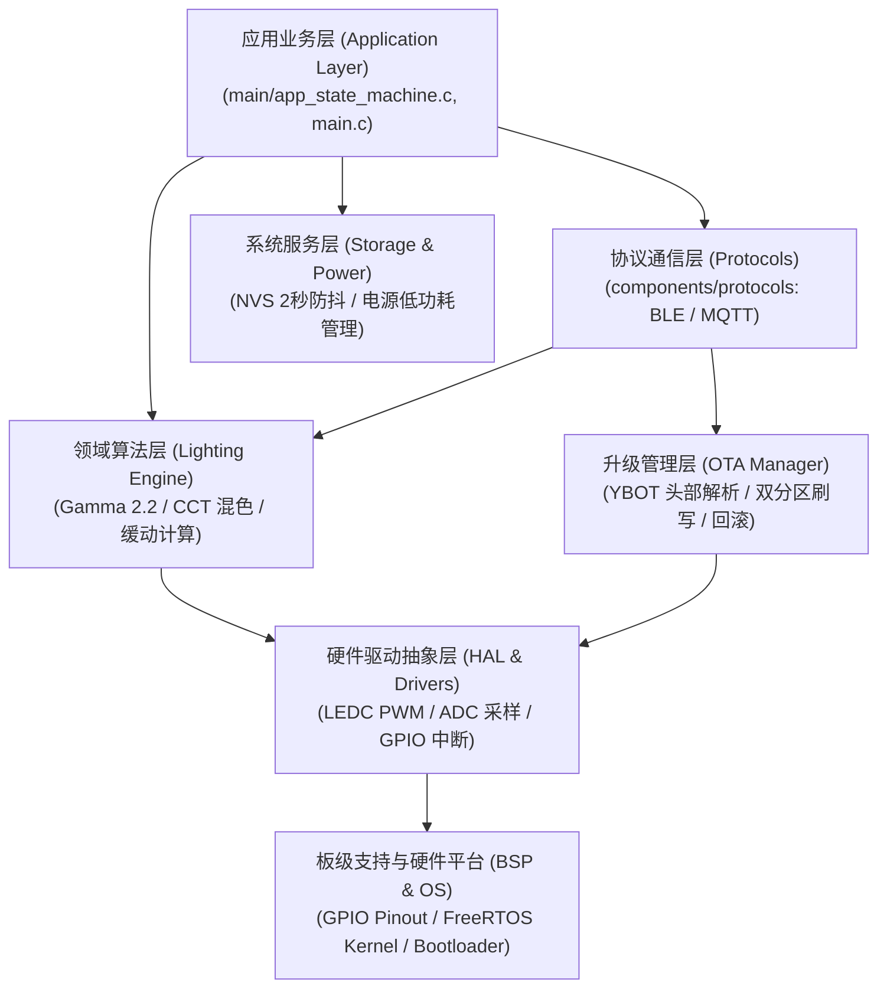
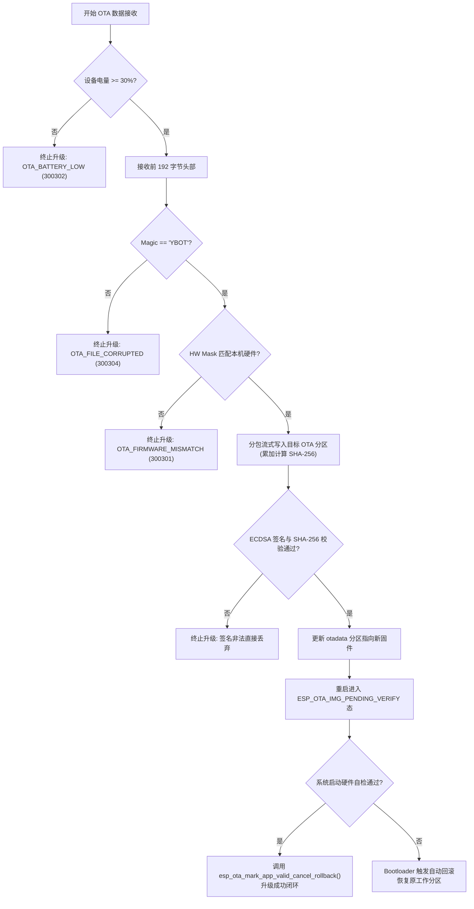
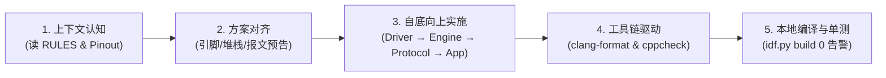

## 一、技术选型

| 类别 | 选择 | 说明 |
| --- | --- | --- |
| 主控芯片 / 硬件平台 | **ESP32-C3 / ESP32-S3** | 32-bit RISC-V / Xtensa 架构，集成 Wi-Fi 4 与 BLE 5.0，低功耗备选 STM32G0/L4 |
| 操作系统与运行时 | **FreeRTOS (ESP-IDF 内核)** | 抢占式多任务内核，多核任务调度，支持任务通知、队列、事件组与软件定时器 |
| 固件开发框架 | **ESP-IDF v5.x** | 官方稳定长期支持版本 (LTS)，采用组件化驱动架构与统一构建系统 |
| 编程语言标准 | **C99 / C11 强类型静态规范** | 严格类型检查、显式位宽 (`uint8_t` 等)，局部支持受限 C++17（严禁异常与 RTTI） |
| 架构设计模式 | **组件化垂直分层 (Component-based Layered)** | 见第三节，`bsp / drivers / lighting_engine / protocols / ota_manager / storage` |
| 蓝牙通信协议栈 | **NimBLE / Bluedroid (BLE 5.0 GATT)** | 见第四节，严格对齐《BLE API 规范》：31 字节主广播（Flags + `0xFF55` UUID + `0xFF` 厂商数据）、`DeviceID_Short`、大端序 |
| 云端通信与配网 | **esp-mqtt (TLS 1.2/1.3) + esp_wifi** | 见第四节，严格对齐《MQTT 规范》：小驼峰 JSON 物模型、60s KeepAlive、遗嘱 LWT |
| OTA 空中升级与容灾 | **A/B 双分区无缝升级 + Bootloader 回滚** | 见第六节，严格对齐《OTA 固件升级与设备管理规范》：YBOT 二进制信封、ECDSA-SHA256 验签、Anti-Rollback |
| 调光控制与 PWM | **LEDC 硬件定时器 PWM** | 见第五节，频率 $\ge 20\text{kHz}$ 无频闪，13-bit 分辨率，Gamma 2.2 查找表，CCT 恒功率调色 |
| 传感器与模拟采样 | **ADC Calibration + GPIO 中断** | 见第五节，锂电池放电曲线非线性映射与移动均值滤波，欠压阶梯降额保护，PIR 人体感应 |
| 参数持久化存储 | **NVS (Non-Volatile Storage)** | 见第七节，Flash 磨损均衡键值存储，配置与状态变更引入 2 秒定时器防抖落盘 |
| 电源与功耗管理 | **ESP-IDF Power Management (PM)** | 见第八节，动态调频 (DFS)、Light Sleep / Deep Sleep 自动休眠，整机待机功耗 < 0.5W |
| 异常防御与容错 | **Task WDT + Flash Core Dump** | 见第七节与第九节，任务看门狗喂狗防死锁，Panic 上下文转储，复位原因检测 |
| 结构化日志 | **ESP_LOGx 统一分级日志** | 见第九节，严禁生产代码裸用 `printf`，生产构建收敛至 `INFO` |
| 构建与代码质量门禁 | **CMake + Ninja + Clang-Format + Cppcheck** | 见第十节，自动化代码格式化、静态分析与依赖锁定 |
| 单元测试框架 | **Unity + CMock** | 见第十节，覆盖核心 Gamma/CCT 算法、协议大端序解包与 YBOT 头部校验 |

代码格式化、静态检查与构建命令：

```bash
# 代码格式化与静态检查
clang-format -i main/*.c main/*.h components/*/*/*.c components/*/*/*.h
cppcheck --enable=all --inconclusive --error-exitcode=1 --suppress=missingIncludeSystem main/ components/

# 固件编译构建
idf.py build

# 烧录并打开串口监视器
idf.py -p /dev/ttyUSB0 flash monitor
```

---

## 二、目录结构

```
my-firmware-project/
├── AI_RULES/                     # AI 协作主规范体系（单一真实来源，所有 AI 工具共用）
│   ├── RULES.md                  # 规范总入口 / 规范清单 (Manifest)
│   ├── core/                     # 核心规范：MASTER(行为), WORKFLOW(流程), COMMUNICATION(沟通)
│   ├── development/              # 开发规范：CODING(编码), ARCHITECTURE(架构), TESTING(测试)
│   ├── project/                  # 项目知识：CONTEXT(背景), DECISIONS(技术决策), STATUS(进度)
│   └── CHANGELOG.md              # 规范变更记录
├── AGENTS.md                     # Codex / Copilot / OpenDevin 平台适配入口
├── CLAUDE.md                     # Claude Code 平台适配入口
├── GEMINI.md                     # Gemini CLI / Antigravity 平台适配入口
├── .github/
│   ├── workflows/
│   │   └── ci.yml                # 自动化检查 (Format, Cppcheck, IDF Build, Test)
│   └── pull_request_template.md
├── CMakeLists.txt                # 顶层构建脚本
├── partitions.csv                # Flash 分区表 (nvs, otadata, phy_init, ota_0, ota_1, storage)
├── sdkconfig.defaults            # 工程基础配置 (FreeRTOS 时钟, TWDT 看门狗, 堆栈监控)
├── main/                         # 应用层主入口与系统状态机
│   ├── CMakeLists.txt
│   ├── idf_component.yml         # 组件依赖声明
│   ├── main.c                    # app_main 入口：硬件自检、组件初始化、任务分发
│   ├── app_state_machine.c       # 系统有限状态机 (FSM)：配网、连云、正常工作、OTA态
│   └── app_state_machine.h
├── components/                   # 垂直业务与驱动组件体系
│   ├── bsp/                      # 板级支持包 (Board Support Package)
│   │   ├── CMakeLists.txt
│   │   └── include/
│   │       ├── bsp_pins.h        # 硬件 GPIO 引脚映射常量 (LEDC, ADC, PIR, Button)
│   │       └── bsp_power.h       # 电源拓扑与外设供电控制接口
│   ├── drivers/                  # 底层硬件抽象驱动组件
│   │   ├── CMakeLists.txt
│   │   ├── include/
│   │   │   ├── driver_ledc.h     # 高频 PWM 驱动与硬件平滑渐变接口
│   │   │   ├── driver_adc.h      # ADC 电池电量与光敏采样接口 (带校准与滤波)
│   │   │   └── driver_button.h   # 轻触按键长按/短按与 PIR 中断防抖驱动
│   │   └── src/
│   │       ├── driver_ledc.c
│   │       ├── driver_adc.c
│   │       └── driver_button.c
│   ├── lighting_engine/          # 照明领域核心算法引擎 (纯 C 实现，与硬件引脚解耦)
│   │   ├── CMakeLists.txt
│   │   ├── include/
│   │   │   ├── lighting_gamma.h  # Gamma 2.2 非线性感知校正查找表与接口
│   │   │   ├── lighting_cct.h    # CCT 双色温恒功率混色算法
│   │   │   └── lighting_color.h  # RGB 与 HSV 色彩空间转换
│   │   └── src/
│   │       ├── lighting_gamma.c
│   │       ├── lighting_cct.c
│   │       └── lighting_color.c
│   ├── protocols/                # 网络与本地通信协议栈
│   │   ├── CMakeLists.txt
│   │   ├── ble/                  # 蓝牙通信实现 (对齐《BLE API 规范》)
│   │   │   ├── ble_adv.c         # 31B 主广播组包 (Flags + 0xFF55 UUID + 0xFF 厂商数据) 与 DeviceID_Short 填充
│   │   │   ├── ble_gatts.c       # GATT Server 服务注册与大端序指令解析
│   │   │   └── include/
│   │   ├── mqtt/                 # 云端物联网通信 (对齐《MQTT 规范》)
│   │   │   ├── mqtt_client.c     # TLS 1.2/1.3 客户端连接、60s 心跳与重连管理
│   │   │   ├── mqtt_property.c   # 物模型属性上报与下发解析 (小驼峰 JSON)
│   │   │   └── include/
│   │   └── wifi_prov/            # Wi-Fi 配网管理器
│   │       ├── wifi_prov_mgr.c   # 支持 BLE Protocomm 配网与 SoftAP 备选
│   │       └── include/
│   ├── ota_manager/              # 固件升级与防变砖管理器 (对齐《OTA 固件升级与设备管理规范》)
│   │   ├── CMakeLists.txt
│   │   ├── include/
│   │   │   ├── ota_ybot.h        # YBOT 二进制信封头部结构体声明
│   │   │   └── ota_upgrade.h     # A/B 双分区刷写、ECDSA 验签、自检与回滚接口
│   │   └── src/
│   │       ├── ota_ybot.c
│   │       └── ota_upgrade.c
│   ├── storage/                  # 持久化存储与参数管理
│   │   ├── CMakeLists.txt
│   │   ├── include/
│   │   │   └── storage_nvs.h     # NVS 状态持久化、掉电保护与 2 秒防抖接口
│   │   └── src/
│   │       └── storage_nvs.c
│   └── power_mgmt/               # 电源拓扑与低功耗策略
│       ├── CMakeLists.txt
│       ├── include/
│       │   └── power_mgmt.h      # 动态调频 DFS、Light/Deep Sleep、低电降额保护
│       └── src/
│           └── power_mgmt.c
└── test/                         # 单元测试工程 (基于 Unity 测试框架)
    ├── CMakeLists.txt
    ├── main/
    │   └── test_main.c           # 测试运行主入口
    └── test_cases/
        ├── test_lighting_engine.c# Gamma/CCT 算法数学逻辑测试
        ├── test_ble_protocol.c   # 0xFF 广播组包与大端序解包测试
        └── test_ota_ybot.c       # YBOT 二进制头部校验测试
```

---

## 三、架构设计与系统分层

### 3.1 核心分层架构

固件采用严格单向依赖的五层组件化架构，各层之间通过清晰的头文件接口解耦：



### 3.2 核心分层职责矩阵与反模式禁令

| 分层 | 典型路径 | 核心职责 | 绝对严禁的反模式 (Anti-Patterns) |
|---|---|---|---|
| **应用层 (Application)** | `main/` | 顶层有限状态机 (FSM) 驱动；系统初始化调度、配网、连云、OTA 态流转。 | 严禁直接调用底层物理寄存器或在应用层硬编码引脚号。 |
| **协议通信层 (Protocols)** | `components/protocols/` | 对齐 BLE 与 MQTT 规范；实现 GATT Server 交互、广播封包、物模型解析。 | 严禁直接在协议解析逻辑中控制 PWM 硬件，必须调用 Engine 接口。 |
| **升级管理层 (OTA Manager)** | `components/ota_manager/` | YBOT 头部信封解析、ECDSA 签名校验、A/B 双分区安全写入与自动回滚。 | 严禁跳过电量校验 ($\ge 30\%$)；严禁单分区覆盖式刷写。 |
| **领域算法层 (Engine)** | `components/lighting_engine/` | 纯数学调光算法；Gamma 2.2 校正、CCT 恒功率调色、HSV/RGB 空间映射。 | 严禁耦合具体芯片外设寄存器；算法层必须支持在 PC Host 运行单测。 |
| **系统服务层 (Storage/Power)** | `components/storage/`, `power_mgmt/` | NVS 键值存储、状态变更 2 秒防抖落盘、动态降频 DFS、自动休眠。 | 严禁高频反复写 Flash；严禁在未获锁的情况下并发读写 NVS。 |
| **硬件驱动层 (Drivers/BSP)** | `components/drivers/`, `bsp/` | 板级物理引脚配置、LEDC 硬件定时器 PWM 输出、ADC 锂电采样滤波。 | 严禁在 ISR 中调用阻塞 API 或打印日志；驱动层禁止处理具体业务。 |

### 3.3 FreeRTOS 任务与优先级规划

系统基于 FreeRTOS 抢占式调度内核，任务划分遵循“高优先级实时短任务、中优先级通信任务、低优先级后台计算任务”原则：

```
FreeRTOS 任务优先级规划表：
[Priority 5 - 较高] ctrl_task    (Stack: 4096B) -> 处理按键事件、FSM 状态转移、调光过渡插值 (注册 TWDT)
[Priority 4 - 中高] net_task     (Stack: 4096B) -> 处理 BLE GATT 交互、MQTT 报文收发、配网流
[Priority 4 - 中高] ota_task     (Stack: 8192B) -> OTA 升级专有任务 (仅升级态激活，预留 SHA-256 计算大栈)
[Priority 3 - 普通] sensor_task  (Stack: 3072B) -> 周期采集 ADC 电池电量、均值滤波、环境照度监测
```

- **任务堆栈监控**：在调试固件中，周期性调用 `uxTaskGetStackHighWaterMark()` 检查各任务历史最小剩余堆栈，**任何任务历史最小剩余堆栈必须 $\ge 512$ 字节**。

### 3.4 任务间通信与并发安全原则 (IPC)

1. **绝对禁止裸全局变量跨任务共享**：
   - 跨任务事件通知必须采用 FreeRTOS 队列 (`QueueHandle_t`) 或事件组 (`EventGroupHandle_t`)。
2. **临界外设互斥量保护**：
   - 共享总线（如 I2C）或 NVS 存储必须使用互斥量 (`SemaphoreHandle_t` / Mutex) 加锁，加锁后严禁执行长时间延时。
3. **中断服务例程专用 API**：
   - ISR 向任务派发信号必须使用 `xQueueSendFromISR` / `xEventGroupSetBitsFromISR`，并在唤醒更高优先级任务时触发 `portYIELD_FROM_ISR()`。

---

## 四、通信协议实现规范：BLE GATT & MQTT 物模型

### 4.1 BLE 广播包封装实现（对齐《BLE API 规范》）

设备通过总长固定 31 字节的 Legacy 主广播包对外广播元数据（3B `Flags` + 4B `0xFF55` Service UUID + 24B `AD Type 0xFF` 厂商自定义数据）。手机 App 无需建立 GATT 连接即可识别设备能力、状态与短标识，并支持 iOS 后台唤醒与硬件过滤：

```c
// components/protocols/ble/include/ble_adv.h
#pragma pack(push, 1)
typedef struct {
    // 1. Flags AD Structure (3 Bytes)
    uint8_t flags_len;          // 0x02
    uint8_t flags_type;         // 0x01 (Flags)
    uint8_t flags_val;          // 0x06 (LE General Discoverable | BR/EDR Not Supported)

    // 2. Complete 16-bit Service UUIDs AD Structure (4 Bytes)
    uint8_t uuid_len;           // 0x03
    uint8_t uuid_type;          // 0x03 (Complete 16-bit Service UUIDs)
    uint16_t service_uuid16;    // 0xFF55 (小端序存储为 0x55, 0xFF)

    // 3. Manufacturer Specific Data AD Structure (24 Bytes)
    uint8_t mfg_len;            // 0x17 (23 字节 = 1B Type + 22B Payload)
    uint8_t mfg_type;           // 0xFF (Manufacturer Specific)
    uint16_t company_id;        // CID: SIG 分配厂商码 (小端序，内测暂用 0xFFFF)
    uint8_t adv_version;        // 0x02 (V1.1 广播数据结构版本号)
    uint16_t brand_id;          // BID: 品牌/品类识别码 (大端序)
    uint16_t product_id;        // PID: 硬件功能型号识别码 (大端序)
    uint8_t model_id;           // 外观与商业款型识别码 (基准款 0x00)
    uint8_t cap_bitmap;         // CAP: Bit0 BLE / Bit1 Wi-Fi / Bit2 Mesh / Bit3 Auth / Bit4 OTA / Bit5 MultiCh / Bit6 Segment
    uint8_t state_bitmap;       // STATE: Bit0开关 / Bit1绑定 / Bit2配网窗口 / Bit3 OTA / Bit4 Wi-Fi连接 / Bit5 忙碌
    uint8_t state_seq;          // 状态变更模 256 循环递增序号 (防旧广播缓存回退)
    uint8_t device_id_short[6]; // DeviceID[2..7] 原始字节流（非物理 MAC 简单异或）
    uint8_t reserve[5];         // 预留扩展字段，固定全填充 0x00
} ble_adv_packet_t;
#pragma pack(pop)

_Static_assert(sizeof(ble_adv_packet_t) == 31, "BLE legacy adv packet must be 31 bytes");
```

- **`DeviceID_Short` 填充与状态序号更新**：
  ```c
  void ble_adv_fill_device_id_short(ble_adv_packet_t *adv, const uint8_t device_id[8]) {
      // 取 8 字节 DeviceID 的末尾 6 字节作为广播逻辑短标识，避免直接暴露物理 MAC
      memcpy(adv->device_id_short, &device_id[2], 6);
  }
  ```
- **PID 与 ModelID 解耦**：PID 固化在固件 ROM 中，定义硬件能力（LEDC 通道数、调光色温范围）；ModelID 烧录于出厂产线 NVS，定义外观款式。同一 PID 的所有产品共享同一固件镜像。
- **分场景广播间隔**：未绑定/配网窗口期使用 `100ms ~ 200ms`；已绑定日常待机或 Wi-Fi 在线共存时降频至 `500ms ~ 1000ms`（OTA Bootloader 期间必须保持相同的 `BID`、`PID` 与 `DeviceID_Short`）。

### 4.2 BLE GATT 通信契约

- **服务与特征 UUID**：Control Service 使用 `0xFF55`（主广播携带），Write 与 Notify 特征严格使用《BLE API 规范》定义的自定义 128-bit UUID（`A83B0002-7D4E-4F9A-9C12-8E4B01000001` / `A83B0003-7D4E-4F9A-9C12-8E4B01000001`），严禁继续使用未分配的 `0xFF88`/`0xFF99` Base UUID。
- **V1.1 帧结构与字节序**：采用 **10 字节固定头尾开销**（1B Head `0xFE` + 1B Type + 1B CMD + 1B Status + 2B SEQ + 2B Length + NB Data + 2B CRC16，单帧上限 512B / 最大载荷 502B）。所有多字节数值（`SEQ`、`Length`、`CRC16`、色温值等）必须严格采用**大端序 (Big-Endian)**；CRC-16/CCITT-FALSE 校验失败静默丢弃；设备端需维护连接级 `SEQ` 事务缓存实现幂等去重与 `SEQ_CONFLICT` 防护。
- **闭环应答与主动通知**：常规控制写指令设备端应在 200ms 内回复 `RESPONSE` 帧，耗时异步任务（配网、复位、OTA）先返回已接受状态再通过 `EVENT` 或任务查询接口收敛；物理按键或传感器引发的状态变动必须通过 Notify 特征主动推送到 App（App 端须先使能 `0x2902` CCCD 后再发起业务请求）。

### 4.3 MQTT 物模型与 JSON 解析安全（对齐《MQTT 规范》）

- **JSON 字段命名**：所有物模型属性上报与下发必须严格遵循小驼峰命名 (`camelCase`)，例如 `deviceId`、`brightness`、`firmwareVersion`。
- **内存碎片防御与 cJSON 释放**：
  ```c
  esp_err_t mqtt_parse_property_set(const char *payload, size_t len) {
      cJSON *root = cJSON_ParseWithLength(payload, len);
      if (root == NULL) {
          ESP_LOGE(TAG, "Failed to parse JSON payload");
          return ESP_ERR_INVALID_ARG;
      }
      
      cJSON *brightness = cJSON_GetObjectItem(root, "brightness");
      if (cJSON_IsNumber(brightness) && brightness->valueint >= 0 && brightness->valueint <= 100) {
          lighting_set_brightness((uint8_t)brightness->valueint);
      }
      
      // 必须显式释放 cJSON 结构树，防止发生堆内存泄漏
      cJSON_Delete(root);
      return ESP_OK;
  }
  ```
- **设备保活与遗嘱消息 (LWT)**：MQTT 建连时注册 QoS=1、Retain=true 的遗嘱消息：
  - 主题：`devices/{product_id}/{device_sn}/status`
  - Payload：`{"isOnline":false,"reason":"lwt_lost"}`
  - KeepAlive 间隔统一设置为 **60 秒**。

---

## 五、照明控制引擎与外设驱动规范

### 5.1 LEDC 高频 PWM 驱动与频闪消除

- **载波频率**：LEDC 硬件定时器频率必须配置为 $\ge 20\text{kHz}$（推荐 $20000\text{Hz}$），彻底消除人耳可闻的高频电感啸叫，并规避手机拍摄时的频闪条纹。
- **定时器位深**：采用 13-bit 分辨率（计数范围 $0 \sim 8191$）。
- **硬件淡入淡出 (Hardware Fading)**：调光与开关灯严禁瞬间跳变，必须配置 LEDC 硬件渐变（Fade）功能，默认过渡时间为 $300\text{ms} \sim 800\text{ms}$，提供丝滑视觉体验。

### 5.2 人眼感知 Gamma 2.2 调光校正

人眼对光强的感知是非线性的，对暗部亮度的微小变化极其敏感。严禁将 $0 \sim 100$ 的 UI 亮度线性映射到 PWM Duty，必须通过 Gamma 2.2 查找表进行校正：

$$\text{Duty} = \left(\frac{\text{Brightness}}{100}\right)^{2.2} \times 8191$$

```c
// components/lighting_engine/src/lighting_gamma.c
// 预计算生成的 101 阶 Gamma 2.2 查找表 (0 ~ 100%)
static const uint16_t s_gamma_lut[101] = {
    0,    1,    2,    4,    7,   11,   16,   22,   29,   37,
   47,   57,   69,   82,   97,  113,  130,  149,  169,  190,
  213,  238,  264,  291,  320,  351,  383,  417,  452,  489,
  528,  568,  610,  654,  700,  747,  796,  847,  900,  955,
 1011, 1070, 1130, 1192, 1256, 1323, 1391, 1461, 1533, 1608,
 1684, 1762, 1843, 1925, 2010, 2096, 2185, 2276, 2369, 2465,
 2562, 2662, 2764, 2868, 2975, 3084, 3195, 3308, 3424, 3542,
 3662, 3785, 3910, 4038, 4168, 4300, 4435, 4572, 4712, 4854,
 4999, 5146, 5296, 5448, 5603, 5760, 5920, 6083, 6248, 6415,
 6586, 6758, 6934, 7112, 7292, 7476, 7662, 7851, 8043, 8191
};

uint16_t lighting_gamma_get_duty(uint8_t brightness) {
    if (brightness > 100) brightness = 100;
    return s_gamma_lut[brightness];
}
```

### 5.3 CCT 双色温恒功率混色算法

智能灯在调节色温（如 2700K 暖光至 6500K 冷光）时，必须保持混色过程中的总光通量恒定，避免中间过渡段出现亮度凹陷或峰值：

```c
esp_err_t lighting_cct_calculate(uint16_t cct_k, uint8_t brightness, 
                                uint32_t *out_duty_ww, uint32_t *out_duty_cw) {
    if (out_duty_ww == NULL || out_duty_cw == NULL) return ESP_ERR_INVALID_ARG;
    if (cct_k < 2700) cct_k = 2700;
    if (cct_k > 6500) cct_k = 6500;
    
    uint32_t total_duty = lighting_gamma_get_duty(brightness);
    // 暖光占比：2700K 为 100%，6500K 为 0%
    float warm_ratio = (float)(6500 - cct_k) / (float)(6500 - 2700);
    
    *out_duty_ww = (uint32_t)(total_duty * warm_ratio);
    *out_duty_cw = total_duty - *out_duty_ww;
    return ESP_OK;
}
```

### 5.4 电池电量采样、均值滤波与欠压降额保护

- **ADC 曲线校准**：必须调用 `esp_adc_cal` 接口加载 eFuse 内部校准参数，将原始 ADC 读数换算为真实毫伏电压 (mV)。
- **滑动加权均值滤波**：连续采集 16 次采样点，剔除最大最小值后取加权均值，防止电机或高频 PWM 引起的电源纹波毛刺。
- **欠压阶梯降额 (Low-Battery Throttling)**：
  - 电量 $> 20\%$：全功能正常工作。
  - 电量 $10\% \sim 20\%$：系统自动将 LED 最大亮度限制在 $50\%$ 以下，延长续航。
  - 电量 $< 5\%$：强制熄灭 LED，关闭 Wi-Fi/BLE，进入低功耗休眠，防止锂电池过放损坏。

---

## 六、OTA 固件升级与双分区容灾机制

### 6.1 分区表规划与容灾设计

固件分区必须使用标准 A/B 双 App 分区设计，严禁使用单分区覆盖升级：

```csv
# partitions.csv
# Name,   Type, SubType, Offset,   Size, Flags
nvs,      data, nvs,     0x9000,   0x6000,
otadata,  data, ota,     0xf000,   0x2000,
phy_init, data, phy,     0x11000,  0x1000,
ota_0,    app,  ota_0,   0x20000,  1536K,
ota_1,    app,  ota_1,   0x1A0000, 1536K,
storage,  data, spiffs,  0x320000, 512K,
```

### 6.2 YBOT 固件包头部结构与校验流程

所有 OTA 固件必须打包为统一的 YBOT 二进制信封（严格对齐《OTA 固件升级与设备管理规范》）：

```c
#pragma pack(push, 1)
typedef struct {
    uint32_t magic;           // 固定为 0x59424F54 ("YBOT")
    uint16_t header_version;  // 头部契约版本: 0x0001 (大端序)
    char hw_mask[8];          // 硬件兼容掩码，如 "HW_V2.1\0"
    char fw_version[16];      // 目标固件版本，如 "v1.2.0\0"
    uint32_t payload_size;    // 有效载荷字节数 (大端序)
    uint8_t payload_sha256[32];// 原始固件 SHA-256 摘要
    uint8_t ecdsa_sig[64];    // 生产离线私钥 ECDSA-SHA256 签名 (R + S)
    uint8_t reserve[64];      // 预留扩展元数据
} ybot_header_t;
#pragma pack(pop)
```



- **防变砖与自检确认**：设备重启进入新固件后，必须执行网络连通与驱动自检。自检成功后调用 `esp_ota_mark_app_valid_cancel_rollback()` 确认固件有效；若启动过程中触发崩溃或看门狗超时，Bootloader 自动回滚至先前正常分区。

---

## 七、内存安全、并发保护与异常防御

### 7.1 内存安全铁律

1. **零动态内存碎片原则**：
   - **严禁在主业务循环中频繁调用 `malloc()` / `free()`**。频繁动态分配会使嵌入式小容量 RAM 迅速碎片化，导致系统运行数天后发生 OOM。
   - 优先采用静态分配 (`static`)、固定大小对象池或预分配环形缓冲区。
2. **指针使用前防御性判空**：
   - 任何接受指针入参的公开函数，必须首先校验入参指针有效性：
     ```c
     if (ptr == NULL) {
         ESP_LOGE(TAG, "Pointer parameter cannot be NULL");
         return ESP_ERR_INVALID_ARG;
     }
     ```
3. **带长度限制的字符串操作**：
   - 严禁使用 `strcpy`、`strcat`、`sprintf`；必须统一使用 `strncpy`、`strncat`、`snprintf`，杜绝栈溢出攻击。

### 7.2 中断服务例程 (ISR) 极速准则

1. **绝对禁令**：ISR 内部严禁执行任何阻塞调用（如 `vTaskDelay`）、浮点运算、`printf`/`ESP_LOGx` 或调用常规 FreeRTOS API。
2. **专用 API 配对**：在中断中发送队列或置位事件组，必须统一使用带 `FromISR` 后缀的专用原语（如 `xQueueSendFromISR`），并在退出时根据返回值决定是否触发上下文切换：
   ```c
   static void IRAM_ATTR button_isr_handler(void *arg) {
       BaseType_t xHigherPriorityTaskWoken = pdFALSE;
       button_event_t evt = { .pin = (uint32_t)arg, .timestamp = esp_timer_get_time() };
       xQueueSendFromISR(s_btn_evt_queue, &evt, &xHigherPriorityTaskWoken);
       if (xHigherPriorityTaskWoken == pdTRUE) {
           portYIELD_FROM_ISR();
       }
   }
   ```

### 7.3 NVS 参数持久化与防抖落盘

- **Flash 物理磨损防御**：Flash 物理扇区的擦写寿命仅为数万次至十万次。用户滑动调光条等高频状态变动时，仅即时更新内存态与底层 PWM 输出；必须通过 2 秒单次软件定时器进行防抖，待参数稳定 2 秒后再落盘持久化至 NVS。
- **读写互斥锁保护**：多任务访问 NVS 时必须使用互斥量保护，防止多任务并发读写导致 NVS 命名空间状态错乱。

### 7.4 Task Watchdog 全局看门狗监控

- 主控制任务 (`ctrl_task`) 与通信任务 (`net_task`) 必须向 Task Watchdog Timer (TWDT) 注册订阅。
- 任务必须在主循环中按时喂狗 (`esp_task_wdt_reset()`)；超时阈值设定为 **5 秒**。若任何任务由于死锁或无限阻塞超过 5 秒，系统自动触发复位并生成崩溃 Core Dump。

---

## 八、低功耗管理与电源策略

### 8.1 自动功耗管理 (Power Management)

- **动态调频 (DFS)**：启用 ESP-IDF 原生电源管理，在无复杂网络计算时自动降低 CPU 主频（如从 160MHz 降至 40MHz）。
- **自动轻度睡眠 (Automatic Light Sleep)**：Wi-Fi 处于 DTIM 保活间隙或 BLE 处于广播等待间歇期时，系统自动关闭数字核心外设与 APB 时钟，将待机电流降至毫安级。

### 8.2 唤醒机制与待机功耗

- 支持 GPIO 中断外部唤醒（PIR 人体感应传感器电平翻转、轻触按键按下）。
- 待机整机功耗必须严格控制在 **0.5W 以下**，满足节能环保与户外太阳能电池长期维保需求。

---

## 九、结构化日志与故障诊断

### 9.1 日志分级规范

- **严禁裸用 `printf()`**：所有控制台输出必须统一使用 ESP-IDF 标准分级日志宏：
  - `ESP_LOGE`：系统错误、硬件初始化失败、OTA 校验失败。
  - `ESP_LOGW`：电量过低警告、重试恢复事件、非致命参数越界。
  - `ESP_LOGI`：关键生命周期状态跃迁、配网成功、固件版本信息。
  - `ESP_LOGD` / `ESP_LOGV`：通信报文 Hex Dump、算法调试中间值。
- **发布版本级别收敛**：生产固件必须在 `sdkconfig` 中将全局日志等级收敛至 `ESP_LOG_INFO` 或 `ESP_LOG_WARN`，关闭所有 Debug 日志输出，节省串口 I/O 阻塞开销与固件空间。

### 9.2 Flash Core Dump 与复位分析

- 固件在 `partitions.csv` 中预留 `coredump` 分区；当系统发生非法指令、空指针解引用或看门狗超时 Panic 时，自动将寄存器状态与调用栈写入 Flash。
- 固件每次启动时，调用 `esp_reset_reason()` 识别本次复位原因。若由于异常重启（如 `ESP_RST_PANIC` 或 `ESP_RST_TASK_WDT`），在连云后通过 MQTT 诊断主题上报复位遥测日志，辅助远端故障诊断。

---

## 十、工程化、工具链与测试

### 10.1 质量门禁执行命令

```bash
# 1. 代码格式化检查 (Clang-Format)
clang-format -i main/*.c main/*.h components/*/*/*.c components/*/*/*.h

# 2. Cppcheck 静态代码分析门禁 (零错误零告警退出)
cppcheck --enable=all --inconclusive --error-exitcode=1 \
  --suppress=missingIncludeSystem \
  main/ components/

# 3. 固件编译构建
idf.py build

# 4. 运行 Unity 单元测试
cd test && idf.py build
```

### 10.2 Unity 单元测试实战

算法模块与协议编解码必须配备单元测试用例，覆盖正常值与极端边界值：

```c
#include "unity.h"
#include "lighting_gamma.h"
#include "lighting_cct.h"

TEST_CASE("Gamma LUT boundaries and monotonic increase", "[lighting]") {
    TEST_ASSERT_EQUAL(0, lighting_gamma_get_duty(0));
    TEST_ASSERT_EQUAL(8191, lighting_gamma_get_duty(100));
    // 验证 Gamma 曲线严格单调递增
    for (uint8_t i = 1; i <= 100; i++) {
        TEST_ASSERT_TRUE(lighting_gamma_get_duty(i) >= lighting_gamma_get_duty(i - 1));
    }
}

TEST_CASE("CCT color mixing null pointer defense", "[lighting]") {
    TEST_ASSERT_EQUAL(ESP_ERR_INVALID_ARG, lighting_cct_calculate(4000, 50, NULL, NULL));
}
```

---

## 十一、代码走查清单 (Checklist - Code Review 用)

在固件代码提交合并或发版发布前，开发者与 AI 必须逐项核对：

- [ ]  所有公开函数入参指针均在使用前执行了 `NULL` 判空防御
- [ ]  主业务任务循环与定时器回调中没有调用 `malloc()` / `free()`
- [ ]  中断服务例程 (ISR) 极速退出，无 `vTaskDelay`、无日志打印、无阻塞调用
- [ ]  跨任务数据共享已使用 FreeRTOS 队列、事件组或互斥量保护，无裸全局变量
- [ ]  LEDC 硬件定时器 PWM 频率 $\ge 20\text{kHz}$，位深 13-bit，已接入 Gamma 2.2 调光曲线
- [ ]  CCT 色温调节实现了功率守恒算法，调光具有平滑渐变 (Fade) 效果，无频闪
- [ ]  BLE 主广播严格对齐 31 字节格式（3B Flags + 4B `0xFF55` UUID + 24B `0xFF` 厂商数据），携带 `DeviceID_Short`、`CAP`、`STATE` 与 `StateSeq`
- [ ]  BLE GATT 通信所有多字节整型字段均严格使用大端序 (Big-Endian)
- [ ]  OTA 固件升级具备 YBOT 头部校验、硬件掩码比对、ECDSA 验签与自检回滚保护
- [ ]  OTA 升级启动前校验了电池电量 ($\ge 30\%$)，低电量时坚决拒绝升级
- [ ]  用户滑动调光与状态变动引入了 2 秒定时器防抖落盘，无频繁擦写 Flash 行为
- [ ]  关键任务均已注册 Task Watchdog (TWDT) 并在主循环中按时喂狗
- [ ]  生产代码中没有裸用 `printf()`，统一采用 `ESP_LOGx` 宏输出
- [ ]  `clang-format` 代码格式化、`cppcheck` 静态分析与 `idf.py build` 全部 0 错误 0 警告通过
- [ ]  **AI 协作与架构合规**：AI 生成的固件代码严格遵循 `AI_RULES/` 架构红线与组件分层

---

## 十二、AI 开发协作规范（AI_RULES 体系与落地）

为了保障不同 AI 辅助工具（如 Cursor、Claude Code、GitHub Copilot、Gemini CLI、Antigravity 等）在协助开发嵌入式固件时输出高度一致、符合实时嵌入式架构且零硬件变砖风险的代码，本项目严格遵循 `9. AI/AI 开发协作规范.md` 所定义的三层协作架构体系。

### 12.1 核心架构定位

```
┌──────────────────────────────────────────────────────────┐
│                   平台适配层 (Adapters)                    │
│      AGENTS.md      │      CLAUDE.md      │  GEMINI.md   │
└─────────────────────────────┬────────────────────────────┘
                              │ 统一指向 (@AI_RULES/RULES.md)
                              ▼
┌──────────────────────────────────────────────────────────┐
│                   通用规范层 (AI_RULES)                    │
│  RULES.md (总清单)                                        │
│  ├── core/            # 核心准则 (MASTER, WORKFLOW, COMM) │
│  ├── development/     # 开发规范 (CODING, ARCH, TESTING)  │
│  ├── project/         # 项目资产 (CONTEXT, ADR, STATUS)   │
│  └── CHANGELOG.md     # 变更记录                          │
└──────────────────────────────────────────────────────────┘
```

### 12.2 AI 协作文件职责矩阵

| 文件路径 | 规范标识 | 核心定位与职责 |
| --- | --- | --- |
| `AI_RULES/RULES.md` | **MANIFEST** | **AI 唯一主入口与索引清单**。定义文档权威性、执行优先级与核心嵌入式技术栈速查。 |
| `AI_RULES/core/MASTER.md` | **CORE-001** | **核心行为规范与红线禁令**。确立 AI 角色定位、安全边界与严禁违反的 10 条嵌入式铁律。 |
| `AI_RULES/core/WORKFLOW.md` | **CORE-002** | **标准作业流程 (SOP)**。规定 AI 从硬件定义、方案预告、自底向上分层实施到编译单测的完整流程。 |
| `AI_RULES/core/COMMUNICATION.md` | **CORE-003** | **沟通与交付规范**。约束 AI 回复风格、硬件引脚/堆栈资源透明化呈现与冲突对齐机制。 |
| `AI_RULES/development/CODING.md` | **DEV-001** | **固件编码规范**。C99/C11 严格规范、内存静态化、ISR 极速准则、Gamma 调光与 NVS 防抖。 |
| `AI_RULES/development/ARCHITECTURE.md` | **DEV-002** | **架构与分层规范**。组件化垂直分层、FreeRTOS 多任务调度、线程安全 IPC 与 A/B 双分区 OTA。 |
| `AI_RULES/development/TESTING.md` | **DEV-003** | **质量与测试规范**。Unity 算法单元测试、CMock 硬件抽象隔离、Cppcheck 静态分析与固件体积门禁。 |
| `AI_RULES/project/CONTEXT.md` | **PROJECT-001** | **项目业务背景**。智能照明与物联网硬件全景、芯片选型、引脚拓扑与核心组件划分。 |
| `AI_RULES/project/DECISIONS.md` | **PROJECT-002** | **架构决策记录 (ADR)**。固化为何选用 ESP-IDF、FreeRTOS、A/B 双分区 OTA、LEDC 20kHz 等决策。 |
| `AI_RULES/project/STATUS.md` | **PROJECT-003** | **项目当前进展**。已完成组件基线、正在进行任务与后续固件迭代路线图。 |
| `AI_RULES/CHANGELOG.md` | — | **规范演进记录**。记录 AI 规则与架构约定的版本迭代变更。 |
| `AGENTS.md` / `CLAUDE.md` / `GEMINI.md` | — | **轻量平台引导入口**。仅包含引入 `@AI_RULES/RULES.md` 的锚点与基础触发指令。 |

### 12.3 AI 开发固件代码的十条绝对红线（Hard Bans）

任何 AI 工具在编写或重构本项目固件代码时，**绝对禁止**以下行为：

1. **严禁在中断服务例程 (ISR) 中调用阻塞 API 或执行高耗时操作**：绝对禁止在 ISR 中调用 `vTaskDelay`、浮点运算、`printf`、`ESP_LOGx` 或未带 `FromISR` 后缀的 FreeRTOS API。
2. **严禁在主业务循环中高频频繁调用 `malloc()` / `free()`**：严禁造成堆内存碎片化，关键数据结构一律采用静态分配或预分配内存池。
3. **严禁忽略指针有效性校验与空指针解引用**：所有接收指针入参的公开函数，必须首先执行判空防御，杜绝触发系统 Panic 崩溃。
4. **严禁在生产代码中使用裸 `printf()` 输出日志**：生产环境严禁遗留 `printf()`，必须统一使用分级日志宏 `ESP_LOGx`。
5. **严禁绕过硬件抽象层直接裸写硬编码寄存器魔术数字**：严禁直接操作寄存器物理地址，必须通过 HAL 或 ESP-IDF 官方 Driver API 驱动外设。
6. **严禁忽视看门狗定时器 (WDT) 或任由任务长时间无限阻塞**：主任务必须注册 Task Watchdog 并按时喂狗，杜绝死锁卡死。
7. **严禁采用单分区覆盖式升级固件**：固件空中升级必须采用 A/B 双分区无缝容灾与 Bootloader 自动回滚机制。
8. **严禁高频反复擦写 Flash / NVS 持久化参数**：用户滑动调光等高频状态变动必须经过 2 秒定时器防抖后再落盘，保护 Flash 物理寿命。
9. **严禁在电量过低 (<30%) 或硬件兼容掩码不符时强行执行 OTA**：严防升级过程掉电或刷错固件导致硬件设备永久损坏（变砖）。
10. **严禁交付未通过本地质量门禁的代码**：代码产出后必须保证 `clang-format` 格式化、`cppcheck` 静态分析与 `idf.py build` 全部 0 错误 0 警告通过。

### 12.4 AI 辅助开发标准化作业流程（AI SOP）

当向 AI 下发固件开发或外设驱动适配任务时，AI 必须严格执行以下五步法：


