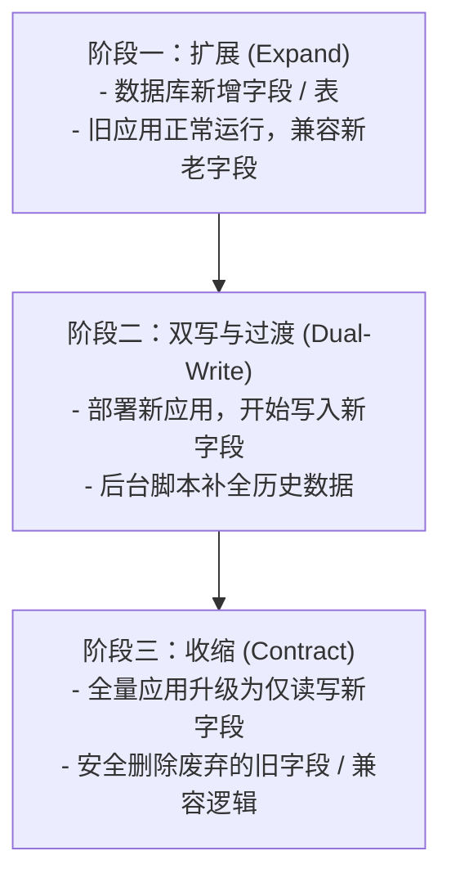
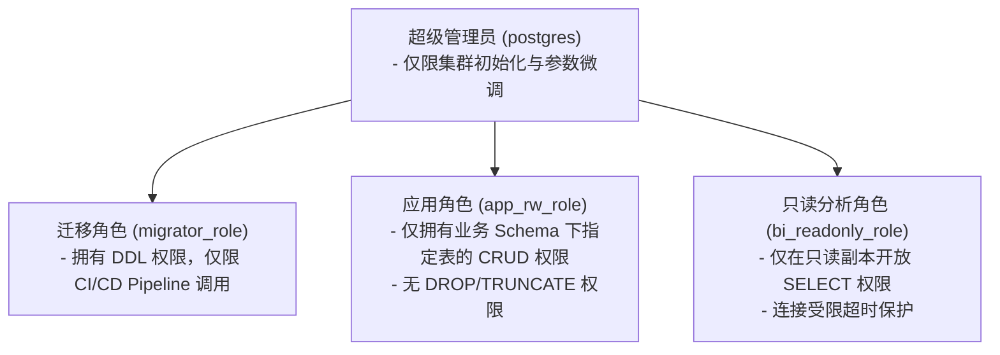

PostgreSQL 规范关注的是关系型数据库在后端微服务与核心数据存储架构中的选型配置、建模规范、字段类型、索引优化、SQL 查询编写、事务与锁控制、版本迁移（Alembic/Flyway）、数据安全及高可用运维的工程化标准。

PostgreSQL 作为一款功能完备的开源对象关系型数据库（ORDBMS），具备严格的 ACID 保证、强大的复杂查询能力以及丰富的高级特性（如 JSONB、UUID、范围类型、时空扩展等）。为了统一数据库设计风格、保障高并发下系统的吞吐能力与稳定性、消除生产隐患并降低后期演进与运维成本，特制定本规范。

---

# 一、前提与基础约定

为了统一基础设施与微服务底层数据交互标准，消除隐式类型转换、字符集乱码及跨时区问题，所有业务数据库实例必须遵循以下基础环境约定：

- **版本基线**：生产环境必须统一采用 **PostgreSQL 16 及以上长期支持（LTS）版本**（推荐 PostgreSQL 16.x 或 17.x），杜绝使用已停服（EOL）的旧版本。
- **全局时区基准**：数据库服务端时区强制设定为 **UTC**（`timezone = 'UTC'`）；涉及时间戳的数据字段统一采用 `TIMESTAMPTZ`（即 `timestamp with time zone`）。
- **统一字符编码**：数据库实例、模式（Schema）及数据表必须强制使用 **UTF-8** 编码，排序规则选用兼容性良好且无操作系统环境漂移风险的规则。
- **连接管理规范**：生产环境禁止应用直连 PostgreSQL 数据库主控进程，必须经由连接池中间件（如 **PgBouncer**）或客户端专属异步连接池（如 Python `asyncpg` / Go `pgx`）接入，严禁短连接频繁创建与销毁。

## 1.1 字符集与排序规则配置

新建数据库实例时必须显式指定编码与排序规则：

```sql
CREATE DATABASE app_db
    WITH OWNER = app_owner
    ENCODING = 'UTF8'
    LC_COLLATE = 'C.UTF-8'
    LC_CTYPE = 'C.UTF-8'
    TEMPLATE = template0;
```

> [!IMPORTANT]
> - 建议采用 `C.UTF-8` 或 PostgreSQL 15+ 支持的内置 ICU Provider，避免因宿主操作系统 glibc 升级导致 `en_US.UTF-8` 等本地化排序规则变更，进而引发 B-Tree 索引损坏与唯一键约束校验异常。

## 1.2 日期与时间基准

与全局项目规范保持一致，时间交互与持久化遵循：

- **时刻类型**：所有涉及具体时刻的时间字段，必须采用 **`TIMESTAMPTZ`** 类型，严禁使用不带时区的 `TIMESTAMP`。
- **交互格式**：对外 API 与数据序列化严格遵循 **RFC 3339** 格式（例如 `2026-10-22T07:30:20.123Z`）。
- **时间生成权**：创建时间（`created_at`）、更新时间（`updated_at`）等审计字段默认值由数据库或后端服务端统一赋值为当前 UTC 时间，严禁接受客户端传入的时间作为凭据。

```sql
-- 字段定义标准示例
created_at TIMESTAMPTZ NOT NULL DEFAULT CURRENT_TIMESTAMP,
updated_at TIMESTAMPTZ NOT NULL DEFAULT CURRENT_TIMESTAMP
```

## 1.3 连接池与并发参数规范

PostgreSQL 采用多进程模型（Process-per-connection），单个连接占用内存通常在 5MB~20MB 不等，高并发直连将迅速耗尽内存并引发进程上下文切换风暴。

- **连接池模式**：采用 PgBouncer 等中间件时，无临时表、无命名预编译语句依赖的微服务强制使用**事务级连接池（Transaction Pooling）**；仅在特殊长事务或重度依赖特定会话变量的场景使用会话级（Session Pooling）。
- **连接数基准公式**：
  $$\text{Max\_Connections} \approx ((\text{CPU 核心数} \times 2) + \text{有效磁盘轴数})$$
  通常单节点应用侧连接数配额控制在 50~200 以内即可发挥出最高吞吐量，严禁盲目调大 `max_connections` 到 1000 以上。
- **超时保护参数**（在 `postgresql.conf` 或连接会话中强制配置）：

| 配置项 | 推荐值 | 说明 |
| --- | --- | --- |
| `statement_timeout` | `15000` (15s) | 单条查询超时上限，防止恶意或慢查询耗尽连接与 CPU |
| `lock_timeout` | `5000` (5s) | 获取表锁/行锁的最大等待时间，避免排队锁死正常请求 |
| `idle_in_transaction_session_timeout` | `10000` (10s) | 事务内空闲超时自动强制断开，彻底杜绝悬挂事务阻止 VACUUM |

---

# 二、命名规范

统一且清晰的命名风格能够大幅降低团队沟通成本，规避大小写敏感陷阱与关键字冲突。

## 2.1 通用命名原则

- **格式统一**：所有数据库对象（库名、模式名、表名、视图名、列名、索引名、函数名、触发器等）**强制使用全小写蛇形命名（lower_snake_case）**。
- **禁止使用引号包裹**：严禁在 DDL 或 SQL 中使用双引号（如 `"UserName"`），一旦使用双引号会导致大小写敏感，后续所有查询必须携带双引号，极易引发运行时语法错误。
- **字符集与长度限制**：仅允许使用英文字母 `a-z`、数字 `0-9` 与下划线 `_`；标识符长度**不得超过 63 字节**（PostgreSQL `NAMEDATALEN` 限制为 64，超出会被隐式截断）。
- **禁止使用保留字**：严禁直接使用 PostgreSQL 保留关键字作为对象名称，如 `user`, `order`, `group`, `table`, `limit`, `offset`, `type`, `status` 等；必须使用具有具体业务含义的复合词，如 `users`, `orders`, `user_groups`, `device_status`。

## 2.2 模式（Schema）规范

- 单个微服务独占对应的业务 Schema，避免将所有业务表集中在默认的 `public` 模式中。
- Schema 命名通常与微服务或领域边界对应，全小写字母，例如：`auth`, `device`, `order`, `billing`。
- 搜索路径配置：在服务连接串中显式声明 `search_path=order,public`。

## 2.3 数据表命名规范

- **实体表统一复数形式**：为与 RESTful API 资源集合规范对齐，常规业务实体表采用**小写蛇形复数名词**，例如 `users`, `products`, `orders`, `device_firmwares`。
- **多对多关联关系表**：采用关联双方单数或复数实体的拼接形式，表达关联语义，例如：
  - `user_roles`（用户与角色关联表）
  - `order_items`（订单与其从属项关联表）
- **日志与时序明细表**：采用 `{entity}_{type}_logs` 形式，例如 `audit_logs`, `device_metric_logs`。
- **临时与归档表**：
  - 临时备份表（仅在维护期允许存在）：`tmp_{table}_{YYYYMMDD}`
  - 历史归档表：`archived_{table}_{YYYY}`

## 2.4 字段命名规范

- **主键字段**：物理主键统一命名为 **`id`**。
- **外键关联字段**：强制采用 `{引用的实体单数形式}_id`，例如 `user_id`, `order_id`, `product_id`。
- **状态字段**：采用 `{business_concept}_status` 或 `status`（若上下文明确），其存储建议采用语义明确的枚举映射码，如 `payment_status`, `device_status`。
- **布尔字段**：强制使用 `is_`、`has_` 或 `can_` 前缀，例如 `is_active`, `is_deleted`, `has_discount`, `can_retry`。
- **时间字段**：强制使用 `_at` 后缀表示具体时刻点，例如：
  - `created_at`：记录创建时间
  - `updated_at`：记录最后修改时间
  - `deleted_at`：软删除标记时间
  - `expired_at`：过期截止时间
  - 纯日期字段使用 `_date` 后缀，如 `birthday_date`, `settlement_date`。
- **货币与金额字段**：
  - 采用复合命名 `{concept}_amount` 或 `{concept}_cents`。
  - 必须在字段注释或团队内部明确计量单位（例如以分为单位的整数或带小数位的定点数）。

## 2.5 索引与约束命名规范

约束与索引必须遵循如下显式前缀，严禁依赖数据库自动生成的随机命名，便于迁移、回滚及慢日志定位：

| 类型 | 命名格式 | 示例 | 说明 |
| --- | --- | --- | --- |
| **主键约束** | `pk_{table}` | `pk_users` | 主键唯一标识 |
| **外键约束** | `fk_{table}_{ref_table}_{col}` | `fk_orders_users_user_id` | 表级物理外键约束 |
| **唯一索引 / 约束** | `uk_{table}_{col1}_{col2}` | `uk_users_email` | 业务唯一性校验 |
| **普通二级索引** | `idx_{table}_{col1}_{col2}` | `idx_orders_user_id_status` | 复合索引按引导列顺序排列 |
| **部分条件索引** | `idx_{table}_{col}_p_{condition}` | `idx_users_phone_p_active` | 携带 WHERE 过滤条件的索引 |
| **全文 / GIN 索引** | `gin_{table}_{col}` | `gin_devices_payload` | JSONB 或分词向量索引 |
| **CHECK 检查约束** | `ck_{table}_{col}_{rule}` | `ck_orders_amount_positive` | 数值或逻辑范围检查 |

---

# 三、数据类型选型规范

合理选型能显著节约磁盘空间、降低 I/O 压力并提升缓存命中率。

## 3.1 主键设计规范：UUIDv7 vs BIGINT

分布式与微服务系统中，主键选型遵循如下矩阵：

| 选型方案 | 适用场景 | 优势 | 劣势 / 注意事项 |
| --- | --- | --- | --- |
| **UUIDv7**<br>*(强力推荐)* | 全局分布式实体、跨库同步、对外暴露 ID、微服务架构 | 包含毫秒级时间戳前缀，**局部单调递增**；在 B-Tree 索引中顺序追加，不会造成页面频繁分裂与磁盘碎片；天然防遍历猜测。 | 占用 16 字节，比 BIGINT 略大。PostgreSQL 17+ 内置支持，旧版可依托插件或业务生成。 |
| **BIGINT IDENTITY** | 内部字典表、高频轻量关联表、只读元数据表 | 占用 8 字节，存储极为紧凑，自增连续，写入效率极高。 | 单库受限；对外暴露易引发商业数据泄露（被顺序遍历爬取）。 |
| **UUIDv4**<br>*(严禁作为聚簇主键)* | 仅用于短生命周期临时 Token、追踪请求的 `trace_id` | 纯随机，全局无序。 | **严禁作为高频写入表的主键**！完全随机的写入会导致 B-Tree 索引剧烈随机 I/O，写入吞吐断崖式下跌。 |

```sql
-- 方式 A：PostgreSQL 17+ 原生 UUIDv7 主键表结构
CREATE TABLE orders (
    id UUID PRIMARY KEY DEFAULT gen_random_uuid_v7(),
    order_no VARCHAR(64) NOT NULL,
    created_at TIMESTAMPTZ NOT NULL DEFAULT CURRENT_TIMESTAMP
);

-- 方式 B：自增 BIGINT 主键（使用标准 IDENTITY 语法，替代旧式 SERIAL）
CREATE TABLE system_configs (
    id BIGINT GENERATED ALWAYS AS IDENTITY PRIMARY KEY,
    config_key VARCHAR(128) NOT NULL,
    config_value TEXT NOT NULL
);
```

> [!TIP]
> 针对外部暴露的实体 ID（例如在 RESTful API 中），建议统一采用 String 形式的 UUIDv7 或通过加密 HashId 映射，避免暴露数据库自增连续序列。

## 3.2 数值类型规范

- **布尔类型**：必须使用原生 `BOOLEAN` 类型（取值 `true` / `false`），严禁使用 `INT2(0/1)` 或 `VARCHAR(1)` 模拟布尔值。
- **整型选型**：
  - `SMALLINT` (2 Bytes)：取值 -32,768 ~ 32,767。适用于状态机码值、类型字典、星期月份等极小范围数值。
  - `INTEGER` (4 Bytes)：取值 -21 亿 ~ 21 亿。适用于常规内部非主键计数、排序编号。
  - `BIGINT` (8 Bytes)：主键、外键引用 ID、大额计数器、全局唯一分布式雪花 ID 强制使用 `BIGINT`。
- **货币与金融数值**：
  - **严禁使用 `REAL`、`DOUBLE PRECISION` 或 `FLOAT`** 存储货币金额、汇率或账户余额，浮点数运算存在固有的二进制精度丢失缺陷。
  - 方案一（推荐）：采用精确数值类型 `NUMERIC(precision, scale)`，例如金额使用 `NUMERIC(18, 4)`，支持 4 位小数位，杜绝四舍五入偏差。
  - 方案二：以最小货币单位（如“分”、“厘”）为基准，使用 `BIGINT` 存储，前端或网关层仅做格式化除法展示。

## 3.3 字符串与文本类型规范

- **`VARCHAR(n)` vs `TEXT`**：
  - 在 PostgreSQL 底层实现中，`VARCHAR(n)`、`VARCHAR` 与 `TEXT` 存储开销与查询性能完全一致（均为变长带头部的 `varlena` 结构）。
  - 当业务字段有严格的长度边界且长度超出属于业务异常时（如手机号、国家代码、邮编、MD5/SHA256 哈希值），应使用 `VARCHAR(n)`。
  - 描述性文本、富文本内容、不限制长度的长字符应使用 `TEXT`。
- **严禁使用定长 `CHAR(n)`**：
  - `CHAR(n)` 在不足长度时会自动用空格补齐尾部，不仅浪费存储空间，还会引发末尾空格比对不一致等隐蔽 Bug。

## 3.4 JSONB 选型与反模式防范

PostgreSQL 提供了 `JSON` 与 `JSONB` 两种半结构化格式，**业务中必须一律选用 `JSONB`**：

- `JSON` 仅做纯文本存储，每次读取必须重新解析语法树，不支持 GIN 快速索引查找。
- `JSONB` 采用预解析二进制格式存储，读写存在轻微解析开销，但支持快速键值定位、丰富操作符以及 GIN 倒排索引。

> [!WARNING]
> **警惕 JSONB 滥用（反模式）**：
> 1. 核心业务主干属性（如订单金额、订单状态、关联用户 ID 等）**必须坚持结构化拆分为一等公民字段（First-class Columns）**。
> 2. 只有符合以下特征的数据才允许放入 `JSONB`：
>    - 动态属性、三方异步回调原始报文（Payload）、用户自定义元数据（Metadata）、跨版本变动频繁的异构扩展参数。
> 3. 严禁将大数组（数百元素以上）存放在单个行内的 JSONB 字段中，会导致 TOAST 读写频繁触发。

## 3.5 枚举类型（ENUM）设计策略

针对有限离散取值的状态字段，存在原生 `CREATE TYPE ... AS ENUM` 与 `SMALLINT / VARCHAR` 两种流派：

- **系统核心高频表推荐**：采用 `SMALLINT` + 应用层 Enum 类 / 代码常量，并在数据库层添加显式 `CHECK` 约束（如 `CHECK (status IN (10, 20, 30))`）。
  - *原因*：PostgreSQL 原生 `ENUM` 类型在删除枚举值、重排枚举顺序时需要执行较为繁琐的元数据 DDL，甚至需要重构类型，对平滑灰度迁移不友好。
- **配置与元数据表**：若枚举范围极其稳定（如性别 `male`, `female`, `unknown`），可采用原生 `ENUM`。

## 3.6 软删除设计规范

为了审计合规与误操作恢复，核心实体普遍引入软删除机制：

- 软删除标记字段一律采用 **`deleted_at TIMESTAMPTZ NULL DEFAULT NULL`**，严禁使用 `is_deleted BOOLEAN`。
- *原因*：`deleted_at` 能够精确保留删除发生时刻，同时其与唯一索引配合时天然友好（利用 PostgreSQL 允许多行 `NULL` 值而不违反唯一约束的特性，或配合部分索引）。

```sql
-- 推荐的软删除与唯一键共存方案（部分唯一索引）
CREATE TABLE users (
    id UUID PRIMARY KEY DEFAULT gen_random_uuid_v7(),
    email VARCHAR(255) NOT NULL,
    phone VARCHAR(32),
    deleted_at TIMESTAMPTZ DEFAULT NULL,
    created_at TIMESTAMPTZ NOT NULL DEFAULT CURRENT_TIMESTAMP,
    updated_at TIMESTAMPTZ NOT NULL DEFAULT CURRENT_TIMESTAMP
);

-- 仅对未删除的记录生效唯一性校验，删除后可重新注册相同邮箱
CREATE UNIQUE INDEX uk_users_email_active 
    ON users (email) 
    WHERE deleted_at IS NULL;
```

---

# 四、表结构与通用模型设计

所有由服务端持久化的数据库表必须具备统一的审计轨迹能力，遵循标准化结构定义。

## 4.1 通用审计基类字段（AuditMixin）

结合 `FastAPI 项目规范` 与通用 ORM 设计，所有标准业务表必须包含如下基础通用列：

```sql
CREATE TABLE example_entities (
    -- 1. 主键
    id UUID PRIMARY KEY DEFAULT gen_random_uuid_v7(),
    
    -- 2. 租户隔离（多租户系统必选）
    tenant_id UUID NOT NULL,
    
    -- 3. 核心业务字段
    name VARCHAR(128) NOT NULL,
    status SMALLINT NOT NULL DEFAULT 1,
    
    -- 4. 乐观锁并发版本号（涉及并发修改的关键实体必选）
    version INTEGER NOT NULL DEFAULT 1,
    
    -- 5. 通用审计与操作人跟踪
    created_by UUID,
    updated_by UUID,
    
    -- 6. 时间轨迹
    created_at TIMESTAMPTZ NOT NULL DEFAULT CURRENT_TIMESTAMP,
    updated_at TIMESTAMPTZ NOT NULL DEFAULT CURRENT_TIMESTAMP,
    deleted_at TIMESTAMPTZ DEFAULT NULL
);
```

## 4.2 非空约束（NOT NULL）优先原则

- **默认非空**：所有列在创建时必须优先考虑声明为 **`NOT NULL`**，并赋予合理的业务默认值。
- **规避三值逻辑（Three-Valued Logic）**：SQL 中的 `NULL` 会导致逻辑判断退化为 `TRUE`, `FALSE`, `UNKNOWN`，使得 `NOT IN`、`COUNT()`、聚合函数及不等式比对极易产生反直觉结果。
- **允许 NULL 的场景**：外键引用置空（`ON DELETE SET NULL`）、软删除时间（`deleted_at`）、特定尚未完成的生命周期步骤（如 `paid_at` 支付时刻）。

## 4.3 外键约束与级联控制（物理外键 vs 逻辑外键）

- **中低频核心业务、强一致性场景**（如用户权限、基础配置）：必须显式定义数据库**物理外键约束**，保障数据引用完整性，防止脏孤儿数据产生。
- **超高并发分库分表、大规模秒杀/日志流场景**：可采用**逻辑外键**（由应用程序 Service 事务编排保证关联关系），避免在高频写操作下由于外键行级共享锁导致级联死锁与性能伸缩瓶颈。
- **级联删除警示**：对外键约束严禁轻率配置 `ON DELETE CASCADE`，防止上游父表单行记录误删触发级联全表数据物理擦除；默认采用 `ON DELETE RESTRICT` 或 `ON DELETE NO ACTION`。

## 4.4 宽表防范与 TOAST 行溢出优化

PostgreSQL 单行大小上限默认为 8KB（单个 Page 页面大小）。当单行数据超过约 2KB 时，PostgreSQL 会自动将大字段（如长 `TEXT`, `JSONB`, `BYTEA`）转移至 **TOAST（The Oversized-Attribute Storage Technique）** 独立外部存储区。

- **性能影响**：TOAST 表数据是压缩切块存储的，频繁查询包含 TOAST 字段的宽表会导致额外的磁盘 I/O 和解压缩 CPU 开销。
- **规约**：
  - 严禁盲目设计拥有数十个冗余字段的超宽表。
  - 对于超出 10KB 级别的大型附件、音视频裸流、固件二进制，**严禁使用数据库 `BYTEA` 存储**，必须上传至对象存储（S3/OSS/MinIO），数据库内仅保存资源 URL 字符串与 SHA-256 校验和。

---

# 五、索引设计与优化规范

索引是保障查询性能的核心工具，但不合理的索引会拖垮写入吞吐并大幅增加磁盘与内存开销。

## 5.1 索引类型选型矩阵

PostgreSQL 拥有非常丰富的索引技术体系，必须针对数据形态与查询特征精准选型：

| 索引类型 | 适用操作符与查询场景 | 典型字段示例 | 注意事项 |
| --- | --- | --- | --- |
| **B-Tree**<br>*(默认)* | `=`, `<`, `<=`, `>`, `>=`, `BETWEEN`, `IN`, `IS NULL`, `ORDER BY` | 主键 `id`, 外键 `user_id`, 时间 `created_at` | 最通用，支持排序与范围扫描。 |
| **GIN**<br>*(Generalized Inverted Index)* | 半结构化与集合包含操作：`@>`, `?`, `?&`, `?\|`, 全文检索 `@@`, 数组类型包含 `&&` | 标签数组 `tags text[]`, 动态属性 `metadata jsonb` | 倒排索引；写入更新成本较 B-Tree 高，适合读多写少。 |
| **BRIN**<br>*(Block Range Index)* | 超大规模海量时序表（千万~数十亿级）、自然物理追加排序的单调自增字段 | 传感器时序表 `logged_at`, 历史归档流表 | 占用空间仅为 B-Tree 的 1%~5%；依赖物理数据存储的物理聚集顺序。 |
| **GiST / SP-GiST** | 几何空间地理（PostGIS）、多维重叠判断、区间范围重叠 `&&` | 空间坐标 `point`, 时间区间 `tsrange` | 需配合 PostGIS 插件或范围类型使用。 |

## 5.2 复合索引与最左前缀法则

- **引导列选择**：建立复合索引 `(col1, col2, col3)` 时，必须将**区分度最高（选择性最强）且最常用于等值条件 `=`** 的列作为最左引导列。
- **范围查询放后**：若查询包含范围条件（如 `created_at >= '...'`），应将范围列置于复合索引的末位，因为 B-Tree 索引在遭遇范围扫描后，后续列将无法用于索引加速过滤。
- **单表索引总数限制**：单张常规业务表的索引总数**不得超过 5 个**。过多的索引会导致每一次 `INSERT`, `UPDATE`, `DELETE` 产生昂贵的索引页面同步刷新，并加剧写写锁争用。

## 5.3 覆盖索引与 `INCLUDE` 子句（Index-Only Scan）

为了彻底避免回表（Heap Fetch）带来的随机 I/O 读取，可使用 PostgreSQL 的覆盖索引特性：

```sql
-- 将查询中需要投影返回、但不需要作为过滤条件的列挂载在 INCLUDE 子句中
CREATE INDEX idx_orders_user_status_inc 
    ON orders (user_id, status) 
    INCLUDE (total_amount, created_at);

-- 执行如下查询时，PostgreSQL 可直接执行 Index-Only Scan，零回表开销
SELECT user_id, status, total_amount, created_at
FROM orders
WHERE user_id = '018f26a1-9a74-7221-a476-886ecb4f8d91'
  AND status = 2;
```

> [!NOTE]
> `INCLUDE` 字段仅保存在 B-Tree 的叶子节点，不参与树枝节点的键值排序与拆分，既能实现 Index-Only Scan，又比直接将这些字段放入复合索引键更节省索引树体积。

## 5.4 部分索引（Partial Index）优化

当查询过滤条件仅聚焦在表内极小比例（如 10% 以下）的局部活跃数据时，**必须优先采用带 `WHERE` 条件的部分索引**：

```sql
-- 场景：全表数千万行，但系统 99% 的查询只关注“待处理 (status = 0)”的任务队列
CREATE INDEX idx_tasks_pending 
    ON tasks (created_at) 
    WHERE status = 0;
```

- **优势**：
  - 索引体积仅占全量数据的极小比例，能完整驻留在共享内存（Buffer Pool）中。
  - 已完成状态（`status = 1`）的大量归档写入与更新操作完全不需要维护该索引，消除写放大。

## 5.5 索引反模式与失效避坑

1. **禁止在索引列上直接套用函数或进行数学运算**：
   - 错误写法：`WHERE EXTRACT(YEAR FROM created_at) = 2026`（导致索引失效，触发全表扫描）。
   - 正确写法：`WHERE created_at >= '2026-01-01T00:00:00Z' AND created_at < '2027-01-01T00:00:00Z'`。
2. **严禁隐式类型转换**：
   - 若字段定义为 `VARCHAR`，查询条件必须传递字符串，严禁传递数值常量，否则 PostgreSQL 的类型推断器会选择全表扫描并将每行字段显式转为数值比对。
3. **前导模糊查询失效**：
   - `LIKE '%keyword'` 无法走常规 B-Tree 索引；若有高频全文搜索或模糊匹配需求，必须使用 `pg_trgm` 扩展的 GIN/GIST 索引（`trgm` 三元分词）。

---

# 六、SQL 开发与查询规范

高效、健壮的 SQL 语句是规避生产慢查询与级联宕机的第一道防线。

## 6.1 查询编写军规

- **严禁 `SELECT *`**：所有业务查询必须显式列出所需的字段名。
  - *原因*：`SELECT *` 会阻断 Index-Only Scan 优化、消耗额外的网络带宽与客户端序列化内存，并且当下游新增字段时极易引发 ORM/契约映射异常。
- **确定性排序规约**：涉及分页的查询必须显式指定 `ORDER BY`，且排序列组合必须具备全局唯一确定性（通常在末尾追加主键 `ORDER BY created_at DESC, id DESC`），防止不同批次之间因为物理行存储迁移发生数据重复或漏读。
- **避免大集合 `IN` 查询**：`IN` 条件内的参数个数严禁超过 500 个；大集合匹配应改用 `JOIN` 临时表或使用 PostgreSQL 的 `WHERE id = ANY(:array)` 原生数组匹配机制。

## 6.2 分页性能规约（游标 / Seek 分页）

- **禁止深分页大 `OFFSET`**：
  - 错误写法：`SELECT id, name FROM users ORDER BY id LIMIT 20 OFFSET 500000;`
  - *原因*：`OFFSET 500000` 意味着数据库必须在底层顺序扫描并物理跳过前 50 万条有效行，随着页码加深耗时呈线性恶化。
- **游标分页（Seek / Keyset Pagination）**：大数据量流式分页强制采用基于上一页末尾记录游标的 Seek 分页：

```sql
-- 游标分页标准范式
SELECT id, title, created_at
FROM articles
WHERE (created_at, id) < (:last_seen_created_at, :last_seen_id)
ORDER BY created_at DESC, id DESC
LIMIT :page_size;
```

## 6.3 批量写入与 UPSERT 规范

- **批量插入合并**：严禁在循环体内单条执行 `INSERT` 提交。必须采用单条多行值批量插入，每次批量提交规模控制在 **500 ~ 2000 行** 之间：

```sql
INSERT INTO device_metrics (device_id, metric_key, metric_value, recorded_at)
VALUES 
    ('dev_01', 'temp', 24.5, CURRENT_TIMESTAMP),
    ('dev_02', 'temp', 25.1, CURRENT_TIMESTAMP),
    ('dev_03', 'temp', 23.8, CURRENT_TIMESTAMP);
```

- **标准 UPSERT 语法（ON CONFLICT）**：业务存在“存在则更新，不存在则创建”的逻辑时，必须使用原子 `ON CONFLICT` 语法，严禁先查后插（引发并发竞态条件）：

```sql
INSERT INTO user_preferences (user_id, theme, notification_enabled, updated_at)
VALUES (:user_id, :theme, :notification_enabled, CURRENT_TIMESTAMP)
ON CONFLICT (user_id) 
DO UPDATE SET 
    theme = EXCLUDED.theme,
    notification_enabled = EXCLUDED.notification_enabled,
    updated_at = CURRENT_TIMESTAMP;
```

## 6.4 事务隔离与高并发锁控制

PostgreSQL 默认事务隔离级别为 **Read Committed（读已提交）**。在高并发修改场景下遵循以下准则：

- **大事务拆分**：长事务会长期持有行锁并阻止被修改行旧版本（Tuple）的 VACUUM 回收，导致表膨胀。事务必须“快进快出”，严禁在事务生命周期内发起耗时网络 I/O（如调用外部 HTTP API、发送短信、高耗时计算）。
- **并发控制：乐观锁优先**：
  - 在实体表中维护 `version` 整数列，修改时通过带版本比对完成条件原子更新：
  ```sql
  UPDATE accounts 
  SET balance = balance - :amount, version = version + 1, updated_at = CURRENT_TIMESTAMP
  WHERE id = :account_id AND version = :expected_version;
  -- 若受影响行数返回 0，应用层抛出并发冲突异常并触发重试
  ```
- **悲观锁防御准则**：
  - 必须使用 `SELECT ... FOR UPDATE` 时，**强制追加 `NOWAIT` 或 `SKIP LOCKED`**，严禁使用裸 `FOR UPDATE` 无限期阻塞其他连接：
  ```sql
  -- 场景：高并发分布式工作队列消费
  SELECT id, payload 
  FROM task_queues 
  WHERE status = 'pending'
  ORDER BY priority DESC, id ASC 
  LIMIT 1
  FOR UPDATE SKIP LOCKED;
  ```
- **死锁防范顺序约定**：涉及多行记录或跨表锁定时，所有业务事务必须严格按照相同的物理顺序（例如始终按主键 `id ASC` 升序）逐行加锁。

## 6.5 执行计划分析与慢查询定位

研发与 DBA 分析查询瓶颈时，强制使用 `EXPLAIN (ANALYZE, BUFFERS)` 诊断真实耗时与内存命中：

```sql
EXPLAIN (ANALYZE, BUFFERS, TIMING, COSTS)
SELECT * FROM orders WHERE user_id = '...' ORDER BY created_at DESC LIMIT 10;
```

- **关注重点**：
  - 是否存在高代价的 `Seq Scan`（全表物理顺序扫描）。
  - `Buffers: shared hit`（内存命中块数）与 `read`（磁盘物理读取块数）的比值。
  - `Sort Method: external merge Disk`（内存不足溢出到磁盘临时文件排序，需调优 `work_mem`）。

---

# 七、数据库版本迁移规范（Database Migration）

系统架构严禁脱离版本管理随意在生产环境手工执行 DDL。所有表结构变更必须通过迁移脚本（如 Python 生态的 **Alembic** 或通用工具 **Flyway**）进行版本化审查与追踪。

## 7.1 迁移工程与脚本治理

结合 `BackEnd/FastAPI 项目规范`，所有的 DDL 变更统一归档于 `alembic/versions/` 目录：

- **单向不可变**：已合并至主干分支（Main/Master）并发布到环境的迁移脚本，**严禁再次编辑修改**；后续所有增量结构调整必须新开独立的 Migration 脚本追加提交。
- **必须提供可逆降级函数**：每个迁移脚本不仅要编写 `upgrade()` 逻辑，必须同步编写经过验证的 `downgrade()` 回滚逻辑。
- **环境隔离配置**：本地开发环境由 Alembic 依据 SQLAlchemy ORM 元数据自动生成基础模版（`alembic revision --autogenerate`），但合并前**必须由工程师人工二次审查实际生成的 SQL**，杜绝未预期的索引丢失或外键级联销毁。

## 7.2 零停机迁移原则（Expand-Contract 模式）

生产环境在高可用连续运转状态下，任何 DDL 均不得破坏正在运行的旧版本应用。重大变更遵循双阶段（Expand-Contract）展开收缩设计：



## 7.3 安全 DDL 操作准则

PostgreSQL 某些 DDL 操作会获取极其严苛的 `ACCESS EXCLUSIVE` 排他表锁，阻塞整张表的所有读写流量。生产环境 DDL 必须遵守如下红线：

### 1. 索引创建必须并发执行
- **禁止**：直接执行 `CREATE INDEX idx_name ON large_table (col);`（全表锁死写入直到索引构建完成）。
- **强制**：必须使用 **`CREATE INDEX CONCURRENTLY idx_name ON large_table (col);`**（在非阻塞后台流水线中逐步扫描并构建索引）。

### 2. 字段默认值赋值安全
- 在 PostgreSQL 11 及以上版本中，为现有表新增带有默认值的列（例如 `ALTER TABLE t ADD COLUMN flag BOOLEAN NOT NULL DEFAULT false;`）属于元数据快速修改，**不会触发全表物理重写**，安全高效。但在低版本或包含动态易变表达式（如 `DEFAULT clock_timestamp()`）时需极为谨慎。

### 3. 为海量大表添加非空约束（NOT NULL）的两步法
对千万级大表直接追加 `ALTER TABLE t ALTER COLUMN c SET NOT NULL;` 会导致全表行扫描锁死，应采用低锁风险的两步迁移法：

```sql
-- 第一步：创建只针对后续新数据生效的 CHECK 约束（NOT VALID 不阻塞历史表扫描）
ALTER TABLE large_orders 
    ADD CONSTRAINT ck_orders_user_id_not_null 
    CHECK (user_id IS NOT NULL) NOT VALID;

-- 第二步：后台校验现有历史数据完整性（仅获取 ShareUpdateExclusiveLock，完全不阻塞读写）
ALTER TABLE large_orders 
    VALIDATE CONSTRAINT ck_orders_user_id_not_null;
```

---

# 八、安全、权限与合规规范

数据是企业最核心资产，安全防御必须深入到数据库层面的访问控制、传输信道与静态落库。

## 8.1 最小权限原则与多角色分级

数据库严禁所有微服务共用最高管理员权限账号（`postgres`）。必须按职责分离原则创建分级角色：



```sql
-- 典型应用读写角色的受限授权示例
REVOKE ALL ON SCHEMA public FROM PUBLIC;
GRANT USAGE ON SCHEMA app_domain TO app_rw_user;
GRANT SELECT, INSERT, UPDATE, DELETE ON ALL TABLES IN SCHEMA app_domain TO app_rw_user;
ALTER DEFAULT PRIVILEGES IN SCHEMA app_domain GRANT SELECT, INSERT, UPDATE, DELETE ON TABLES TO app_rw_user;
```

## 8.2 敏感数据脱敏与存储合规

- **用户凭据与密码**：严禁明文或使用可逆算法存储用户密码。强制使用强单向哈希加盐算法，推荐 **Argon2id** 或 **Bcrypt**（工作因子 Work Factor 依据基准压测调整至约 200~300ms）。
- **核心合规敏感信息**（如身份证号、银行卡号、手机号码、通信密钥）：
  - 必须采用强对称加密存储（参照 RESTful 规范统一标准，采用 **AES-256-GCM** 加密后 Base64 编码落库）。
  - 加密密钥由 KMS（Key Management Service）或保密配置中心动态下发，禁止硬编码于代码仓库中。
- **行级安全策略（Row-Level Security, RLS）**：多租户共享数据库时，利用 PostgreSQL 原生 RLS 机制实施底层租户间数据物理级强隔离，防止应用侧代码漏写 `WHERE tenant_id = ...` 引发越权数据泄露。

## 8.3 SQL 注入防御与传输加密

- **强制参数化查询（Prepared Statements）**：应用层与数据库驱动交互，必须 100% 采用参数化绑定变量机制，**严禁在代码中利用字符串拼接拼凑 SQL**。
- **传输层加密（TLS/SSL）**：
  - 生产环境客户端连接字符串必须强制启用 SSL 验证：`sslmode=verify-full` 并配置 CA 根证书，杜绝内网中间人嗅探与攻击。

---

# 九、运维监控、高可用与灾备规范

高可用架构与健壮的运维观测机制是保障数据库 7x24 小时高可用（99.99%）的坚实基石。

## 9.1 高可用架构与读写分离

- **集群架构**：生产环境必须采用基于物理流复制（Streaming Replication）的高可用架构（如基于 **Patroni + etcd / Consul** 构建的自动化故障转移集群），杜绝单点故障（SPOF）。
- **读写分离策略**：
  - **主节点（Primary/Master）**：承接全量写事务及强一致性读请求。
  - **只读从节点（Standby/Replica）**：分流后台报表、复杂统计分析、数据导出及允许秒级复制延迟的常规列表查询。
  - **复制延迟控制**：监控指标必须采集 `pg_stat_replication` 中的 `replay_lag`，一旦从库延迟超过 3 秒，网关层应自动告警并熔断只读路由，将读流量回退至主库。

## 9.2 备份与灾备策略（RPO / RTO）

必须构建两级互补的备份体系，定期验证数据恢复可用性：

1. **持续 WAL 归档与物理热备（推荐 pgBackRest / Barman）**：
   - 开启持续 Write-Ahead Logging（WAL）日志归档。
   - 每周执行一次全量物理热备（Full Backup），每日执行一次增量备份（Incremental / Differential Backup）。
   - 保障数据库具备**任意时间点恢复能力（Point-in-Time Recovery, PITR）**，确保灾难场景下数据丢失（RPO）控制在 5 分钟以内。
2. **逻辑备份（pg_dump）**：每周或关键发布前针对核心配置表及高价值元数据导出结构与逻辑数据，用于轻量跨版本测试验证。
3. **恢复演练**：每季度至少组织一次全流程容灾恢复与数据校验实操演练。

## 9.3 核心性能指标与自动化告警阈值

运维监控平台（Prometheus + postgres_exporter）必须重点监控并针对如下核心指标设置阈值告警：

| 监控指标 | 指标源 / 视图 | 告警触发阈值 | 危害与应对措施 |
| --- | --- | --- | --- |
| **缓存命中率 (Cache Hit Ratio)** | `pg_stat_database` | `< 99%` | 共享内存 `shared_buffers` 不足或出现大量非索引全表大扫描 |
| **死锁发生率 (Deadlocks Count)** | `pg_stat_database.deadlocks` | 瞬时增量 `> 0` | 事务加锁顺序不一致，需介入排查锁冲突并优化业务事务流程 |
| **复制延迟 (Replication Lag)** | `pg_stat_replication` | `> 5000ms` 或 `> 100MB` | 从库重放拥堵，只读流量读到陈旧脏数据 |
| **连接池水位利用率** | `pg_stat_activity` / PgBouncer | `> 80%` | 连接未释放或遭遇突发慢查询堵塞，防范连接池耗尽抛错 |
| **最长活跃事务时长** | `pg_stat_activity` | `> 60s` | 悬挂长事务阻碍 VACUUM，需排查未提交的客户端网络连接 |
| **事务 ID 回绕风险 (XID Age)** | `datfrozenxid` | `> 1.5 亿` | 事务号回绕将导致整个数据库被迫进入只读停机保护，必须调优并激活 `autovacuum` |

## 9.4 Autovacuum 引擎维护与表膨胀调优

PostgreSQL 采用多版本并发控制（MVCC），更新和删除的行并不会立即被物理擦除，而是以死元组（Dead Tuples）残留在页中。必须确保 `autovacuum` 后台清理进程高效平稳运行：

- **严禁全局关闭 `autovacuum`**。
- **高频写大表针对性调优**：对于每日写入与更新百万级以上的高频变动表，应单独降低触发清理的阈值比例：

```sql
-- 针对特定高频写入表调优 Autovacuum 参数
ALTER TABLE active_device_states SET (
    autovacuum_vacuum_scale_factor = 0.05,  -- 死元组比例达到 5% 即触发清理（默认 0.2）
    autovacuum_vacuum_cost_limit = 1000,    -- 提高单次清理的 I/O 额度
    autovacuum_vacuum_cost_delay = 2        -- 降低每次休眠时间，加速垃圾回收
);
```
