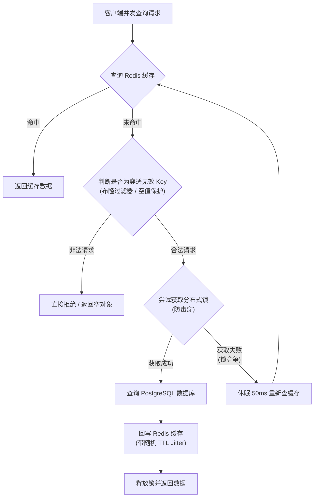
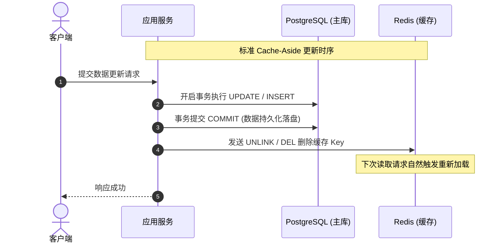
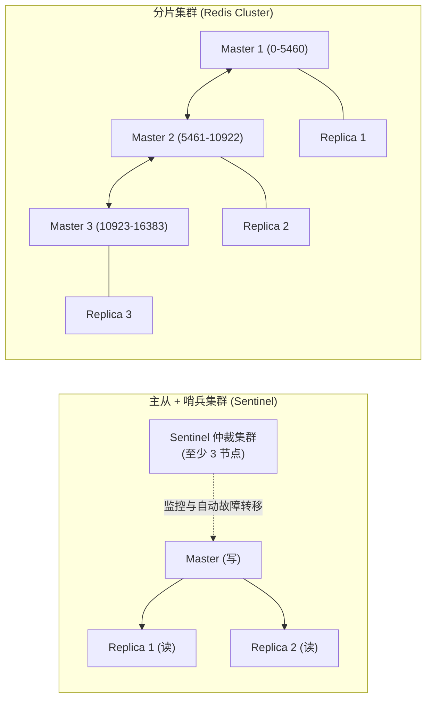

Redis 规范关注的是内存键值数据库（In-Memory K-V Store）在分布式后端架构中的业务定位、命名规范、数据结构选型、过期淘汰机制、缓存异常治理（穿透/击穿/雪崩）、大 Key/热 Key 防护、分布式锁实现、安全红线及高可用运维的工程化标准。

Redis 凭借单线程事件循环（基于 I/O 多路复用）与内存读写特性，具备亚毫秒级的高吞吐能力，但其内存资源的昂贵性、单线程对阻塞操作的敏感性，以及分布式缓存与主存储之间的一致性挑战，对工程规范提出了极高要求。为杜绝生产阻塞宕机、内存泄漏及脏读灾难，特制定本规范。

---

# 一、前提与基础约定

所有微服务与系统组件接入 Redis 服务时，必须严格遵守以下基础约定：

- **基线版本**：生产环境必须统一采用 **Redis 7.0 及以上版本**（或完全兼容的开源衍生版如 Valkey 7.x+），充分利用 Multi-Part AOF、Function 模块以及更细粒度的 ACL 权限机制。
- **协议与字符集**：数据键名（Key）与文本类值（Value）强制使用 **UTF-8** 字符编码；客户端优先采用 **RESP3** 协议通信以获取更丰富强类型的错误与返回映射。
- **核心定位准则**：
  - **允许用途**：高频热点缓存、分布式并发锁、高频递增计数器、轻量滑动窗口限流、短周期 Session/Token 存储。
  - **禁止用途**：**严禁将 Redis 作为唯一的数据主持久化存储（Single Source of Truth）**；严禁将不可丢弃、不可通过上游/数据库重建的核心账务或用户资产数据仅存储在 Redis 中。
- **连接池治理**：客户端必须强制使用长连接池（如 Python `redis-py` ConnectionPool / Go `go-redis`），严禁在请求处理流水线中反复建立短连接；连接池最大连接数（Max Active Connections）单实例推荐限制在 **50 ~ 200** 之间。

## 1.1 客户端核心参数规范

客户端配置必须显式设置三级超时保护，严禁使用驱动默认的无限阻塞参数：

| 参数项 | 推荐值 | 说明 |
| --- | --- | --- |
| `connect_timeout` | `1000ms` (1s) | TCP 建连握手超时，快速失败防止线程积压 |
| `read_timeout` | `2000ms` (2s) | 单次读响应超时，避免服务端卡顿拖垮调用方 |
| `write_timeout` | `2000ms` (2s) | 单次写响应超时 |
| `max_connections` | `50 ~ 100` | 结合微服务实例副本数计算，总量不得超过 Redis 单机允许上限 |
| `health_check_interval` | `30s` | 连接保活心跳检测，及时回收失效连接 |

---

# 二、键名（Key）设计与命名空间规范

规范的 Key 命名能够天然构成逻辑命名空间，便于按业务划分配额、慢日志排查、内存审计与前缀扫描。

## 2.1 统一 Key 命名范式

全局 Key 必须严格采用**英文半角冒号 `:`** 作为命名空间层级分隔符，命名结构定义如下：

```text
{业务域}:{模块/实体}:{业务主键/条件}:{属性/动作}
```

- **示例**：
  - 用户登录凭据：`auth:token:usr_018f26a1-9a74-7221-a476-886ecb4f8d91`
  - 订单缓存对象：`order:entity:ord_202611030001`
  - 商品库存计数：`inventory:sku:10086:stock`
  - 短信验证码限流：`limit:sms:rate:13800000000`
  - 设备活跃度位图：`device:online:bitmap:2026-11-03`

## 2.2 命名基础红线

1. **全小写命名**：Key 中的命名空间、业务字段除特定外部 ID（如包含大小写的大写 UUID）外，统一采用**全小写蛇形（lower_snake_case）**，严禁使用驼峰命名。
2. **长度约束**：Key 的整体长度应控制在 **44 字节以内**（最长不得超过 128 字节）。
   > [!NOTE]
   > Redis 底层使用简单动态字符串（SDS）存储字符串对象。当字符串长度 ≤ 44 字节时，Redis 会采用紧凑的 `embstr` 编码，内存分配与元数据保存在单块连续内存区；超出 44 字节会退化为 `raw` 编码，产生两次内存分配与指针寻址开销。
3. **禁止非法字符**：Key 中严禁包含空格、换行符 `\r\n`、引号 `"`、单引号 `'`、反斜杠 `\` 以及 Emoji 等特殊控制字符。
4. **禁止敏感信息直接裸露**：密码明文、未脱敏身份证、完整银行卡号等核心敏感信息严禁作为 Key 的一部分；用户手机号若作为 Key 必须哈希脱敏或加盐散列（如 `user:profile:md5(phone)`）。

---

# 三、数据结构选型规范

Redis 提供了多种数据结构，必须结合读写复杂度、内存占用与并发特征精准选型，避免“一律用 String 存 JSON”。

| 数据结构 | 最佳适用场景 | 慎用 / 禁用场景 | 内存与性能注意事项 |
| --- | --- | --- | --- |
| **String** | 简单 KV 缓存、分布式锁 Token、高频原子计数器 (`INCR`)、限流器 | 频繁需要局部读写其中某个字段的复杂对象 | 存储大 JSON 字符串会导致修改时全量覆盖与网络传输放大。 |
| **Hash** | 结构化对象属性（用户资料、设备实时状态、配置字典） | 包含数万以上键值对的超大 Hash 表 | 小 Hash 会自动使用 `listpack` 紧凑内存编码，节省大量内存指针。 |
| **List** | 轻量 FIFO 异步任务队列、固定长度的最新动态流（`LPUSH` + `LTRIM`） | 随机索引下标访问（`LINDEX` 超千条时复杂度退化为 $O(N)$） | 队列必须限制最大深度，防止积压导致 OOM。 |
| **Set** | 无序去重集合、标签体系、黑/白名单、抽奖去重 | 大集合交集/并集/差集运算（`SINTER`/`SUNION` 在生产阻塞单线程） | 集合基数较大时禁止实时执行计算命令，应拆解至客户端或离线批处理。 |
| **Sorted Set<br>(ZSet)** | 积分排行榜、时间线排序、延迟任务调度（Score=触发时间戳）、滑动窗口计数 | Score 频繁高并发修改的大集合；范围极大时的深偏移读取（`ZREVRANGE ... LIMIT`） | 依靠跳表（SkipList）与哈希表实现，内存开销约为普通 Set 的 2~3 倍。 |
| **Bitmap** | 极海量布尔型状态统计（用户日活签到、设备在线标记） | 稀疏离散 ID（如仅有 ID 为 10 亿的一个点，会导致中间全部分配内存） | 偏移量必须密集连续；单个 Bitmap 偏移量不建议超过 $2^{24}$（约 2MB）。 |
| **HyperLogLog** | 粗粒度基数去重计数（页面独立访客 UV、千万级去重搜索词） | 必须精准无误差的对账、结算、用户身份认证（存在约 0.81% 标准误差） | 每个 HLL Key 占用固定 12KB 内存，能统计高达 $2^{64}$ 个元素。 |
| **Stream** | 具备消息持久化、消费组（Consumer Group）、ACK 确认的轻量消息总线 | 超高吞吐大数据流（吞吐超 10 万/秒建议使用 Kafka） | 必须结合 `XADD ... MAXLEN ~ N` 控制消息总长度。 |

> [!WARNING]
> **发布订阅（Pub/Sub）使用红线**：
> Redis 原生 `PUBLISH` / `SUBSCRIBE` 不具备任何消息持久化、重放或消费确认能力。当订阅端发生网络闪断或重启时，**期间发布的消息将彻底丢失**。生产环境核心业务严禁使用 Pub/Sub 传递核心不可丢弃指令；跨服务事件解耦必须采用 Stream、MQTT 或外部专用消息队列（RabbitMQ / Kafka）。

---

# 四、过期时间（TTL）与内存淘汰策略规范

没有设置 TTL 的 Key 是内存泄漏和集群 OOM 的最大根源。

## 4.1 强制 TTL 约定

- **强制时效性**：除极少数全局静态配置字典、底层分布式锁常驻信号量外，**所有写入 Redis 的业务 Key 必须显式指定过期时间（TTL）**。
- **严禁无界累积**：严禁在 `SET`、`HSET`、`LPUSH` 后遗漏过期配置，导致临时产生的状态数据永久驻留内存。
- **推荐原子设置**：设置带过期时间的 String 必须使用原子指令 `SET key value EX seconds` 或 `PX milliseconds`，严禁拆解为 `SET` + `EXPIRE` 两条分离指令（网络异常会导致 Key 变成永久数据）。

## 4.2 缓存雪崩与 TTL 随机抖动（Jitter）

当大量热点缓存被集中设置相同的过期时长（如整点 3600 秒到期），到期时将触发缓存雪崩，海量流量瞬间击穿至数据库。

- **防护准则**：所有批量生成的缓存 Key，其过期时间必须强制叠加随机时间扰动（Jitter）：

$$\text{Actual\_TTL} = \text{Base\_TTL} + \text{random}(0, \text{Jitter\_Range})$$

```python
import random

# 基础过期时间 3600 秒 (1 小时)，随机追加 0 ~ 300 秒扰动
base_ttl = 3600
jitter = random.randint(0, 300)
actual_ttl = base_ttl + jitter

await redis_client.set(f"order:cache:{order_id}", order_json, ex=actual_ttl)
```

## 4.3 内存上限与淘汰策略选型（Eviction Policy）

生产实例的 `redis.conf` 必须强制配置 `maxmemory` 参数（通常为宿主物理机内存的 **70%~75%**，预留充足内存给 Redis 自身进程开销、BGSAVE 的 Copy-On-Write 以及主从复制缓冲区），并明确设置内存淘汰策略：

```text
# redis.conf 核心推荐配置
maxmemory 8gb
maxmemory-policy volatile-lru
```

| 淘汰策略 | 适用架构场景 | 机制与优缺点 |
| --- | --- | --- |
| **`volatile-lru`**<br>*(强力推荐)* | 大部分常规微服务缓存 | 仅在**设置了过期时间（TTL）**的键集合中淘汰最近最少使用的数据。能确保未设置过期的全局核心元数据不被意外丢弃。 |
| **`allkeys-lru`** | 纯粹的高速数据缓存层（全库可清） | 在**全体键集合**中淘汰最近最少使用的数据。适合纯只读缓存场景，内存利用率极高。 |
| **`volatile-lfu`** | 访问频率冷热分明的数据集 | 淘汰访问频次最低且带 TTL 的键，比 LRU 更能抵抗突发偶发访问的干扰。 |
| **`noeviction`**<br>*(严禁在纯缓存系统中使用)* | 强持久化账本场景 | 内存满后直接拒绝所有写入操作并报错 `OOM command not allowed`，导致业务写崩溃。 |

---

# 五、大 Key（BigKey）与热 Key（HotKey）治理规范

BigKey 与 HotKey 是单线程架构下引发服务阻塞与连接崩溃的头号杀手。

## 5.1 BigKey 定义标准与红线

符合下列任一条件的键，均被定义为生产危险级 BigKey：

| 类型 | 危险级 BigKey 判定阈值 | 生产红线建议 |
| --- | --- | --- |
| **String** | 单值大小 `> 10 KB` | 严禁存储超过 `500 KB` 的单文本/二进制对象 |
| **Hash / Set** | 元素个数 `> 5,000` 或内存占用 `> 5 MB` | 单集合成员数建议控制在 `1,000` 以内 |
| **List** | 列表长度 `> 10,000` 或内存占用 `> 5 MB` | 队列必须实时消费并用 `LTRIM` 压制 |
| **ZSet** | 成员个数 `> 5,000` 或内存占用 `> 5 MB` | 排行榜只保留 Top N（如 Top 500） |

## 5.2 BigKey 危害与治理方案

### 1. 核心危害
- **单线程阻塞**：读取或删除（`DEL`）BigKey 耗时数十至数百毫秒，期间 Redis 无法响应任何其他客户端命令。
- **主从延迟与流控**：全量复制或从库重放 BigKey 会造成网络缓冲区打满（Replication Buffer Overflow）并引发主从断连重同步。
- **集群倾斜**：在 Redis Cluster 中，单个节点内存可能因一个 BigKey 暴增，导致分片内存严重不均。

### 2. 治理与拆分方案
- **按 Hash 槽分桶（Sharding）**：将包含 10 万个字段的大 Hash 表通过哈希取模拆解为多个分片桶：
  $$\text{bucket\_id} = \text{CRC32}(\text{sub\_key}) \pmod{100}$$
  `Key: user:attributes:bucket_42 -> Field: sub_key`
- **异步安全删除**：严禁在生产对集合类 BigKey 直接执行阻塞性 `DEL` 命令；必须使用异步非阻塞删除 **`UNLINK`**（Redis 4.0+），由后台 Lazy-Free 线程回收内存：

```bash
# 错误做法（同步阻塞主线程）：
DEL big_hash_key

# 正确做法（异步非阻塞回收）：
UNLINK big_hash_key
```

## 5.3 HotKey（热点 Key）识别与应对

当某个特定 Key 的每秒访问频率（QPS）达到数千至数万以上（如明星爆料、秒杀核心 SKU），会造成单节点网卡带宽或 CPU 核心打满。

### 应对方案：
1. **多级缓存（L1 本地内存 + L2 Redis）**：
   - 接入服务端本地内存缓存（如 Python 的 `cachetools`、Go 的 `go-cache` / `bigcache`、Java 的 `Caffeine`）。
   - 设置极短的本地过期时间（如 1~3 秒），99% 的读流量直接在应用层拦截消化。
2. **热点散列分片（Key 副本散列）**：
   - 将热点 Key 复制为多个带随机后缀的分片副本并分散至集群各节点：
   - `inventory:sku:10086:stock_replica_1`, `..._replica_2`, `..._replica_3`
   - 客户端读取时随机哈希路由：`sku_key = f"inventory:sku:10086:stock_replica_{random.randint(1, 3)}"`。

---

# 六、缓存经典异常与高并发防护

在高并发微服务系统中，数据库通常是吞吐瓶颈。必须系统化防御缓存穿透、缓存击穿与雪崩。



## 6.1 缓存穿透（Cache Penetration）防护

**现象**：恶意攻击者或异常流量持续查询**数据库和缓存中均不存在的 Key**，导致每次请求直接穿透到数据库，拖垮主库。

- **防御手段 A：空值/空对象缓存（Null Caching）**：
  - 查库为空时，同样在 Redis 中缓存一个空值标记（如空字符串 `""` 或 `"{}"`），但必须设置**极短的过期时间（30~60 秒）**。
- **防御手段 B：布隆过滤器（Bloom Filter）**：
  - 利用 RedisBloom 模块或服务启动时在内存中加载位图，通过多哈希映射判定数据是否存在；判定不存在者直接拦截阻断。

## 6.2 缓存击穿（Cache Breakdown）防护

**现象**：某一个**访问量极高的热点 Key** 在某个瞬时点正好过期失效，海量并发同时发现缓存未命中，涌向数据库同时发起构建。

- **防御手段：互斥锁 / 分布式锁重建（Mutex Lock）**：
  - 仅允许争抢到锁的单个工作线程访问数据库并回写缓存，其他未获得锁的请求自旋重试读取新缓存。

## 6.3 数据一致性保障（Cache-Aside 模式）

业务系统中最经典、最稳健的数据同步策略为 **Cache-Aside Pattern（旁路缓存模式）**：

1. **读取流程**：先查缓存，命中则返回；未命中则查数据库，再回写缓存并返回。
2. **更新流程**：**必须先更新/提交数据库，成功后再删除缓存（Cache Invalidation）**。

> [!CAUTION]
> **严禁在更新数据时采用“先删除缓存，再更新数据库”**：
> 在高并发下，线程 A 先删除了缓存，此时线程 B 读请求未命中缓存，从数据库读取了旧数据并回写到缓存中，紧接着线程 A 才完成数据库更新。这将导致缓存中永久驻留陈旧脏数据，直到 TTL 过期。



---

# 七、分布式锁与并发控制规范

分布式锁是协调多节点互斥访问共享资源的重要机制，任何实现漏洞都将引发超卖或资产核算错乱。

## 7.1 分布式锁核心安全原则

一个安全可靠的 Redis 分布式锁必须同时满足以下四项原则：

1. **互斥性**：在任意时刻，只有一个客户端能够持有锁。
2. **防死锁**：必须具备租约时限（Lease Time），持有者故障时能依靠 TTL 自动释放。
3. **加锁解铃（谁加锁谁释放）**：客户端只能释放自己持有的锁，严禁释放其他客户端持有的锁。
4. **容错性**：Redis 节点发生主从切换或重连时具备预期的故障应对机制。

## 7.2 加锁实现标准（原子 SET 指令）

加锁操作必须通过单条原子的 `SET ... NX PX` 命令完成：

```bash
SET lock:resource_id {random_unique_token} NX PX 30000
```

- `NX`：仅当 Key 不存在时才执行成功（保证互斥）。
- `PX 30000`：锁的自动租期设为 30,000 毫秒（防死锁）。
- `{random_unique_token}`：必须生成全局唯一的随机标识（如 `UUIDv4` 或雪花 ID），用于在释放锁时核验持有者身份。

## 7.3 安全释放锁标准（Lua 脚本）

严禁直接通过 `DEL lock:resource_id` 释放锁！如果业务执行超时导致锁已被系统自动失效且被其他线程获取，直接 `DEL` 会误删其他线程合法获取的锁。

**释放锁必须使用如下具备原子比对与删除能力的 Lua 脚本**：

```lua
-- KEYS[1]: 锁的 Key 名 (如 lock:order:1001)
-- ARGV[1]: 当前客户端持有的随机唯一标识 token
if redis.call("get", KEYS[1]) == ARGV[1] then
    return redis.call("del", KEYS[1])
else
    return 0
end
```

## 7.4 锁持有周期与看门狗自动续期（Watchdog）

- **业务执行时长不可预估时**：若无法确保业务逻辑一定在指定锁超时时间内完成，必须引入看门狗机制（后台定时器在业务未完成前，每隔 `TTL / 3` 周期自动延长锁租期）。
- **锁内禁止长 I/O**：分布式锁保护的临界区代码必须极其精炼，**严禁在持有分布式锁期间调用第三方高延时 HTTP 外部接口或执行大文件上传**。

---

# 八、命令禁用与安全红线

PostgreSQL 或传统关系型数据库可以依赖多进程隔离慢查询，但 Redis 是**单线程处理命令队列**，一条危险的高复杂度命令足以让整套集群陷入瘫痪。

## 8.1 生产环境严禁执行的危险命令

以下命令在生产环境严禁通过业务代码或控制台直接调用，运维必须在 `redis.conf` 中统一禁用或重命名：

| 禁用命令 | 复杂度 | 禁用原因 | 替代合规方案 |
| --- | --- | --- | --- |
| **`KEYS *`** | $O(N)$ | 全量键扫描，会瞬间阻塞单线程长达数秒至数分钟，全站瘫痪 | 使用带限制步长的 **`SCAN`** 游标式增量渐进扫描 |
| **`FLUSHALL` / `FLUSHDB`** | $O(N)$ | 瞬间擦除全库数据，灾难性不可恢复 | 运维后台分步异步清除 |
| **`SAVE`** | $O(N)$ | 同步阻塞生成 RDB 快照，阻塞所有读写操作 | 必须使用非阻塞后台进程命令 **`BGSAVE`** |
| **无限制的 `HGETALL` / `SMEMBERS`** | $O(N)$ | 一旦目标键为 BigKey，全量拉取会导致网络与主线程瞬间挂起 | 使用 **`HSCAN`**、**`SSCAN`** 或指定少量字段 **`HMGET`** |
| **跨大集合运算 `SINTERSTORE`** | $O(N \times M)$ | 计算开销巨大，长时间独占 CPU 核心 | 客户端应用内存内计算，或借助离线计算服务 |

```text
# redis.conf 生产安全禁用/混淆配置示例
rename-command KEYS ""
rename-command FLUSHALL ""
rename-command FLUSHDB ""
rename-command CONFIG "SYS_SECURE_CONFIG_ADMIN"
```

## 8.2 批量操作与流水线（Pipeline）规范

- **杜绝单条高频网络 RTT 往返**：当需要批量读取或写入数十个 Key 时，严禁在 `for` 循环中单条同步调用 `GET`/`SET`。
- **Pipeline 优化**：必须使用 Pipeline（管道）打包收发请求，将多次网络往返压缩为一次批量 TCP 交互。
- **批量规模限制**：单次 Pipeline 包含的操作指令数**严格控制在 100 ~ 500 条以内**；超大批量必须拆分批次执行，防止单次 Pipeline 报文过大占满客户端与服务端的 Socket 缓冲区。

---

# 九、持久化、高可用架构与运维监控

生产级 Redis 不仅仅作为内存缓存，其高可用韧性直接决定整个后端服务的稳定性。

## 9.1 持久化策略选型规范

生产实例强制启用 **RDB + AOF 混合持久化机制**：

```text
# 核心持久化配置
save 900 1
save 300 10
save 60 10000

appendonly yes
appendfsync everysec
no-appendfsync-on-rewrite yes
aof-use-rdb-preamble yes
```

- **AOF 策略强制设为 `appendfsync everysec`**：每秒由后台线程异步执行一次刷盘。既能兼顾超高的写入吞吐量，又可将断电极端事故下的数据丢失上限限制在 1 秒以内。
- **开启 AOF 混合持久化（`aof-use-rdb-preamble yes`）**：在 AOF 重写（Rewrite）时直接将前半段内存数据作为紧凑的 RDB 格式打入日志头，仅将增量数据以增量 AOF 写入尾部，大幅提速故障重启恢复耗时。

## 9.2 高可用架构选型与分级

依据业务并发规模与数据容量选型：



- **数据量 < 20 GB 且 QPS < 8 万**：采用**主从复制 + 哨兵架构（Master-Replica with Sentinel）**，搭配读写分离。架构简单，运维心智成本低，强一致性故障自动转移（Failover）。
- **数据量 > 20 GB 或并发写入吞吐 > 10 万/秒**：采用 **Redis Cluster 分片集群架构**（16384 个数据哈希槽 Hash Slot）。
  > [!IMPORTANT]
  > **Redis Cluster 多键操作规约**：在 Redis Cluster 环境下，所有跨 Key 批量操作（如 `MGET`、Pipeline、Lua 脚本、事务）所涉及的所有 Key **必须位于同一数据槽（Hash Slot）内**。若存在强业务绑定需求，必须使用 **Hash Tag** 语法强行路由至同一槽位：例如 `{order:1001}:info` 与 `{order:1001}:items`。

## 9.3 慢日志（Slowlog）与指标告警阈值

监控采集（基于 `redis_exporter` + Prometheus）必须设定如下关键监控预警线：

| 监控指标 | 指标名称 / 命令 | 告警触发阈值 | 危害与应对措施 |
| --- | --- | --- | --- |
| **慢查询阈值** | `slowlog-log-slower-than` | `> 10000` (10ms) | 单条命令执行超 10ms 即记录慢日志，必须人工排查索引与 BigKey |
| **内存水位百分比** | `used_memory / maxmemory` | `> 80%` | 达到 80% 触发扩容或排查淘汰策略，防止触发无差别剔除或 OOM 抛错 |
| **瞬时连接数利用率** | `connected_clients / maxclients` | `> 75%` | 连接池泄露或客户端突发激增，排查长连接未回收 |
| **内存碎片率 (Fragmentation)** | `mem_fragmentation_ratio` | `> 1.5` 或 `< 0.9` | `>1.5` 说明存在严重系统内存碎片（启用 `activedefrag yes`）；`<0.9` 说明开始利用磁盘 Swap 发生严重性能颠簸 |
| **主从复制断连或延迟** | `master_link_status == down` | 瞬时断开 | 主从网络断开或从库重放崩溃，立即排查故障转移 |
| **每秒被逐出键数量** | `evicted_keys` 增量突增 | 速率异常抬升 | 内存逼近警戒线，频繁触发大量非预期冷热置换 |

## 9.4 访问安全与访问控制列表（ACL）

- **禁止监听公网**：`bind` 必须绑定内网私有 IP（如 `bind 10.0.0.12 127.0.0.1`），**严禁绑定 `0.0.0.0`**，必须关闭 `protected-mode no`。
- **强制强密码认证**：`requirepass` 密码长度不少于 24 位，杜绝空密码或弱口令接入。
- **细粒度 ACL 授权（Redis 6.0+）**：按业务应用隔离不同用户的命令白名单与 Key 前缀范围，禁止应用账号拥有全局管理权限：

```text
# ACL 配置示例：为订单服务分配专用受限账号
user order_service on >Str0ng_P@ssw0rd! ~order:* ~limit:* +@read +@write -@dangerous
```
