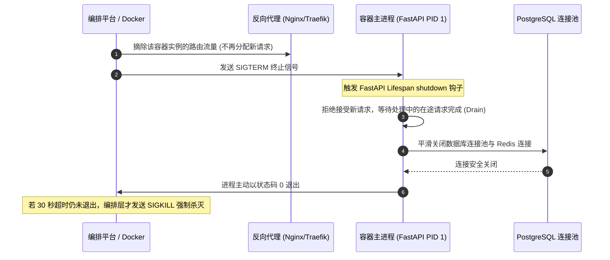

Docker 与容器化部署规范关注的是后端服务、前端 Web 应用及支撑组件在容器化构建、镜像瘦身优化、容器运行安全、健康探测、优雅停机（Graceful Shutdown）以及本地/生产环境编排编排的工程化标准。

容器镜像是现代持续交付（CI/CD）的基石。不规范的 Dockerfile 会导致镜像体积动辄数 GB、构建缓存失效耗时冗长，甚至因使用 Root 特权用户运行而埋下宿主机逃逸的重大安全隐患。为了确保容器安全、敏捷、轻量与稳定，特制定本规范。

---

# 一、前提与基础原则

所有工程团队在容器化改造与编写部署配置时，必须严格遵守以下四大基准原则：

1. **镜像不可变性（Immutable Artifacts）**：
   - 镜像一旦在 CI 构建并打上版本 Tag 后，**严禁在运行时动态下载、编译外部代码或修改代码文件**。从测试环境到生产环境，部署的必须是完全一致的同一份二进制镜像产物。
2. **符合云原生 12-Factor 原则（配置与代码完全分离）**：
   - 镜像内部严禁固化任何与特定环境相关的账号密码、数据库连接串或 API 密钥；**所有环境差异化配置必须通过容器环境变量或挂载的 ConfigMap / Secret 注入**。
3. **无状态化（Stateless）设计**：
   - 容器进程必须设计为无状态、随时可被销毁与横向扩容（Scale-Out）的单元；所有持久化数据（如上传的文件、数据库数据、日志）必须挂载外部卷（Volume）或转移至对象存储与外部数据库。
4. **最小攻击面与最小权限（Least Privilege）**：
   - 生产镜像严禁保留 GCC、Make、Git 等构建依赖，**严禁以 Root 用户启动容器主进程**。

---

# 二、多阶段构建（Multi-Stage Build）标准

必须强制采用 Docker 官方的多阶段构建（Multi-Stage）能力，将“构建编译阶段”与“生产运行阶段”彻底解耦，使最终生产镜像体积缩减 80% 以上。

## 2.1 Python / FastAPI 标准多阶段 Dockerfile

结合现代化极速包管理工具 `uv` 与官方 Python Slim 镜像：

```dockerfile
# ==============================================================================
# 第一阶段：构建依赖与编译环境 (Builder)
# ==============================================================================
FROM python:3.12-slim-bookworm AS builder

# 安装构建可能需要的底层编译依赖 (如针对某些 C 扩展)
RUN apt-get update && apt-get install -y --no-install-recommends \
    build-essential \
    libpq-dev \
    curl \
    && rm -rf /var/lib/apt/lists/*

# 从官方镜像拉取预编译的 uv 二进制文件
COPY --from=ghcr.io/astral-sh/uv:latest /uv /bin/uv

WORKDIR /build

# 先复制依赖声明，利用 Docker 层缓存加速构建
COPY pyproject.toml uv.lock ./

# 创建虚拟环境并同步生产依赖 (排除开发测试依赖 --no-dev)
ENV UV_PROJECT_ENVIRONMENT="/venv"
RUN uv sync --frozen --no-dev --no-editable

# ==============================================================================
# 第二阶段：生产运行轻量镜像 (Runner)
# ==============================================================================
FROM python:3.12-slim-bookworm AS runner

# 设置运行时环境参数
ENV PYTHONUNBUFFERED=1 \
    PYTHONDONTWRITEBYTECODE=1 \
    PATH="/venv/bin:$PATH" \
    PORT=8000

# 仅安装生产运行必须的共享动态链接库 (如 libpq5)
RUN apt-get update && apt-get install -y --no-install-recommends \
    libpq5 \
    ca-certificates \
    && rm -rf /var/lib/apt/lists/*

# 创建非 root 专属系统用户及用户组 (UID/GID: 10001)
RUN groupadd -g 10001 appuser && \
    useradd -u 10001 -g appuser -d /app -s /usr/sbin/nologin appuser

WORKDIR /app

# 从 builder 阶段复制虚拟环境
COPY --from=builder /venv /venv

# 复制应用程序源代码，并将所有权赋予非 root 用户
COPY --chown=appuser:appuser . /app

# 切换至低权限安全用户
USER appuser

# 暴露端口声明
EXPOSE 8000

# 容器健康检查
HEALTHCHECK --interval=15s --timeout=3s --start-period=10s --retries=3 \
    CMD curl -f http://localhost:8000/healthz || exit 1

# 使用 Exec 形式启动进程，确保信号能正确传递给 PID 1
CMD ["uvicorn", "app.main:app", "--host", "0.0.0.0", "--port", "8000", "--workers", "2", "--no-access-log"]
```

## 2.2 React / 前端 Nginx 多阶段 Dockerfile

```dockerfile
# 阶段一：前端静态打包
FROM node:20-alpine AS frontend-builder
WORKDIR /app
COPY package.json package-lock.json ./
RUN npm ci --prefer-offline
COPY . .
RUN npm run build

# 阶段二：Nginx 高性能静态托管
FROM nginx:1.27-alpine AS runner
# 复制安全配置的 nginx.conf
COPY nginx.conf /etc/nginx/conf.d/default.conf
# 仅复制产物
COPY --from=frontend-builder /app/dist /usr/share/nginx/html

EXPOSE 80
HEALTHCHECK --interval=30s --timeout=3s CMD wget -q -O - http://localhost/ || exit 1
CMD ["nginx", "-g", "daemon off;"]
```

## 2.3 强制配套 `.dockerignore` 规约

每个 Dockerfile 同级目录下必须存在严谨的 `.dockerignore` 文件，避免无关文件导致 Docker 上下文（Build Context）传输缓慢或私密文件意外打入镜像：

```text
.git
.gitignore
.github
.idea
.vscode
__pycache__
*.pyc
*.pyo
.venv
venv
node_modules
dist
build
.env
.env.*
tests
*.log
docker-compose*.yml
Dockerfile*
README.md
```

---

# 三、容器运行安全基线与权限最小化

生产环境容器必须满足 CIS Docker Benchmark 核心安全准则：

1. **严禁 Root 运行**：必须在镜像构建末期使用 `USER {uid}` 切换为非特权用户。Root 容器一旦发生安全漏洞，攻击者可直接控制宿主机内核。
2. **禁止特权模式**：在 Docker Compose 或生产配置中，**严禁配置 `privileged: true`**。
3. **收敛 Linux Capabilities**：丢弃所有默认能力，仅保留运行必需权限：
   ```yaml
   security_opt:
     - no-new-privileges:true
   cap_drop:
     - ALL
   ```
4. **只读根文件系统（Read-Only Root Filesystem）**：
   - 应用若无需写入本地文件，容器根目录建议挂载为只读；临时缓存统一挂载内存临时卷：
   ```yaml
   read_only: true
   tmpfs:
     - /tmp:size=64M,mode=1777
   ```

---

# 四、健康检查与优雅停机（Graceful Shutdown）

在发布升级与容器自动扩缩容时，必须保证业务流量零感知平滑过渡。



## 4.1 容器 PID 1 信号转发陷阱与 Exec 格式

- **错误写法（Shell 格式）**：`CMD uvicorn app.main:app`
  - *原因*：使用该语法时，Docker 会以 `/bin/sh -c "uvicorn ..."` 启动，导致 Shell 成为 PID 1 进程，而 Shell 默认不会把外界传来的 `SIGTERM` 信号转发给子进程，导致容器无法优雅退出，直到被系统以 `SIGKILL` 强杀。
- **正确写法（Exec 格式）**：**`CMD ["uvicorn", "app.main:app", ...]`**
  - 确保目标应用进程直接作为 PID 1 启动并直接接收操作系统的 `SIGTERM` 停机信号。

## 4.2 优雅停机在 FastAPI Lifespan 中的代码实现

```python
# app/main.py
from contextlib import asynccontextmanager
from fastapi import FastAPI
from app.shared.db.session import close_db_connections
from app.core.redis import close_redis_pool

@asynccontextmanager
async def lifespan(app: FastAPI):
    # 启动阶段：初始化连接池
    yield
    # 优雅停机阶段：捕获到 SIGTERM 后执行
    await close_db_connections()
    await close_redis_pool()

app = FastAPI(lifespan=lifespan)
```

---

# 五、容器资源配额限制（Resource Constraints）

为防止单实例代码内存泄漏（Memory Leak）无节制膨胀拖垮宿主机上的其他业务容器，每个容器必须显式配置 CPU 与内存上限。

在 `docker-compose.yml` 或 K8s 资源清单中的标准配额声明：

```yaml
services:
  api:
    image: my-registry.com/app/backend:v1.2.0
    deploy:
      resources:
        limits:
          cpus: '2.0'         # 最多使用 2 核 CPU
          memory: 1024M       # 内存上限 1GB (超出将触发 OOMKilled)
        reservations:
          cpus: '0.25'        # 最小保障 0.25 核
          memory: 256M        # 启动保障 256MB
```

---

# 六、Docker Compose 本地与编排最佳实践

开发与测试环境通过 `docker-compose.yml` 编排基础设施，必须遵循如下规范：

```yaml
version: '3.8'

services:
  postgres:
    image: postgres:16-alpine
    container_name: local-postgres
    restart: unless-stopped
    environment:
      POSTGRES_USER: ${DB_USER:-postgres}
      POSTGRES_PASSWORD: ${DB_PASSWORD:-local_dev_pwd}
      POSTGRES_DB: ${DB_NAME:-app_db}
    volumes:
      - postgres_data:/var/lib/postgresql/data
    ports:
      - "127.0.0.1:5432:5432"  # 仅绑定本地回环，禁止暴露外网
    healthcheck:
      test: ["CMD-SHELL", "pg_isready -U ${DB_USER:-postgres}"]
      interval: 5s
      timeout: 3s
      retries: 5

  redis:
    image: redis:7-alpine
    container_name: local-redis
    restart: unless-stopped
    command: ["redis-server", "--requirepass", "${REDIS_PASSWORD:-local_redis_pwd}"]
    volumes:
      - redis_data:/data
    ports:
      - "127.0.0.1:6379:6379"
    healthcheck:
      test: ["CMD", "redis-cli", "-a", "${REDIS_PASSWORD:-local_redis_pwd}", "ping"]
      interval: 5s
      timeout: 3s
      retries: 5

  api:
    build:
      context: .
      dockerfile: Dockerfile
    container_name: local-api
    restart: unless-stopped
    depends_on:
      postgres:
        condition: service_healthy   # 必须等待 DB 健康探针通过再启动 API
      redis:
        condition: service_healthy
    env_file:
      - .env
    ports:
      - "8000:8000"

volumes:
  postgres_data:
  redis_data:
```

---

# 七、镜像标签（Tag）与发布规范

- **严禁在生产环境直接使用 `:latest` 镜像部署**：`:latest` 无法表达任何确定性版本，会导致故障时无法回退到指定快照。
- **发布镜像 Tag 命名公式**：
  $$\text{Image\_Tag} = \text{vX.Y.Z}-\{\text{git\_sha\_7位}\}-\{\text{构建时间戳}\}$$
  例如：`backend:v1.2.0-a1b2c3d-20261104`。
- **CI 镜像构建门禁**：推送至私有镜像仓库前，必须运行静态安全扫描工具（如 **Trivy**），发现未修复的 `CRITICAL` 级高危 CVE 漏洞时直接阻断构建流程。
