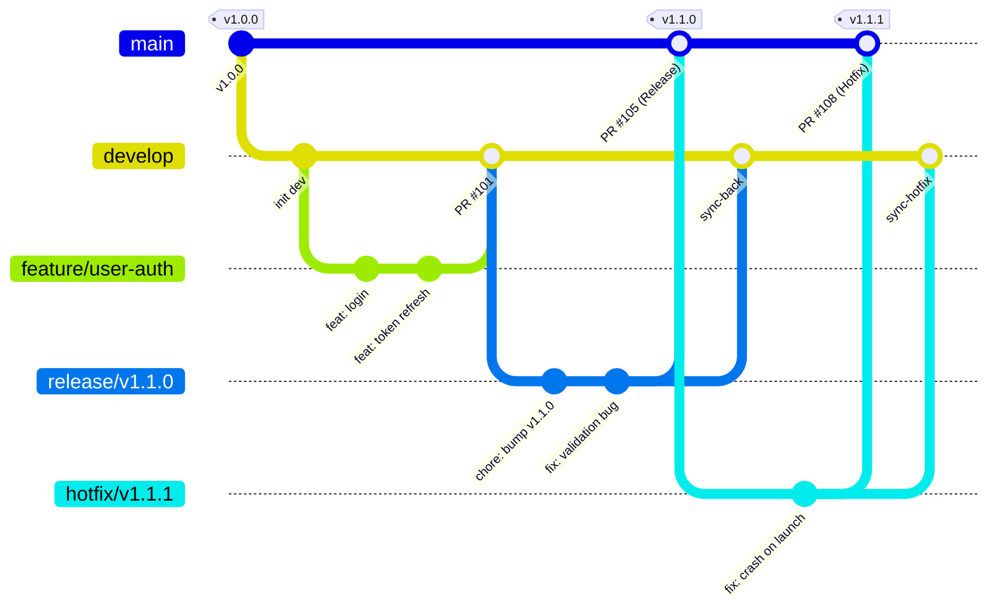
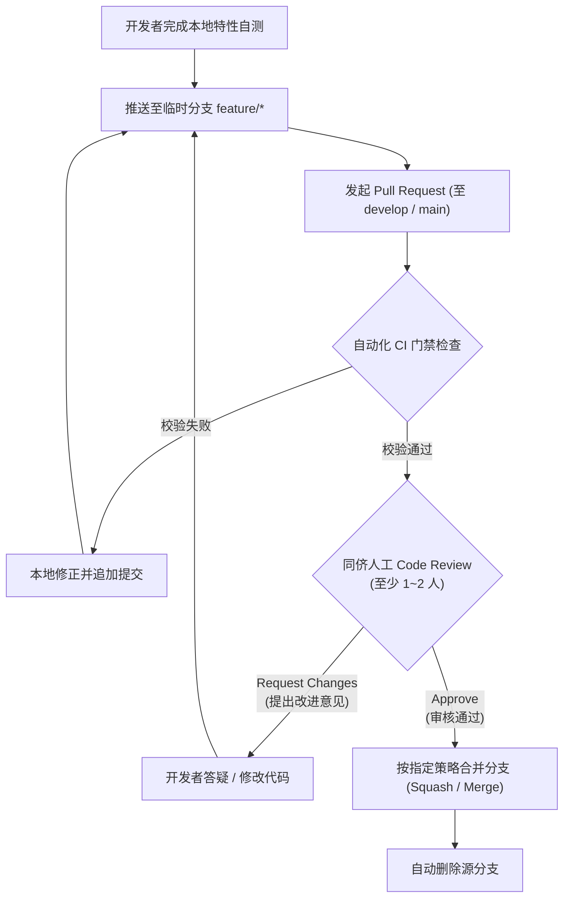

Git 工作流与版本发布规范关注的是代码仓库在多成员协作、跨端协同（App、Web、后端、嵌入式）场景下的分支管理模型、Commit 提交信息规范、Pull Request（PR）代码审查流程、语义化版本发布（SemVer）以及事故应急回滚的工程化标准。

代码仓库不仅是源码的存储载体，更是项目技术演进的唯一真实历史记录（Audit Trail）。规范的 Git 工作流能够消除分支混乱与代码覆盖冲突，确保每次发布的确定性、可追踪性与快速回滚能力。

---

# 一、前提与基础环境约定

为了避免跨操作系统（macOS / Linux / Windows）换行符错乱、作者身份识别混淆或敏感凭据泄露，所有参与项目开发的成员必须遵循以下基础配置：

## 1.1 Git 全局用户信息与行为配置

新环境初始化 Git 时，必须显式配置规范的开发者姓名（真实姓名拼音或统一英文花名）与企业邮箱：

```bash
# 1. 基础身份配置（严禁使用 root、admin、localhost 等匿名信息）
git config --global user.name "San Zhang"
git config --global user.email "zhangsan@company.com"

# 2. 换行符跨平台统一（统一转换为 LF）
git config --global core.autocrlf input       # macOS / Linux 推荐
# git config --global core.autocrlf true      # Windows 推荐

# 3. 默认分支初始化命名统一为 main
git config --global init.defaultBranch main

# 4. Pull 策略优先使用 rebase（保持本地提交历史线性整洁）
git config --global pull.rebase true

# 5. 推送行为限制为仅推送当前跟踪分支
git config --global push.default simple
```

## 1.2 敏感信息防泄露与 `.gitignore` 红线

- **严禁向代码仓库提交任何机密信息**：包括但不限于私钥文件（`.pem`, `.key`）、生产数据库账号密码、第三方 API Secret、云厂商 AccessKey、未脱敏私有证书等。
- **配置与代码彻底分离**：所有环境差异化参数必须通过环境变量（`.env`）管理，仓库仅允许提交 `.env.example` 模版，`.env` **必须强制加入 `.gitignore`**。
- **本地敏感信息扫描**：推荐在本地集成 `pre-commit` 钩子或使用 `gitleaks` 工具，在提交触发前自动拦截疑似私钥与 Token 泄露。

```text
# 典型 .gitignore 必须包含的基础项
.env
.env.local
*.pem
*.key
*.p12
*.keystore
id_rsa*
__pycache__/
*.py[cod]
.venv/
node_modules/
dist/
build/
.DS_Store
Thumbs.db
.idea/
.vscode/
*.swp
```

---

# 二、分支模型与生命周期规范

项目采用基于主干的敏捷演进分支模型（Modified Trunk-Based / Feature-Branch Workflow），平衡持续交付的灵活性与生产发布的稳定性。



## 2.1 核心长效分支

| 分支名称 | 受保护状态 | 来源基线 | 说明与规约 |
| --- | --- | --- | --- |
| **`main`** | **受强保护**<br>(禁止直接 Push) | - | **生产就绪分支**。该分支上的代码必须始终处于随时可上线的绝对稳定状态；每一次向 `main` 的合并都对应一次生产版本发布，并必须打上附注 Tag（如 `v1.2.0`）。 |
| **`develop`** | **受保护**<br>(禁止直接 Push) | `main` | **日常集成开发分支**。汇聚已通过测试、待发布的全部最新特性；连接 CI 自动化测试流水线与测试/预发（Staging）环境部署。 |

> [!CAUTION]
> `main` 与 `develop` 严禁任何人直接执行 `git push origin` 强推操作；所有代码合入必须严格通过 Pull Request（PR）并满足门禁条件。

## 2.2 临时短效分支

所有开发与修复工作必须在独立的临时短效分支中进行，严禁直接在长效分支上编码：

### 1. 特性开发分支 (`feature/*`)
- **命名规范**：`feature/{issue-id}-{brief_desc}` 或 `feature/{username}/{brief_desc}`
  - 正确示例：`feature/1024-ble-audio-stream`、`feature/auth-jwt-refresh`
  - 错误示例：`feat1`、`my_branch`、`dev_temp`
- **生命周期**：从最新的 `develop` 分支检出，特性开发、自测及通过 Code Review 合并回 `develop` 后**立即删除该分支**。

### 2. 发布预备分支 (`release/*`)
- **命名规范**：`release/vX.Y.Z`（例如 `release/v1.2.0`）
- **职责范围**：当 `develop` 积累的特性满足发版要求时拉出。仅允许进行版本号微调（Bump Version）、Changelog 补全以及发版前最后一轮回归测试阻断性 Bug 修复；**严禁在 release 分支上开发全新特性**。
- **流向**：验证通过后双向合入：合并至 `main` 打 Release Tag，同时同步回合至 `develop`。

### 3. 日常缺陷修复分支 (`fix/*`)
- **命名规范**：`fix/{issue-id}-{brief_desc}`（例如 `fix/402-token-expire`）
- **生命周期**：从 `develop` 分支检出，修复验证后合并回 `develop`。

### 4. 线上紧急修复分支 (`hotfix/*`)
- **命名规范**：`hotfix/vX.Y.Z-{brief_desc}`（例如 `hotfix/v1.1.1-crash-fix`）
- **触发条件**：生产环境发生重大故障、严重安全漏洞或 App 崩溃（P0/P1 级），必须跳过正常的两周迭代周期紧急修复。
- **流向**：直接从生产分支 `main`（对应的 Release Tag）拉出分支，修复并灰度验证通过后，通过 PR 合入 `main` 打出补丁 Tag，并**必须立刻反向合入 `develop` 分支**，防止后续迭代版本发生线上故障代码回退。

---

# 三、Commit Message 提交信息规范

项目严格遵循业界标准的 **Conventional Commits 1.0.0** 规范。结构清晰的提交记录是自动化生成版本变更日志（Changelog）、快速检索 Bug 引发点（`git bisect`）与审查代码的基础。

## 3.1 提交消息格式定义

每个 Commit Message 由 **Header**、**Body（可选）** 和 **Footer（可选）** 组成：

```text
<type>(<scope>): <subject>

[optional body: 详细说明本次变更的背景、动机与前后对比]

[optional footer: 关联的 Issue、任务链接或破坏性变更声明]
```

- **Header 单行限制**：Header（首行）长度**不得超过 72 字符**，必须简明扼要。
- **空行分隔**：Header 与 Body 之间、Body 与 Footer 之间**必须保留一个空行**。

## 3.2 Type（类型）枚举定义

| Type | 语义与适用场景 | 影响版本号 | 示例 |
| --- | --- | --- | --- |
| **`feat`** | 引入全新的业务功能或接口特性 | MINOR (次版本) | `feat(auth): add google oauth login support` |
| **`fix`** | 修复已有的 Bug 或缺陷 | PATCH (补丁) | `fix(order): resolve dead lock on checkout flow` |
| **`perf`** | 提升系统性能或降低内存/CPU 消耗的代码变更 | PATCH (补丁) | `perf(query): add partial index for pending tasks` |
| **`refactor`** | 代码重构（既不修复 Bug 也不添加新功能的代码调整） | - | `refactor(ble): streamline packet parser state machine` |
| **`docs`** | 仅有文档、注释、说明类的变动 | - | `docs(api): update websocket heartbeat payload schema` |
| **`style`** | 不影响代码运行语义的格式改动（空格、标点、缩进、格式化） | - | `style(react): format components with prettier` |
| **`test`** | 新增测试用例或调整已有测试代码 | - | `test(user): add unit tests for password hashing` |
| **`build`** | 影响构建系统或外部依赖的改动（如 npm, uv, poetry, gradle） | - | `build(deps): bump pydantic from 2.8 to 2.9` |
| **`ci`** | CI/CD 自动化流水线配置文件或脚本变动（GitHub Actions 等） | - | `ci(workflow): add ruff and mypy static check step` |
| **`chore`** | 其他日常琐碎维护性变更（不修改生产代码与测试代码） | - | `chore(git): update .gitignore for local artifacts` |
| **`revert`** | 撤销之前的某次提交（必须在 Body 中注明被撤销的 Commit SHA） | - | `revert: feat(pay): rollback wechat pay v3 endpoint` |

## 3.3 Scope（影响作用域）规范

Scope 用于指明本次提交影响的具体模块或领域上下文，统一采用小写，常见作用域包括：
- 后端领域：`auth`, `user`, `order`, `device`, `payment`, `db`
- 协议/网关：`api`, `ws`, `mqtt`, `ble`, `gateway`
- 前端/App：`ui`, `router`, `store`, `hook`, `component`
- 基础设施：`deps`, `docker`, `config`, `logging`

## 3.4 Subject（简短描述）与正文规则

1. **祈使句式动词开头**：使用英文简短描述，如 `add`, `fix`, `remove`, `update`, `refactor`；若使用中文，动词置前（如“新增用户登出接口”、“修复蓝牙重连状态死锁”）。
2. **禁止无效废话**：严禁提交如 `"fix bug"`, `"update"`, `"temp commit"`, `"wip"`, `"test"` 等毫无检索价值的无意义信息。
3. **句末不加句号**：首行末尾不得携带中英文标点句号。
4. **破坏性变更声明（Breaking Change）**：
   - 若引入破坏既有契约或接口向下兼容性的改动，**必须在 Type 后追加 `!`**，并在 Footer 中显式以 `BREAKING CHANGE:` 开头说明升级兼容方案：

```text
feat(api)!: migrate auth token payload to rfc7519 standard

BREAKING CHANGE: The `access_token` format has changed from opaque string to signed JWT.
Clients must decode token with RS256 public key.
Closes #204
```

---

# 四、代码审查（Pull Request / Code Review）规范

代码审查（Code Review）是保障工程质量、促进架构对齐与防范生产事故的核心卡点。



## 4.1 PR 颗粒度与规模控制

- **小步快跑原则**：单次 PR 的代码变更规模应严格控制在 **400 行以内**（不含自动化生成的 lockfile、schema 迁移文件或静态资源）。
- **拒绝“大锅烩”**：一个 PR 仅聚焦解决一个特定需求或 Bug。严禁在一个 PR 内混合“开发支付功能 + 顺手重构登录逻辑 + 调整全局样式”，否则会导致审查无法推进且回滚代价极大。

## 4.2 Pull Request 模板标准

发起 PR 时必须详尽填写预设模版，提供完整上下文：

```markdown
## 1. 变更类型 (Type of Change)
- [ ] 🚀 新功能 (Feature)
- [ ] 🐛 Bug 修复 (Bug Fix)
- [ ] ♻️ 代码重构 (Refactor)
- [ ] ⚡️ 性能优化 (Performance)
- [ ] 📝 文档更新 (Documentation)

## 2. 需求/缺陷关联 (Related Issue)
- Closes #1024
- Fixes #2048

## 3. 变更概述 (Summary)
简要说明本次修改的核心背景、实现方案及影响面：
- 重构 BLE 状态机连接断开重连逻辑，补充退避指数重试算法；
- 增加设备端 Notify 异常丢包时的回执重传处理。

## 4. 验证凭证 (Verification & Testing)
说明自测手段，并提供通过测试的截图、日志或 curl 输出：
- [x] 本地单元测试全部通过 (`pytest` / `npm test`)
- [x] 真机/模拟器测试通过，截图附后
- [x] 无新增 Linter / Mypy 告警

## 5. 破坏性与兼容性评估 (Compatibility & Risk)
- 是否影响既有 API 协议：否
- 是否涉及数据库结构变更（DDL）：否
- 是否需要配置项同步更新：是，需增加环境变量 `BLE_RETRY_MAX=5`
```

## 4.3 自动化流水线（CI）门禁红线

在 Reviewer 介入前，目标分支的 CI 自动化 Pipeline 必须全绿通过，任何一项失败均直接阻断合并：

1. **代码风格与静态分析**：Linter（如 Python `ruff`, 前端 `eslint`, Flutter `dart analyze`）零错误。
2. **静态类型检查**：Type Checker（如 `mypy`, `tsc`）零类型断言错误。
3. **安全扫描**：无敏感文件泄露，依赖依赖库无高危 CVE 漏洞。
4. **自动化测试**：单元测试 100% 运行通过，核心领域服务代码测试覆盖率达到门禁要求（通常要求 ≥ 80%）。

## 4.4 审查礼仪与合并准则

- **审查人职责**：
  - 聚焦架构设计、并发安全、边界条件、性能隐患与可读性；
  - 表达明确：阻断性问题使用 **`Request Changes`**；微小格式建议使用 `Nit:` 或 `IMO:` 前缀并允许作者自行裁量；
  - 响应时效：PR 发出后，指定 Reviewer 必须在 **24 小时工作日内** 给予反馈，避免阻塞迭代流速。
- **合并策略选型**：
  - **Feature -> develop**：推荐采用 **Squash and Merge**（将特性分支上大量碎小的 `wip/fix` 提交压缩为单个清晰规范的 Commit），保持主干提交树干净线性。
  - **release -> main**：推荐采用 **Create a Merge Commit**，清晰记录完整的版本发布集成分支轨迹。
  - **合并后自动删除源分支**：勾选 GitHub / GitLab 的 "Automatically delete head branch"，防止远端分支膨胀堆积成千上万个僵尸分支。

---

# 五、版本发布与 Tag 规范（Semantic Versioning）

生产发布必须有迹可循，版本编号严格遵守 **语义化版本 2.0.0（Semantic Versioning）** 规范。

## 5.1 语义化版本格式：`vX.Y.Z`

版本号格式定义为：**`vMAJOR.MINOR.PATCH[-PRERELEASE]`**

```text
v1 . 2 . 3 - beta.1
 ^   ^   ^     ^
 |   |   |     |__ 预发布标识 (可选)
 |   |   |________ 补丁版本号 (Bug 修复，完全向下兼容)
 |   |____________ 次版本号 (新增向下兼容的功能特性)
 |________________ 主版本号 (包含不兼容的重大 API / 架构变更)
```

- **MAJOR（主版本号）**：当做了不兼容的 API 修改、底层存储架构颠覆性重构或协议断代时递增。
- **MINOR（次版本号）**：当做了向下兼容的功能性新增时递增。
- **PATCH（补丁版本号）**：当做了向下兼容的缺陷修复时递增。
- **先行版本标识（Prerelease）**：
  - `alpha`：内部快速迭代、功能未完全冻结的早期测试版（如 `v2.0.0-alpha.1`）。
  - `beta`：功能已冻结、进行全链路联调与压力测试的公测版（如 `v2.0.0-beta.2`）。
  - `rc`（Release Candidate）：候选发布版本，若无重大缺陷即直接转为正式版（如 `v2.0.0-rc.1`）。

## 5.2 Git Tag 命名与操作规范

所有正式发布以及预发布版本，**必须在 `main` 分支对应的 Commit 上创建附注标签（Annotated Tag）**，严禁使用轻量标签（Lightweight Tag）：

```bash
# 1. 创建带附注与签名的 Release Tag
git tag -a v1.2.0 -m "release: production release v1.2.0"

# 2. 推送指定 Tag 到远端仓库
git push origin v1.2.0

# 3. 严禁随意推送全量本地脏标签（禁止 git push --tags）
```

> [!IMPORTANT]
> 已经推送到远端共享仓库的 Release Tag **具有物理不可变性**。严禁删除已有 Tag 并重新指向新的 Commit SHA；若发现紧急 Bug，必须按 SemVer 递增发布新补丁版本（如 `v1.2.1`）。

## 5.3 自动化 Changelog 生成

基于第 3 节的 Conventional Commits 规范，CI 流水线可自动提取合并日志并生成标准化 `CHANGELOG.md`：

```markdown
# CHANGELOG

## [v1.2.0] - 2026-11-04

### Features
- **auth**: add google oauth login support ([#101](https://github.com/org/repo/pull/101))
- **ble**: streamline automatic reconnect exponential backoff ([#104](https://github.com/org/repo/pull/104))

### Bug Fixes
- **order**: resolve dead lock on checkout flow under high concurrency ([#103](https://github.com/org/repo/pull/103))
- **ws**: fix connection drop when ping pong frame lost ([#107](https://github.com/org/repo/pull/107))

### Performance Improvements
- **db**: add partial index for pending audit tasks ([#108](https://github.com/org/repo/pull/108))
```

---

# 六、常见异常场景与救火应急指南

开发过程中遇到版本冲突、误提交或敏感信息泄露时，必须按照标准应急流程处理，禁止盲目强推。

## 6.1 敏感信息泄露紧急消除（机密销毁）

若误将私钥、数据库密码或 API Secret 提交到了远端仓库：

1. **第一动作：立即轮换（Revoke & Rotate）凭据！**
   - 必须立刻前往控制台作废该泄露的密钥并重新生成；**默认已泄露密钥在被提交的第 1 秒起便已被网络扫描机器人捕获**，哪怕随后执行 `git push --force` 也无法阻止已被拉取泄露的事实。
2. **彻底擦除 Git 历史记录**：
   - 使用官方推荐工具 `git-filter-repo`（替代过时的 `git filter-branch`）：
   ```bash
   # 安装后彻底剔除包含敏感信息的文件历史
   git filter-repo --invert-paths --path config/prod_secret.key --force
   # 强制推送到全部分支覆盖
   git push origin --force --all
   ```

## 6.2 生产代码回滚规范（Revert vs Reset）

当已上线的版本发现致命严重故障需要立即回退生产代码时：

- **受保护分支（`main` / `develop`）强制采用 `git revert`**：
  - `git revert` 通过创建一次全新的“反向修改”提交来抵消指定历史提交的效果，**不破坏历史时间线的完整性**。
  ```bash
  # 回滚指定的故障提交（保留历史审计轨迹）
  git revert <faulty_commit_sha> -m 1
  git push origin main
  ```
- **严禁在公共共享长分支上执行 `git reset --hard` + `push -f`**：
  - 这会强行擦除历史节点，导致其他协作者本地与远端分支发生分叉与代码覆盖灾难。仅允许在私有个人 `feature/*` 分支整理未合并的本地提交时使用 `git reset`。

## 6.3 变基冲突（Rebase Conflict）解决标准

当特性分支落后于 `develop` 分支需要同步更新时，**推荐采用 rebase 保持提交图谱单线整洁**：

```bash
# 1. 切换并拉取最新的 develop 分支
git checkout develop
git pull origin develop

# 2. 切换回个人特性分支并执行 rebase
git checkout feature/order-pay
git rebase develop

# 3. 若发生冲突，终端会提示具体冲突文件：
# 编辑解决冲突文件，重新加入暂存区（切勿执行 git commit）
git add <conflicted-file>

# 4. 继续完成后续提交的变基重放
git rebase --continue

# 5. 若冲突极其复杂陷入僵局，可无损撤销变基并恢复初始状态：
git rebase --abort
```

## 6.4 工作区未提交改动的暂存规范

当正在开发新特性突然需要切换分支排查紧急 Bug 时：

```bash
# 1. 规范暂存未追踪与已修改的文件，并标注明确备注
git stash save -u "WIP: audio packet parsing unfinished"

# 2. 此时工作区干净，切换分支处理应急工作
git checkout hotfix/critical-bug

# 3. 完成后切回特性分支，恢复工作现场
git checkout feature/order-pay
git stash pop
```
