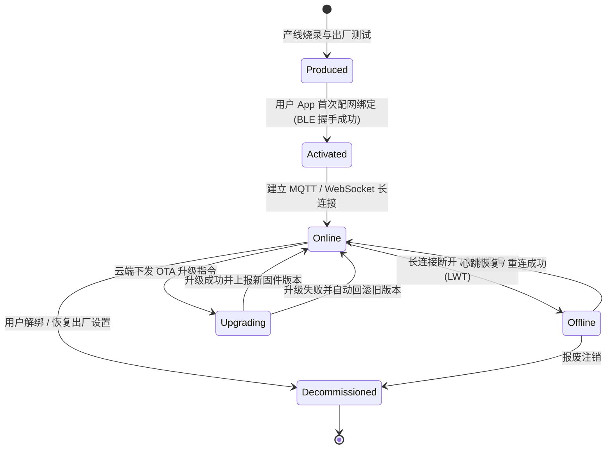
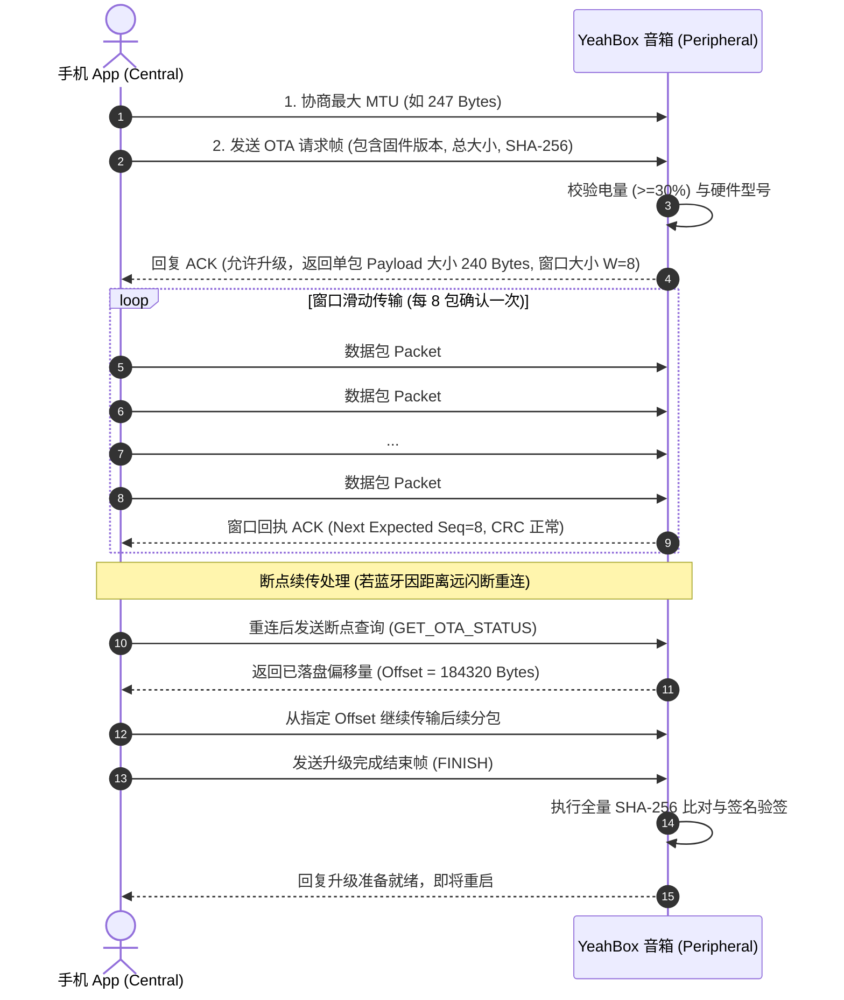
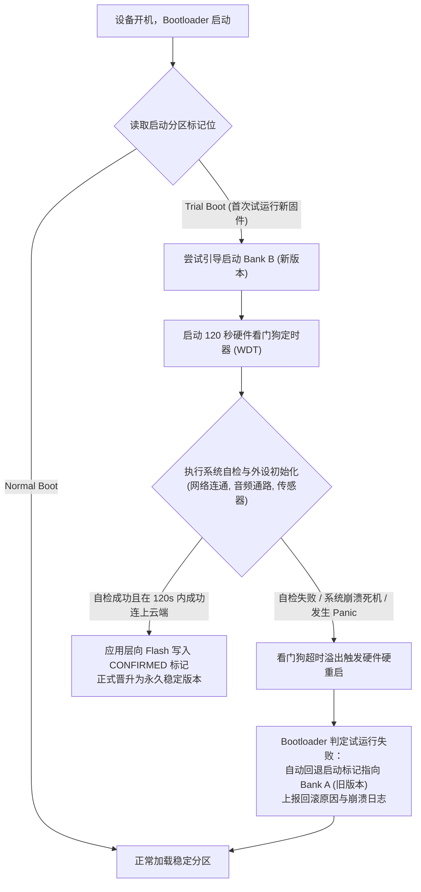

OTA 固件升级与设备管理规范关注的是物联网硬件设备（YeahBox 音箱/耳机及智能硬件系列）在设备唯一身份标识、生命周期状态流转、空中固件升级（Over-The-Air, OTA）包封装标准、双分区防变砖容灾、传输协议（BLE/HTTPS）以及云端灰度发布策略层面的工程化标准。

硬件设备一旦出厂交付到用户手中，OTA 固件升级是修复嵌入式缺陷、下发新音频算法、迭代系统特性的唯一维保通道。嵌入式设备 Flash 空间有限、运行算力受限且处于复杂的无线弱网环境中，任何一次校验遗漏或供电异常都可能导致设备永久损坏（变砖）。为了保障固件分发与升级的绝对安全性与可靠性，特制定本规范。

---

# 一、设备身份标识与生命周期管理

## 1.1 设备核心三元组标识契约

每台硬件设备在出厂产线烧录时，必须固化全局唯一的身份凭据：

```text
{
  "product_id": "0x0001",                   // 2 字节产品型号 (PID，对齐 BLE 广播规范)
  "device_mac": "AA:BB:CC:DD:EE:FF",        // 6 字节经典蓝牙 / Wi-Fi 物理 MAC 地址
  "device_sn": "YB202611040001",            // 产线唯一产品序列号 (Serial Number)
  "hardware_version": "HW_V2.1",            // 硬件 PCB 主板物料版本
  "device_secret": "9a744b21a476886e..."    // 出厂固化的设备通信私密密钥 (用于 MQTT 鉴权)
}
```

## 1.2 设备生命周期状态机

设备在云端注册表（Registry）中的生命周期严格按如下有限状态机（FSM）流转：



## 1.3 在线判定与保活策略

- **心跳周期（KeepAlive）**：MQTT 设备心跳间隔统一设置为 **60 秒**。
- **遗嘱消息（Last Will and Testament, LWT）**：设备建连时必须注册遗嘱主题：
  - 主题格式：`devices/{product_id}/{device_sn}/status`
  - 遗嘱 Payload：`{"isOnline": false, "reason": "lwt_lost", "timestamp": "..."}`
  - QoS 设为 1，Retain 设为 true。
- **快速同步**：网关监听到设备离线事件后，必须在 **3 秒内** 同步更新 Redis 缓存（`device:online:{device_sn}`）并通知业务微服务。

---

# 二、OTA 固件包格式与安全封装标准

## 2.1 固件包物理二进制结构

所有对外发布的 OTA 固件产物，必须通过签名工具打包为统一的二进制信封（Envelope）：

```text
+-----------------------------------------------------------------------+
| 固定魔数 (Magic) | 头部版本 | 硬件兼容掩码 | 目标固件版本 | 原始固件大小 |
|     (4 Bytes)    | (2 Bytes)|   (8 Bytes)  |  (16 Bytes)  |   (4 Bytes)  |
+-----------------------------------------------------------------------+
| 原始 SHA-256 哈希值 (32 Bytes)                                         |
+-----------------------------------------------------------------------+
| ECDSA (secp256r1) 数字签名数据 (64 Bytes)                             |
+-----------------------------------------------------------------------+
| 预留扩展元数据 (64 Bytes - 包含音频 EQ 预设/分区偏移)                  |
+-----------------------------------------------------------------------+
| 固件二进制有效负载 (Firmware Binary Payload)                           |
| (N Bytes - 支持全量镜像或差分增量补丁)                                 |
+-----------------------------------------------------------------------+
| 尾部 CRC32 循环冗余校验码 (4 Bytes)                                    |
+-----------------------------------------------------------------------+
```

### 字段物理定义说明

| 字段名称 | 字节长度 | 取值 / 规范 | 说明 |
| --- | --- | --- | --- |
| **`Magic`** | 4 Bytes | 固定为 `0x59424F54` ("YBOT") | 固件文件合法性快速嗅探魔数 |
| **`Header Version`** | 2 Bytes | `0x0001` (大端序) | 本头部契约协议版本号 |
| **`HW Version Mask`** | 8 Bytes | ASCII 字符串，如 `"HW_V2.1\0"` | 严格比对硬件主板型号，禁止跨硬件烧录 |
| **`FW Target Version`** | 16 Bytes | ASCII 字符串，如 `"v1.2.0\0"` | 目标升级固件版本 |
| **`Payload Size`** | 4 Bytes | 无符号大端整型 `uint32_t` | 有效载荷真实字节数 |
| **`Payload SHA-256`** | 32 Bytes | 二进制摘要数据 | 固件内容的完整性校验和 |
| **`ECDSA Signature`** | 64 Bytes | 非对称数字签名 ($R + S$) | 使用生产离线私钥签名，防篡改防伪造 |
| **`Payload`** | N Bytes | 原始镜像数据或 Delta Patch | 实际刷写至 Flash 的二进制流 |
| **`Tail CRC32`** | 4 Bytes | IEEE 802.3 标准 CRC32 | 固件传输末尾快速防误码校验 |

## 2.2 数字签名防伪与防降级攻击

1. **防伪签名**：
   - 固件编译构建完成后，必须由发布系统调用离线私钥生成 ECDSA-SHA256 签名并注入固件头。
   - 设备端 Bootloader 内部固化不可篡改的公钥；**验签不通过直接丢弃固件并报警，严禁刷写任何未经签名的固件**。
2. **防降级攻击（Anti-Rollback Protection）**：
   - 固件头中必须包含单调递增的内部安全版本计数器（`security_version`）；
   - 设备端 eFuse 或安全存储记录当前安全版本号；**严禁设备刷写安全版本号低于当前版本的旧固件**，防止黑客通过刷入已知存量漏洞的历史固件实施逆向渗透。

---

# 三、升级传输通道与协议交互规范

依据硬件通信形态，规范支持 BLE 通道升级（适用于耳机/便携蓝牙音箱）与 HTTPS/Wi-Fi 通道升级（智能 Wi-Fi 音箱）。

## 3.1 基于 BLE 通道的分包传输规范（GATT OTA）

依据 [BLE API 规范.md](file:///Users/grandboy/Desktop/gb-project-guidelines/BLE%20API%20%E8%A7%84%E8%8C%83.md)，BLE MTU 交换后有效载荷通常在 240 字节左右，必须遵循滑动窗口流控：



---

# 四、设备端防变砖（Anti-Bricking）与容灾回滚

任何由意外断电、Flash 损坏或致命逻辑 Bug 导致的设备死锁变砖都不可接受。系统必须具备底层自愈能力。

## 4.1 双分区架构（A/B Dual-Bank Flash）

嵌入式系统必须划分独立的两个可运行固件镜像槽位（Bank A 与 Bank B）：

```text
+-------------------+-------------------+-------------------+-------------------+
|    Bootloader     |   Flash Bank A    |   Flash Bank B    |    用户配置区     |
| (只读安全自检区)  |  (当前运行系统)   |  (待写入新固件)   |    (NVRAM / NVS)  |
+-------------------+-------------------+-------------------+-------------------+
```

1. **零下线静默烧录**：当设备运行在 Bank A 时，OTA 下载的分包直接烧录写入闲置的 Bank B，业务音频播放与功能完全不受干扰。
2. **原子切换**：完整写入并校验无误后，Bootloader 仅需将启动标记位从 Bank A 指向 Bank B，耗时不足 1 秒即可完成重启切换。

## 4.2 试运行模式与看门狗自动回滚机制（Trial Run）



## 4.3 电量保护硬性门禁

- **升级前电量检查**：设备在进入 OTA 升级模式前，必须通过电量计（Fuel Gauge IC）核验当前电池电量：
  - **电量 $\ge 30\%$ 或处于外接电源充电中**：方可进入 OTA 烧录流程；
  - **电量 $< 30\%$ 且未插电**：必须坚决拒绝升级请求，向 App 返回错误码 `300302`（`BATTERY_LOW_FOR_OTA`）并弹窗提示用户“电量不足，请连接充电器后再试”。

---

# 五、云端灰度发布与熔断机制

固件升级面向成千上万的物理实体，云端发布严禁全量一次性推流，必须按阶梯分级灰度：


## 5.1 自动化熔断与回退红线

OTA 云端管理平台必须实时采集设备上报的升级指标，**触发以下任一条件时，系统必须自动暂停全站固件分发并向固件研发团队告警**：

| 监控指标 | 熔断触发阈值 | 应对与防护动作 |
| --- | --- | --- |
| **升级失败率 (Failure Rate)** | $\ge 2.0\%$ | 立即自动停止该批次固件推送，禁止后续设备下载 |
| **设备回滚率 (Rollback Rate)** | $\ge 0.5\%$ | 说明新固件存在导致设备崩溃无法自检的严重缺陷，全线终止 |
| **设备离线激增率** | 升级后离线率相比基线提高 $> 3.0\%$ | 疑似设备死机脱管，立即暂停发布并启动紧急排查 |

---

# 六、设备升级专属错误码表

对接 [统一错误码与异常处理规范.md](file:///Users/grandboy/Desktop/gb-project-guidelines/统一错误码与异常处理规范.md) 业务域 `30`（物联网设备域）：

| 错误码 (`code`) | 内部标识 | 说明与处置引导 | 是否允许重试 (`isRetryable`) |
| --- | --- | --- | --- |
| **`300301`** | `OTA_FIRMWARE_MISMATCH` | 固件硬件兼容掩码不匹配，禁止刷写 | `false` |
| **`300302`** | `OTA_BATTERY_TOO_LOW` | 电池电量低于 30%，需连接充电器 | `false` |
| **`300303`** | `OTA_SIGNATURE_INVALID` | 固件 ECDSA 数字签名校验失败，文件损坏或被篡改 | `false` |
| **`300304`** | `OTA_PACKET_CRC_ERROR` | 单包无线传输误码，触发原地请求重传 | `true` |
| **`300305`** | `OTA_STORAGE_WRITE_FAIL` | 设备底层 Flash 扇区擦写失败或空间不足 | `false` |
| **`300306`** | `OTA_ROLLBACK_OCCURRED` | 固件试运行超时或自检未通过，已自动回滚旧版本 | `false` |
