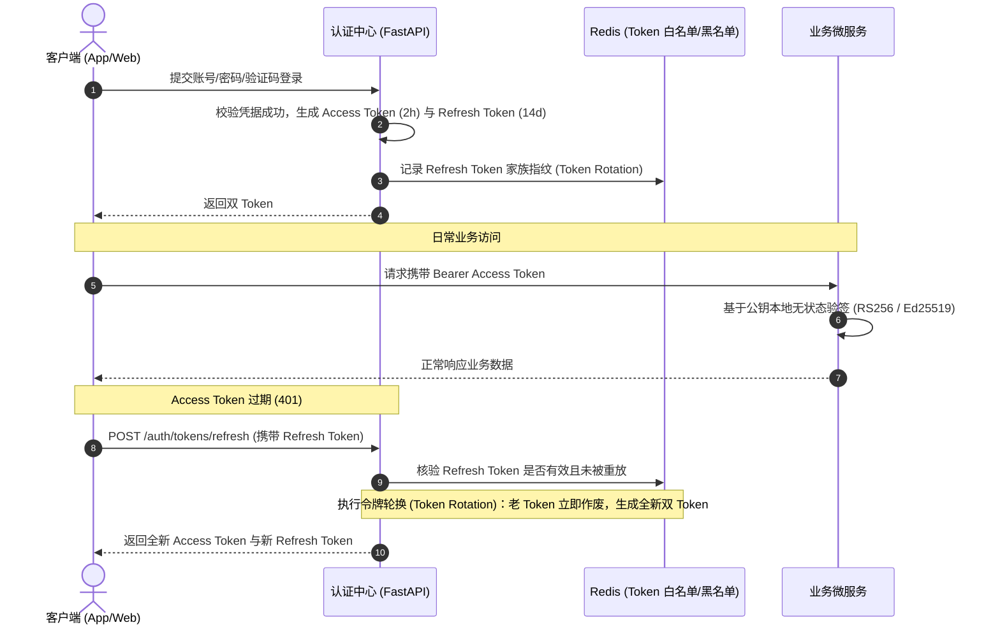

安全与数据合规规范关注的是全栈系统（App 移动端、Web 端、微服务、底层存储以及 IoT 硬件交互）在身份认证、敏感数据防护、传输加密、API 防刷防重放、越权漏洞防范以及隐私合规层面的工程化标准。

安全是系统的底线。任何一处未参数化的 SQL 拼接、未绑定的证书校验、泄露的密钥或水平越权逻辑，都会使整个企业的商业信誉与核心资产遭受毁灭性打击。为了构筑多层纵深防御体系（Defense in Depth），特制定本规范。

---

# 一、数据安全分级与保护矩阵

依据数据资产的破坏影响度，系统内的所有数据划分为 **P1 ~ P4 四个安全密级**，并执行对应的技术控制措施：

| 密级定义 | 典型数据示例 | 静态存储（At Rest）要求 | 传输通信（In Transit）要求 | 日志输出要求 |
| --- | --- | --- | --- | --- |
| **P4 绝密级** | 用户登录密码、通信私钥、支付通道密钥、JWT 签名 Secret | 强单向加盐哈希（**Argon2id** 或 **Bcrypt**）；私钥必须存放在 KMS / Vault 硬件安全模块，**严禁明文入库** | 强制内部 TLS 1.3 传输，严禁暴露至公网 | **绝对禁止打印** |
| **P3 敏感机密** | 身份证号、银行卡号、手机号、第三方支付账号、精准 GPS 轨迹 | 必须采用对称加密存储（**AES-256-GCM**）；密文与 IV 向量独立落库 | 生产强制启用 TLS（`HTTPS` / `WSS` / `MQTTS`） | **强制脱敏掩码**（如 `138****5678`），严禁输出明文 |
| **P2 内部专有** | 用户订单、设备绑定关系、系统运行配置、私信元数据 | 数据库原生透明加密（TDE）或常规关系表存储 | 生产强制启用 TLS 传输 | 允许结构化记录，严禁向低权限用户越权回显 |
| **P1 公开数据** | 商品详情展示、公共固件升级公告、静态帮助文档 | 常规持久化存储 | 允许公开访问与 CDN 缓存 | 无特殊限制 |

---

# 二、身份认证与令牌（Token）安全

## 2.1 双令牌机制（Access Token + Refresh Token）

系统统一采用双令牌无状态与有状态相结合的模型进行鉴权：



- **生命周期约束**：
  - `Access Token`：有效期**不得超过 2 小时**（高安全性业务建议设为 15~30 分钟），用于无状态快速鉴权；
  - `Refresh Token`：有效期最长 **14 天**，必须采用**令牌轮换（Token Rotation）机制**：每次刷新后，旧的 Refresh Token 立即在 Redis 中注销失效，换发全新的一对令牌。一旦发现已被作废的旧 Refresh Token 再次发起刷新，认证中心必须判定为令牌泄露窃取攻击，**立刻冻结该用户所有活跃会话**。
- **签名算法安全**：
  - 强制采用非对称签名算法（**RS256** 或 **Ed25519**）；
  - 严禁使用已废弃的弱对称 HMAC（如使用简单硬编码的 Secret），杜绝由于单个微服务泄露 Secret 导致整个平台伪造 Token。

## 2.2 暴力破解防护与登录锁定

- **密码强度基准**：长度至少 8 位，必须混合包含大写字母、小写字母、数字及特殊符号；禁止使用 Top 10,000 常见弱口令。
- **登录防爆破策略**：同一 IP 或同一用户账号，连续输错密码 **5 次**，系统必须立即锁定该账号登录权限 **15 分钟**，并要求用户通过短信验证码或人机图形验证码（CAPTCHA）进行二次安全核验。

---

# 三、API 接口安全防御与防刷

依据 [RESTful API 规范.md](file:///Users/grandboy/Desktop/gb-project-guidelines/RESTful%20API%20%E8%A7%84%E8%8C%83.md) 2.4 节约定，生产核心写接口必须执行强制防重放与防篡改校验。

## 3.1 请求防篡改与防重放机制

针对关键写入（支付、下单、设备配网、敏感资料修改），请求 Header 必须携带签名校验字段：

- **时间戳偏差校验**：服务端核验 `X-Timestamp` 与当前服务器 UTC 时间，允许偏差不得超过 **±300 秒**（超出直接返回 `401 Unauthorized` 拒绝处理）。
- **Nonce 唯一性去重**：每次请求生成 16~64 位高强度随机数 `X-Nonce`；服务端在 Redis 中记录 `X-Key-Id:X-Nonce`，设置 **600 秒 TTL**，窗口期内重复出现的相同 Nonce 判定为重放攻击，直接拦截。
- **签名原文验签**：对 HTTP 方法、请求路径、规范化查询参数、请求体摘要（SHA-256）及请求头计算签名并进行 HMAC 验签。

## 3.2 越权访问漏洞防御（BOLA / BFLA）

越权漏洞是 API 安全中最常见的灾难性隐患（OWASP API Top 10 首位）：

- **水平越权（Broken Object Level Authorization）防御**：
  - **红线**：严禁在更新或删除接口中，直接使用客户端传入的 `user_id` 作为数据过滤条件！
  - **正确准则**：所有涉及个人数据的业务查询与更新，**必须强制从当前已经过身份认证的 Token 上下文中获取当前登录人的 `current_user.id`**：

```python
# 严重错误示范 (存在水平越权漏洞)：
@router.put("/users/{user_id}/profile")
async def update_profile(user_id: str, data: ProfileUpdate):
    # 攻击者只需遍历 user_id 即可篡改全站任意用户资料！
    return await repo.update_by_id(user_id, data)

# 正确合规示范：
@router.put("/users/me/profile")
async def update_my_profile(
    data: ProfileUpdate,
    current_user: User = Depends(get_current_active_user)
):
    # 强制绑定当前 Token 持有者身份
    return await repo.update_by_id(current_user.id, data)
```

## 3.3 跨域安全策略（CORS）

生产环境严禁将跨域头配置为过于宽泛的通配符：
- **禁止**：`Access-Control-Allow-Origin: *` 与 `Access-Control-Allow-Credentials: true` 组合使用。
- **强制**：必须显式声明受信任的前端域名白名单（如 `https://app.company.com`），对于未授权的 Origin 直接阻断跨域响应。

---

# 四、静态存储加密与注入防御

## 4.1 对称加密实现规范（AES-256-GCM）

针对 P3 级敏感数据（如手机号、密钥），采用带认证标签的 GCM 模式：

```python
# app/core/security.py
import os
import base64
from cryptography.hazmat.primitives.ciphers.aead import AESGCM

# 生产环境密钥从 KMS 或安全环境变量注入 (32 字节)
AES_KEY = base64.b64decode(os.environ["SENSITIVE_DATA_AES_KEY"])

def encrypt_sensitive_field(plaintext: str) -> str:
    """AES-256-GCM 加密，输出格式：Base64(12字节Nonce + 密文 + 16字节Tag)"""
    aesgcm = AESGCM(AES_KEY)
    nonce = os.urandom(12)  # 每次加密必须生成全新的密码学随机 Nonce，绝不复用
    ciphertext = aesgcm.encrypt(nonce, plaintext.encode("utf-8"), None)
    return base64.b64encode(nonce + ciphertext).toString()

def decrypt_sensitive_field(encrypted_token: str) -> str:
    """解密还原"""
    raw_bytes = base64.b64decode(encrypted_token)
    nonce, ciphertext = raw_bytes[:12], raw_bytes[12:]
    aesgcm = AESGCM(AES_KEY)
    decrypted_bytes = aesgcm.decrypt(nonce, ciphertext, None)
    return decrypted_bytes.decode("utf-8")
```

## 4.2 SQL 注入绝对阻断

- **强制使用 ORM 参数化绑定**：基于 SQLAlchemy 2.0 构建查询，所有用户输入参数严格经由驱动参数化占位符提交给 PostgreSQL。
- **严禁使用 f-string 或 `+` 拼接 SQL 语句**；执行原生 SQL 时必须强制使用 `text("... WHERE id = :id").bindparams(id=...)`。

---

# 五、端侧（Flutter / React / IoT）安全基线

## 5.1 证书绑定（SSL / TLS Pinning）

为了杜绝通过抓包工具（Charles / Fiddler / Mitmproxy）对移动端 API 通信进行中间人攻击：
- 移动端生产版本必须内置服务端 CA 根证书的 SHA-256 公钥哈希（SPKI Pinning）；
- 当系统层代理拦截或证书链不匹配时，客户端立即中断网络连接，严禁提示用户点击“忽略证书异常继续访问”。

## 5.2 移动端安全持久化

- **iOS**：敏感凭据（Token、设备密钥）强制保存在系统的 **Keychain Services** 中。
- **Android**：强制使用 **EncryptedSharedPreferences**（基于 Android Keystore 硬件安全芯片加解密）。
- **严禁**：使用普通的未加密 XML / SharedPreferences / 本地 SQLite 裸库保存用户登录 Token 与私钥。

## 5.3 硬件通信安全（BLE / MQTT）

- 依据 [BLE API 规范.md](file:///Users/grandboy/Desktop/gb-project-guidelines/BLE%20API%20%E8%A7%84%E8%8C%83.md)，广播包内设备 MAC 地址强制执行异或混淆；关键控制指令帧包含 CRC16 校验码与动态序列号，杜绝伪造重放。
- MQTT 通信生产环境强制开启 TLS 端口（`8883`），客户端连接时必须使用设备专属的 `Client ID` + `Username` + 动态密码哈希双向验证，禁止匿名发布与订阅。
