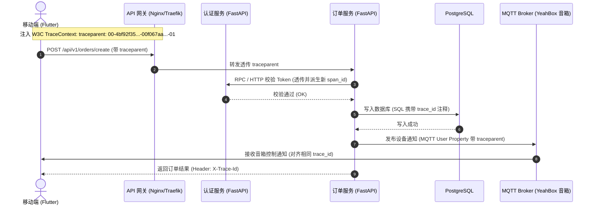

日志与链路追踪规范关注的是在微服务、移动端 App、Web 前端与物联网（IoT）设备端构建统一的结构化日志（Structured Logging）、分布式链路追踪（Distributed Tracing）、日志安全脱敏以及全生命周期可观测性（Observability）的工程化标准。

在多协议交互（RESTful、WebSocket、MQTT、BLE）与微服务异步协同体系中，孤立、无上下文、非结构化的文本日志无法胜任生产排障。为了实现从“客户端单次点击”到“网关”、“微服务”、“缓存”与“数据库”的毫秒级端到端问题定位，特制定本规范。

---

# 一、前提与基础约定

所有微服务与系统应用必须遵守以下基础约定：

- **强制结构化（JSON First）**：生产环境中的应用日志**必须以单行 JSON 格式输出**，严禁使用散落的自由文本拼接或无序的多行文本。
- **输出通道遵循 12-Factor 标准**：应用程序**严禁向容器内部的静态文件写日志**；日志必须统一输出至标准输出（`stdout`）与标准错误（`stderr`），由容器运行环境（Docker/K8s）配合日志采集代理（Vector / FluentBit）异步拉取。
- **全链路追踪协议基线**：分布式链路追踪必须遵循 **W3C TraceContext** 官方标准（`traceparent` Header），与 **OpenTelemetry (OTel)** 体系全面兼容。
- **时区与时间精度**：日志时间戳统一使用 **UTC** 时间，严格遵循 **RFC 3339** 格式并固定毫秒精度（例如 `2026-11-04T00:30:20.123Z`）。

---

# 二、结构化日志 Schema 契约

单条日志在序列化为 JSON 时，必须包含如下标准化顶层字段：

```json
{
  "timestamp": "2026-11-04T00:30:20.123Z",
  "level": "INFO",
  "service": "order-service",
  "environment": "production",
  "trace_id": "4bf92f3577b34da6a3ce929d0e0e4736",
  "span_id": "00f067aa0ba902b7",
  "logger_name": "app.domains.orders.service",
  "message": "Order checkout payment succeeded",
  "http": {
    "method": "POST",
    "path": "/api/v1/orders/1001/checkout",
    "status_code": 200,
    "latency_ms": 45.2,
    "client_ip": "114.240.12.34"
  },
  "user": {
    "id": "018f26a1-9a74-7221-a476-886ecb4f8d91",
    "role": "customer"
  },
  "extra": {
    "order_id": "ord_202611040001",
    "amount_cents": 12800,
    "pay_channel": "wechat"
  }
}
```

## 2.1 字段定义矩阵

| 字段名 | 类型 | 必填 | 说明与规约 |
| --- | --- | --- | --- |
| **`timestamp`** | String | 是 | UTC RFC 3339 毫秒时间戳 |
| **`level`** | String | 是 | 日志级别：`DEBUG`, `INFO`, `WARN`, `ERROR`, `FATAL`（大写） |
| **`service`** | String | 是 | 当前微服务名称，与部署声明一致（如 `auth-service`） |
| **`environment`** | String | 是 | 环境标识：`production`, `staging`, `development`, `testing` |
| **`trace_id`** | String | 是 | 32 位全链路分布式追踪唯一 ID（若缺失必须在网关层自动生成） |
| **`span_id`** | String | 是 | 16 位当前调用跨度 ID |
| **`logger_name`** | String | 是 | 代码模块或类路径（如 `app.core.security`） |
| **`message`** | String | 是 | 人类可读的核心业务事件摘要，严禁拼接变量，变量统一入 `extra` |
| **`http`** | Object | 否 | HTTP 请求相关元数据（仅请求处理类日志包含） |
| **`user`** | Object | 否 | 当前登录主体标识，脱敏仅保留 `id` 与 `role` |
| **`exception`** | Object | 否 | 异常明细（`class`, `message`, `stack_trace`，仅 ERROR/FATAL 包含） |
| **`extra`** | Object | 否 | 结构化业务上下文自定义键值字典 |

---

# 三、日志级别定义与打印准则

| 级别 | 生产环境默认开关 | 核心适用场景 | 示例与规约 |
| --- | --- | --- | --- |
| **`DEBUG`** | **关闭**（仅在本地与排障临时开启） | 细粒度算法步骤、复杂 SQL 执行原文、协议原始二进制报文十六进制打印 | 严禁在生产长期开启，避免海量日志将磁盘与 I/O 瞬间打满。 |
| **`INFO`** | **开启** | 核心业务生命周期里程碑（用户注册、订单支付、设备上线、任务启动/完成） | 记录“谁在何时完成了什么关键业务”，必须控制打印密度，禁止在循环体内单步打印。 |
| **`WARN`** | **开启** | 业务可自愈的异常、降级熔断触发、接口接近限流阈值、缓存未命中击穿 | 系统功能未瘫痪，但偏离了最优路径，需要引起注意。 |
| **`ERROR`** | **开启** | 阻断性异常、未捕获崩溃、第三方支付/短信服务挂掉、数据库写入异常 | **必须附带 `exception` 完整调用堆栈**，需触发告警系统介入。 |
| **`FATAL`** | **开启** | 进程级致命崩溃、核心基础设施磁盘满或数据库连接永久中断 | 进程无法继续工作并将退出，立即触发最高级别值班电话报警。 |

---

# 四、全链路追踪（Trace）规范

在多端（Flutter App / Web -> 统一 API 网关 -> 微服务 -> DB / Redis / MQTT Broker）的拓扑中，必须依托 Trace 上下文实现一站式追踪。



## 4.1 W3C TraceContext 编码标准

跨 HTTP 服务通信与对外响应必须统一使用标准 Header：

- **请求头 `traceparent`**：
  ```http
  traceparent: 00-4bf92f3577b34da6a3ce929d0e0e4736-00f067aa0ba902b7-01
  ```
  - `00`：版本号；
  - `4bf92f3577b34da6a3ce929d0e0e4736`：全局唯一 `trace_id`（32 位十六进制）；
  - `00f067aa0ba902b7`：当前调用的 `parent_span_id`（16 位十六进制）；
  - `01`：采样标志位（`01` 代表强制采样记录，`00` 代表未采样）。
- **跨协议透传规则**：
  - **WebSocket**：在握手 Header 或客户端第一条鉴权帧的 `traceId` 字段中携带；
  - **MQTT**：在 MQTT v5.0 的 `User Property` 报文中设置键名 `traceparent`；
  - **异步队列（Celery / Kafka）**：在消息元数据 Header 中携带 `traceparent`。

---

# 五、工程化实践：FastAPI 结构化日志与追踪注入

在 Python 后端中，使用 `structlog` 配合全局中间件实现日志与 Trace 自动化注入：

```python
# app/core/logging.py
import sys
import structlog
import uuid
from contextvars import ContextVar
from fastapi import Request, Response
from starlette.middleware.base import BaseHTTPMiddleware

trace_ctx: ContextVar[str] = ContextVar("trace_id", default="")

def add_trace_context(logger, method_name, event_dict):
    """自定义 structlog 处理器：将上下文 TraceId 自动注入每条日志"""
    trace_id = trace_ctx.get()
    if trace_id:
        event_dict["trace_id"] = trace_id
    event_dict["service"] = "fastapi-core"
    return event_dict

structlog.configure(
    processors=[
        structlog.contextvars.merge_contextvars,
        add_trace_context,
        structlog.processors.TimeStamper(fmt="iso", utc=True, key="timestamp"),
        structlog.processors.add_log_level,
        structlog.processors.format_exc_info,
        structlog.processors.JSONRenderer()
    ],
    logger_factory=structlog.PrintLoggerFactory(file=sys.stdout),
)

logger = structlog.get_logger()

class TraceIdMiddleware(BaseHTTPMiddleware):
    async def dispatch(self, request: Request, call_next):
        # 提取上游传入的 traceparent 或自生成 UUID
        traceparent = request.headers.get("traceparent")
        if traceparent and len(traceparent.split("-")) >= 3:
            trace_id = traceparent.split("-")[1]
        else:
            trace_id = uuid.uuid4().hex
            
        token = trace_ctx.set(trace_id)
        request.state.trace_id = trace_id
        
        try:
            response: Response = await call_next(request)
            # 对外返回追踪头，方便前端工单反馈
            response.headers["X-Trace-Id"] = trace_id
            return response
        finally:
            trace_ctx.reset(token)
```

---

# 六、安全脱敏与合规审计红线

日志往往直接流向 Elasticsearch 等集中检索平台，若无脱敏过滤将造成严重合规与泄密灾难。

## 6.1 绝对禁止记录的内容（P0 禁区）

以下字段严禁以任何明文形式进入日志系统：
- **凭据与密码**：用户登录密码、手势密码、数据库账密、Redis 认证口令；
- **加密密钥**：RSA 私钥、AES 对称密钥、JWT 签名 Secret、云厂商 AccessKeySecret；
- **全量金融信息**：信用卡 CVV 码、完整银行卡卡号；
- **通信隐私原文**：聊天私聊文本、用户手机短信验证码原文。

## 6.2 常见敏感字段掩码脱敏（Masking）规则

| 字段类型 | 原文示例 | 脱敏后日志输出 | 掩码规则 |
| --- | --- | --- | --- |
| **手机号码** | `13812345678` | `138****5678` | 前 3 后 4 保留，中间 4 位星号掩码 |
| **身份证号** | `110101199003072345` | `110101********2345` | 前 6 后 4 保留，中间星号掩码 |
| **电子邮箱** | `zhangsan@company.com` | `z***n@company.com` | 邮箱前缀首尾保留，中间星号掩码 |
| **Bearer Token** | `Bearer eyJhbGciOiJIUzI1Ni...` | `Bearer eyJhbG***[MASKED]` | 仅保留前 10 字符，后方全量截断 |

---

# 七、日志采集、生命周期与存储分级

为平衡排障需求与昂贵的存储成本，日志必须实施冷热分级治理：

1. **热存储区（Hot Tier，基于 Elasticsearch / OpenSearch）**：
   - 全量实时检索分析，保留周期为 **7 ~ 14 天**；
   - 重点针对 ERROR/WARN 日志建立自动化监控告警看板。
2. **温冷归档区（Cold Tier，基于 S3 / 对象存储压缩归档）**：
   - 超过 14 天的日志自动滚动打包压缩（gzip/zstd），转移至低频对象存储；
   - 满足合规与安全审计要求，保留 **180 天至 1 年** 后由生命周期规则自动物理销毁。
3. **健康检查过滤**：
   - 网关层与服务自身的健康探针（如 `GET /healthz`、`GET /live`、Prometheus `/metrics`）严禁输出常规 INFO 日志，默认在中间件层静默过滤，避免产生 90% 以上的无意义垃圾日志。
