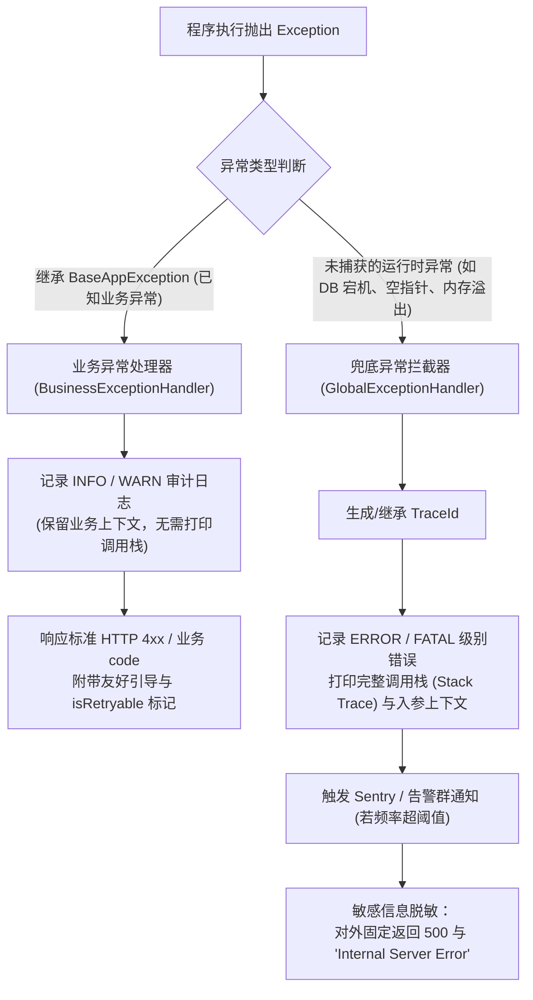

统一错误码与异常处理规范关注的是在前后端分离、移动端跨端（Flutter/React）以及物联网多协议（RESTful、WebSocket、MQTT、BLE）交互场景下，系统异常捕获、错误分级、错误码分段编码、多语言（i18n）转换及客户端统一弹窗/重试的工程化标准。

在复杂的分布式架构中，没有规范的错误处理会导致“前端弹一串未知 Object”、“用户看到裸 SQL 报错”、“移动端无法识别网络重试策略”等灾难性体验。为了给用户提供友好的操作反馈、给开发者提供毫秒级排障凭据，特制定本规范。

---

# 一、前提与全局错误信封契约

无论采用 HTTP RESTful 还是 WebSocket 接口，当发生业务异常或系统故障时，服务端必须返回结构完全一致的统一错误响应体（Error Envelope）。

## 1.1 统一错误响应体 JSON 契约

```json
{
  "code": 100102,
  "message": "Authentication token expired. Please refresh or login again.",
  "data": null,
  "traceId": "c3a1b098-9a74-4b21-a476-886ecb4f8d91",
  "timestamp": "2026-11-04T00:30:20.123Z",
  "details": [
    {
      "field": "authorization",
      "reason": "Token lifetime exceeded 7200 seconds"
    }
  ],
  "isRetryable": false
}
```

### 字段说明矩阵

| 字段名 | 类型 | 必填 | 说明与规约 |
| --- | --- | --- | --- |
| **`code`** | Integer / String | 是 | 统一业务错误码（参见第二节编码规则），成功统一为 `0` |
| **`message`** | String | 是 | 面向开发者的英文/中文可读性错误描述（禁止包含敏感堆栈） |
| **`data`** | Any | 否 | 错误发生时附带的辅助上下文（如被锁定的解锁倒计时等），无数据固定为 `null` |
| **`traceId`** | String (UUID) | 是 | 全链路分布式追踪唯一 ID，端侧报错弹窗展示该 ID 用于客服与工单检索 |
| **`timestamp`** | String (RFC 3339) | 是 | 错误发生的服务端 UTC 时刻（毫秒级并以 `Z` 结尾） |
| **`details`** | Array[Object] | 否 | 字段级表单校验失败明细（含 `field` 路径与失败原因 `reason`） |
| **`isRetryable`** | Boolean | 是 | 明确指示客户端该错误**是否可通过原地重试（Retry）恢复**（如网络抖动、幂等冲突、从库同步延迟等） |

## 1.2 HTTP 状态码与业务错误码（Code）的职责划分

严禁“无论发生什么一律返回 200”或“完全不定义业务错误码仅靠 HTTP Status”两种极端反模式：

- **HTTP 状态码（Transport Layer）**：表达的是**传输通道与标准 HTTP 语义**（网络层/网关/代理层可识别）：
  - `400 Bad Request`：客户端入参语法格式错误或基础校验不通过；
  - `401 Unauthorized`：未提供有效认证凭据（Token 缺失或非法）；
  - `403 Forbidden`：凭据有效但没有当前操作权限；
  - `404 Not Found`：请求的资源 URI 实体不存在；
  - `409 Conflict`：并发版本冲突（如乐观锁版本不一致）；
  - `422 Unprocessable Content`：语义校验不通过（业务规则拒绝）；
  - `429 Too Many Requests`：触发限流阈值；
  - `500 Internal Server Error`：服务端未捕获的非预期程序崩溃；
  - `502 / 503 / 504`：网关/上游服务不可用或超时。
- **业务错误码 `code`（Application Layer）**：表达的是**细粒度具体的业务语义**（例如“余额不足”、“蓝牙设备未响应”、“短信验证码错误”）。

---

# 二、错误码分段编码架构

为杜绝不同团队各自定义导致的数字冲突，系统统一采用 **6 位十进制整数（AABBCC 模式）** 进行分层编码：

$$\text{Error\_Code} = \underbrace{\text{AA}}_{\text{业务域 (2位)}} \times 10000 + \underbrace{\text{BB}}_{\text{功能模块 (2位)}} \times 100 + \underbrace{\text{CC}}_{\text{具体错误 (2位)}}$$

```text
  1 0   0 1   0 2
  ───   ───   ───
   │     │     └─ 具体错误序号 (01-99: 如 Token 过期)
   │     └─────── 功能模块 (01: 登录认证, 02: 权限体系, 03: 密码策略)
   └───────────── 业务域 (10: 认证授权, 20: 用户域, 30: 物联网设备域...)
```

## 2.1 业务域（AA）段号分配规划

| AA 编号 | 业务域标识 | 负责领域范围 |
| --- | --- | --- |
| **`00`** | `COMMON` | 全局基础框架（通用参数错误、系统未知异常、网关错误、网络不可达） |
| **`10`** | `AUTH` | 身份认证与权限授权（Token、签名验签、角色鉴权、多因素 MFA） |
| **`20`** | `USER` | 用户与租户体系（用户资料、企业租户、员工组织架构） |
| **`30`** | `DEVICE` | 物联网设备与固件（YeahBox 音响、BLE 连接、MQTT 离线、OTA 固件） |
| **`40`** | `ORDER` | 交易与订单聚合（创建订单、状态流转、履约取消、库存冻结） |
| **`50`** | `PAY` | 支付与清结算（微信/支付宝/Stripe 支付、退款、钱包对账） |
| **`60`** | `AUDIO` | 音视频与流媒体处理（音频转码、均衡器 EQ 配置、流媒体分发） |
| **`90`** | `EXTERNAL` | 第三方依赖与外呼服务（短信网关、云存储 OSS、外部三方 API） |

## 2.2 核心预设错误码字典表（节选）

| 错误码 (`code`) | 建议 HTTP 状态 | 内部枚举名 | 默认可读描述 (`message`) | `isRetryable` |
| --- | --- | --- | --- | --- |
| **`0`** | `200` | `SUCCESS` | Success | `false` |
| **`000001`** | `500` | `INTERNAL_SERVER_ERROR` | Internal server encountered an unexpected error. | `false` |
| **`000101`** | `400` | `INVALID_ARGUMENT` | Request payload format or parameter validation failed. | `false` |
| **`000102`** | `429` | `RATE_LIMIT_EXCEEDED` | Request frequency limit exceeded. Please slow down. | `true` |
| **`000201`** | `503` | `SERVICE_UNAVAILABLE` | Target service is temporarily down or in maintenance. | `true` |
| **`000202`** | `504` | `GATEWAY_TIMEOUT` | Upstream service response timed out. | `true` |
| **`100101`** | `401` | `AUTH_TOKEN_MISSING` | Bearer authentication token is missing or malformed. | `false` |
| **`100102`** | `401` | `AUTH_TOKEN_EXPIRED` | Access token has expired. | `false` |
| **`100103`** | `401` | `AUTH_TOKEN_INVALID` | Signature verification failed or token is malformed. | `false` |
| **`100201`** | `403` | `PERMISSION_DENIED` | Current identity does not have permission for this resource. | `false` |
| **`100301`** | `401` | `SIGNATURE_VERIFY_FAILED` | Custom header request signature mismatch or timestamp expired. | `false` |
| **`200101`** | `404` | `USER_NOT_FOUND` | Specified user account does not exist. | `false` |
| **`200102`** | `409` | `USER_ALREADY_EXISTS` | Phone number or email has already been registered. | `false` |
| **`300101`** | `404` | `DEVICE_NOT_FOUND` | Hardware device MAC or DID does not exist in registry. | `false` |
| **`300102`** | `409` | `DEVICE_OFFLINE` | Device is currently offline in MQTT broker. | `true` |
| **`300201`** | `400` | `BLE_PACKET_CHECKSUM_ERROR` | CRC16 verification failed for BLE transmission frame. | `true` |
| **`300301`** | `409` | `OTA_FIRMWARE_MISMATCH` | Uploaded firmware binary is not compatible with device model. | `false` |
| **`400101`** | `409` | `ORDER_STATE_INVALID` | Current order status does not allow this operation transition. | `false` |
| **`400102`** | `409` | `INVENTORY_INSUFFICIENT` | SKU inventory stock is insufficient to complete checkout. | `false` |

---

# 三、异常分级与分流处理机制

系统中的异常分为**已知受控业务异常**与**非预期系统异常**两大类：



## 3.1 异常级别定义

1. **INFO / WARN 级别（用户受控异常）**：
   - 典型表现：密码输入错误、表单字段格式错误、优惠券过期、非重放并发冲突；
   - 处理：不打印完整长调用栈，记录单行业务行为日志，不触发运维报警。
2. **ERROR 级别（系统降级与非预期故障）**：
   - 典型表现：数据库连接池耗尽、Redis 读写超时、第三方短信网关抛出 5xx、下游微服务超时；
   - 处理：**必须完整输出错误调用栈（Stack Trace）**，附带上下文入参，并在持续出现时触发告警。
3. **FATAL 级别（不可逆灾难）**：
   - 典型表现：数据破坏性异常、主从复制不可逆回绕、底层存储磁盘已满；
   - 处理：立刻触发 P0 级电话/短信值班警报。

---

# 四、工程化落地：服务端与端侧处理最佳实践

## 4.1 服务端（FastAPI / Python）统一异常框架

```python
# app/core/exceptions.py
from typing import Any, List, Optional
from fastapi import Request, status
from fastapi.responses import JSONResponse
import structlog
import uuid
from datetime import datetime, timezone

logger = structlog.get_logger()

class BaseAppException(Exception):
    """所有受控业务异常基类"""
    def __init__(
        self,
        code: int,
        message: str,
        http_status: int = status.HTTP_400_BAD_REQUEST,
        data: Optional[Any] = None,
        details: Optional[List[dict]] = None,
        is_retryable: bool = False
    ):
        self.code = code
        self.message = message
        self.http_status = http_status
        self.data = data
        self.details = details or []
        self.is_retryable = is_retryable
        super().__init__(message)

class AuthTokenExpiredException(BaseAppException):
    def __init__(self):
        super().__init__(
            code=100102,
            message="Authentication token expired. Please refresh your session.",
            http_status=status.HTTP_401_UNAUTHORIZED,
            is_retryable=False
        )

# 全局异常捕获中间件注册 (app/main.py)
async def app_exception_handler(request: Request, exc: BaseAppException):
    trace_id = getattr(request.state, "trace_id", str(uuid.uuid4()))
    return JSONResponse(
        status_code=exc.http_status,
        content={
            "code": exc.code,
            "message": exc.message,
            "data": exc.data,
            "traceId": trace_id,
            "timestamp": datetime.now(timezone.utc).isoformat().replace("+00:00", "Z"),
            "details": exc.details,
            "isRetryable": exc.is_retryable,
        }
    )

async def unhandled_exception_handler(request: Request, exc: Exception):
    trace_id = getattr(request.state, "trace_id", str(uuid.uuid4()))
    # 核心：必须打印完整堆栈用于研发排查
    logger.exception("unhandled_system_exception", trace_id=trace_id, path=str(request.url))
    
    # 对外脱敏保护
    return JSONResponse(
        status_code=status.HTTP_500_INTERNAL_SERVER_ERROR,
        content={
            "code": 1,
            "message": "Internal server encountered an unexpected error.",
            "data": None,
            "traceId": trace_id,
            "timestamp": datetime.now(timezone.utc).isoformat().replace("+00:00", "Z"),
            "details": [],
            "isRetryable": False,
        }
    )
```

## 4.2 移动端（Flutter / Dart）统一拦截与提示

```dart
// app/core/network/error_interceptor.dart
import 'package:dio/dio.dart';

class ApiError implements Exception {
  final int code;
  final String message;
  final String traceId;
  final bool isRetryable;

  ApiError({
    required this.code,
    required this.message,
    required this.traceId,
    required this.isRetryable,
  });

  factory ApiError.fromJson(Map<String, dynamic> json) {
    return ApiError(
      code: json['code'] as int? ?? 1,
      message: json['message'] as String? ?? 'Network error occurred',
      traceId: json['traceId'] as String? ?? '',
      isRetryable: json['isRetryable'] as bool? ?? false,
    );
  }
}

void handleUiError(ApiError error) {
  // 1. 核心 Token 过期，直接截流并跳转至登录页
  if (error.code == 100102) {
    AuthService.to.redirectToLogin();
    return;
  }

  // 2. 存在可重试标记且属于网络抖动
  if (error.isRetryable) {
    UiToast.showRetryToast(
      message: error.message,
      onRetry: () => retryLastAction(),
    );
    return;
  }

  // 3. 常规业务错误，弹窗或轻提示，并附带故障排查码 (Trace ID 缩略)
  UiToast.showError("${error.message} (Ref: ${error.traceId.substring(0, 8)})");
}
```

---

# 五、多语言国际化（i18n）映射规范

为了保障全球化与多语言切换的一致性，系统遵循**“服务端输出稳定机器语义 Key，客户端负责最终文案本地化渲染”**的原则：

1. **服务端规约**：
   - 响应体中的 `message` 作为兜底通用英文说明（便于开发者在 Postman / 日志中直接看懂）；
   - 在 `details` 或特定多语言键中输出可映射的 `errorKey`：例如 `error_key = "ERR_DEVICE_OFFLINE"`。
2. **端侧（App / Web）规约**：
   - 端侧本地工程（如 Flutter `intl` 或 React `i18next`）按 `code` 或 `errorKey` 配置本地多语言词典：

```json
// zh-CN.json
{
  "ERR_100102": "登录凭据已过期，请重新登录。",
  "ERR_300102": "音箱设备已离线，请检查设备电源及 Wi-Fi 连接。"
}

// en-US.json
{
  "ERR_100102": "Session expired. Please log in again.",
  "ERR_300102": "Speaker is currently offline. Please check power and Wi-Fi."
}
```

---

# 六、安全脱敏与合规审计红线

1. **严禁原始异常穿透暴露给外部客户端**：
   - 严禁将数据库驱动报错（如 `psycopg2.OperationalError: table users does not exist`）、代码堆栈路径（`/var/www/app/core/...`）或 ORM 执行语句直接当作 `message` 返回。
2. **严禁在错误响应中回显机密敏感数据**：
   - 当入参由于包含格式错误而进入 `details` 明细时，若字段为 `password`、`credit_card`、`secret_key` 等，**必须使用 `***` 进行掩码脱敏**，严禁原样反射客户端敏感输入。
3. **客户端日志收集保护**：
   - 端侧 Sentry 或 Crashlytics 上报异常信封时，需自动过滤包含用户密码与支付信息的上下文 Payload。
